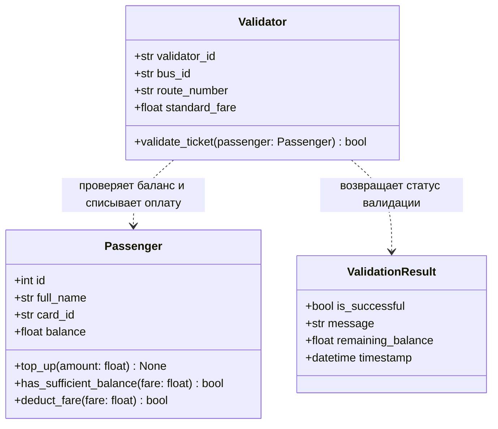
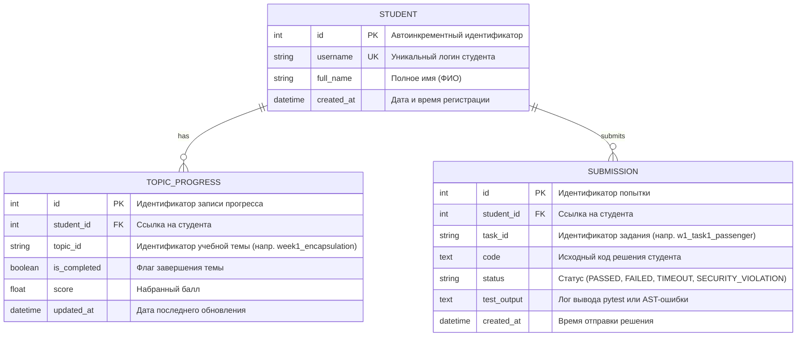

# UML-модель предметной области Avtobys и схема базы данных

## 1. Контекст предметной области

В качестве сквозной прикладной темы курса ООП выбрана транспортная система **Avtobys** (электронное билетирование, валидаторы в автобусах, учет баланса пассажиров и маршрутов). Эта предметная область интуитивно понятна студентам и идеально иллюстрирует фундаментальные принципы ООП: инкапсуляцию, полиморфизм валидаторов, наследование тарифов и композицию сущностей.

---

## 2. Диаграмма классов (UML Class Diagram)

Вводная диаграмма классов демонстрирует взаимодействие пассажира (`Passenger`) и бортового валидатора (`Validator`):

### Описание сущностей:
- `Passenger`: инкапсулирует данные о балансе транспортной карты пассажира. Предоставляет методы безопасного пополнения и списания средств без прямого неконтролируемого изменения баланса.
- `Validator`: отвечает за логику проверки билета на конкретном маршруте автобуса. Проверяет наличие средств и подтверждает проезд.
- `ValidationResult`: легковесный объект-значение (Value Object), инкапсулирующий результат операции валидации.

---

## 3. Схема базы данных (Entity-Relationship Diagram)

Схема хранения данных мини-LMS в SQLite (`data/web_oop.db`):

### Отношения и ограничения:
- `STUDENT -> TOPIC_PROGRESS`: отношение «один-ко-многим». Удаление студента каскадно удаляет связанные записи прогресса (`cascade="all, delete-orphan"`).
- `STUDENT -> SUBMISSION`: отношение «один-ко-многим». Фиксирует полную историю попыток сдачи лабораторных работ и тестов.
