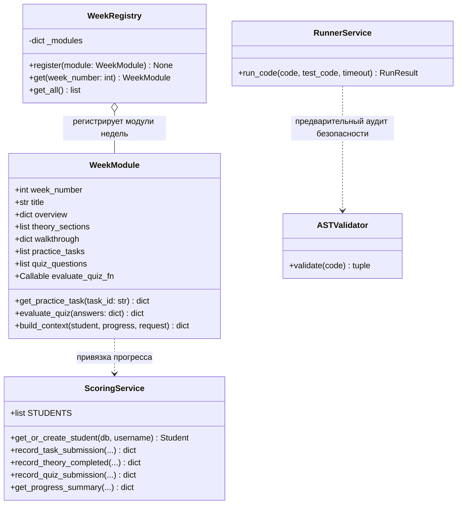
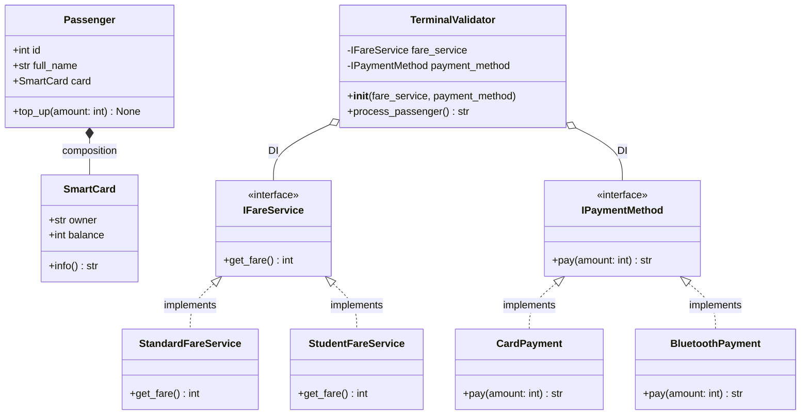
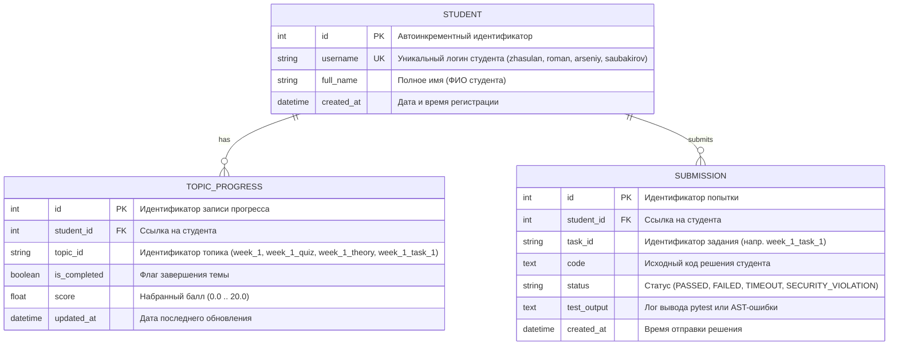

# UML-модель предметной области Avtobys, модульная структура и схема базы данных

## 1. Контекст предметной области

В качестве сквозной прикладной темы курса ООП выбрана транспортная система **Avtobys** (электронное билетирование, валидаторы в автобусах, учет баланса пассажиров и маршрутов). Эта предметная область интуитивно понятна студентам и идеально иллюстрирует фундаментальные принципы ООП: инкапсуляцию, полиморфизм валидаторов, наследование тарифов, композицию сущностей и принципы SOLID (разделение интерфейсов и внедрение зависимостей).

---

## 2. Диаграмма модульной архитектуры платформы (WeekModule & Registry)

Модульная архитектура платформы обеспечивает расширяемость и устраняет дублирование кода между учебными неделями:

---

## 3. Диаграмма классов предметной области (UML Class Diagram)

Взаимодействие пассажира (`Passenger`), транспортной карты (`SmartCard`), сервисов тарифа (`FareService`) и бортового валидатора (`TerminalValidator`):

---

## 3.1. Паттерны GoF и Чистая архитектура Недели 3 (Week 3 UML Class Diagram)

В Неделе 3 рассматриваются порождающие, структурные и поведенческие паттерны GoF, а также инверсия зависимостей Clean Architecture:

```mermaid
classDiagram
    %% Порождающий паттерн: Builder
    class DailyShiftReport {
        +str date
        +str bus_id
        +int passenger_count
        +Decimal total_revenue
        +list errors
    }

    class ShiftReportBuilder {
        -str _date
        -str _bus_id
        -int _passenger_count
        -Decimal _total_revenue
        -list _errors
        +set_date(date: str) ShiftReportBuilder
        +set_bus(bus_id: str) ShiftReportBuilder
        +set_metrics(passengers: int, revenue: Decimal) ShiftReportBuilder
        +add_error(error_msg: str) ShiftReportBuilder
        +build() DailyShiftReport
    }

    ShiftReportBuilder ..> DailyShiftReport : creates

    %% Структурный паттерн: Adapter
    class PaymentRequest {
        +str card_id
        +Decimal amount
    }

    class LegacyBankClient {
        +charge_tiyn(card_token: str, tiyn: int) dict
    }

    class BankApiAdapter {
        -LegacyBankClient _legacy_client
        +__init__(legacy_client: LegacyBankClient)
        +process_payment(request: PaymentRequest) dict
    }

    BankApiAdapter o-- LegacyBankClient : adapts
    BankApiAdapter ..> PaymentRequest : accepts

    %% Поведенческий паттерн: Chain of Responsibility
    class ValidationResult {
        +bool is_valid
        +str reason
    }

    class ValidationHandler {
        <<abstract>>
        -ValidationHandler _next_handler
        +set_next(handler: ValidationHandler) ValidationHandler
        +handle(card: TransitCard, amount: Money) ValidationResult
    }

    class FormatValidationHandler {
        +handle(card: TransitCard, amount: Money) ValidationResult
    }

    class CardActiveHandler {
        +handle(card: TransitCard, amount: Money) ValidationResult
    }

    class BalanceHandler {
        +handle(card: TransitCard, amount: Money) ValidationResult
    }

    ValidationHandler <|-- FormatValidationHandler : inherits
    ValidationHandler <|-- CardActiveHandler : inherits
    ValidationHandler <|-- BalanceHandler : inherits
    ValidationHandler --> ValidationHandler : next

    %% Поведенческий паттерн: Observer
    class ITelemetryObserver {
        <<interface>>
        +update(event: str, data: dict) None
    }

    class AuditLogObserver {
        +update(event: str, data: dict) None
    }

    class DisplayObserver {
        +update(event: str, data: dict) None
    }

    class TransitTelemetrySubject {
        -list _observers
        +attach(observer: ITelemetryObserver) None
        +detach(observer: ITelemetryObserver) None
        +notify(event: str, data: dict) None
    }

    ITelemetryObserver <|.. AuditLogObserver : implements
    ITelemetryObserver <|.. DisplayObserver : implements
    TransitTelemetrySubject o-- ITelemetryObserver : notifies

    %% Clean Architecture: Use Case & Entities
    class Money {
        +Decimal amount
        +str currency
    }

    class TransitCard {
        +str card_id
        +Money balance
        +bool is_active
    }

    class CardRepository {
        <<protocol>>
        +get_by_id(card_id: str) TransitCard
        +save(card: TransitCard) None
    }

    class NotificationGateway {
        <<protocol>>
        +notify_passenger(card_id: str, message: str) None
    }

    class ValidateRideUseCase {
        -CardRepository _card_repo
        -NotificationGateway _notifier
        +__init__(card_repo, notifier)
        +execute(card_id: str, fare: Money) dict
    }

    ValidateRideUseCase o-- CardRepository : dependency inversion
    ValidateRideUseCase o-- NotificationGateway : dependency inversion
    ValidateRideUseCase ..> TransitCard : uses
    TransitCard *-- Money : value object
```

---

## 4. Схема базы данных (Entity-Relationship Diagram)

Схема хранения данных мини-LMS в SQLite (`data/web_oop.db`):

### Отношения и ограничения:
- `STUDENT -> TOPIC_PROGRESS`: отношение «один-ко-многим». Обеспечивает полную изоляцию баллов между 4 участниками группы.
- `STUDENT -> SUBMISSION`: отношение «один-ко-многим». Фиксирует историю запусков кода в тренажере.
