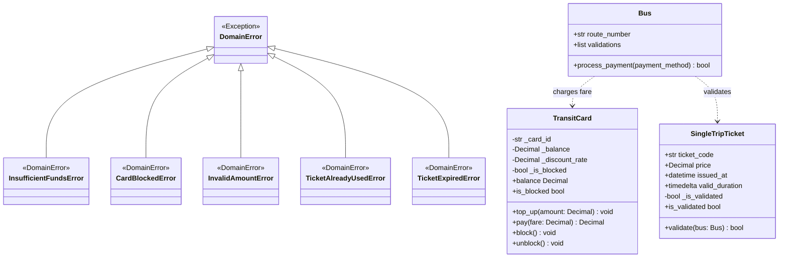

# Инженерное руководство: Доменная модель Недели 1 (Avtobys)

## 1. Введение и архитектурные принципы

Учебный модуль Недели 1 знакомит студентов с основами объектно-ориентированного программирования в Python 3.12 на примере сквозной транспортной предметной области — системы оплаты проезда **Avtobys (Алматы)**.

### Ключевые принципы:
1. **Rich Domain Model (Богатая модель предметной области):** Сущности объединяют состояние и поведение. Все проверки инвариантов, бизнес-правила и операции списания инкапсулированы внутри методов самих классов, а не вынесены в процедурные внешние сценарии.
2. **Strict Invariant Defense (Строгая защита инвариантов):** Состояние объекта валидируется как при создании в конструкторе `__init__`, так и при каждом вызове мутирующих методов. Объект принципиально невозможно перевести в некорректное состояние.
3. **Data Hiding & Properties (Сокрытие состояния через @property):** Внутренние поля защищены соглашением о приватности (`_balance`, `_is_validated`). Доступ на чтение предоставляется через свойства `@property`, а прямая модификация без сеттера блокируется интерпретатором (`AttributeError`).
4. **Typed Domain Exceptions (Типизированные исключения):** Сбои бизнес-правил возбуждают специализированные исключения, унаследованные от `DomainError`, что исключает игнорирование ошибок в клиентском коде.

---

## 2. Иерархия классов и доменные сущности

---

## 3. Спецификация сущностей и инвариантов

### 3.1. Класс `TransitCard` (Многоразовая транспортная карта)

- **Конструктор:** `__init__(card_id: str, initial_balance: Decimal = Decimal("0"), discount_rate: Decimal = Decimal("0.0"))`
  - *Инвариант 1:* `initial_balance >= Decimal("0")`. При попытке передачи отрицательного числа возбуждается `ValueError("Начальный баланс не может быть отрицательным")`.
  - *Инвариант 2:* `Decimal("0.0") <= discount_rate <= Decimal("1.0")`. Нарушение возбуждает `ValueError`.
  - Внутреннее состояние инициализируется полями: `_card_id`, `_balance`, `_discount_rate`, `_is_blocked = False`.
- **Свойства:**
  - `@property balance -> Decimal`: возвращает `self._balance` (только для чтения).
  - `@property is_blocked -> bool`: возвращает `self._is_blocked` (только для чтения).
- **Метод `top_up(amount: Decimal) -> None`:**
  - *Инвариант 3:* Заблокированную карту пополнять нельзя (`CardBlockedError`).
  - *Инвариант 4:* Минимальная сумма пополнения составляет 100 тенге (`amount >= Decimal("100")`). Нарушение возбуждает `InvalidAmountError`.
  - Успешное пополнение увеличивает `self._balance += amount`.
- **Метод `pay(fare: Decimal) -> Decimal`:**
  - *Инвариант 5:* Заблокированная карта не может совершать оплату (`CardBlockedError`).
  - *Инвариант 6:* Тариф обязан быть строго положительным (`fare > Decimal("0")`), иначе возбуждается `InvalidAmountError`.
  - Расчет стоимости: `effective_fare = fare * (Decimal("1.0") - self._discount_rate)`.
  - *Инвариант 7:* Баланс карты не может стать отрицательным (`self._balance >= effective_fare`). При нехватке средств возбуждается `InsufficientFundsError`, а баланс карты остается неизменным.
  - Успешная оплата уменьшает баланс и возвращает списанную сумму `effective_fare`.
- **Методы `block()` и `unblock()`:**
  - Управляют состоянием `_is_blocked`.

---

### 3.2. Класс `SingleTripTicket` (Одноразовый билет)

- **Конструктор:** `__init__(price: Decimal = Decimal("120"), valid_minutes: int = 60, issued_at: datetime | None = None)`
  - `ticket_code`: уникальный строковый UUID билета.
  - `price`: стоимость билета в тенге.
  - `issued_at`: точное время выпуска билета (если не передано, используется `datetime.now()`).
  - `valid_duration`: `timedelta(minutes=valid_minutes)` (по умолчанию 60 минут).
  - `_is_validated`: приватный флаг, изначально `False`.
- **Свойство `is_validated -> bool`:**
  - Реализовано строго как `@property` без сеттера.
  - Попытка выполнить `ticket.is_validated = True` возбуждает `AttributeError`, исключая возможность подделки статуса.
- **Метод `validate(bus: Bus) -> bool`:**
  - *Инвариант 1 (Однократность):* Если `self._is_validated == True`, повторный вызов возбуждает `TicketAlreadyUsedError("Билет уже был использован")`.
  - *Инвариант 2 (Срок годности):* Если `datetime.now() - self.issued_at > self.valid_duration`, вызов возбуждает `TicketExpiredError("Срок действия билета истек")`.
  - При соблюдении всех инвариантов переводит `self._is_validated = True` и возвращает `True`.

---

### 3.3. Класс `Bus` (Городской автобус)

- **Конструктор:** `__init__(route_number: str)`
  - Сохраняет `route_number` и инициализирует пустой список `validations = []`.
- **Метод `process_payment(payment_method) -> bool`:**
  - Демонстрирует **полиморфизм:** валидатор автобуса принимает любой объект, удовлетворяющий контракту оплаты.
  - Если у объекта есть метод `pay`, списывается стандартный тариф (100 ₸), событие фиксируется в журнале и возвращается `True`.
  - Если у объекта есть метод `validate`, вызывается `payment_method.validate(self)`, событие фиксируется в журнале и возвращается `True`.
  - При неподдерживаемом типе возбуждается `TypeError`.

---

## 4. Система оценивания и учет прогресса (Scoring)

Учебный модуль Недели 1 оценивается по 20-балльной шкале:

| Компонент | Макс. балл | Механизм проверки | Порог зачета |
|---|---|---|---|
| **Квиз по теории** | **3.0 балла** | Серверная валидация 5 вопросов (по 0.6 б. за правильный ответ) | — |
| **Практикум `TransitCard`** | **7.0 баллов** | 7 скрытых юнит-тестов в `RunnerService` (по 1.0 б. за пройденный тест) | — |
| **Лабораторная `SingleTripTicket`** | **10.0 баллов** | 10 скрытых юнит-тестов в `RunnerService` (по 1.0 б. за пройденный тест) | — |
| **ИТОГО** | **20.0 баллов** | Суммирование результатов в `TopicProgress` | $\ge 12.0$ баллов (60%) |

### Политика защиты от понижения баллов (High-Water Mark)
При отправке решений в `TopicProgress` действует правило:
$$\text{Score}_{\text{new}} = \max(\text{Score}_{\text{current}}, \text{Quiz}_{\text{best}} + \text{Practice}_{\text{best}} + \text{Lab}_{\text{best}})$$
Студент может безопасно экспериментировать и переотправлять код: неудачная попытка не снижает ранее заработанные баллы.
Все попытки с кодом и логами RunnerService архивируются в таблице `submissions` для последующего анализа преподавателем.

---

## 5. Безопасность и изоляция песочницы (RunnerService)

Студенческий код исполняется в изолированной временной директории `tempfile.TemporaryDirectory`:
1. **Предварительный AST-анализ (`ASTValidator`):** Запрещены вызовы системных модулей (`os`, `sys`, `subprocess`, `socket`, `shutil`, `pathlib`) и небезопасных функций (`open`, `eval`, `exec`, `__import__`). При обнаружении возвращается статус `SECURITY_VIOLATION`.
2. **Лимит времени:** Процесс pytest ограничен жестким таймаутом 5.0 секунд. При зацикливании процесс принудительно завершается со статусом `TIMEOUT`.
3. **Автономность:** Изолированная директория гарантированно удаляется после завершения прогона.
