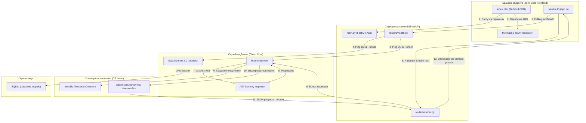

# HL — OOP_20261015-022500_CORE: Платформенный фундамент и базовый запуск мини-LMS (Zero-Build & FastAPI)

> **Current filename**: `HL-OOP_20261015-022500_CORE.md`
> **Date**: 2026-10-15
> **Author**: zhasulan
> **Title**: Платформенный фундамент и базовый запуск мини-LMS (Zero-Build & FastAPI)
> **Abbreviation**: CORE
> **Status**: 🟡 TS_DRAFT — Awaiting TS approval
> **Contract**: 🔒 FROZEN — approved by zhasulan 2026-10-15
> **Frozen**: §1 · §3 · §4 · §5 · §6 · §7 — locked on owner approval
> **Free**: §2 · §7.2 · §8 · §9 · §10 · §11 — research updates these directly
> **Append-only**: §12 Amendment Log — the only channel for changing a frozen section
> **Baseline**: freeze commits — recovery form in `conventions.md` §3 rule 15
> **Project North Star**: `README.md § 1. Миссия и цели проекта`

---

## 1. Vision 🔒 FROZEN

Создан и запущен самодостаточный, легковесный локальный фундамент мини-LMS на связке FastAPI, SQLite (SQLAlchemy 2.0) и Zero-Build фронтенда (Tailwind CDN, Vanilla JS, Mermaid.js) с изолированной тестовой песочницей RunnerService. Платформа полностью готова к быстрому и бесшовному наполнению интерактивными учебными модулями курса ООП без накладных расходов на компиляторы и сборщики фронтенда.

**Impact:**
- **Для студентов:** Мгновенный отклик интерфейса, нулевой порог локального запуска (без `npm` и `node_modules`), наглядная интерактивная визуализация классов и безопасная среда проверки заданий.
- **Для преподавателя:** Надежный автоматический запуск студенческого кода с изоляцией процессов и защитой от зависаний, чистая слоистая архитектура и прозрачная документация в `docs/`.
- **Для разработчика/системы:** Устойчивый каркас (Clean Architecture), строго отделяющий транспорт (FastAPI) и UI от бизнес-логики и изоляции запуска тестов.

> *«Каркас платформы запустился за секунды без единой строчки npm-зависимостей, индикаторы подтвердили готовность бэкенда, БД и песочницы, а дымовой тест мгновенно верифицировал код студента через pytest. Теперь мы можем спокойно переходить к модулям курса!»*
> — Воображаемый отзыв ментора @saubakirov при первой демонстрации.

---

## 2. Current State (As-Is) 🟢 FREE

- **Методология и аудит:** Завершена инициализация проекта (`OOP_20261015-015123_INIT`). Методология TFW Full развернута, база знаний `KNOWLEDGE.md` зафиксировала ключевые архитектурные решения D1–D4 и доменную специфику Avtobys.
- **Кодовая база:** Рабочая директория пуста (чистый старт). Нет серверных скриптов, нет моделей данных, нет статики UI, нет тестов и документации.
- **Окружение:** Локальная среда Windows, Python 3.12.9 доступен. Пакеты FastAPI, Uvicorn, SQLAlchemy, Pydantic, Pytest готовы к установке/конфигурации.

---

## 3. Target State (To-Be) 🔒 FROZEN

Полнофункциональный работающий каркас мини-LMS со следующими компонентами:

1. **Бэкенд (FastAPI):**
   - Точка входа `app/main.py` с монтированием статических файлов (`/static`) и API-роутеров.
   - Эндпоинты:
     - `GET /api/health` — комплексная проверка состояния системы (бэкенд, SQLite, Runner).
     - `POST /api/runner/smoke` — контрольный запуск простейшего теста в песочнице.
     - `GET /` — главная страница каркаса мини-LMS.
     - `GET /docs` — автоматическая спецификация OpenAPI / Swagger.

2. **База данных (SQLite + SQLAlchemy 2.0):**
   - Файл БД: `data/web_oop.db` (каталог `data/` создается автоматически).
   - Модели:
     - `Student` (id, username, full_name, created_at).
     - `TopicProgress` (id, student_id, topic_id, is_completed, score, updated_at).
     - `Submission` (id, student_id, task_id, code, status, test_output, created_at).
   - Инициализация таблиц при запуске приложения (`lifespan` событие FastAPI).

3. **Фронтенд (Строго Zero-Build):**
   - Чистый HTML5 + Tailwind CSS (через CDN) + Vanilla JS (модульный `app.js`) + Mermaid.js (через CDN).
   - Полное отсутствие `package.json`, `node_modules`, Webpack, Vite.
   - Элементы интерфейса:
     - **3 индикатора статуса системы:** «Бэкенд: Active», «SQLite: Connected», «Runner: Ready» (опрос через `/api/health`).
     - **Интерактивная кнопка:** «Smoke-тест раннера» с выводом результата (зеленый/красный бейдж, время исполнения в мс, лог pytest).
     - **UML-диаграмма:** Автоматический рендеринг через Mermaid.js классов `Passenger` и `Validator` предметной области Avtobys.

4. **Песочница RunnerService (`app/services/runner.py`):**
   - Изолированное исполнение тестов через `subprocess.run` во временном каталоге (`tempfile.TemporaryDirectory`).
   - Ограничение времени выполнения: жесткий таймаут 5 секунд (`subprocess.TimeoutExpired`).
   - Базовая AST-валидация: статический анализ кода перед запуском с блокировкой опасных модулей (`os`, `sys`, `subprocess`, `shutil`, `socket`, `builtins.__import__`).

5. **Документация (`docs/`):**
   - `docs/architecture.md`: слои Clean Architecture, поток данных, устройство RunnerService, безопасность песочницы.
   - `docs/domain_model_uml.md`: UML-диаграммы классов Avtobys (`Passenger`, `Validator`) и ER-диаграмма сущностей базы данных (`Student`, `TopicProgress`, `Submission`).

6. **Тестирование и линтинг:**
   - Сьют `pytest` в `tests/`: тестирование роутов API, валидации моделей БД и различных сценариев RunnerService (успешный запуск, ошибка синтаксиса, срабатывание таймаута, попытка запрещенного импорта).
   - Чистый прогон `ruff check .`.

### 3.1 Result Visualization

#### Внешний вид интерфейса каркаса (Браузер `http://localhost:8000/`)

```
+-----------------------------------------------------------------------------------+
|  [LOGO] Web OOP — Мини-LMS по объектно-ориентированному программированию        |
+-----------------------------------------------------------------------------------+
|                                                                                   |
|  СТАТУС ПЛАТФОРМЕННОГО КАРКАСА (Системный мониторинг):                            |
|  +--------------------+   +-----------------------+   +-------------------------+ |
|  |  [●] Бэкенд        |   |  [●] SQLite           |   |  [●] RunnerService      | |
|  |  FastAPI: Active   |   |  data/web_oop.db: OK  |   |  Pytest Sandbox: Ready  | |
|  +--------------------+   +-----------------------+   +-------------------------+ |
|                                                                                   |
|  ПРОВЕРКА ПЕСОЧНИЦЫ ВЫЧИСЛЕНИЙ:                                                  |
|  [ Запустить Smoke-тест раннера ]  --> [ ✓ ПЕСОЧНИЦА РАБОТАЕТ: 3 PASS в 142ms ]   |
|                                                                                   |
|  МОДЕЛЬ ПРЕДМЕТНОЙ ОБЛАСТИ (Avtobys Domain Preview via Mermaid.js):               |
|  +------------------------------------------------------------------------------+ |
|  |  classDiagram                                                                | |
|  |      class Passenger {                                                       | |
|  |          -id: str                                                            | |
|  |          -balance: float                                                     | |
|  |          +pay_fare(amount: float) bool                                       | |
|  |      }                                                                       | |
|  |      class Validator {                                                       | |
|  |          -bus_id: str                                                        | |
|  |          +validate_ticket(p: Passenger) TransactionResult                    | |
|  |      }                                                                       | |
|  |      Validator ..> Passenger : validates                                     | |
|  +------------------------------------------------------------------------------+ |
|                                                                                   |
|  Инженерный фундамент готов к наполнению Неделей 1 | КазНУ им. аль-Фараби 2026   |
+-----------------------------------------------------------------------------------+
```

#### Структура директорий проекта после выполнения задачи

```
Web-OOP/
├── app/
│   ├── __init__.py
│   ├── main.py                     # FastAPI приложение, lifespan, роутинг
│   ├── config.py                   # Pydantic Settings (пути, таймауты)
│   ├── database/
│   │   ├── __init__.py
│   │   ├── session.py              # SQLAlchemy engine и SessionLocal
│   │   └── base.py                 # DeclarativeBase
│   ├── models/
│   │   ├── __init__.py
│   │   ├── student.py              # Модель Student
│   │   ├── progress.py             # Модель TopicProgress
│   │   └── submission.py           # Модель Submission
│   ├── routers/
│   │   ├── __init__.py
│   │   ├── health.py               # /api/health
│   │   └── runner.py               # /api/runner/smoke, /api/runner/execute
│   ├── services/
│   │   ├── __init__.py
│   │   ├── runner.py               # RunnerService (AST-валидация + subprocess pytest)
│   │   └── ast_validator.py        # Анализ запрещенных узлов и импортов
│   ├── static/
│   │   ├── css/
│   │   │   └── style.css           # Локальные стили (дополнение к Tailwind)
│   │   └── js/
│   │       └── app.js              # Модульный Vanilla JS (health check, smoke trigger)
│   └── templates/
│       └── index.html              # Базовый дашборд со статусами, кнопкой и Mermaid
├── data/
│   └── web_oop.db                  # SQLite БД (создается автоматически)
├── docs/
│   ├── architecture.md             # Описание Clean Architecture, безопасности, потоков
│   └── domain_model_uml.md         # UML классов Avtobys и ER-диаграмма БД
├── tests/
│   ├── __init__.py
│   ├── conftest.py                 # Фикстуры тестовой сессии БД и FastAPI TestClient
│   ├── test_health.py              # Тесты эндпоинта /api/health
│   ├── test_models.py              # CRUD тесты моделей БД
│   └── test_runner.py              # Тесты песочницы (валидный код, таймаут, AST-блок)
├── pyproject.toml                  # Зависимости и настройки ruff / pytest
└── README.md
```

### 3.2 Value Flow



---

## 4. Phases 🔒 FROZEN

Задача является самодостаточной, компактной разработкой инженерного каркаса (до 20 файлов, ~1200 строк чистого кода) и выполняется в рамках единой фазы:

### 4.1 Coordination Selection 🔒 FROZEN

| Activation source | Accountable owner | Task Coordinator unit | Phase Coordinator rule | Mandate scope / role reach | Upward route | Dialogue | Reporting | Reservations / controls | Amendment authority | Immutable epoch |
|---|---|---|---|---|---|---|---|---|---|---|
| owner-direct | zhasulan | antigravity:coordinator | none (one-phase task) | Coordinator: Task inception, HL, TS; roles: Executor (ONB, Code, RF), Reviewer (REV) | owner:zhasulan | tfw-gates-only | native-gates | Owner reserves HL approval, TS approval, and final REVIEW acceptance | none | baseline |

### Phase A: Platform Foundation & Zero-Build LMS Framework 🔴

- **Requires:** Independent (опирается на архитектурные решения D1–D4 из `KNOWLEDGE.md`).
- **Shared files:** Greenfield-разработка, конфликтов нет.
- **Deliverables:**
  1. Конфигурация зависимостей в `pyproject.toml` (fastapi, uvicorn, sqlalchemy, pydantic, pytest, ruff, jinja2).
  2. Модуль базы данных `app/database/` и SQLAlchemy модели `Student`, `TopicProgress`, `Submission` в `app/models/`.
  3. Служба `RunnerService` в `app/services/` с изолированным запуском pytest и AST-фильтрацией.
  4. Роутеры `/api/health` и `/api/runner/` в `app/routers/` и приложение `app/main.py`.
  5. Zero-Build веб-интерфейс в `app/templates/index.html` и `app/static/js/app.js` со статусами, smoke-кнопкой и рендерингом Mermaid.js.
  6. Документация в `docs/architecture.md` и `docs/domain_model_uml.md`.
  7. Тестовый сьют `tests/` на pytest для всех модулей и успешная валидация через `ruff check .`.

---

## 5. Definition of Done (DoD) 🔒 FROZEN

- ✅ 1. Сервер FastAPI запускается локально без ошибок и эндпоинт `GET /api/health` возвращает статус `200 OK` с состоянием компонентов: бэкенд, SQLite и RunnerService.
- ✅ 2. SQLite база данных корректно создает файл `data/web_oop.db` при первом старте, а модели `Student`, `TopicProgress`, `Submission` успешно проходят юнит-тесты создания и выборки.
- ✅ 3. При открытии главной страницы в браузере отображаются три зеленых индикатора статуса системы, кнопка «Smoke-тест раннера» интерактивно запускает проверку песочницы с визуальным подтверждением, а Mermaid.js корректно рендерит вводную UML-диаграмму предметной области Avtobys (`Passenger`, `Validator`).
- ✅ 4. Фронтенд полностью соответствует принципу Zero-Build: в проекте нет `node_modules`, `package.json` или шагов сборки.
- ✅ 5. `RunnerService` запускает тесты через `subprocess` во временном каталоге, завершает процесс по таймауту 5 секунд при попытке зависания (`while True`) и предотвращает выполнение опасных конструкций через AST-анализ.
- ✅ 6. Созданы документы `docs/architecture.md` (Clean Architecture, безопасность песочницы) и `docs/domain_model_uml.md` (UML Avtobys и схема БД).
- ✅ 7. Сьют тестов `pytest` полностью зелёный (API, Models, RunnerService), проверка `ruff check .` проходит без замечаний.
- ✅ 8. Контент Недели 1 отсутствует (Non-Goal строго соблюден).

---

## 6. Definition of Failure (DoF) 🔒 FROZEN

- ❌ 1. Появление `package.json`, `node_modules` или инструментов сборки фронтенда (нарушение Zero-Build).
- ❌ 2. Добавление учебного контента лекций или квизов Недели 1 (нарушение изоляции задачи).
- ❌ 3. `RunnerService` допускает выполнение вредоносных импортов (`os.system`, `subprocess`) или зависает на бесконечном цикле без срабатывания таймаута в 5 секунд.
- ❌ 4. Отсутствие обязательных документов в `docs/` или сбои в `pytest` / `ruff`.

**On failure:** Немедленная остановка, откат нарушающих изменений, усиление фильтров песочницы, повторный запуск тестового контура.

---

## 7. Principles 🔒 FROZEN

1. **Zero-Build Front Supremacy** — Никаких сборщиков, транспиляторов или локальных npm-пакетов. Все браузерные скрипты и стили работают из коробки.
2. **Deterministic Sandbox Isolation** — Любой внешний код студента считается недоверенным; исполнение только во временных изолированных каталогах с жесткими квотами по времени и статическим анализом.
3. **Clean Architecture Strictness** — Бизнес-логика независима от транспортного протокола (FastAPI) и интерфейса пользователя.
4. **No Premature Content** — Фундамент платформы строится независимо от наполнения курсов, сохраняя модульность и чистоту абстракций.

### 7.2 Knowledge Citations 🟢 FREE

| # | Source | Item | How it applies |
|---|--------|------|----------------|
| 1 | `README.md` | § 1. Миссия и цели проекта | Задает North Star: локальная мини-LMS для изучения ООП студентами КазНУ. |
| 2 | `.tfw/README.md` | Methodology values | Требует строгой трассируемости, независимого ревью и сохранения артефактов в репозитории. |
| 3 | `KNOWLEDGE.md` | § 1. Architecture Map | Задает слои Clean Architecture: routers, services, models, database, templates, static. |
| 4 | `KNOWLEDGE.md` | D1 (Стек) | Предписывает использование Python 3.12, FastAPI, SQLAlchemy 2.0, SQLite, Tailwind CDN, Vanilla JS, Mermaid.js. |
| 5 | `KNOWLEDGE.md` | D2 (Домен) | Фиксирует сквозной домен транспортной системы Avtobys (Passenger, Validator) для визуализации. |
| 6 | `KNOWLEDGE.md` | D3 (Верификатор) | Закрепляет двухуровневую проверку: AST-анализ + запуск pytest с таймаутом 5с. |
| 7 | `KNOWLEDGE.md` | D4 (Документация) | Требует создания файлов `docs/architecture.md` и `docs/domain_model_uml.md`. |
| 8 | `.tfw/conventions.md` | § 3. HL Contract | Регулирует фиксацию и заморозку разделов контракта HL. |

---

## 8. Dependencies 🟢 FREE

| Dependency | Status |
|------------|--------|
| Python 3.12+ локально | ✅ Доступен (Python 3.12.9) |
| FastAPI, Uvicorn, SQLAlchemy, Pydantic, Jinja2 | ⬜ Готовы к установке |
| Pytest, Ruff | ⬜ Готовы к установке |
| Доступ к CDN (Tailwind, Mermaid.js) | ✅ Доступен |

---

## 9. Risks 🟢 FREE

| Risk | Probability | Impact | Mitigation |
|------|-------------|--------|------------|
| Блокировка дескрипторов файлов в `tempfile` под Windows при падении `pytest` | Medium | Medium | Явное закрытие ресурсов и обработка исключений в блоке `finally` RunnerService. |
| Зависание дочернего процесса при `while True` | Medium | High | Использование `subprocess.run(..., timeout=5)` с перехватом `TimeoutExpired` и принудительным `kill()`. |
| Обход AST-фильтра через динамические атрибуты (`getattr`, `builtins`) | Low | High | Блокировка опасных встроенных имен и узлов AST `Import`, `ImportFrom`, вызовов `eval`/`exec`/`getattr`. |
| Отсутствие интернета для загрузки CDN Tailwind/Mermaid | Low | Low | Для локальной работы студента интерфейс сохраняет читаемую семантическую разметку даже без стилей. |

---

## 10. RESEARCH Case 🟢 FREE

### Blind Spots
- Специфика обработки сигналов завершения процессов (`SIGKILL` vs `terminate`) в `subprocess` на платформе Windows при превышении таймаута.

### Hypotheses

| # | Hypothesis | Status |
|---|----------|--------|
| H1 | Встроенный механизм `subprocess.run(..., timeout=5)` корректно прерывает бесконечный цикл `while True: pass` на Windows 11 без утечки фоновых процессов python.exe. | open |
| H2 | Базовый AST-инспектор способен заблокировать импорты `os`, `sys`, `subprocess` без ложных срабатываний на валидных конструкциях ООП (классы, методы, свойства). | open |

### Risks of Not Researching
- Риск минимален: обе гипотезы проверяются стандартными юнит-тестами в процессе фазы исполнения.

### Proposed RESEARCH Focus
1. **Gather**: Проверить поведение `subprocess.run` с таймаутом в PowerShell под Windows.
2. **Extract**: Сформировать минимальный список запрещенных узлов AST.
3. **Challenge**: Убедиться, что `RunnerService` изолирует окружение тестов.

### Why Not Just...?

| Approach | Value | Adoption / operating burden | Risks / tradeoffs | Decision and reason |
|---|---|---|---|---|
| **Рекомендованный:** FastAPI + Zero-Build (Vanilla JS + Tailwind CDN + Mermaid.js) + RunnerService | Максимальная скорость запуска, нулевые внешние зависимости сборки, модульный Clean Code | Минимальная: один `pip install`, запуск одной командой `uvicorn` | Требует дисциплины в чистом Vanilla JS | **Выбран:** Идеально соответствует целям мини-LMS для студентов 2 курса. |
| **Альтернатива 1:** Полноценный SPA на React/Vue + Vite | Богатая экосистема компонентов | Огромная нагрузка: `node_modules`, npm, долгий билд, конфликты версий Node.js | Нарушает строгое требование пользователя (Zero-Build) | **Отклонен:** Избыточная сложность, не нужна для локальной платформы. |
| **Альтернатива 2:** Классический SSR на чистом Jinja2 (без клиентского JS) | Простота бэкенда | Полная перезагрузка страницы при каждом запуске smoke-теста или health-check | Отсутствие динамической обратной связи, неудобство студента | **Отклонен:** Ухудшает UX проверки заданий и динамику индикаторов. |

**Leave unchanged:** Без создания фундамента невозможно реализовать интерактивные лабораторные Недели 1; студенты останутся без практической платформы с автопроверкой.

**Critical challenge:** Что может сделать рекомендованное решение ошибочным?
Если безопасность AST-валидатора окажется иллюзорной (студент сможет обойти черный список через метапрограммирование `().__class__.__bases__`), сервер может быть скомпрометирован. 
*Контраргумент:* Платформа предназначена для **локального** персонального запуска студентом на своей машине для проверки своих же заданий. Угрозы мультиарендного облачного взлома нет. Двухуровневой защиты (AST + таймаут 5с) более чем достаточно для учебных целей.

---

## 11. Strategic Insights (Planning) 🟢 FREE

| # | Insight | Category | Source |
|---|---------|----------|--------|
| S1 | Разделение фундамента (Задача 1) и учебного контента (Задача 2) позволяет протестировать стабильность веб-песочницы независимо от методических материалов. | process | User / zhasulan |
| S2 | Выбор Zero-Build подхода снижает барьер входа для студентов специальности «Программная инженерия», фокусируя их внимание на логике Python и ООП, а не на проблемах сборки фронтенда. | architecture | zhasulan / saubakirov |

---

## 12. Amendment Log 🟢 APPEND-ONLY

**No amendments.**

### Material handover at this return

- **Producer unit:** antigravity:coordinator
- **Inspected scope:** `workspace/2026/OOP_20261015-022500_CORE/`, `KNOWLEDGE.md`, `README.md`
- **Material findings:** Полный драфт контракта HL составлен в строгом соответствии с требованиями и ограничениями пользователя.
- **Uncertainty:** Ожидается утверждение владельцем проекта (`zhasulan`) начального режима координации и ключевых положений контракта.

---

*HL — OOP_20261015-022500_CORE: Платформенный фундамент и базовый запуск мини-LMS (Zero-Build & FastAPI) | 2026-10-15*
