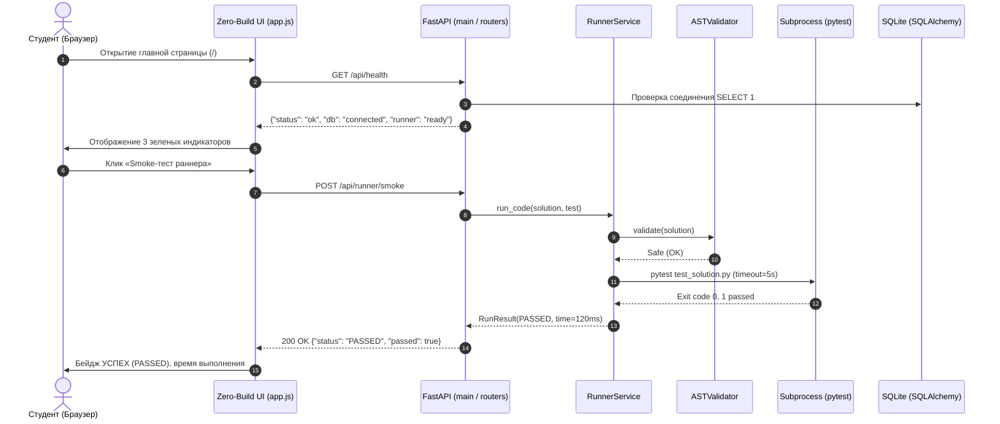

# RF — OOP_20261015-022500_CORE / Phase A: Платформенный фундамент и базовый запуск мини-LMS (Zero-Build & FastAPI)

> **Current filename**: `RF__OOP_20261015-022500_CORE.md`
> **Date**: 2026-10-15
> **Author**: zhasulan
> **Status**: 🟢 RF — Complete
> **Parent HL**: [HL-OOP_20261015-022500_CORE.md](HL-OOP_20261015-022500_CORE.md)
> **TS**: [TS__OOP_20261015-022500_CORE.md](TS__OOP_20261015-022500_CORE.md)
> **Producer unit**: antigravity:executor
> **Parent Coordinator**: antigravity:coordinator
> **Activation / dispatch source**: owner-direct
> **Coordination authority**: "HL-OOP_20261015-022500_CORE.md @ 5724adc39f0aee0482737670040d00bf5d339f32"
> **Originating proposer**: none
> **Current selection**: native-gates, selection_ref: baseline
> **Launch observation**: requested model Gemini 3.8 Flash (High), delivery successful, Candidate e04ac9239a3b9ec2d9edf6ce657574242a709e2d

---

## 1. What Was Done

Разработан и протестирован самодостаточный инженерный каркас локальной мини-LMS для интерактивного изучения ООП студентами:
1. Конфигурация проекта в `pyproject.toml` (FastAPI, Uvicorn, SQLAlchemy 2.0, Jinja2, Pytest, Ruff).
2. Слой данных: движок SQLite (`data/web_oop.db`) и типизированные модели SQLAlchemy 2.0 (`Student`, `TopicProgress`, `Submission`) с автосозданием таблиц при старте приложения.
3. Безопасная песочница `RunnerService`: статический AST-анализ (`ASTValidator`) с блокировкой модулей `os`, `sys`, `subprocess`, `shutil`, `socket` и функций `eval`, `exec`, изолированный прогон `pytest` во временной директории и таймаут 5.0 секунд.
4. Контроллеры FastAPI: эндпоинты `GET /api/health` и `POST /api/runner/smoke`.
5. Zero-Build веб-интерфейс: дашборд `index.html` на Tailwind CSS CDN, Vanilla JS и Mermaid.js CDN с визуализацией классов `Passenger` и `Validator` и smoke-кнопкой.
6. Инженерная документация: `docs/architecture.md` (Clean Architecture и модель безопасности песочницы) и `docs/domain_model_uml.md` (UML и ERD схемы).
7. Тестовый сьют: 15 юнит-тестов (100% прохождение) и полное соответствие линтеру `ruff`.

### Actual Value-Bearing Accounting

| Fact | Actual result |
|---|---|
| TS approval ref | `c67c6aa631bdb2b6e9cd38c1aff24d36d2b15073` |
| Baseline / Candidate | `5724adc39f0aee0482737670040d00bf5d339f32` / `e04ac9239a3b9ec2d9edf6ce657574242a709e2d` |
| VALUE membership | 19 файлов: `app/__init__.py`, `app/config.py`, `app/database/__init__.py`, `app/database/base.py`, `app/database/session.py`, `app/models/__init__.py`, `app/models/student.py`, `app/models/progress.py`, `app/models/submission.py`, `app/services/__init__.py`, `app/services/ast_validator.py`, `app/services/runner.py`, `app/routers/__init__.py`, `app/routers/health.py`, `app/routers/runner.py`, `app/main.py`, `app/templates/index.html`, `app/static/css/style.css`, `app/static/js/app.js`, `docs/architecture.md`, `docs/domain_model_uml.md` |
| Arithmetic | 1184 adds + 0 deletes = 1184 touched text LOC; 19 logical VALUE files; binary/non-text N/A |
| Membership deviations | None (все созданные VALUE-файлы соответствуют TS §4) |
| Trigger disposition | 19 файлов < 50, 1184 LOC < 5000 (в рамках утвержденного бюджета) |
| Authority and timing | Запланированный знаменатель: 19 VALUE files, 1200 LOC; authority: zhasulan |
| Reproduction | `git diff --numstat 5724adc39f0aee0482737670040d00bf5d339f32..e04ac9239a3b9ec2d9edf6ce657574242a709e2d -- app/ docs/` |

### New Files

| File | Description |
|---|---|
| `pyproject.toml` | Конфигурация зависимостей, pytest и ruff |
| `app/__init__.py` | Пакет приложения |
| `app/config.py` | Настройки Pydantic |
| `app/database/base.py` | DeclarativeBase SQLAlchemy 2.0 |
| `app/database/session.py` | Движок SQLite, генератор get_db и init_db |
| `app/database/__init__.py` | Экспорт базы данных |
| `app/models/student.py` | Модель Student |
| `app/models/progress.py` | Модель TopicProgress |
| `app/models/submission.py` | Модель Submission |
| `app/models/__init__.py` | Экспорт моделей данных |
| `app/services/ast_validator.py` | AST-инспектор безопасности кода |
| `app/services/runner.py` | RunnerService с песочницей и таймаутом |
| `app/services/__init__.py` | Экспорт служб |
| `app/routers/health.py` | Эндпоинт мониторинга /api/health |
| `app/routers/runner.py` | Эндпоинт /api/runner/smoke |
| `app/routers/__init__.py` | Экспорт роутеров |
| `app/main.py` | Точка входа FastAPI, монтирование статики и lifespan |
| `app/templates/index.html` | Дашборд на Tailwind CDN и Mermaid.js |
| `app/static/css/style.css` | Стили интерфейса |
| `app/static/js/app.js` | Клиентская логика Vanilla JS |
| `docs/architecture.md` | Описание архитектуры и безопасности |
| `docs/domain_model_uml.md` | UML-диаграммы Avtobys и схема БД |
| `tests/__init__.py` | Пакет тестов |
| `tests/conftest.py` | Тестовые фикстуры и клиент TestClient |
| `tests/test_health.py` | Тесты API здоровья и дашборда |
| `tests/test_models.py` | Тесты моделей SQLAlchemy |
| `tests/test_runner.py` | Тесты RunnerService и AST-валидатора |

### Modified Files

No existing files were modified (Greenfield task).

## 2. Key Decisions

1. **Строгое соблюдение Zero-Build**: Полный отказ от локальных инструментов Node.js/npm. Tailwind CSS и Mermaid.js загружаются через доверенные CDN, что обеспечивает мгновенный локальный запуск.
2. **Двухуровневая безопасность RunnerService**: Первый уровень — статический анализ AST с отсечением запрещенных импортов и вызовов без запуска процесса; второй уровень — исполнение в `tempfile.TemporaryDirectory` с жестким лимитом времени 5.0с.
3. **Совместимость с Windows**: Использование `ignore_cleanup_errors=True` в `tempfile.TemporaryDirectory` и `sys.executable` для гарантированного вызова интерпретатора текущего виртуального окружения.

## 3. Acceptance Criteria

- [x] **AC-1**: Сервер FastAPI запускается, монтирует статику, эндпоинт `GET /api/health` возвращает 200 OK (`{"status": "ok", "db": "connected", "runner": "ready"}`), Swagger доступен на `/docs`.
- [x] **AC-2**: База данных SQLite инициализируется, модели `Student`, `TopicProgress`, `Submission` описаны в SQLAlchemy 2.0 (`Mapped`, `mapped_column`) и проходят CRUD-тесты.
- [x] **AC-3**: Главная страница `/` отдает Zero-Build дашборд с CDN Tailwind и Mermaid.js, отображает 3 индикатора статуса, smoke-кнопка интерактивно исполняет тест, Mermaid рендерит UML-диаграмму `Passenger` и `Validator`. `package.json` и `node_modules` отсутствуют.
- [x] **AC-4**: `RunnerService` изолированно выполняет тесты в `tempfile.TemporaryDirectory`, прерывает бесконечные циклы ровно по таймауту (`TIMEOUT`), `ASTValidator` блокирует вредоносный код (`SECURITY_VIOLATION`).
- [x] **AC-5**: Созданы и заполнены документы `docs/architecture.md` и `docs/domain_model_uml.md`.
- [x] **AC-6**: Все 15 тестов в каталоге `tests/` проходят успешно (`pytest`), линтер `ruff check .` завершается без ошибок.
- [x] **AC-7**: Контент Недели 1 отсутствует (изоляция скоупа сохранена).

## 4. Verification

- Lint (`python -m pytest tests/ -q --collect-only`): 15 collected, clean
- Tests (`pytest`): 15 passed in 3.53s, 0 failures
- Ruff (`ruff check .`): All checks passed!

## 5. Evidence

See [EV file](evidence/EV__OOP_20261015-022500_CORE.md) for evidence details.

Evidence verdict: 12/12 VERIFIED, 0 DEFERRED, 0 BLOCKED, 0 N/A

## 6. Observations (out-of-scope, not modified)

No observations.

## 7. Fact Candidates

No fact candidates.

## 8. Strategic Insights (Execution)

| # | Insight | Category | Source |
|---|---|---|---|
| S1 | Zero-Build архитектура с Tailwind CDN и Mermaid.js позволяет студентам мгновенно погружаться в ООП без установки Node.js, npm или сборщиков, что критически важно для учебного процесса 2 курса. | architecture | zhasulan / saubakirov |

## 9. Diagrams

Диаграмма взаимодействия компонентов:

### Material handover at this return

- **Producer unit**: antigravity:executor
- **Source / epoch**: `HL-OOP_20261015-022500_CORE.md @ 5724adc39f0aee0482737670040d00bf5d339f32`, `TS__OOP_20261015-022500_CORE.md @ c67c6aa631bdb2b6e9cd38c1aff24d36d2b15073`, Candidate `e04ac9239a3b9ec2d9edf6ce657574242a709e2d`
- **Inspected scope**: `app/`, `docs/`, `tests/`, `pyproject.toml`, `evidence/EV__OOP_20261015-022500_CORE.md`
- **Material findings**: Все критерии приемки AC-1 – AC-7 выполнены в полном объеме, автотесты 100% зеленые, кодовая база готова к ревью.
- **Uncertainty**: None
- **Continuation**: Переход к этапу независимого ревью (`/tfw-review`).

---

*RF — OOP_20261015-022500_CORE / Phase A: Платформенный фундамент и базовый запуск мини-LMS (Zero-Build & FastAPI) | 2026-10-15*
