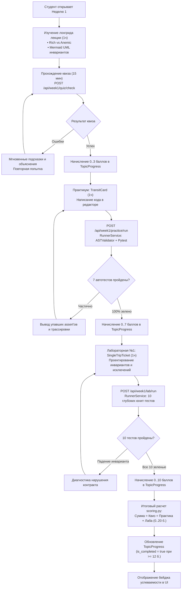

# HL — OOP_20261015-162432_W1MAT: Учебный модуль Недели 1: Основы ООП, инкапсуляция и защита инвариантов

> **Current filename**: `HL-OOP_20261015-162432_W1MAT.md`  
> **Date**: 2026-10-15  
> **Author**: zhasulan  
> **Title**: Учебный модуль Недели 1: Основы ООП, инкапсуляция и защита инвариантов  
> **Abbreviation**: W1MAT  
> **Status**: 🟡 TS_DRAFT — Awaiting TS approval  
> **Contract**: 🔒 FROZEN — approved by zhasulan 2026-10-15  
> **Frozen**: §1 · §3 · §4 · §5 · §6 · §7 — locked on owner approval  
> **Free**: §2 · §7.2 · §8 · §9 · §10 · §11 — research updates these directly  
> **Append-only**: §12 Amendment Log — the only channel for changing a frozen section  
> **Baseline**: freeze commits — recovery form in `conventions.md` §3 rule 15  
> **Project North Star**: `README.md § Цель и North Star проекта`

---

## 1. Vision 🔒 FROZEN

В мини-LMS разработан и встроен законченный, интерактивный учебный модуль Недели 1 («Основы ООП, инкапсуляция и защита инвариантов») на базе домена городской транспортной системы Avtobys. Студенты 2 курса специальности «Программная инженерия» последовательно проходят теоретический блок с архитектурным разбором Rich vs Anemic Domain Model, интерактивный квиз с мгновенной валидацией, практический тренажер по реализации сущности `TransitCard` и лабораторную работу №1 по проектированию класса `SingleTripTicket` с защитой инвариантов и обработкой исключений. Прогресс и оценка (от 0 до 20 баллов) автоматически верифицируются через безопасный `RunnerService`, персистентно фиксируются в SQLite (`TopicProgress`, `Submission`) и в реальном времени визуализируются в Zero-Build веб-интерфейсе при строгом соблюдении академической нормы 3 часов учебной нагрузки.

**Impact:**
- **Для студентов (2 курс, КазНУ):** Понятный, бесшовный переход от процедурного стиля (словари и глобальные функции) к настоящему ООП с защитой инвариантов, мгновенная обратная связь от тестового раннера в браузере без необходимости ручной настройки среды.
- **Для преподавателя (@saubakirov):** 100% автоматизация первичной проверки лабораторных и практических заданий, исключение рутинного ручного прогона тестов, защита от фальсификации результатов и прозрачный мониторинг успеваемости потока по 20-балльной шкале.
- **Для платформы Web-OOP:** Полноценный эталон контентного модуля, подтверждающий масштабируемость платформенного фундамента (Task 1 CORE) и создающий готовые программные контракты для последующих модулей Недель 2 и 3.

> *«Студенты на реальном коде Avtobys увидели катастрофу анемичной модели — когда посреди смены в автобусе баланс уходит в минус или дважды используется один билет. Практикум и лабораторная с автопроверкой заставили их защитить инварианты прямо в классе, а начисление до 20 баллов с фиксацией в SQLite сняло с меня часы рутинной проверки!»*  
> — Воображаемый отзыв преподавателя Санжара Аубакирова (@saubakirov).

---

## 2. Current State (As-Is) 🟢 FREE

1. **Фундамент платформы (Задача `OOP_20261015-022500_CORE` — статус DONE):**
   - Бэкенд на Python 3.12 (FastAPI), база данных SQLite (`data/web_oop.db`) с ORM-моделями SQLAlchemy 2.0 (`Student`, `TopicProgress`, `Submission`).
   - Изолированная среда выполнения студенческого кода `RunnerService` с предварительной AST-фильтрацией опасных операций (`ASTValidator`) и таймаутом выполнения (5 сек).
   - Главная страница (`app/templates/index.html`) на базе чистого Zero-Build стека (Tailwind CSS CDN, Vanilla JS, Mermaid.js CDN).
   - Инфраструктура полностью покрыта тестами (15 passed, ruff clean).

2. **Первоисточники учебного контента (репозиторий и локальные материалы):**
   - В каталоге `C:\Users\kz444\OneDrive\Desktop\OOP` присутствуют методические материалы курса CS2203:
     - `01_Лекции\Лекция_01_От_процедурного_подхода_к_объектам_Инкапсуляция.pdf` (нарратив Chaos → Structure, понятия Identity/State/Behavior, Anemic vs Rich Domain Model, защита инвариантов состояния, синтаксис Python 3.12 `@property`).
     - `02_Лабораторные\Лабораторная_01_Моделирование_домена_Avtobys_Защита_инвариантов.pdf` (домен Avtobys: сущности `TransitCard`, `SingleTripTicket`, `Bus`, `Route`, правила валидации, исключения `InsufficientFundsError`, `CardBlockedError`, `TicketAlreadyUsedError`, шкала оценивания).
     - Референсная реализация структуры модуля: `saubakirov/kaznu-2026-web-oop` (`OOP_20261014-133501_W1MAT`).

3. **Разрыв (Gap Analysis):**
   - В платформе отсутствуют веб-страницы и маршруты для учебного контента Недели 1 (`/week1/...`).
   - Материалы лекции не оцифрованы в веб-формат и не содержат интерактивных диаграмм классов и последовательностей на Mermaid.js.
   - Нет интерактивного квиза с вопросами на понимание инкапсуляции и моментальной проверкой.
   - Нет интерактивного тренажера-практикума с кодовым редактором и вызовом `RunnerService` для задачи `TransitCard`.
   - Нет страницы и валидатора лабораторной работы №1 для задачи `SingleTripTicket`.
   - Сервис подсчета баллов `scoring.py` еще не реализован; прогресс по Неделе 1 не агрегируется и не сохраняется в `TopicProgress` (шкала 0..20 баллов).
   - Главная страница отображает тестовый smoke-интерфейс вместо перехода к модулям курса.

---

## 3. Target State (To-Be) 🔒 FROZEN

Законченный, интерактивный и эргономичный модуль Недели 1 в составе веб-платформы Web-OOP со строгим расчетом на 3 часа учебной работы студента:

1. **Блок 1: Лекция и теория (1 час / 0 баллов):**
   - Веб-страница лекции с наглядным изложением:
     - *Chaos → Structure:* почему процедурные словари (`{"card_id": 101, "balance": -400}`) приводят к сбоям в продакшене.
     - *Rich Domain Model vs Anemic Domain Model:* почему логика списания должна быть внутри сущности, а не во внешних скриптах.
     - *Защита инвариантов состояния:* свойства (`@property`, `@setter`), валидация при инициализации и мутациях, типизированные исключения (`InsufficientFundsError`, `CardBlockedError`, `InvalidAmountError`).
     - *Домен Avtobys:* интерактивные диаграммы Mermaid.js (Class Diagram: `TransitCard`, `SingleTripTicket`, `Bus`, `Route`; Sequence Diagram: сценарий оплаты проезда через валидатор).

2. **Блок 2: Интерактивный квиз (проверка теории, ~15 мин / максимум 3 балла):**
   - 4-5 ключевых вопросов с выбором одного/нескольких вариантов ответа:
     - Различие Rich и Anemic моделей;
     - Назначение инкапсуляции и сокрытия данных;
     - Правильная реакция класса на нарушение инварианта (выброс исключения vs тихий возврат None/False);
     - Роль `@property` в Python для контроля мутаций.
   - Мгновенная клиент-серверная валидация через эндпоинт `POST /api/week1/quiz/check`.
   - Подробные объяснения под каждым ответом: почему вариант верен или ошибочен.
   - Начисление от 0 до 3 баллов с сохранением в БД.

3. **Блок 3: Практикум (1 час / максимум 7 баллов):**
   - Интерактивный веб-тренажер с редактором кода (Monaco-like или легковесный TextArea/Ace/CodeMirror Zero-Build).
   - Задача: реализация класса `TransitCard`:
     - Инварианты: баланс не может стать отрицательным; пополнение `top_up` минимум на 100 ₸; списание `pay(fare)` учитывает `discount_rate`; заблокированная карта (`is_blocked`) отклоняет операции.
     - Исключения: `InsufficientFundsError`, `CardBlockedError`, `InvalidAmountError`.
   - Автоматическая проверка кода в изолированном `RunnerService` через эндпоинт `POST /api/week1/practice/run`.
   - Прогон скрытого сьюта из 7 параметризованных тестов pytest, каждый пройденный тест дает 1 балл (итого до 7 баллов).
   - Вывод детального отчета: пройденные/упавшие тесты, стек вызовов, диагностика ASTValidator при попытке запрещенных импортов.

4. **Блок 4: Лабораторная работа №1 (1 час / максимум 10 баллов):**
   - Инженерное задание на проектирование ядра домена Avtobys:
     - Реализация сущности `SingleTripTicket` (разовый билет): `ticket_code` (UUID), `price: Decimal`, метка времени `issued_at`, статус `is_validated: bool`.
     - Метод `validate(bus: Bus)` с защитой от повторного проезда (инвариант однократности: повторный вызов выбрасывает `TicketAlreadyUsedError`).
     - Метод проверки срока действия (билет действителен в течение 60 минут с момента покупки, просроченный билет выбрасывает `TicketExpiredError`).
     - Класс `Bus` с маршрутом и валидатором, принимающий оплату как по `TransitCard`, так и по `SingleTripTicket`.
   - Автоматическая верификация через `RunnerService` (10 тестов, по 1 баллу за тест, максимум 10 баллов).

5. **Блок 5: Агрегация баллов и профиль успеваемости (0..20 баллов):**
   - Сервис `app/services/scoring.py`, агрегирующий результаты:  
     $$\text{Total Score} = \text{Quiz (0..3)} + \text{Practice (0..7)} + \text{Lab (0..10)} \in [0, 20]$$
   - Сохранение в таблице `TopicProgress`: `topic_id="week_1"`, `score`, `is_completed` (порог сдачи: $\ge 12$ баллов, т.е. 60%).
   - При повторных попытках балл не уменьшается: $\text{score} = \max(\text{score}_{\text{current}}, \text{score}_{\text{new}})$.
   - История попыток сохраняется в `Submission`.
   - В шапке сайта и на главном дашборде отображается динамический прогресс: бейдж баллов (`18 / 20`), шкала выполнения и статус (В процессе / Сдано).

---

### 3.1 Result Visualization

#### Сравнение As-Is и To-Be

| Параметр | До (As-Is) | После (To-Be) |
|---|---|---|
| **Главный экран** | Статический smoke-тест платформенного ядра | Дашборд с карточкой «Неделя 1», статусом прохождения и набранными баллами (0–20) |
| **Теория** | PDF-файл 4.3 МБ на внешнем диске | Интерактивный адаптивный лонгрид с Mermaid-диаграммами классов и последовательностей |
| **Проверка знаний** | Ручной опрос на паре | Интерактивный квиз с мгновенной валидацией и разбором ошибок (0–3 балла) |
| **Практикум** | Отсутствует | Онлайн-тренажер `TransitCard` с автопроверкой через RunnerService (0–7 баллов) |
| **Лабораторная №1** | Ручная сдача zip-архива | Интерактивная среда сдачи `SingleTripTicket` с запуском pytest и анализом инвариантов (0–10 баллов) |
| **Учет баллов** | Не реализован | Автоматическая фиксация в SQLite `TopicProgress` и бейдж успеваемости в UI |

#### Макет веб-интерфейса Недели 1 (Zero-Build Tailwind CSS)

```
+-----------------------------------------------------------------------------------------+
| [Web-OOP LMS]   Неделя 1: Инкапсуляция и инварианты      [Студент: zhasulan] [17/20 б.] |
+-----------------------------------------------------------------------------------------+
| [ Лекция (1ч) ]  |  [ Квиз (15м) ]  |  [ Практикум (1ч) ]  |  [ Лабораторная №1 (1ч) ]  |
+-----------------------------------------------------------------------------------------+
|                                                                                         |
|  ТЕОРИЯ: Доменная модель Avtobys: от словарей к Rich Domain Model                       |
|  -------------------------------------------------------------------------------------  |
|  Проблема процедурного подхода:                                                         |
|  passenger = {"card_id": 12, "balance": 100}                                            |
|  passenger["balance"] -= 120  # БАЛАНС: -20 тенге! Инвариант нарушен!                   |
|                                                                                         |
|  +-----------------------------------------------------------------------------------+  |
|  | [Mermaid.js Diagram: TransitCard & SingleTripTicket Class Invariants]             |  |
|  +-----------------------------------------------------------------------------------+  |
|                                                                                         |
|  ИНТЕРАКТИВНЫЙ ТРЕНАЖЕР (Практикум):                                                    |
|  +---------------------------------------------+ +------------------------------------+ |
|  | # Ваш код класса TransitCard                | | РЕЗУЛЬТАТЫ ТЕСТОВ (RunnerService):  | |
|  | class TransitCard:                          | | [x] test_initial_balance_non_neg   | |
|  |     def __init__(self, card_id, balance):   | | [x] test_top_up_minimum_amount     | |
|  |         ...                                 | | [x] test_pay_insufficient_funds    | |
|  |                                             | | [x] test_blocked_card_rejects_pay  | |
|  | [ Кнопка: Запустить автопроверку ]          | | ---------------------------------- | |
|  |                                             | | Итог: 7/7 тестов пройдено (+7 б.)  | |
|  +---------------------------------------------+ +------------------------------------+ |
+-----------------------------------------------------------------------------------------+
```

---

### 3.2 Value Flow

Диаграмма создания образовательной ценности и начисления баллов:



---

## 4. Phases 🔒 FROZEN

Задача выполняется как единая сквозная фаза **Phase A** под управлением Координатора задачи:

### Phase A: Разработка и интеграция учебного модуля Недели 1 🔴

**Deliverables:**
1. **Слой данных и контента (`app/content/week_1/`):**
   - Текст лекции и теория в структурированном виде (Markdown/HTML) с диаграммами Mermaid.js.
   - Банк вопросов квиза (JSON/Python) с вариантами ответов, ключами правильности и методическими объяснениями.
   - Спецификации и шаблоны кода заданий: `TransitCard` (практикум) и `SingleTripTicket` + `Bus` (лабораторная).
   - Наборы автотестов для RunnerService (`test_practice_w1.py` на 7 тестов, `test_lab_w1.py` на 10 тестов).
2. **Служба оценивания (`app/services/scoring.py`):**
   - Функции валидации и начисления баллов: квиз (0..3), практика (0..7), лабораторная (0..10).
   - Логика обновления `TopicProgress` (гарантия диапазона 0..20, фиксация `is_completed=True` при $\ge 12$ баллах, политика неотрицательного приращения баллов $\max$).
   - Логирование посылок в `Submission`.
3. **Контроллеры и эндпоинты (`app/routers/week1.py`):**
   - Страничные роуты: `GET /week1` (обзор модуля), `GET /week1/lecture`, `GET /week1/quiz`, `GET /week1/practice`, `GET /week1/lab`.
   - API роуты:
     - `POST /api/week1/quiz/check` — проверка ответов квиза, возврат пояснений и начисление баллов.
     - `POST /api/week1/practice/run` — запуск решения практикума через `RunnerService` и начисление баллов.
     - `POST /api/week1/lab/run` — запуск лабораторной работы через `RunnerService` и начисление баллов.
     - `GET /api/week1/progress` — получение текущих баллов и статуса студента.
4. **Веб-интерфейс Zero-Build (`app/templates/week1/`, `app/static/js/week1.js`):**
   - Шаблоны страниц лекции, квиза, практикума и лабораторной работы со стилизацией Tailwind CSS (CDN).
   - Интерактивный клиентский скрипт для мгновенной валидации квиза и отправки кода на проверку с отображением логов RunnerService.
   - Рендеринг UML диаграмм классов и последовательностей на Mermaid.js.
   - Обновление главного дашборда (`app/templates/index.html`): карточка Недели 1 с прогресс-баром и переходом к заданиям.
5. **Тестовое покрытие и верификация (`tests/test_week1.py`, `tests/test_scoring.py`):**
   - Тесты всех новых эндпоинтов FastAPI, сервиса scoring, корректности сохранения в SQLite и устойчивости к ошибкам.
   - Проверка линтером `ruff`.

---

### 4.1 Coordination Selection 🔒 FROZEN

| Activation source | Accountable owner | Task Coordinator unit | Phase Coordinator rule | Mandate scope / role reach | Upward route | Dialogue | Reporting | Reservations / controls | Amendment authority | Immutable epoch |
|---|---|---|---|---|---|---|---|---|---|---|
| owner-direct | zhasulan | antigravity:coordinator | none (единая фаза) | Полный цикл Недели 1: контент, API, UI, scoring, тесты | owner:zhasulan | tfw-gates-only | native-gates | Бюджет 0..20 баллов, 3ч нагрузки, Zero-Build | none | baseline |

---

## 5. Definition of Done (DoD) 🔒 FROZEN

- ✅ 1. **Теоретический контент доступен в UI:** Страница лекции Недели 1 (`/week1/lecture`) полностью сверстана, содержит объяснение перехода от процедурного хаоса к объектам, Rich vs Anemic моделей, защиты инвариантов и рендерит интерактивные диаграммы классов и последовательностей на Mermaid.js.
- ✅ 2. **Интерактивный квиз функционирует:** Страница квиза (`/week1/quiz`) содержит 4-5 вопросов, эндпоинт `POST /api/week1/quiz/check` валидирует ответы, возвращает пояснения ошибок и начисляет от 0 до 3 баллов.
- ✅ 3. **Практикум `TransitCard` с автопроверкой работает:** Страница практикума (`/week1/practice`) содержит форму/редактор кода, эндпоинт `POST /api/week1/practice/run` запускает изолированный `RunnerService` против сьюта из 7 тестов, возвращает структурированный отчет и начисляет от 0 до 7 баллов.
- ✅ 4. **Лабораторная работа №1 `SingleTripTicket` работает:** Страница лабы (`/week1/lab`) позволяет отправить решение, эндпоинт `POST /api/week1/lab/run` выполняет проверку инвариантов однократности использования и сроков действия против 10 тестов и начисляет от 0 до 10 баллов.
- ✅ 5. **Агрегация баллов 0–20 и сохранение в SQLite:** Сервис `scoring.py` рассчитывает суммарный балл, гарантирует диапазон $[0, 20]$, сохраняет прогресс в `TopicProgress` (с выставлением `is_completed=True` при $\ge 12$ баллах) и историю в `Submission`. Повторные отправки не уменьшают ранее достигнутый максимальный балл.
- ✅ 6. **Отображение прогресса в UI:** Главная страница (`/`) и шапка модуля Недели 1 отображают актуальный балл (например, `17 / 20 баллов`), статус сдачи и активные ссылки на все компоненты недели.
- ✅ 7. **Zero-Build принцип соблюден:** Никаких `package.json`, `node_modules`, npm/yarn/vite. Все стили и скрипты подключаются через CDN или отдаются как статические файлы FastAPI.
- ✅ 8. **Академический хронометраж соблюден:** Суммарное расчетное время освоения модуля второкурсником составляет ровно 3 часа (1ч теория, 1ч практика, 1ч лаба).
- ✅ 9. **Качество кода и тесты:** 100% прохождение новых и ранее созданных тестов сьюта `pytest` (общее число тестов $\ge 30$), нулевые замечания линтера `ruff`.

---

## 6. Definition of Failure (DoF) 🔒 FROZEN

- ❌ 1. Нарушение Zero-Build подхода (появление инструментов сборки фронтенда, компиляторов TypeScript, npm-пакетов или node_modules).
- ❌ 2. Превышение академической нормы 3 часов учебной нагрузки за счет избыточного усложнения доменных моделей.
- ❌ 3. Некорректный расчет баллов: сумма максимумов не равна 20, возможность набрать более 20 баллов, обнуление ранее набранных баллов при повторной неудачной попытке.
- ❌ 4. Уязвимость песочницы: обход `ASTValidator` в отправленном студенческом коде (импорт `os`, `sys`, `subprocess`, чтение файлов за пределами временной папки).
- ❌ 5. Анемичная доменная модель в обучающих материалах и эталонах: предоставление классов без валидации и методов-защитников инвариантов.
- ❌ 6. Падение существующих платформенных тестов Задача 1 (`test_health.py`, `test_models.py`, `test_runner.py`).

**On failure:** Немедленная остановка приемки, локализация дефекта в `scoring.py`, `week1.py` или шаблонах, исправление в рамках Role Lock Исполнителя до полного соответствия DoD.

---

## 7. Principles 🔒 FROZEN

1. **Zero-Build UI Integrity:** Только нативный HTML5/Jinja2, Tailwind CSS CDN, Mermaid.js CDN и чистый Vanilla JS. Никаких локальных сборщиков.
2. **Rich Domain Model Over Anemic Model:** Объект в ООП объединяет состояние и поведение. Сущности `TransitCard` и `SingleTripTicket` сами защищают свои инварианты, а не полагаются на внешние проверки.
3. **Strict Invariant Defense:** Невозможно перевести объект в невалидное состояние ни при инициализации, ни при вызове методов. Нарушение инварианта обязано возбуждать специализированное исключение.
4. **Fail-Safe Execution Sandbox:** Выполнение студенческого кода через `RunnerService` всегда ограничено по времени (5 сек), изолировано во временной директории и предварительно инспектируется AST-парсером.
5. **Calibrated 3-Hour Academic Workload:** Модуль рассчитан строго на возможности студента 2 курса бакалавриата (1ч лекция, 1ч практикум, 1ч лабораторная).
6. **Transparent Grading (0–20 Scale):** Четкое, понятное студенту распределение баллов: 3 (квиз) + 7 (практика) + 10 (лаба) = 20 баллов. Порог сдачи — 12 баллов (60%).

---

### 7.2 Knowledge Citations 🟢 FREE

| # | Source | Item | How it applies |
|---|--------|------|----------------|
| 1 | `README.md` | § Цель и North Star проекта | Неделя 1 — первый базовый контентный блок курса (основы ООП, инкапсуляция, инварианты на домене Avtobys). |
| 2 | `.tfw/README.md` | Methodology values | Строгое соблюдение Trace-First Workflow, разделение ролей Координатора, Исполнителя и Ревьюера. |
| 3 | `KNOWLEDGE.md` §1 | D1 (Стек: Python 3.12, FastAPI, SQLite) | Использование стандартного стека без сторонних сервисов. |
| 4 | `KNOWLEDGE.md` §1 | D2 (Домен Avtobys) | Сквозной домен городской транспортной системы Алматы для всех заданий. |
| 5 | `KNOWLEDGE.md` §1 | D3 (Верификатор RunnerService) | Автопроверка решений практики и лабы через изолированный pytest и ASTValidator. |
| 6 | `KNOWLEDGE.md` §1 | D5 (Zero-Build интерфейс) | Запрет локальных node_modules, использование CDN для Tailwind и Mermaid.js. |
| 7 | `KNOWLEDGE.md` §4 | F1 (Аудитория: 2 курс, 3 часа) | Строгая калибровка заданий под уровень студентов 2 курса «Программная инженерия». |
| 8 | `KNOWLEDGE.md` §4 | F4 (Изоляция RunnerService) | Блокировка опасных системных вызовов при выполнении кода практических заданий. |

---

## 8. Dependencies 🟢 FREE

| Dependency | Status |
|------------|--------|
| Задача платформенного фундамента `OOP_20261015-022500_CORE` | ✅ Завершена (DONE) |
| База данных SQLite и таблицы `students`, `topic_progress`, `submissions` | ✅ Готовы к использованию |
| Изолированный движок `RunnerService` и `ASTValidator` | ✅ Готовы к интеграции |
| Исходные материалы курса в `C:\Users\kz444\OneDrive\Desktop\OOP` | ✅ Доступны для оцифровки |

---

## 9. Risks 🟢 FREE

| Risk | Probability | Impact | Mitigation |
|------|-------------|--------|------------|
| Студенты будут испытывать сложности с синтаксисом `@property` и исключениями в Python 3.12 | Medium | Medium | Предоставление наглядных примеров в лекции и частичного стартового скелета кода в редакторе практикума |
| Случайная потеря набранных баллов при повторном запуске тестов с ошибкой | Low | High | Реализация в `scoring.py` правила $\max(\text{old\_score}, \text{new\_score})$ |
| Зависание бесконечного цикла в студенческом коде при проверке лабы | Medium | High | `RunnerService` принудительно убивает процесс по истечении таймаута 5.0 секунд |
| Перегрузка веб-страницы тяжелыми скриптами редактора кода | Low | Medium | Использование компактного и надежного Zero-Build редактора без тяжелых зависимостей |

---

## 10. RESEARCH Case 🟢 FREE

### Blind Spots
- Требуется ли студенту сохранять черновик недописанного кода в LocalStorage браузера, чтобы код не пропадал при случайном закрытии вкладки?
- Как лучше организовать навигацию между 4 частями модуля: 4 отдельные страницы или 1 страница с вкладками (tabs)?

### Hypotheses

| # | Hypothesis | Status |
|---|----------|--------|
| H1 | Организация модуля Недели 1 в виде единого многовкладочного интерфейса (Tabs: Лекция / Квиз / Практикум / Лабораторная) с сохранением состояния в LocalStorage обеспечивает лучший UX без потери контекста. | open |
| H2 | Фиксация баллов за квиз должна производиться на стороне сервера по хешам правильных ответов, чтобы исключить подсмотр ответов через DevTools браузера. | open |

### Risks of Not Researching
Если захардкодить ответы квиза в открытом клиентском JS, студенты смогут получить 3 балла через инспектор браузера без изучения теории.

### Why Not Just...?

| Approach | Value | Adoption / operating burden | Risks / tradeoffs | Decision and reason |
|---|---|---|---|---|
| **Рекомендуемый: Полноценный веб-модуль с Zero-Build UI, встроенным тренажером и автопроверкой через RunnerService** | Максимальная интерактивность, мгновенный фидбек, автоматический учет 0..20 баллов в SQLite | Средняя трудоемкость создания шаблонов и роутов, нулевая нагрузка на инфраструктуру (Zero-Build) | Требует качественной верстки и отладки тестов раннера | **Выбрано**: полностью соответствует North Star платформы и требованиям учебного процесса |
| **Альтернатива 1: Выдача PDF-файлов и прием решений через форму отправки zip-файла** | Минимальные трудозатраты на разработку | Огромная ручная нагрузка на преподавателя по проверке архивов, отсутствие интерактива | Студенты теряют мотивацию, нет мгновенного фидбека | **Отклонено**: противоречит миссии создания интерактивной мини-LMS |
| **Альтернатива 2: Использование внешнего онлайн-раннера (Repl.it / Judge0 / Stepik API)** | Готовая инфраструктура песочницы | Зависимость от внешних платных API, нестабильность сети, утечка данных студентов | Сложность интеграции с локальной SQLite | **Отклонено**: проект спроектирован как полностью локальный и автономный (F3) |

**Leave unchanged:** Оставление платформы на стадии Task 1 (пустой каркас без контента) делает систему бесполезной для студентов и преподавателя.

**Critical challenge:**  
*Главное возражение:* Не перегрузит ли студента 2 курса необходимость проектировать исключения и инварианты сразу для двух сущностей (`TransitCard` и `SingleTripTicket`) за один модуль?  
*Ответ:* Нагрузка строго декомпозирована по времени и сложности: на лекции дается готовый разбор логики `TransitCard`, в практикуме студент закрепляет его под руководством подсказок (1 час), а в лабораторной работе переносит освоенный паттерн на новую сущность `SingleTripTicket` (1 час). Общий хронометраж строго равен 3 часам.

---

## 11. Strategic Insights (Planning) 🟢 FREE

| # | Insight | Category | Source |
|---|---------|----------|--------|
| S1 | Второкурсники специальности «Программная инженерия» лучше всего понимают разницу между ООП и процедурным стилем на конкретных сценариях сбоев («ночной сбой валидатора в автобусе из-за отрицательного баланса словаря»). Доменная модель Avtobys идеальна для демонстрации инвариантов. | domain | saubakirov / zhasulan |
| S2 | Фиксация баллов по принципу High-Water Mark ($\max$) стимулирует студентов экспериментировать и улучшать код, не боясь потерять ранее набранные баллы при ошибке компиляции в новой попытке. | process | zhasulan |

---

## 12. Amendment Log 🟢 APPEND-ONLY

**No amendments.**

---

### Material handover at this return

- **Producer unit:** `antigravity:coordinator`
- **Source / epoch:** `HL-OOP_20261015-162432_W1MAT.md @ draft`
- **Inspected scope:** Полноценный учебный модуль Недели 1 (теория, квиз, практикум, лаба, начисление 0–20 баллов).
- **Uncertainty:** UX компоновки страниц (единый многовкладочный интерфейс vs раздельные страницы). Рекомендуется вкладка с автосохранением черновика.
- **Continuation:** Ожидание решения и утверждения контракта владельцем задачи `@zhasulan` для перехода к фиксации контракта и написанию спецификации задачи (TS).

---

*HL — OOP_20261015-162432_W1MAT: Учебный модуль Недели 1: Основы ООП, инкапсуляция и защита инвариантов | 2026-10-15*
