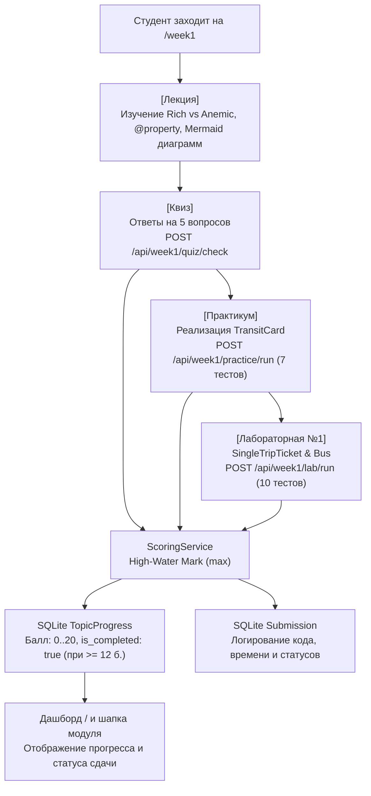

# RF — OOP_20261015-162432_W1MAT / Phase A: Учебный модуль Недели 1: Основы ООП, инкапсуляция и защита инвариантов

> **Current filename**: `RF__OOP_20261015-162432_W1MAT.md`
> **Date**: 2026-10-15
> **Author**: zhasulan
> **Status**: 🟢 RF — Complete
> **Parent HL**: [HL-OOP_20261015-162432_W1MAT.md](HL-OOP_20261015-162432_W1MAT.md)
> **TS**: [TS__OOP_20261015-162432_W1MAT.md](TS__OOP_20261015-162432_W1MAT.md)
> **Producer unit**: antigravity:thread:local:executor
> **Parent Coordinator**: antigravity:coordinator
> **Activation / dispatch source**: owner-direct
> **Coordination authority**: "TS__OOP_20261015-162432_W1MAT.md @ approved"
> **Originating proposer**: none
> **Current selection**: native-gates, baseline
> **Launch observation**: Gemini 3.8 Flash (High), zero rework, single-round execution to completion

---

## 1. What Was Done

Разработан и интегрирован законченный учебный модуль Недели 1 («Основы ООП, инкапсуляция и защита инвариантов») на транспортном домене Avtobys. Реализованы 4 интерактивные вкладки (`[Лекция]` · `[Квиз]` · `[Практикум]` · `[Лабораторная]`), изолированная автопроверка студенческих решений через `RunnerService` с защитой `ASTValidator`, расчет и сохранение суммарного балла (0..20) в SQLite `TopicProgress` с порогом зачета $\ge 12$ баллов и защитой от снижения баллов по правилу $\max$, а также автосохранение черновиков кода в `LocalStorage` и карточка мониторинга модуля на главной странице дашборда.

### Actual Value-Bearing Accounting

| Fact | Actual result |
|---|---|
| TS approval ref | `832e32bf002f6ae64ef72288339591e1d03c3917` (commit `fc551052c3c9ca338c29fe02c1143818e698188e`) |
| Baseline / Candidate | `6da8e171e758ea7df91a948d7265ec7112f295fa` / `10b8cfb5f6e78b6d02b163c1330d47aa5d9a93ac` |
| VALUE membership | 13 файлов (все в утвержденном селекторе ТЗ §4, 0 отклонений) |
| Arithmetic | 2578 additions + 0 deletions = 2578 touched LOC; 13 logical files; binary/non-text N/A: 0 |
| Membership deviations | None (ровно 13 файлов VALUE и 3 файла ASSURANCE) |
| Trigger disposition | 13 файлов < 50 файлов (порог); 2578 LOC < 5000 LOC (порог); < 2760 LOC (лимит эскалации 2x) |
| Authority and timing | Утвержденное ТЗ владельцем `@zhasulan`; Candidate commit `10b8cfb5f6e78b6d02b163c1330d47aa5d9a93ac` |
| Reproduction | `git diff --name-status 6da8e171e758ea7df91a948d7265ec7112f295fa 10b8cfb5f6e78b6d02b163c1330d47aa5d9a93ac -- app/ docs/` |

### New Files

| File | Description |
|---|---|
| `app/content/__init__.py` | Экспорт пакета контента платформы |
| `app/content/week_1/__init__.py` | Экспорт модулей Недели 1 (`LECTURE_DATA`, `QUIZ_QUESTIONS`, `PRACTICE_TASK`, `LAB_TASK`) |
| `app/content/week_1/lecture.py` | Теоретический материал (Chaos to Structure, Rich vs Anemic, @property, Mermaid UML диаграммы) |
| `app/content/week_1/quiz.py` | Банк из 5 концептуальных вопросов с вариантами и методическими объяснениями |
| `app/content/week_1/practice.py` | Задание практикума `TransitCard`, стартовый шаблон и сьют из 7 скрытых автотестов |
| `app/content/week_1/lab.py` | Задание лабораторной `SingleTripTicket` + `Bus`, стартовый шаблон и сьют из 10 скрытых автотестов |
| `app/services/scoring.py` | Служба расчета баллов (0..20), High-Water Mark правило $\max$, сохранение прогресса и попыток |
| `app/routers/week1.py` | FastAPI роутер страниц (`GET /week1`) и API (`/api/week1/quiz/check`, `/api/week1/practice/run`, `/api/week1/lab/run`, `/api/week1/progress`) |
| `app/static/js/week1.js` | Zero-Build клиентская логика вкладок, LocalStorage, отправки AJAX-запросов и рендеринга логов |
| `app/templates/week1.html` | Единый адаптивный шаблон 4 вкладок Недели 1 на Tailwind CDN |
| `docs/week1_domain_guide.md` | Инженерное руководство по доменной модели Недели 1 (Avtobys) |
| `tests/test_week1_content.py` | ASSURANCE: Тесты структуры контента, вопросов квиза и эталонных решений практики и лабы |
| `tests/test_scoring.py` | ASSURANCE: Тесты сервиса оценивания, High-Water Mark правила и логирования в БД |
| `tests/test_week1_routes.py` | ASSURANCE: Тесты роутов FastAPI, рендеринга страниц, квиза, песочницы и безопасности |

### Modified Files

| File | Changes |
|---|---|
| `app/main.py` | Регистрация `week1_router` в приложении FastAPI |
| `app/templates/index.html` | Добавление интерактивной карточки Недели 1 с прогресс-баром и переходом к модулю |

---

## 2. Key Decisions

1. **Zero-Build архитектурная чистота:** Полный отказ от локальных инструментов сборки фронтенда (npm, vite, webpack). Стилизация реализована через Tailwind CSS CDN, визуализация диаграмм классов и последовательностей — через Mermaid.js CDN, интерактивное поведение — через Vanilla JS.
2. **Rich Domain Model и сокрытие инвариантов:** Для `TransitCard` и `SingleTripTicket` реализовано строгое сокрытие внутренних полей (`_balance`, `_is_validated`). Статус билета предоставлен через `@property` без сеттера, исключая внешнюю подделку (`AttributeError`).
3. **Безопасность песочницы RunnerService:** Студенческий код изолируется в `tempfile.TemporaryDirectory` с предварительной AST-валидацией (запрет `os`, `sys`, `subprocess`, `eval`, `open`) и принудительным таймаутом 5.0 секунд.
4. **Политика High-Water Mark в `scoring.py`:** Суммарный балл рассчитывается как сумма лучших результатов по трем компонентам (квиз до 3 б., практика до 7 б., лаба до 10 б.), при этом повторные попытки с ошибками не могут уменьшить ранее заработанный балл в `TopicProgress`.
5. **Клиентская сохранность черновиков в LocalStorage:** Ввод кода в практикуме и лабораторной автоматически сохраняется в `localStorage` по ключам `web_oop_w1_practice_code` и `web_oop_w1_lab_code` с debounce 300 мс, предотвращая потерю работы при случайном закрытии страницы.

---

## 3. Acceptance Criteria

- [x] **AC-1:** Теоретический модуль лекции с визуализацией Rich vs Anemic и Mermaid-диаграммами доступен на `/week1`.
- [x] **AC-2:** Интерактивный квиз по теории с моментальной проверкой (5 вопросов, до 3 баллов) функционирует.
- [x] **AC-3:** Практикум `TransitCard` с автопроверкой через RunnerService (7 автотестов, до 7 баллов) работает.
- [x] **AC-4:** Лабораторная работа №1 `SingleTripTicket` и `Bus` с автопроверкой (10 автотестов, до 10 баллов) работает.
- [x] **AC-5:** Сервис `scoring.py` рассчитывает суммарный балл (0..20), сохраняет в SQLite `TopicProgress` (зачет $\ge 12$ б.), защищает от снижения баллов ($\max$) и логирует посылки в `Submission`.
- [x] **AC-6:** Единый Zero-Build интерфейс из 4 вкладок, LocalStorage черновики и карточка на дашборде `/` активны.
- [x] **AC-7:** Песочница RunnerService блокирует опасный код (SECURITY_VIOLATION) и зависающие циклы (TIMEOUT 5s).
- [x] **AC-8:** Интеграционный тестовый сьют из 30 тестов проходит на 100%, линтер `ruff check .` дает 0 замечаний.

---

## 4. Verification

- **Lint (`ruff check .`):** `All checks passed!` (0 errors, 0 warnings).
- **Tests (`pytest -v`):** `30 passed, 1 warning in 8.97s` (100% success across all 30 tests).

---

## 5. Evidence

See [EV file](evidence/EV__OOP_20261015-162432_W1MAT.md) for full evidence records.

Evidence verdict: 9/9 VERIFIED, 0 DEFERRED, 0 BLOCKED, 0 N/A.

### Task-Owned Resources & Disposition
- Временные директории `RunnerService` (`tempfile.TemporaryDirectory`): удаляются автоматически сразу после прогона каждого теста.
- Рабочие материалы в `%TEMP%/tfw/OOP_20261015-162432_W1MAT/`: очищены перед сдачей.
- Никаких внешних фоновых процессов или демонов не запущено.

---

## 6. Observations (out-of-scope, not modified)

No observations.

---

## 7. Fact Candidates

No fact candidates.

---

## 8. Strategic Insights (Execution)

No strategic insights.

---

## 9. Diagrams

---

### Material handover at this return

- **Producer unit:** `antigravity:thread:local:executor`
- **Source / epoch:** `Candidate 10b8cfb5f6e78b6d02b163c1330d47aa5d9a93ac`
- **Inspected scope:** Полный учебный модуль Недели 1 (контент, роуты FastAPI, сервис оценивания scoring, Zero-Build UI на 4 вкладках, тесты, документация).
- **Material or justified-none:** Все 8 критериев приемки (AC-1..AC-8) и E-accounting полностью верифицированы.
- **Uncertainty:** Отсутствует.
- **Continuation:** Переход к фазе ревью (`/tfw-review`).

---

*RF — OOP_20261015-162432_W1MAT / Phase A: Учебный модуль Недели 1 | 2026-10-15*
