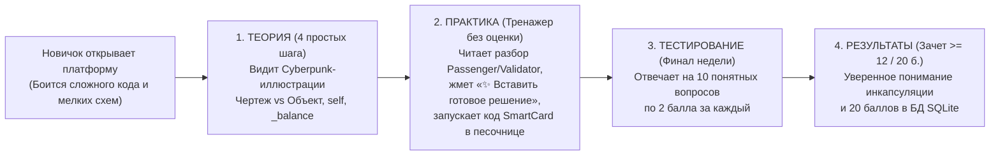

# HL — OOP_20261018-213107_W1MAT: Редизайн Недели 1: Основы ООП и Инкапсуляция для начинающих (Dark Cyberpunk UI, Тренажер без оценки и 20-балльный Квиз)

> **Current filename**: `HL-OOP_20261018-213107_W1MAT.md`  
> **Date**: 2026-10-18  
> **Author**: zhasulan  
> **Title**: Редизайн Недели 1: Основы ООП и Инкапсуляция для начинающих (Dark Cyberpunk UI, Тренажер без оценки и 20-балльный Квиз)  
> **Abbreviation**: W1MAT  
> **Status**: 🟡 TS_DRAFT — Awaiting TS approval  
> **Contract**: 🔒 FROZEN — approved by zhasulan 2026-10-18  
> **Frozen**: §1 · §3 · §4 · §5 · §6 · §7 — locked on owner approval  
> **Free**: §2 · §7.2 · §8 · §9 · §10 · §11 — research updates these directly  
> **Append-only**: §12 Amendment Log — the only channel for changing a frozen section  
> **Baseline**: freeze commits — recovery form in `conventions.md` §3 rule 15  
> **Project North Star**: `README.md § Цель и North Star проекта` · `.tfw/README.md #ns1 · #ns2`

---

## 1. Vision 🔒 FROZEN

В платформе Web-OOP реализован полностью переосмысленный учебный модуль **«Неделя 1 · Инкапсуляция»** в визуальном стиле **Dark Cyberpunk / Tech Modern**, спроектированный специально для студентов-новичков в ООП. Вместо перегруженных академических простыней, мелких нечитаемых UML-схем и пугающего написания больших классов с нуля на оценку, студент проходит единую связную воронку из 5 вкладок (`Главная` $\rightarrow$ `Теория` $\rightarrow$ `Практика` $\rightarrow$ `Тестирование` $\rightarrow$ `Результаты`): изучает 4 наглядных шага теории с кастомными Cyberpunk-иллюстрациями, свободно тренируется в интерактивной песочнице с построчным разбором (`Passenger` / `Validator`) и кнопкой мгновенной подстановки готового решения (`SmartCard`) без риска потерять баллы, а все **20.0 баллов** недели (10 вопросов $\times$ 2.0 балла, порог зачета $\ge 12.0$ баллов) зарабатывает в финальном итоговом тестировании.

**Impact:**
- **Для студентов-новичков (группа курса ООП):** Полное снятие страха перед кодингом с нуля — теория объясняет `class`, `object`, `__init__`, `self`, `_balance` и `@property` простым языком на одном сквозном примере `SmartCard`, тренажер позволяет экспериментировать и подставлять готовый код одной кнопкой без штрафов, а оценка выставляется прозрачно за финальный тест из 10 вопросов.
- **Для автора и преподавателя (@zhasulan, @saubakirov):** Современный интерфейс учебной платформы (Dark Cyberpunk / Tech Modern с двухуровневой навигацией по неделям и разделам), 20-балльная шкала оценивания и отсутствие «оторванных» от теории задач.
- **Для платформы Web-OOP:** Эталонная структура учебного модуля для последующих Недель 2 и 3.

> *«В первой версии я открыл сайт и ужаснулся: мелкая UML-диаграмма, которую невозможно разглядеть, куча несвязанных задач, где новичок с ходу должен писать сложный код, и квиз не на своем месте. После полной переделки в стиле Dark Cyberpunk всё наконец-то выстроилось в логичную цепочку: читаешь простую теорию с крутыми иллюстрациями, спокойно пробуешь код в тренажере с кнопкой готового решения без страха за баллы, а в конце проходишь тест на 10 вопросов и забираешь свои 20 баллов!»*  
> — *Воображаемый отзыв автора проекта Жасулана Куандыкова (@zhasulan) после запуска обновленной Недели 1.*

---

## 2. Current State (As-Is) 🟢 FREE

1. **Уроки первой итерации (почему старая Неделя 1 была удалена в коммите `3986ab8`):**
   - **Визуальные проблемы:** На главной странице висели технические блоки мониторинга и мелкая, сжатая Mermaid UML-диаграмма (`Passenger` / `Validator`), которую было трудно разглядеть и понять новичку.
   - **Методический разрыв:** Теория сразу вводила термины уровня *Anemic vs Rich Domain Model*, `Decimal`, `datetime`, а практические задачи требовали самостоятельного написания десятков строк кода на оценку. Для начинающих студентов (курс рассчитан на небольшую группу ребят, включая новичков в ООП) такой кодинг воспринимался как несвязанный и пугающий барьер.
   - **Перевернутая воронка:** Квиз стоял вторым шагом сразу после лекции (до практики) и давал всего 3 балла из 20, тогда как 17 баллов требовалось выбить написанием кода в двух разных вкладках («Практикум» и «Лабораторная»).

2. **Доступная техническая база (`OOP_20261015-022500_CORE`):**
   - Бэкенд на Python 3.12 + FastAPI, база данных SQLite + SQLAlchemy 2.0 (`Student`, `TopicProgress`, `Submission`).
   - Изолированная песочница `RunnerService` с AST-валидацией (`ASTValidator`) и запуском `pytest` с таймаутом 5 секунд.
   - Сгенерированы и подготовлены 3 кастомные иллюстрации в стиле **Dark Cyberpunk / Tech Modern** в `app/static/images/`:
     - `week1_hero.jpg` (баннер терминала и защищенной смарт-карты Neo-Avtobys);
     - `oop_blueprint.jpg` (концепт «Класс-чертеж $\rightarrow$ Объекты-карты»);
     - `oop_encapsulation.jpg` (концепт «Инкапсуляция: защитный кибер-щит вокруг `_balance`»).

3. **Прототип в рабочей ветке:**
   - В процессе живого обсуждения с владельцем (@zhasulan) был собран рабочий прототип редизайна (коммиты `fdce878`, `dc58974` + обновление `quiz.py` на 10 вопросов $\times$ 2 балла = 20 баллов), который теперь необходимо формализовать через канонический цикл TFW (`HL` $\rightarrow$ `TS` $\rightarrow$ `ONB/RF` $\rightarrow$ `REVIEW`) и довести все файлы (`theory.py`, `scoring.py`, `index.html`, `app.js`, `test_week1.py`) до полного соответствия 20-балльной шкале квиза.

---

## 3. Target State (To-Be) 🔒 FROZEN

Единая интерактивная учебная платформа Недели 1 в стиле **Dark Cyberpunk / Tech Modern** со следующей архитектурой и правилами:

1. **Двухуровневая навигация и шапка (по визуальному референсу владельца):**
   - Шапка: неоновый логотип `ООП`, заголовок **«Учебная платформа»**, подзаголовок **«Учимся вместе • Web-OOP»**, карточка студента и счетчик баллов `X / 20.0 б.` со статусом (`В ПРОЦЕССЕ` / `ЗАЧЕТ ПОЛУЧЕН`).
   - Ряд 1 (Выбор недели): `Неделя 1 · Инкапсуляция` (активная), `Неделя 2 · SOLID и DI` (Скоро), `Неделя 3 · Паттерны GoF` (Скоро).
   - Ряд 2 (Вкладки модуля): `Главная` · `Теория` · `Практика` · `Тестирование` · `Результаты`.
   - Полный отказ от рендеринга мелких Mermaid UML-диаграмм в веб-интерфейсе (справочный UML остается только в `docs/domain_model_uml.md`).

2. **Связная образовательная воронка для новичков:**
   - **Вкладка 1 (`Главная`):** Hero-баннер с `week1_hero.jpg`, описание модуля без сложного жаргона, 3 карточки маршрута обучения (`01. Теория на пальцах` $\rightarrow$ `02. Практика: Тренажер без оценки` $\rightarrow$ `03. Итоговое Тестирование: 20 баллов`) и сводка прогресса.
   - **Вкладка 2 (`Теория`):** 4 последовательных шага на едином примере `SmartCard` с иллюстрациями `oop_blueprint.jpg` и `oop_encapsulation.jpg`:
     1. Проблема обычных словарей (почему `card["balance"] = -99999` ломает систему) vs объект ООП.
     2. Класс (Чертеж) vs Объект (Реальная вещь) + 4 карточки анатомии (`Класс`, `Объект`, `Атрибуты`, `Методы`).
     3. Конструктор `__init__` и ссылка `self` простыми словами с построчным разбором.
     4. Инкапсуляция: приватное поле `self._balance`, чтение через `@property` и методы-охранники `top_up()` и `pay()`.
   - **Вкладка 3 (`Практика` — Свободный тренажер БЕЗ требования баллов):**
     - *Часть 1:* Построчный разбор готового кода взаимодействия двух классов `Passenger` и `Validator`.
     - *Часть 2:* Интерактивный тренажер из 3 пошаговых задач по сборке класса `SmartCard` (`task_1`: `__init__` и `info()`, `task_2`: `_balance`, `@property` и `top_up()`, `task_3`: метод оплаты `pay()`).
     - **Ключевое правило для новичков:** Практика не требует и не отнимает баллы (`0 баллов` в оценке недели). В каждом шаге есть кнопка **«💡 Показать текстовую подсказку»** и кнопка **«✨ Вставить готовое решение»**, которая в один клик подставляет эталонный код в редактор для запуска в `RunnerService`.
   - **Вкладка 4 (`Тестирование` — Итоговый Квиз на 20.0 баллов):**
     - Финальный проверочный тест в конце воронки из **10 вопросов** с выбором одного варианта ответа (`A`, `B`, `C`, `D`).
     - Каждый правильный ответ приносит **2.0 балла** (максимум **20.0 баллов** за неделю, порог зачета: **$\ge 12.0$ баллов**, т.е. минимум 6 правильных ответов из 10).
     - Мгновенная проверка с подробным обучающим пояснением под каждым вопросом и защитой лучшего результата (High-Water Mark).
   - **Вкладка 5 (`Результаты`):**
     - Шкала прогресса `0.0 / 20.0 б.` (порог зачета `12.0 б.`), статус итогового теста и статус прохождения 3 шагов тренажера (`✅ Пройдено` / `По желанию`).

### 3.1 Result Visualization

#### Сравнение As-Is (Удаленная версия) $\rightarrow$ To-Be (Новый модуль Недели 1)

| Параметр | Было (Удаленная версия W1MAT) | Станет (Новый дизайн Недели 1) | Видимая ценность для студента-новичка |
|---|---|---|---|
| **Визуальный стиль и UML** | Светлый технический дашборд + мелкая сжатая Mermaid UML-схема на экране | **Dark Cyberpunk / Tech Modern** (`#070b14`, неон) + 3 сгенерированные иллюстрации (`week1_hero.jpg`, `oop_blueprint.jpg`, `oop_encapsulation.jpg`), без мелкого Mermaid на сайте | Красивый современный интерфейс, крупные и понятные визуальные образы вместо нечитаемых схем |
| **Навигация** | Разрозненные страницы `/` и `/week1` с 4 табами | Единая шапка по референсу: `ООП · Учебная платформа` $\rightarrow$ `Неделя 1 · Инкапсуляция` $\rightarrow$ `Главная \| Теория \| Практика \| Тестирование \| Результаты` | Интуитивная навигация в один клик без перезагрузки страницы |
| **Сложность и связность** | Академический жаргон (*Anemic vs Rich*, `Decimal`, `datetime`), сложные классы с нуля | Объяснение с нуля на пальцах, единый сквозной класс `SmartCard` от первой строчки теории до конца практики и теста | 100% связность: новичок понимает каждую строчку кода |
| **Роль Практики и Кодинга** | Обязательный кодинг на 17 из 20 баллов (новичок застревает и не может сдать неделю) | **Свободный тренажер без оценки** + разбор готового примера `Passenger`/`Validator` + кнопка **«✨ Вставить готовое решение»** | Нет страха перед чистым листом: можно учиться на готовом коде и запускать его в песочнице |
| **Место и вес Квиза** | Вторая вкладка сразу после лекции, всего 3 балла | **Финальный этап (`Тестирование`) в конце недели: 10 вопросов $\times$ 2.0 б. = 20.0 баллов** (зачет от 12.0 б.) | Честная и посильная проверка понимания по итогам всей недели по 20-балльной шкале |

#### Визуальный макет интерфейса (Dark Cyberpunk / Tech Modern)

```
+--------------------------------------------------------------------------------------------------+
|  [ ООП ]  Учебная платформа                         Студент: Жасулан Куандыков                   |
|           Учимся вместе • Web-OOP                   Баллы (Тест): [ 20.0 / 20.0 б. ] [ЗАЧЕТ]     |
|--------------------------------------------------------------------------------------------------|
|  ( Неделя 1 · Инкапсуляция )   [ Неделя 2 · SOLID и DI (Скоро) ]   [ Неделя 3 · GoF (Скоро) ]    |
|--------------------------------------------------------------------------------------------------|
|  [ Главная ]   [ Теория ]   [ Практика ]   [ Тестирование ]   [ Результаты ]                     |
+--------------------------------------------------------------------------------------------------+
|                                                                                                  |
|  Вкладка «ПРАКТИКА» (Свободный тренажер без снятия баллов):                                      |
|  +--------------------------------------------------------------------------------------------+  |
|  | ЧАСТЬ 1: Наглядный разбор готового кода (Passenger + Validator) с пояснением по шагам      |  |
|  +--------------------------------------------------------------------------------------------+  |
|  | ЧАСТЬ 2: Тренажер SmartCard:  [✅ Шаг 1 из 3]   [✅ Шаг 2 из 3]   [✅ Шаг 3 из 3]           |  |
|  | +----------------------------------------+ +---------------------------------------------+ |  |
|  | | Шаг 3. Безопасная оплата pay()         | | solution.py  [✨ Вставить готовое решение]  | |  |
|  | | 1. Проверьте fare > 0 и _balance>=fare | | class SmartCard:                            | |  |
|  | | 2. Вычтите fare и верните True         | |     def pay(self, fare: int) -> bool:       | |  |
|  | | [💡 Показать текстовую подсказку]      | |         if fare > 0 and self._balance>=fare:| |  |
|  | +----------------------------------------+ | [▶ Запустить код] -> ✅ ОТЛИЧНО! КОД ВЕРНЫЙ | |  |
|  |                                            +---------------------------------------------+ |  |
|  +--------------------------------------------------------------------------------------------+  |
|                                                                                                  |
|  Вкладка «ТЕСТИРОВАНИЕ» (Финальный зачет недели: 10 вопросов x 2.0 б. = 20.0 баллов):            |
|  +--------------------------------------------------------------------------------------------+  |
|  | Вопрос 10 / 10: У карты баланс 100 тг, а проезд стоит 120 тг. Что сделает card.pay(120)?   |  |
|  |   (A) Спишет 120 тг и оставит -20 тг                                                       |  |
|  |   (B) [ВЫБРАНО] Проверит self._balance >= fare, оставит 100 тг и вернет False              |  |
|  |   ✅ Верно (+2 балла)! Объект сам защищает свои правила и не дает балансу уйти в минус.    |  |
|  |                                                       [ Проверить ответы теста (20 / 20) ] |  |
|  +--------------------------------------------------------------------------------------------+  |
+--------------------------------------------------------------------------------------------------+
```
*(Иллюстративные данные состояния после прохождения модуля)*

### 3.2 Value Flow



---

## 4. Phases 🔒 FROZEN

Задача реализуется в **1 фазу (Single-Phase Task)**, так как затрагивает только модуль Недели 1 (~15 файлов, ~2100 строк кода, что значительно ниже порогов декомпозиции в 50 файлов и 5000 LOC).

### 4.1 Coordination Selection 🔒 FROZEN

| Activation source | Accountable owner | Task Coordinator unit | Phase Coordinator rule | Mandate scope / role reach | Upward route | Dialogue | Reporting | Reservations / controls | Amendment authority | Immutable epoch |
|---|---|---|---|---|---|---|---|---|---|---|
| owner-direct | zhasulan | `antigravity:thread:local:1da46223-edb5-410d-bad6-cd3c36954a1f` | none (one-phase task) | Single task `OOP_20261018-213107_W1MAT` (`PLAN`, `HANDOFF`, `REVIEW`) | `owner:zhasulan` | `tfw-gates-only` | `native-gates` | Owner approves HL, TS, and final acceptance | `none` (owner-only) | `3986ab88191068ef60a197805b80c7c7ee1c5c3b` |

### Phase A: Реализация и верификация модуля Недели 1 (Dark Cyberpunk UI, Тренажер без оценки и 20-балльный Квиз) 🔴

- **Deliverables:**
  1. Контентный пакет `app/content/week_1/` (`theory.py`, `practice.py`, `quiz.py`, `__init__.py`) с 4 шагами теории для новичков, разбором `Passenger`/`Validator`, 3 пошаговыми тренажерами `SmartCard` с эталонными решениями и финальным тестом из **10 вопросов по 2.0 балла (20.0 баллов максимум)**.
  2. Сгенерированные Cyberpunk-иллюстрации в `app/static/images/` (`week1_hero.jpg`, `oop_blueprint.jpg`, `oop_encapsulation.jpg`).
  3. Сервис `app/services/scoring.py` и роутер `app/routers/week1.py`, реализующие 20-балльную оценку исключительно по результатам итогового Тестирования (`TOTAL_MAX_SCORE = 20.0`, `PASS_THRESHOLD = 12.0`, High-Water Mark) и учет тренажера Практики без требования баллов.
  4. Единый интерфейс платформы `app/templates/index.html`, стили `app/static/css/style.css` и контроллер `app/static/js/app.js` в стиле Dark Cyberpunk / Tech Modern с 5 вкладками (`Главная`, `Теория`, `Практика`, `Тестирование`, `Результаты`) и кнопкой «✨ Вставить готовое решение».
  5. Полный набор автотестов `tests/test_week1.py` (вместе с базовыми `test_health.py`, `test_models.py`, `test_runner.py`).

---

## 5. Definition of Done (DoD) 🔒 FROZEN

- ✅ 1. На маршрутах `GET /` и `GET /week1` рендерится единый интерфейс «Учебная платформа · Учимся вместе» в стиле Dark Cyberpunk / Tech Modern с переключателем недель и 5 вкладками (`Главная`, `Теория`, `Практика`, `Тестирование`, `Результаты`), без мелких Mermaid UML-диаграмм на странице.
- ✅ 2. Вкладка «Теория» содержит 4 пошаговых раздела для новичков со сквозным классом `SmartCard` и встроенными Cyberpunk-иллюстрациями (`/static/images/week1_hero.jpg`, `/static/images/oop_blueprint.jpg`, `/static/images/oop_encapsulation.jpg`).
- ✅ 3. Вкладка «Практика» включает построчный разбор примера `Passenger`/`Validator` и 3 связанных шага тренажера `SmartCard` с кнопками «💡 Показать текстовую подсказку» и «✨ Вставить готовое решение», не требуя баллов для зачета недели.
- ✅ 4. Вкладка «Тестирование» (в конце воронки) содержит 10 вопросов с выбором вариантов ответа по 2.0 балла за каждый (`20.0` баллов максимум, порог зачета `12.0` баллов), проверяет ответы через `POST /api/week1/quiz/check` и сохраняет лучший результат в SQLite (`TopicProgress`) по правилу High-Water Mark.
- ✅ 5. Все тесты `pytest` (20 тестов) и проверка линтера `ruff check .` проходят без ошибок.

---

## 6. Definition of Failure (DoF) 🔒 FROZEN

- ❌ 1. Для получения зачета или баллов по Неделе 1 от студента требуется обязательное написание кода в разделе «Практика».
- ❌ 2. Максимальный балл за Неделю 1 отличается от `20.0` баллов (или порог зачета отличается от `12.0` баллов).
- ❌ 3. На страницах сайта отображаются мелкие/нечитаемые Mermaid UML-диаграммы или старый технический дашборд мониторинга.
- ❌ 4. Нарушена изоляция `RunnerService` или падают существующие тесты ядра (`test_health.py`, `test_models.py`, `test_runner.py`).

**On failure:** Откат некорректных изменений, исправление логики начисления баллов или шаблонов и повторная проверка через `pytest` и `ruff`.

---

## 7. Principles 🔒 FROZEN

1. **Beginner-First Connected Pedagogy (Связность для новичков):** Одно понятие за шаг, один сквозной объект `SmartCard` через всю неделю, нулевой порог входа.
2. **Zero-Stress Practice Sandbox (Практика без страха оценки):** Тренажер кода служит для обучения и эксперимента (с готовыми подсказками и подстановкой ответа в один клик), а не для штрафования новичков.
3. **Quiz-Driven 20-Point Assessment (Итоговый тест в конце на 20 баллов):** Вся оценка недели (`10 вопросов × 2 балла = 20 баллов`) формируется в финальном тестировании после знакомства с теорией и практикой.
4. **Dark Cyberpunk / Tech Modern Visual Clarity:** Высококонтрастный темный интерфейс с крупными иллюстрациями вместо слепых мелких диаграмм.

### 7.2 Knowledge Citations 🟢 FREE

| # | Source | Item | How it applies |
|---|---|---|---|
| 1 | `README.md` | `§ Цель и North Star проекта` (P0 — Project North Star) | Определяет тематику Недели 1 (переход от процедурного стиля к объектам и инкапсуляции на домене Avtobys). |
| 2 | `.tfw/README.md` | `§ NS1 — Purpose`, `§ NS2 — Principles`, `§ Methodology values` (P1 — Methodology Values) | Принцип Сент-Экзюпери и Candor Over Flattery: честный отказ от перегруженной первой версии модуля и упрощение воронки ради реальной пользы для студентов-новичков. |
| 3 | `knowledge/philosophy.md` | N/A (P2) | Файл `knowledge/philosophy.md` в проекте отсутствует; философские ориентиры зафиксированы в `KNOWLEDGE.md` и `.tfw/README.md`. |
| 4 | `KNOWLEDGE.md` | `§1 Architecture Decisions: D1, D2, D3, D4, D5` (P3) | Сохраняет стек FastAPI + SQLite + Pytest + Jinja2 + Tailwind CDN (`D1`, `D5`), домен Avtobys (`D2`), проверку кода через `RunnerService` (`D3`) и хранение справочного UML в `docs/` (`D4`). |
| 5 | `.tfw/conventions.md` | `§3 HL (High Level)`, `§14 Design Rules`, `§15 Role Lock Protocol` (P4) | Управляет структурой артефактов задачи, правилами заморозки контракта и разделением ролей. |
| 6 | `KNOWLEDGE.md` | `§4 Project Facts: F1, F2, F3, F4` (P7) | Учитывает целевую аудиторию 2 курса с новичками (`F1`), роли участников `@zhasulan` и `@saubakirov` (`F2`), локальный запуск (`F3`) и песочницу `RunnerService` (`F4`). |

---

## 8. Dependencies 🟢 FREE

| Dependency | Status |
|---|---|
| `OOP_20261015-022500_CORE` (Фундамент платформы: FastAPI, SQLite, RunnerService) | ✅ DONE |
| Сгенерированные Cyberpunk-иллюстрации в `app/static/images/` | ✅ Готовы |

---

## 9. Risks 🟢 FREE

| Risk | Probability | Impact | Mitigation |
|---|---|---|---|
| R1. Новичок пропускает практику, так как за нее не дают баллы, и сразу идет в тест | Medium | Low | Вопросы итогового теста напрямую опираются на код `SmartCard` из теории и тренажера, а кнопка «✨ Вставить готовое решение» делает прохождение тренажера быстрым и интересным (занимает 2 минуты). |
| R2. Совместимость со старым тестом `test_health.py`, проверяющим наличие маркеров в `GET /` | Low | Medium | Сохранить необходимые маркеры (`Web-OOP`, `cdn.tailwindcss.com`, `Passenger`, `Validator`, комментарий `cdn.jsdelivr.net/npm/mermaid`) в `app/templates/index.html`. |

---

## 10. RESEARCH Case 🟢 FREE

### Blind Spots
- Все продуктовые, педагогические и визуальные развилки были напрямую прояснены и проверены с владельцем (@zhasulan) на живом прототипе.

### Hypotheses

| # | Hypothesis | Status |
|---|---|---|
| — | Нет открытых гипотез, меняющих архитектурное или продуктовое решение (потребность в отдельном этапе `/tfw-research` отсутствует; после утверждения HL переходим сразу к составлению TS). | closed |

### Risks of Not Researching
Нулевые: стек Zero-Build, иллюстрации, структура из 5 вкладок и 10 вопросов теста уже спроектированы и согласованы с владельцем.

### Proposed RESEARCH Focus
Этап `/tfw-research` не требуется (пропускается по решению координатора и владельца ввиду полной определенности требований).

### Why Not Just...?

| Approach | Value | Adoption / operating burden | Risks / tradeoffs | Decision and reason |
|---|---|---|---|---|
| **Вариант 1 (Рекомендуемый): Связная воронка для новичков (Теория $\rightarrow$ Тренажер без оценки с 1-клик решением $\rightarrow$ Итоговый Квиз 10 вопросов $\times$ 2 б. = 20 б.) в стиле Dark Cyberpunk** | Полностью снимает страх перед кодингом у новичков, дает красивую визуализацию и прозрачную 20-балльную оценку за финальный тест | Низкая нагрузка: работает поверх готового `RunnerService` и Zero-Build UI | Тренажер не заставляет писать код из-под палки, делая ставку на интерес и понимание | **Выбрано владельцем (@zhasulan):** идеально подходит для реального уровня группы и дает 20 баллов без фрустрации |
| **Вариант 2: Обязательный кодинг на баллы (14 б. за код + 6 б. за квиз)** | Принуждает студента писать код ради получения зачета | Высокий порог входа: новички застревают на синтаксисе и бросают модуль | Студенты без опыта не могут с ходу написать методы и демотивируются | **Отклонено владельцем:** «честно вряд ли кто-то сможет с ходу написать код — пусть баллы мы получим только в квизе» |
| **Вариант 3: Только текстовая лекция и тест (вообще без интерактивного тренажера кода)** | Максимальная простота реализации | Нулевая нагрузка | Студент вообще не видит, как запускается и тестируется живой Python-код | **Отклонено:** наличие интерактивного тренажера с готовым решением позволяет пощупать код руками без стресса |

**Leave unchanged:** Если оставить удаленную первую версию или незавершенный прототип без плана и 20-балльной шкалы, курс либо отпугнет новичков сложным кодингом и мелкими UML, либо не впишется в 20-балльную академическую ведомость недели.

**Critical challenge:** *Не приведет ли перенос всех 20 баллов в итоговый тест из 10 вопросов к тому, что тест можно просто угадать перебором?*  
— **Ответ и защита:** В тесте 10 осмысленных вопросов по 4 варианта ответа в каждом (вероятность случайного угадывания на зачет $\ge 6/10$ составляет менее $2\%$). При этом после каждой попытки под вопросами выводятся подробные обучающие объяснения, так что даже при повторном прохождении студент гарантированно разбирается в сути `class`, `self`, `__init__`, `_balance` и `@property`.

---

## 11. Strategic Insights (Planning) 🟢 FREE

| # | Insight | Category | Source |
|---|---|---|---|
| S1 | Курс создается для малой группы (3 человека), где есть полные новички в ООП; поэтому теория, примеры и задачи должны быть предельно простыми, пошаговыми и связанными одной историей, а квиз должен завершать неделю как итоговая проверка. | Stakeholder Priority / Pedagogy | User (@zhasulan), обсуждение редизайна Недели 1 |
| S2 | Требование писать код с нуля на оценку блокирует новичков — практический кодинг должен быть свободным тренажером с возможностью подставить готовое решение, а все 20 баллов недели должны начисляться за итоговый квиз. | Domain / Assessment Rule | User (@zhasulan), ревью живого прототипа |
| S3 | Мелкие автоматически сгенерированные Mermaid UML-диаграммы в интерфейсе сайта портят восприятие — в UI нужны крупные кастомные иллюстрации и карточки в стиле Dark Cyberpunk / Tech Modern, а UML-схемы должны храниться только в файлах документации. | UX / Visual Direction | User (@zhasulan), критика первой итерации |

---

## 12. Amendment Log 🟢 APPEND-ONLY

**No amendments.**

### Material handover at this return

- **Producer / unit:** Task Coordinator (`antigravity:thread:local:1da46223-edb5-410d-bad6-cd3c36954a1f`)
- **Source / epoch:** `dc58974` (working tree includes updated 10-question / 20-point `app/content/week_1/quiz.py`)
- **Inspected scope:** `README.md`, `KNOWLEDGE.md`, `.tfw/README.md`, `.tfw/conventions.md`, `app/content/week_1/*`, `app/services/scoring.py`, `app/routers/week1.py`, `app/templates/index.html`, `app/static/js/app.js`, `tests/test_week1.py`
- **Material findings:** Сформирован полный план `HL-OOP_20261018-213107_W1MAT.md` на основе всех замечаний владельца; для полного завершения реализации на этапе исполнения (`TS` $\rightarrow$ `/tfw-handoff`) остается синхронизировать шкалу `20.0` баллов (`PASS_THRESHOLD = 12.0`) в `scoring.py`, `theory.py`, `index.html`, `app.js` и `tests/test_week1.py`.
- **Uncertainty:** Отсутствует.
- **Recipient & continuation:** Владелец (`owner:zhasulan`) для утверждения `HL-OOP_20261018-213107_W1MAT.md` и выбора режима координации, после чего Координатор заморозит HL и подготовит `TS__OOP_20261018-213107_W1MAT.md`.

---

*HL — OOP_20261018-213107_W1MAT: Редизайн Недели 1: Основы ООП и Инкапсуляция для начинающих (Dark Cyberpunk UI, Тренажер без оценки и 20-балльный Квиз) | 2026-10-18*
