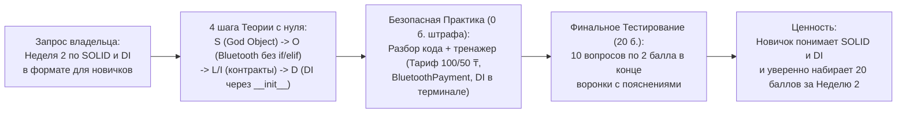

# HL — OOP_20261018-222800_W2SOL: Модуль Недели 2: Принципы SOLID и Dependency Injection для начинающих (Dark Cyberpunk UI, Тренажер без оценки и 20-балльный Квиз)

> **Current filename**: `HL-OOP_20261018-222800_W2SOL.md`
> **Date**: 2026-10-18
> **Author**: zhasulan
> **Title**: Модуль Недели 2: Принципы SOLID и Dependency Injection для начинающих (Dark Cyberpunk UI, Тренажер без оценки и 20-балльный Квиз)
> **Abbreviation**: W2SOL
> **Status**: 🔒 FROZEN — Approved by owner
> **Contract**: 🔒 FROZEN — approved by zhasulan 2026-10-18
> **Frozen**: §1 · §3 · §4 · §5 · §6 · §7 — locked on owner approval
> **Free**: §2 · §7.2 · §8 · §9 · §10 · §11 — research updates these directly
> **Append-only**: §12 Amendment Log — the only channel for changing a frozen section
> **Baseline**: freeze commits — recovery form in `conventions.md` §3 rule 15
> **Project North Star**: `README.md § Цель и North Star проекта` · `.tfw/README.md #methodology-values · #success-criteria`
> **Producer unit**: `antigravity:thread:local:1da46223-edb5-410d-bad6-cd3c36954a1f`
> **Parent Coordinator**: `owner:zhasulan`
> **Activation / dispatch source**: `owner-direct (/tfw-plan)`
> **Coordination authority**: `HL-OOP_20261018-222800_W2SOL.md @ frozen`
> **Originating proposer**: `{principal: zhasulan, unit: antigravity:thread:local:1da46223-edb5-410d-bad6-cd3c36954a1f}`
> **Current selection**: `reporting: native-gates, selection_ref: baseline`

---

## 1. Vision 🔒 FROZEN

В учебной платформе **Web-OOP** открыт согласованный интерактивный модуль **«Неделя 2 · SOLID и DI»**, объединяющий теорию, практику и самопроверку в едином стиле **Dark Cyberpunk / Tech Modern**. На одном последовательном примере автобусного терминала оплаты Avtobys (где расчет тарифа — например, обычная карта `100 ₸` и студенческая `StudentFareService = 50 ₸`, а также способы оплаты `SmartCard`, `KaspiQR`, `BluetoothPayment` — вынесены в отдельные независимые компоненты и подключаются через конструктор) студент-новичок понимает, как разделять обязанности классов (**SRP**), расширять поведение без переписывания старого кода (**OCP**), соблюдать честные контракты (**LSP**, **ISP**) и передавать зависимости снаружи (**DIP / Dependency Injection**). Предоставленные эталонные решения и свободный тренажер (`0.0` баллов штрафа, кнопка «✨ Вставить готовое решение») явно отделены от проверки понимания в финальном тестировании на **20.0 баллов** (`10 вопросов × 2.0 балла`, порог зачета $\ge 12.0$ баллов) с сохранением прогресса Недели 1.

**Impact:** Владелец и одногруппники (включая начинающих студентов) получают понятный учебный маршрут по второй неделе курса без перегрузки академическим формализмом, свободно переключаются между Неделей 1 (`20` б.) и Неделей 2 (`20` б.) и проверяют свои знания в 20-балльном квизе.

> *«На примере терминала Avtobys со студенческим тарифом 50 ₸ и подключением Bluetooth-оплаты я наконец понял, почему не надо лепить всё в один класс-монстр и как передача компонентов через \_\_init\_\_ позволяет расширять программу без поломки старого кода. Потренировался в песочнице с готовыми примерами и сдал тест из 10 вопросов на 20 из 20 баллов!»* — явно воображаемая реплика студента курса.

---

## 2. Current State (As-Is) 🟢 FREE

1. **Принятый фундамент и Неделя 1 (`OOP_20261015-022500_CORE`, `OOP_20261018-213107_W1MAT` — оба `DONE`):**
   - Git HEAD при входе: `18af536d2c97f21c5096cae3392a86ce84f9e681`.
   - В `app/` работает пятисекционный интерфейс Dark Cyberpunk (`Главная`, `Теория`, `Практика`, `Тестирование`, `Результаты`), роутер `app/routers/week1.py` и сервис `app/services/scoring.py` (`QUIZ_MAX_SCORE = 20.0`, `PASS_THRESHOLD = 12.0`, High-Water Mark).
   - В верхней панели переключателя недель кнопка `Неделя 1 · Инкапсуляция` активна, а кнопка `Неделя 2 · SOLID и DI` пока отображается со статусом `Скоро` (`disabled`).
2. **Методические источники Недели 2 (`C:\Users\kz444\OneDrive\Desktop\OOP`):**
   - **Лекция 4 (`RF__lecture_04.pdf`) и Лабораторная 4 (`RF__lab_04.pdf`):** Метрики `High Cohesion` и `Low Coupling`; антипаттерн `BusValidatorGodObject` / `SpaghettiValidator` и его декомпозиция по **SRP** (`NfcCardReader`, `FareCalculator` / `FareCalculationService`, `TransactionRepository`, `ValidatorDisplay`); устранение цепочек `if/elif` в `PaymentProcessor` через полиморфные стратегии оплаты (`SmartCard`, `KaspiQR`, `BluetoothPaymentStrategy`) по **OCP**.
   - **Лекция 5 (`RF__lecture_05.pdf`) и Лабораторная 5 (`RF__lab_05.pdf`):** Нарушение **LSP** на примере `FreeVolunteerPass` / `SocialFreePass`, выбрасывающего исключение в `charge(amount)`; нарушение **ISP** на примере «толстого» интерфейса `ITransitTerminal` с методом `print_paper_receipt()` для турникета без принтера; принцип **DIP** и паттерн **Dependency Injection (Constructor Injection)** в `TripValidator(db, buzzer)`.
3. **Квалифицированные знания и референсный материал владельца:**
   - В [KNOWLEDGE.md](../../../KNOWLEDGE.md) (`D6`, `F5`) и записи [REC-OOP_20261018-213107_W1MAT-human-beginner-format.md](../../../knowledge/records/REC-OOP_20261018-213107_W1MAT-human-beginner-format.md) закреплен формат для группы с новичками: простая пошаговая теория без мелких Mermaid-схем на сайте, необязательный тренажер с построчным разбором и кнопкой «✨ Вставить готовое решение» (`0.0` баллов) и 20-балльный финальный квиз из 10 вопросов (`10 × 2.0 = 20.0` б.).
   - Владелец также предоставил референсный материал по Неделе 2 (`SOLID и DI`), выделяющий удачный учебный кейс: отдельный сервис расчета стоимости проезда (**обычная карта — `100` у.е./₸, студенческая `StudentFareService` — `50` у.е./₸**) и подключение **Bluetooth-оплаты** к терминалу без изменения кода терминала.

### 2.1 Выбранные рабочие входы и воспроизводимость

Следующая таблица фиксирует SHA-256 хеши исходных методических PDF и ключевых файлов платформы на момент проектирования `HL` (`18af536d2c97f21c5096cae3392a86ce84f9e681`):

| Путь | SHA-256 исходных байтов | Роль входа |
|---|---|---|
| `C:\Users\kz444\OneDrive\Desktop\OOP\01_Лекции\RF__lecture_04.pdf` | `a5d93e29c2662134825003440538272dba97223f9475e1a40de2e568ee918c16` | Первоисточник: Cohesion/Coupling, SRP, OCP |
| `C:\Users\kz444\OneDrive\Desktop\OOP\01_Лекции\RF__lecture_05.pdf` | `2cb6f657105cd0ed0404db2675811371c61f498e4cf673606e41676532343e6a` | Первоисточник: LSP, ISP, DIP и Dependency Injection |
| `C:\Users\kz444\OneDrive\Desktop\OOP\02_Лабораторные\RF__lab_04.pdf` | `5145063b76cef20515a4322fa9aeb2df558a4e9d0baa98912aa6c008fb68dda0` | Первоисточник практики: рефакторинг монолита и `BluetoothPaymentStrategy` |
| `C:\Users\kz444\OneDrive\Desktop\OOP\02_Лабораторные\RF__lab_05.pdf` | `f524c894e80d10001c5c2eb33303ab9a7a85aeae50d48bece4a098c903bb9553` | Первоисточник практики: устранение нарушений LSP/ISP/DIP и DI |
| `app/main.py` | `d9f637cb0633a4785e77fb8ace2ff7a5a859d293cfda64da1da9ad168185a29b` | Точка входа FastAPI |
| `app/routers/week1.py` | `eb878f9883eb4209f7c9ed141a8a79721b103c1c673c514eaf1059a3c4ec3cd3` | Действующий роутер Недели 1 (образец контракта) |
| `app/services/scoring.py` | `0d0189e30b9f33525a192eca589da5dcc06ce11d21f40622e41a146558e2313f` | Сервис оценивания (`20.0` б. квиз, High-Water Mark) |
| `app/templates/index.html` | `70b6b113e9ee952905699dce19058190d181f49aacc6a69cc93f303bf09527c9` | Единый шаблон платформы Dark Cyberpunk |
| `app/static/js/app.js` | `f90e17afb2858c199125a5a98e153454965deb8368a23554a76733c04eef800e` | Клиентская логика вкладок, тренажера и квиза |
| `app/static/css/style.css` | `21727a503e7997be01c9d63a85bd74962362c150ed05667c508083abd535e152` | Стили Dark Cyberpunk / Tech Modern |

### 2.2 Полный список 10 вопросов Финального Тестирования Недели 2 (`10 × 2.0 = 20.0` баллов)

1. **`w2_q1` (`2.0` б. · Буква `S` — Single Responsibility Principle и антипаттерн God Object):**
   *Вопрос:* Программист написал один гигантский класс `BusValidator`, который одновременно читает NFC-чип карты, считает скидку студента (`100 ₸` / `50 ₸`), отправляет SQL-запросы в базу данных и мигает лампочками экрана. Как называется такой антипаттерн и какой принцип SOLID он нарушает в первую очередь?
   - `a)` Антипаттерн «Инкапсуляция» — нарушение принципа подстановки Лисков (`LSP`).
   - ✅ **`b)` Антипаттерн «Божественный объект» (`God Object`) — нарушение Принципа единственной ответственности (`SRP`: у класса должна быть только одна причина для изменения).**
   - `c)` Антипаттерн «Полиморфизм» — нарушение принципа разделения интерфейса (`ISP`).
   - `d)` Это идеальная архитектура: чем меньше файлов в проекте, тем надежнее код.
2. **`w2_q2` (`2.0` б. · Метрики качества `High Cohesion` и `Low Coupling` из Лекции 4):**
   *Вопрос:* В хорошей архитектуре ООП мы стремимся к **высокому зацеплению (`High Cohesion`)** и **слабой связанности (`Low Coupling`)**. Что это означает простыми словами на примере автобусного терминала?
   - `a)` Все классы должны знать внутренние приватные поля друг друга и храниться в одном файле.
   - ✅ **`b)` Каждый класс сфокусирован только на своей задаче (`High Cohesion`, например `StudentFareService` считает только тариф `50 ₸`), а классы общаются через простые контракты и почти не зависят от переделки соседей (`Low Coupling`).**
   - `c)` Нельзя создавать больше двух классов в одной программе.
   - `d)` Методы класса никогда не должны принимать аргументы.
3. **`w2_q3` (`2.0` б. · Буква `O` — Open/Closed Principle, проблема `if/elif`):**
   *Вопрос:* В методе оплаты терминала написано: `if type == "card": ... elif type == "qr": ...`. Когда добавили оплату по Bluetooth (`BluetoothPayment`), а затем Apple Pay, программисту пришлось снова и снова вскрывать и переписывать этот метод, рискуя сломать старую оплату картой. Какой принцип SOLID здесь нарушен?
   - `a)` Принцип единственной переменной (`SVP`).
   - ✅ **`b)` Принцип открытости/закрытости (`OCP` — Open/Closed Principle): код должен быть открыт для расширения новыми способами оплаты, но закрыт для переписывания уже работающего класса.**
   - `c)` Принцип удаления старого кода (`DCP`).
   - `d)` Принцип запрета условных операторов в Python.
4. **`w2_q4` (`2.0` б. · Буква `O` — как правильно применить OCP на практике):**
   *Вопрос:* Как исправить код терминала по принципу **Open/Closed (`OCP`)**, чтобы добавление оплаты через `BluetoothPayment` или `Crypto` не требовало менять ни одной строчки в самом классе `TerminalValidator`?
   - `a)` Скопировать класс `TerminalValidator` в 5 разных файлов для каждого способа оплаты.
   - ✅ **`b)` Выделить общий контракт (например, метод `pay(amount)`) и создавать для каждого нового способа оплаты отдельный класс (`CardPayment`, `KaspiQRPayment`, `BluetoothPayment`), передавая нужный объект в терминал.**
   - `c)` Заменить `if/elif` на цикл `while True`.
   - `d)` Хранить все способы оплаты в одной строковой переменной.
5. **`w2_q5` (`2.0` б. · Буква `L` — Liskov Substitution Principle, проблема «класса-предателя»):**
   *Вопрос:* Мы создали дочерний класс бесплатного проездного волонтера `FreeVolunteerPass(TransportCard)`, но в методе списания `charge(amount)` написали `raise NotImplementedError("У волонтеров нельзя списывать деньги!")`. Когда терминал вызвал `card.charge(100)`, вся система упала с ошибкой. Какой принцип SOLID нарушен?
   - `a)` Принцип открытости/закрытости (`OCP`).
   - ✅ **`b)` Принцип подстановки Барбары Лисков (`LSP`): дочерний класс должен честно выполнять контракт родителя и работать везде, где ожидается базовый класс, без внезапных аварий.**
   - `c)` Принцип разделения интерфейса (`ISP`).
   - `d)` Принцип единственной ответственности (`SRP`).
6. **`w2_q6` (`2.0` б. · Буква `L` — как исправить нарушение LSP):**
   *Вопрос:* Как правильно спроектировать льготный или бесплатный проездной (`FreeVolunteerPass` / `StudentFareService`), чтобы **НЕ нарушать** принцип подстановки Лисков (`LSP`) при проходе через терминал?
   - `a)` Внутри терминала написать `if isinstance(card, FreeVolunteerPass): pass` перед каждым списанием.
   - ✅ **`b)` Соблюдать общий контракт проверки проезда (например, метод `process_trip()` или сервис тарифа, списывающий `0 ₸` для волонтера и `50 ₸` для студента и возвращающий `True`), чтобы терминал работал с любой картой одинаково без ошибок.**
   - `c)` Отключить проверку оплаты для всех пассажиров автобуса.
   - `d)` Перехватывать все ошибки через пустой `except Exception: pass`.
7. **`w2_q7` (`2.0` б. · Буква `I` — Interface Segregation Principle, проблема «толстого интерфейса»):**
   *Вопрос:* Разработчик создал один общий интерфейс `ITransitDevice` с тремя обязательными методами: `scan_card()`, `beep()` и `print_paper_receipt()`. Из-за этого компактному автобусному валидатору (у которого вообще нет бумажного принтера!) пришлось писать пустую заглушку `def print_paper_receipt(self): pass`. Какой принцип SOLID нарушен?
   - `a)` Принцип инверсии зависимостей (`DIP`).
   - ✅ **`b)` Принцип разделения интерфейса (`ISP` — Interface Segregation Principle): клиенты не должны зависеть от «толстых» интерфейсов и методов, которые они не используют.**
   - `c)` Принцип единственной ответственности (`SRP`).
   - `d)` Принцип наследования атрибутов.
8. **`w2_q8` (`2.0` б. · Буква `D` — Dependency Inversion Principle, жесткая привязка внутри `__init__`):**
   *Вопрос:* Внутри конструктора валидатора жестко написано: `def __init__(self): self.db = PostgresDatabase()`. Почему такой код нарушает **Принцип инверсии зависимостей (`DIP`)** и мешает тестировать валидатор на обычном ноутбуке без поднятого сервера базы данных?
   - `a)` Потому что база данных PostgreSQL работает слишком медленно.
   - ✅ **`b)` Модуль верхнего уровня (бизнес-логика `TripValidator`) намертво привязан к конкретной детали нижнего уровня (`PostgresDatabase`) вместо абстракции, поэтому базу нельзя легко заменить на легкую `InMemoryDatabase` для тестов.**
   - `c)` Потому что в конструкторе `__init__` вообще нельзя создавать поля `self`.
   - `d)` Потому что название класса базы данных должно начинаться с маленькой буквы.
9. **`w2_q9` (`2.0` б. · Паттерн `Dependency Injection` — внедрение зависимостей через конструктор):**
   *Вопрос:* Вместо создания объектов внутри себя (`self.fare = StudentFareService()`), наш терминал принимает их снаружи как аргументы конструктора: `def __init__(self, fare_service, payment_method): self.fare = fare_service; self.payment = payment_method`. Как называется этот прием?
   - `a)` Инкапсуляция приватных полей.
   - ✅ **`b)` Внедрение зависимостей через конструктор (`Constructor Dependency Injection` / `DI`): внешние компоненты передаются объекту снаружи как детали конструктора LEGO.**
   - `c)` Множественное наследование классов.
   - `d)` Рекурсивный вызов конструктора.
10. **`w2_q10` (`2.0` б. · Итоговая сборка SOLID + DI на практике):**
    *Вопрос:* Мы собрали терминал `TerminalValidator(fare_service, payment_method)` по правилам **SOLID и DI**. Теперь нам нужно протестировать студенческий тариф (`StudentFareService` = `50 ₸`) и оплату через `BluetoothPayment` без настоящих банковских карт. Что нам достаточно сделать?
    - `a)` Переписать код класса `TerminalValidator`, закомментировав в нем все строки оплаты.
    - ✅ **`b)` Создать объекты `StudentFareService()` и `BluetoothPayment()` и передать их при создании: `TerminalValidator(StudentFareService(), BluetoothPayment())` — сам код `TerminalValidator` менять вообще не нужно!**
    - `c)` Удалить старый класс оплаты и переименовать тестовый класс в его имя.
    - `d)` Написать отдельный класс `TestTerminalValidator` с копией всего кода терминала.

---

## 3. Target State (To-Be) 🔒 FROZEN

Результат поручения — законченный локальный модуль **«Неделя 2 · SOLID и DI»** в существующем сайте **Web-OOP**, сохраняющий полную доступность и независимость результатов **Недели 1**. Все части модуля образуют единый последовательный маршрут (ориентировочный учебный план `60 мин теория + 60 мин практика + 60 мин самопроверка` — это методический ориентир, а не обещание измеренного темпа; все платежи и устройства в примерах имитируются):

1. **Переключатель недель и 5 вкладок в стиле Dark Cyberpunk / Tech Modern:**
   - В шапке сайта обе кнопки — **`Неделя 1 · Инкапсуляция`** (`/week1`) и **`Неделя 2 · SOLID и DI`** (`/week2`) — активны и позволяют переключаться между неделями без смешения результатов; `Неделя 3 · Паттерны GoF` остается со статусом `Скоро`.
   - Внутри Недели 2 работают 5 вкладок: `Главная` | `Теория` | `Практика` | `Тестирование` | `Результаты`.
2. **Визуальные иллюстрации Dark Cyberpunk (без мелких Mermaid-схем на сайте):**
   - 3 новые кастомные иллюстрации в `app/static/images/`:
     - `week2_hero.jpg` — модульный киберпанк-терминал Avtobys с подключаемыми голографическими блоками (NFC, Kaspi QR, Bluetooth).
     - `solid_modular.jpg` — визуальное сравнение: перегруженный искрящийся монолит «God Object» против 4 чистых специализированных модулей (SRP & OCP).
     - `di_ports.jpg` — концепт Dependency Injection: терминал с универсальными разъемами, к которым снаружи подключаются сменные модули тарифа (`100 ₸` / `50 ₸`) и базы данных (`PostgresDB` / `MemoryStorage`).
3. **Пошаговая Теория Недели 2 для новичков (`app/content/week_2/theory.py`):**
   - **Шаг 1 (`w2_step_1_srp`): Буква S (SRP) и метрики Cohesion/Coupling — почему «Класс-Монстр» (`God Object`) разваливается?** (Разделяем `BusValidatorGodObject` на специализированные компоненты: чтение карты, расчет тарифа `100 ₸` / `50 ₸`, сохранение чека).
   - **Шаг 2 (`w2_step_2_ocp`): Буква O (Open/Closed) — как добавлять `KaspiQR` и `BluetoothPayment` без 100 строк `if/elif`?** (Единый метод-контракт `pay(amount)`, при котором терминал открыт для расширения новыми способами оплаты, но закрыт для переписывания).
   - **Шаг 3 (`w2_step_3_lsp_isp`): Буквы L и I (Liskov & Interface Segregation) — честные наследники без `NotImplementedError` и компактные интерфейсы.** (Почему бесплатный/льготный проездной не должен взрывать метод оплаты неожиданным исключением, а компактному турникету без бумажного принтера не нужен метод `print_paper_receipt()`).
   - **Шаг 4 (`w2_step_4_dip_di`): Буква D (Dependency Inversion) и Dependency Injection — передаем зависимости через `__init__`.** (От жесткого создания `self.db = PostgresDatabase()` внутри конструктора к передаче готовых компонентов `fare_service`, `payment_method`, `storage` снаружи).
4. **Безопасная Практика-Тренажер без снятия баллов (`app/content/week_2/practice.py`):**
   - Открывается **построчным разбором готового кода** (`WALKTHROUGH_EXAMPLE`): как терминал `TerminalValidator` принимает сменный сервис тарифа и способ оплаты через `__init__` (4 шага разбора).
   - Содержит **3 связанных шага тренажера** на авторском примере из референса (`100 ₸` обычный / `50 ₸` студенческий тариф + `BluetoothPayment`):
     - `w2_task_1` (**SRP — Разделение расчета тарифа**): создать сервис расчета стоимости проезда `StudentFareService` (обычный тариф `100`, студенческий `50` у.е./₸), вынесенный из класса терминала.
     - `w2_task_2` (**OCP & LSP — Расширение способов оплаты без `if/elif`**): реализовать класс новой бесконтактной оплаты `BluetoothPayment` с тем же методом `pay(amount)`, что и у `CardPayment`, не меняя код процессора.
     - `w2_task_3` (**DIP & DI — Сборка терминала через конструктор**): подключить `fare_service` и `payment_method` в `TerminalValidator(fare_service, payment_method)` через `__init__` и провести оплату поездки.
   - В каждом упражнении есть кнопка **«✨ Вставить готовое решение»** (`fillSolutionCode`), автопроверка в изолированной песочнице `RunnerService` и **нулевое требование баллов (`0.0` б.)** — предоставленный пример и тренажер явно отделены от оцениваемого квиза.
5. **Финальное Тестирование (Квиз) в конце воронки на 20.0 баллов (`app/content/week_2/quiz.py`):**
   - **10 тестовых вопросов (`w2_q1`..`w2_q10`)** с выбором одного из 4 вариантов ответа и подробными обучающими пояснениями.
   - Каждый правильный ответ дает **2.0 балла**; максимум за Неделю 2 — **20.0 баллов** (порог зачета Недели 2: $\ge 12.0$ баллов, $60\%$).
   - Результаты сохраняются в SQLite с защитой лучшего результата **High-Water Mark** отдельно от Недели 1 (`w2_quiz`).

### 3.1 Result Visualization

```
====================================================================================================
  [ООП]  Учебная платформа                                    Неделя 2: 20.0 / 20.0 б. [ЗАЧЕТ ✅]
         Учимся вместе • Web-OOP
----------------------------------------------------------------------------------------------------
  [ Неделя 1 · Инкапсуляция ]   [ 💠 Неделя 2 · SOLID и DI (Активна) ]   [ Неделя 3 · GoF (Скоро) ]
----------------------------------------------------------------------------------------------------
  ( Главная )   ( Теория )   ( Практика )   ( 💠 Тестирование )   ( Результаты )
====================================================================================================

  +----------------------------------------------------------------------------------------------+
  | [ИЛЛЮСТРАЦИЯ: week2_hero.jpg — Модульный киберпанк-терминал Avtobys с блоками SOLID и DI]    |
  |                                                                                              |
  | НЕДЕЛЯ 2 · АРХИТЕКТУРА КЛАССОВ: 5 ПРИНЦИПОВ SOLID И DEPENDENCY INJECTION                     |
  | Маршрут недели (ориентир 60 + 60 + 60 мин):                                                  |
  |   1. Теория (4 шага: S -> O -> L & I -> D + DI)  [Изучить]                                   |
  |   2. Практика (Разбор примера + 3 шага тренажера: Тариф 100/50 ₸, Bluetooth, DI · 0 б.)      |
  |   3. Финальное Тестирование (10 вопросов × 2 балла = 20 баллов за неделю) [Сдать тест]       |
  +----------------------------------------------------------------------------------------------+

  [Вкладка "Теория" — 4 простых шага с иллюстрациями solid_modular.jpg и di_ports.jpg]:
    [Шаг 1: S — Одно дело, а не Класс-Монстр] -> [Шаг 2: O — Оплата Bluetooth/QR без if/elif]
    -> [Шаг 3: L и I — Без сюрпризов и лишних кнопок] -> [Шаг 4: D и DI — Детали через __init__]

  [Вкладка "Практика" — Свободный тренажер в песочнице без потери баллов]:
    +------------------------------------------------------------------------------------------+
    | Разбор готового примера: как TerminalValidator разделяет расчет тарифа и способ оплаты    |
    +------------------------------------------------------------------------------------------+
    | Тренажер (По желанию · 0 баллов штрафа · Готовое решение отделено от оценки квиза):      |
    | [Задача 1: StudentFareService (100/50 ₸)] [Задача 2: BluetoothPayment] [Задача 3: DI]    |
    | [▶ Проверить в песочнице]  [💡 Подсказка]  [✨ Вставить готовое решение]                 |
    +------------------------------------------------------------------------------------------+

  [Вкладка "Тестирование" — Итоговый Квиз Недели 2 (20.0 баллов = 100% оценки недели)]:
    +------------------------------------------------------------------------------------------+
    | Вопрос 1 из 10 (2.0 балла): Программист написал один гигантский класс BusValidator,      |
    | который сам читает чип карты, считает тариф 100/50 ₸, пишет SQL в БД и мигает экраном... |
    |   (•) «Божественный объект» (God Object) — нарушение Single Responsibility Principle     |
    | ... (Вопросы 2..10 по всем принципам SOLID, Cohesion/Coupling и Dependency Injection)    |
    | [ 🏆 Отправить ответы и получить до 20 баллов ]                                          |
    +------------------------------------------------------------------------------------------+
```

**Сравнение Before / After (До и После):**

| Измерение | До (После закрытия Недели 1) | После (Модуль Недели 2 `W2SOL`) | Видимая польза |
|---|---|---|---|
| **Переключатель недель в шапке** | Активна только `Неделя 1 · Инкапсуляция`; `Неделя 2 · SOLID и DI` заблокирована (`Скоро`). | Обе кнопки (`Неделя 1` и `Неделя 2`) активны; студент свободно переключается между `/week1` и `/week2`, а результаты хранятся раздельно. | Можно в любой момент вернуться к Неделе 1 без смешения попыток и баллов. |
| **Теория SOLID и DI** | Есть только в исходных PDF лекций 4–5 вне сайта. | 4 простых шага для новичков (`SRP`, `OCP`, `LSP + ISP`, `DIP + DI`) с 3 Cyberpunk-иллюстрациями (`week2_hero.jpg`, `solid_modular.jpg`, `di_ports.jpg`). | Наглядное объяснение всех 5 принципов SOLID на одном примере терминала. |
| **Практика кода Недели 2** | Отсутствует. | Построчный разбор готового кода + 3 связанных шага тренажера (`StudentFareService` 100/50 ₸, `BluetoothPayment`, `TerminalValidator` с DI) с кнопкой «✨ Вставить готовое решение» и `0.0` баллов штрафа. | Безопасная тренировка в браузерной песочнице `RunnerService` без страха потерять баллы. |
| **Оценивание Недели 2** | Отсутствует (`0` б.). | **10 вопросов квиза по 2.0 балла = 20.0 баллов** (порог зачета `12.0` б.) с сохранением в SQLite и защитой High-Water Mark. | Прозрачная и честная проверка понимания всех тем Недели 2. |

### 3.2 Value Flow



---

## 4. Phases 🔒 FROZEN

Однофазное поручение (Single-Phase Task): один Task Coordinator ведет весь цикл без лишнего фазового координатора, так как объем изменений (~13–14 файлов, ~1500–1800 LOC) кратно ниже порога декомпозиции (50 файлов / 5000 LOC) и опирается на готовый каркас Недели 1.

### 4.1 Coordination Selection 🔒 FROZEN

| Activation source | Accountable owner | Task Coordinator unit | Phase Coordinator rule | Mandate scope / role reach | Upward route | Dialogue | Reporting | Reservations / controls | Amendment authority | Immutable epoch |
|---|---|---|---|---|---|---|---|---|---|---|
| owner-direct | `zhasulan` | `antigravity:thread:local:1da46223-edb5-410d-bad6-cd3c36954a1f` | none (single-phase task; Single-phase agent mode via distinct `invoke_subagent` units for Executor and Reviewer) | `OOP_20261018-222800_W2SOL` (single-phase: Executor `/tfw-handoff`, Reviewer `/tfw-review`) | `owner:zhasulan` | `tfw-gates-only` | `native-gates` | Owner approves HL freeze, TS + immutable denominator, any scope/budget overrun $\ge 2\times$, and final acceptance | `none` (all frozen-section amendments reserved to `owner:zhasulan`) | `draft` (to be bound at HL freeze commit) |

### Single-Phase Deliverables: Модуль Недели 2 (`SOLID и DI`) 🔴
1. **Иллюстрации Недели 2 (`app/static/images/`):**
   - `week2_hero.jpg`, `solid_modular.jpg`, `di_ports.jpg` в стиле Dark Cyberpunk / Tech Modern.
2. **Образовательный контент Недели 2 (`app/content/week_2/`):**
   - `theory.py`: метаданные `WEEK2_OVERVIEW` (`max_score = 20.0`, `pass_threshold = 12.0`, явное указание источников Лекций 4–5 и Лабораторных 4–5), 4 пошаговых раздела теории (`THEORY_SECTIONS`: `w2_step_1_srp`, `w2_step_2_ocp`, `w2_step_3_lsp_isp`, `w2_step_4_dip_di`) и построчный разбор готового кода (`WALKTHROUGH_EXAMPLE`).
   - `practice.py`: 3 пошаговых задания свободного тренажера (`PRACTICE_TASKS`: `w2_task_1` — `StudentFareService` 100/50 ₸ по SRP; `w2_task_2` — `BluetoothPayment` по OCP/LSP; `w2_task_3` — `TerminalValidator` с DI через `__init__`, каждое с `max_score = 0.0`, `starter_code`, `reference_solution`, `hint` и `test_code` для `RunnerService`).
   - `quiz.py`: 10 финальных вопросов (`QUIZ_QUESTIONS`: `w2_q1`..`w2_q10`, по `2.0` балла каждый = `20.0` баллов максимум) с пояснениями и функцией `evaluate_quiz()`.
   - `__init__.py`: экспорт структур Недели 2.
3. **Бэкенд-сервис и роутер Недели 2 (`app/services/scoring.py`, `app/routers/week2.py`, `app/routers/week1.py`, `app/main.py`):**
   - Поддержка в `ScoringService` независимого расчета прогресса для Недели 1 (`week_id=1`) и Недели 2 (`week_id=2`, `QUIZ_MAX_SCORE = 20.0`, `PASS_THRESHOLD = 12.0`, High-Water Mark для `w2_quiz`, тренажер `w2_task_1..3` с `0.0` баллов).
   - Маршруты `GET /week2`, `GET /api/week2/progress`, `POST /api/week2/practice/{task_id}/run`, `POST /api/week2/quiz/check` в `app/routers/week2.py` и подключение в `app/main.py`.
4. **Фронтенд (`app/templates/index.html`, `app/static/js/app.js`):**
   - Активный переключатель между `Неделя 1 · Инкапсуляция` (`/week1`) и `Неделя 2 · SOLID и DI` (`/week2`) в шапке платформы.
   - Динамическая привязка API-запросов тренажера и квиза к активной неделе (`/api/week1/...` или `/api/week2/...`), чтобы единый шаблон `index.html` и `app.js` обслуживал обе недели без дублирования и без смешения результатов.
5. **Автотесты (`tests/test_week2.py`):**
   - Проверка `GET /week2`, всех 5 вкладок и 3 новых иллюстраций, прохождения `reference_solution` всех 3 задач Недели 2 в `RunnerService` с `0.0` баллов, начисления `0..20.0` баллов за 10 вопросов квиза Недели 2 (`PASS_THRESHOLD = 12.0`), защиты High-Water Mark и отсутствия регрессий в Неделе 1 (`tests/test_week1.py`, `tests/test_health.py`).

---

## 5. Definition of Done (DoD) 🔒 FROZEN

- ✅ 1. **Активный переключатель Недели 1 и Недели 2 и 5 вкладок Dark Cyberpunk UI:** На `GET /week2` (и при клике на «Неделя 2 · SOLID и DI» в шапке) открывается модуль Недели 2 с 5 вкладками (`Главная`, `Теория`, `Практика`, `Тестирование`, `Результаты`) и 3 иллюстрациями (`week2_hero.jpg`, `solid_modular.jpg`, `di_ports.jpg`), а переход обратно на `Неделя 1 · Инкапсуляция` (`/week1`) работает без поломок и без смешения баллов между неделями.
- ✅ 2. **4 связанных шага Теории SOLID и DI для начинающих:** Вкладка «Теория» Недели 2 содержит 4 последовательных шага (`w2_step_1_srp`, `w2_step_2_ocp`, `w2_step_3_lsp_isp`, `w2_step_4_dip_di`) на базе Лекций 4–5 и Лабораторных 4–5 без рендеринга мелких Mermaid-диаграмм на веб-странице.
- ✅ 3. **Безопасный Тренажер Практики с готовым решением и 0 баллов штрафа:** Вкладка «Практика» Недели 2 содержит построчный разбор готового кода (`WALKTHROUGH_EXAMPLE`) и 3 пошаговых упражнения (`w2_task_1`: `StudentFareService` 100/50 ₸, `w2_task_2`: `BluetoothPayment`, `w2_task_3`: `TerminalValidator` с DI) с кнопкой «✨ Вставить готовое решение» (`fillSolutionCode`), успешным прохождением эталонных решений через `RunnerService` и нулевым влиянием на баллы (`0.0` б.).
- ✅ 4. **Финальное Тестирование Недели 2 на 20 баллов:** Вкладка «Тестирование» содержит 10 вопросов (`w2_q1`..`w2_q10`) по `2.0` балла каждый (`20.0` баллов максимум, порог зачета $\ge 12.0$ баллов), сохраняет результат в SQLite с защитой лучшего результата High-Water Mark и обновляет экран «Результаты».
- ✅ 5. **Зеленые тесты, документация и экономика:** Все автотесты (`tests/test_health.py`, `tests/test_models.py`, `tests/test_runner.py`, `tests/test_week1.py`, `tests/test_week2.py`) и `ruff check .` проходят на 100%; после независимого `REVIEW` обновлены знания/changelog и сформирован полный отчет экономики `economics/report.md`.

---

## 6. Definition of Failure (DoF) 🔒 FROZEN

- ❌ 1. **Поломка Недели 1 или смешение результатов недель:** Если добавление Недели 2 ломает маршруты `/week1`, квиз Недели 1, `tests/test_health.py` / `tests/test_week1.py` или перезаписывает баллы Недели 1 баллами Недели 2.
- ❌ 2. **Принудительные баллы за код в Практике:** Если для получения `20.0` баллов за Неделю 2 от студента требуется писать код в тренажере на баллы или в тренажере отсутствует кнопка «✨ Вставить готовое решение».
- ❌ 3. **Несоответствие шкалы Квиза 20 баллам:** Если квиз Недели 2 содержит не 10 вопросов или начисляет в сумме не `20.0` баллов (при пороге зачета `12.0` баллов), либо не защищает набранный балл по правилу High-Water Mark.
- ❌ 4. **Мелкие Mermaid UML-схемы на сайте:** Если на страницу возвращаются нечитаемые мелкие диаграммы Mermaid.

**On failure:** Остановить переход, вернуть дефект Координатору и синхронизировать роутер/шаблон со строгим соблюдением контракта 20-балльного квиза, свободного тренажера и сохранения Недели 1.

---

## 7. Principles 🔒 FROZEN

1. **P1 (Педагогическая преемственность и наглядный сквозной пример):** Неделя 2 продолжает мир `SmartCard` из Недели 1 на примере терминала оплаты с расчетом тарифа (`100 ₸` обычный / `50 ₸` студенческий `StudentFareService`) и подключением `BluetoothPayment` через Dependency Injection.
2. **P2 (Честное разделение тренажера с готовым решением и 20-балльной самопроверки):** Предоставленные решения и кнопка «✨ Вставить готовое решение» в тренажере предназначены для обучения без страха (`0.0` баллов), а все `20.0` баллов недели (`10 × 2.0` б.) начисляются за ответы на 10 вопросов финального квиза.
3. **P3 (Единый шаблон Dark Cyberpunk и сохранение Недели 1):** Неделя 1 и Неделя 2 работают на едином параметризованном шаблоне `app/templates/index.html` и `app/static/js/app.js`, а их попытки в БД независимы.
4. **P4 (Честные основания и ясность источников):** Исходные PDF Лекций 4–5 и Лабораторных 4–5 явно названы основой модуля, авторская адаптация для новичков и ориентировочный план `60+60+60 мин` не выдаются за измеренный темп прохождения.

### 7.2 Knowledge Citations 🟢 FREE

| # | Source | Item | How it applies |
|---|--------|------|----------------|
| P0 | [README.md](../../../README.md) | `§ Цель и North Star проекта` | Определяет содержание Недели 2: «Принципы проектирования SOLID, связанность и зацепление (Cohesion & Coupling), Dependency Injection». |
| P1 | [.tfw/README.md](../../../.tfw/README.md) | `Methodology values` and `Success Criteria` | Требует проверяемых приемочных критериев, визуализации результата до кодирования и честной верификации в реальной среде. |
| P2 | `knowledge/philosophy.md` | Файл отсутствует при проверке 2026-10-18 | Дополнительные обязательства из отсутствующего файла не выводятся; принципы зафиксированы в `HL §7`. |
| P3 | [KNOWLEDGE.md](../../../KNOWLEDGE.md) & [REC-OOP_20261018-213107_W1MAT-tech-week1-funnel.md](../../../knowledge/records/REC-OOP_20261018-213107_W1MAT-tech-week1-funnel.md) | `§1 Architecture Decisions (D1–D6)` | Применяет стек FastAPI + SQLite + Jinja2 (`D1`), домен Avtobys (`D2`), песочницу `RunnerService` (`D3`), хранение UML в `docs/` (`D4`), Zero-Build UI (`D5`) и пятисекционный паттерн с 20-балльным квизом (`D6`). |
| P4 | [.tfw/conventions.md](../../../.tfw/conventions.md) | `HL (High Level)`, `Design Rules`, `Anti-patterns (prohibited)` | Управляет структурой `HL`, бюджетами `VALUE` (50 файлов / 5000 LOC) и разделением ролей `Coordinator` / `Executor` / `Reviewer`. |
| P5–P6 | `knowledge/convention.md`, `knowledge/process.md` | Оба файла отсутствуют при проверке 2026-10-18 | Локальные соглашения берутся из `AGENTS.md` и `.tfw/conventions.md`. |
| P7 | [KNOWLEDGE.md](../../../KNOWLEDGE.md) & [REC-OOP_20261018-213107_W1MAT-human-beginner-format.md](../../../knowledge/records/REC-OOP_20261018-213107_W1MAT-human-beginner-format.md) | `§4 Project Facts (F1–F5)` и квалифицированная запись человеческого знания | Закрепляет обязательный формат для новичков: простая пошаговая теория, тренажер без снятия баллов с кнопкой готового решения и 20-балльный квиз из 10 вопросов в конце модуля. |

---

## 8. Dependencies 🟢 FREE

| Dependency | Status |
|------------|--------|
| Платформенный каркас и БД (`OOP_20261015-022500_CORE`) | ✅ DONE |
| Модуль Недели 1 и пятисекционный UI Dark Cyberpunk (`OOP_20261018-213107_W1MAT`) | ✅ DONE |
| Исходные лекции 4–5 и лабораторные 4–5 по SOLID и DI (`RF__lecture_04.pdf`, `RF__lecture_05.pdf`, `RF__lab_04.pdf`, `RF__lab_05.pdf`) | ✅ Прочитаны и хешированы в §2.1 |
| Утверждение владельцем этого `HL` и 10 вопросов квиза Недели 2 | ⬜ Ожидает подтверждения владельца (`owner:zhasulan`) |

---

## 9. Risks 🟢 FREE

| Risk | Probability | Impact | Mitigation |
|------|-------------|--------|------------|
| Смешение прогресса Недели 1 и Недели 2 в БД SQLite | Low | High | Использовать отдельные идентификаторы задач Недели 2 (`w2_quiz`, `w2_task_1..3`) и фильтрацию по `week_number = 2` в `ScoringService`, покрыв тестом независимости недель в `tests/test_week2.py`. |
| Перегрузка новичков сразу 5 буквами SOLID и 6 зависимостями терминала | Medium | High | Разбить теорию на 4 коротких шага и использовать в тренажере компактный терминал с 2 понятными зависимостями (`fare_service` 100/50 ₸ и `payment_method` Card/Bluetooth). |
| Жесткая привязка URL `/api/week1/...` в `app/static/js/app.js` | Low | Medium | Передавать `active_week` (`1` или `2`) в `index.html`, чтобы `app.js` динамически обращался к `/api/week{active_week}/...`. |

---

## 10. RESEARCH Case 🟢 FREE

### Blind Spots
- Все 4 исходных PDF (`RF__lecture_04.pdf`, `RF__lecture_05.pdf`, `RF__lab_04.pdf`, `RF__lab_05.pdf`), референсный материал владельца и кодовая база `app/` уже полностью прочитаны и сверены на шаге 2 планирования; технических или методических белых пятен не осталось.

### Hypotheses

| # | Hypothesis | False case and consequence | Status |
|---|----------|---|---|
| H1 | Исходные лекции 4–5 и лабораторные 4–5 полностью покрывают тему SOLID и DI, а адаптация на примере `StudentFareService` (100/50 ₸) и `BluetoothPayment` делает ее доступной новичкам без потери смысла. | Если тема не покрыта PDF — уточнить источники до `TS`. Проверено прямым чтением всех 4 PDF в §2.1. | confirmed |
| H2 | Единый шаблон `app/templates/index.html` и скрипт `app/static/js/app.js` могут обслуживать и Неделю 1 (`/week1`), и Неделю 2 (`/week2`) через параметр `active_week`, сохраняя 100% прохождение `tests/test_week1.py` и `tests/test_health.py`. | Если общий шаблон ломает Неделю 1 — выделить отдельные секции или хелперы до `TS`. | confirmed |

### Risks of Not Researching
Нулевой риск: поскольку все 4 PDF-первоисточника Недели 2 и кодовая база Недели 1 уже детально прочитаны и задокументированы в §2.1, дополнительный цикл `/tfw-research` не добавит новых фактов. После одобрения `HL` владельцем можно сразу перейти к спецификации `TS` и реализации (`/tfw-handoff`).

### Proposed RESEARCH Focus
1. **Gather**: Не требуется (все 4 PDF прочитаны и хешированы в §2.1).
2. **Extract**: Не требуется.
3. **Challenge**: Не требуется.

### Why Not Just...?

| Approach | Value | Adoption / operating burden | Risks / tradeoffs | Decision and reason |
|---|---|---|---|---|
| **Вариант А (Рекомендуемый): Та же 5-вкладочная воронка Dark Cyberpunk (4 шага теории + свободный тренажер `StudentFareService`/`BluetoothPayment` с 1-клик решением + квиз из 10 вопросов на 20 баллов) на едином шаблоне `index.html`** | Привычный новичкам интерфейс; наглядный пример тарифа `100/50 ₸` и `Bluetooth`; 0 стресса на практике; честные 20 баллов в квизе; мгновенное переключение между Неделей 1 и Неделей 2 | Низкая (переиспользуется дизайн и `ScoringService`, добавляется `app/content/week_2/` и `week2.py`) | Требует аккуратной параметризации URL `/api/week{N}/...` в `app.js` | **Выбрано:** на 100% соответствует формату Недели 1 (`KNOWLEDGE.md D6, F5`) и включает лучшие идеи из референсного материала. |
| **Вариант Б (Альтернатива 1): Требовать от студентов вручную рефакторить 200-строчный `SpaghettiValidator` на 6 классов ради получения 20 баллов** | Полное повторение академической Лабораторной №4 | Высокая (сложные AST-проверки 6 протоколов) | Новички застрянут на синтаксисе `Protocol` и не смогут набрать баллы (нарушает `KNOWLEDGE.md F5`) | **Отклонено:** противоречит решению владельца начислять баллы только в квизе. |
| **Вариант В (Альтернатива 2): Сделать отдельный набор Markdown-файлов вне сайта или скопировать `week2.html` + `week2.js`** | Простая поставка текста без интеграции в единый шаблон | Средняя (разрыв учебного пути или дублирование >1000 строк HTML/JS) | Студент теряет единый интерактивный тренажер или возникает двойная поддержка UI | **Отклонено:** нарушает целостность платформы и принцип Saint-Exupéry. |

**Leave unchanged (Оставить как есть):** Кнопка «Неделя 2 · SOLID и DI» останется неактивной (`Скоро`), и курс остановится на первой неделе без тем SOLID и Dependency Injection.

**Critical challenge (Критический вызов):** Предоставленное готовое решение в тренажере может создать иллюзию освоения при простом нажатии кнопки «✨ Вставить готовое решение».
*Ответ:* Именно поэтому тренажер в Практике дает `0.0` баллов и честно подписан как обучающая песочница, а все **20.0 баллов** студент должен заработать самостоятельно в **Финальном Тестировании из 10 вопросов**, где проверяется понимание сути каждого принципа (`SRP`, `OCP`, `LSP`, `ISP`, `DIP`, `Cohesion/Coupling` и `DI` на примерах `StudentFareService` и `BluetoothPayment`).

---

## 11. Strategic Insights (Planning) 🟢 FREE

| # | Insight | Category | Source |
|---|---------|----------|--------|
| S1 | Сочетание проверенной в Неделе 1 воронки («4 шага теории $\rightarrow$ свободный тренажер без штрафов $\rightarrow$ 10 вопросов квиза на 20 баллов») с наглядным кейсом из референсного материала владельца (вынос расчета тарифа `100 ₸ / 50 ₸ StudentFareService` и подключение `BluetoothPayment` через DI) идеально связывает теорию SOLID с практикой без перегрузки новичков. | `domain` / `philosophy` | User request, референсный `HL WEEK2` и `KNOWLEDGE.md F5` |

### Material handover at this return

- **Producer / unit:** Coordinator (`antigravity:thread:local:1da46223-edb5-410d-bad6-cd3c36954a1f`)
- **Source / epoch:** `HL-OOP_20261018-222800_W2SOL.md @ draft`, `KNOWLEDGE.md @ 18af536d2c97f21c5096cae3392a86ce84f9e681`, `RF__lecture_04.pdf`, `RF__lecture_05.pdf`, `RF__lab_04.pdf`, `RF__lab_05.pdf` и референсный материал владельца.
- **Inspected scope:** `app/`, `tests/`, `KNOWLEDGE.md`, 4 PDF Недели 2 в `C:\Users\kz444\OneDrive\Desktop\OOP` и предоставленный владельцем референсный `HL`.
- **Material findings:** В `HL-OOP_20261018-222800_W2SOL.md` интегрированы лучшие элементы из референсного материала владельца: сквозной пример со студенческим тарифом `StudentFareService` (`100 ₸` обычный / `50 ₸` студенческий) и бесконтактной оплатой `BluetoothPayment`, таблица SHA-256 хешей всех входных материалов (§2.1), явное разделение тренажера (`0.0` б.) и 20-балльного квиза, а также промежуточный срез экономики Координатора.
- **Uncertainty:** Ожидается подтверждение владельцем (`owner:zhasulan`) обновленного `HL` и 10 вопросов квиза Недели 2 перед заморозкой (`🔒 FROZEN`).
- **Recipient & continuation:** Владелец (`owner:zhasulan`); после подтверждения `HL` будет заморожен, создан `TS__OOP_20261018-222800_W2SOL.md`, сгенерированы 3 иллюстрации Недели 2 и запущен `/tfw-handoff OOP_20261018-222800_W2SOL`.

**Промежуточный срез экономики текущего Coordinator (Interim Planning Snapshot at HL Gate):**
- **Статус и привязка:** Извлечен и валидирован промежуточный срез БД Antigravity IDE 2.17.0 по точному непересекающемуся диапазону новой задачи `[143, 161)` (`complete: false`, так как задача находится на стадии `HL_DRAFT`).
- **Файл в репозитории:** [5c4f8547ef945dfa2dbaf81c4ad245ef8544b27d7d414df2852802d2320ee255.jsonl](economics/roles/5c4f8547ef945dfa2dbaf81c4ad245ef8544b27d7d414df2852802d2320ee255.jsonl) (`revision: 1`, `source_id: 1da46223-edb5-410d-bad6-cd3c36954a1f`, `source_sha256: 2d2123681b099b887632c5a805acd3203d643b427f768327b6768cb868daacc5`, `cutoff: 2026-10-18T17:42:45.936908+00:00`).
- **Показатели диапазона `[143, 161)` (18 нативных записей `gen_metadata`, модель `gemini-4-argon-trial`):** `input = 3 300 725` (`fresh = 338 492`, `cached = 2 962 233`), `output = 32 203` (`reasoning = 6 835`), `total = 3 332 928` токенов; `duration_seconds = 288.246` с (`model_generation`). Временная папка `%TEMP%\tfw\OOP_20261018-222800_W2SOL` очищена.

---

## 12. Amendment Log 🟢 APPEND-ONLY

**No amendments.**

---

*HL — OOP_20261018-222800_W2SOL: Модуль Недели 2: Принципы SOLID и Dependency Injection для начинающих (Dark Cyberpunk UI, Тренажер без оценки и 20-балльный Квиз) | 2026-10-18*
