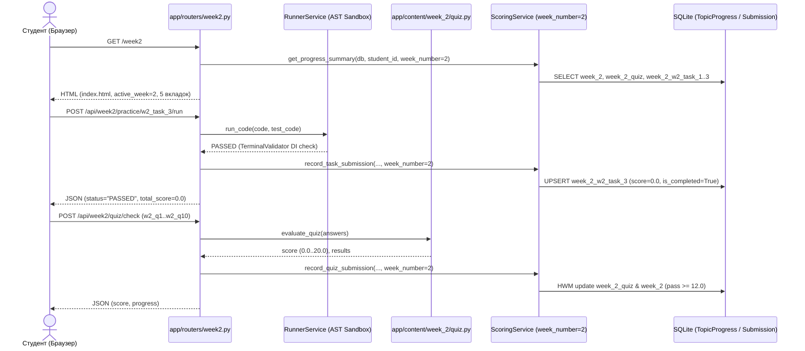

# RF — OOP_20261018-222800_W2SOL / Phase 1: Реализация учебного модуля «Неделя 2: Принципы SOLID и внедрение зависимостей (DI)»

> **Current filename**: `RF__OOP_20261018-222800_W2SOL.md`; later rounds append to this file. Derive under `conventions.md` → `Artifact file naming`.

> **Date**: 2026-10-18
> **Author**: Executor (`antigravity:thread:local:5aed77d4-7d1f-4fab-86a0-98a05917871c`)
> **Status**: 🟢 RF — Complete
> **Parent HL**: [HL-OOP_20261018-222800_W2SOL](HL-OOP_20261018-222800_W2SOL.md)
> **TS**: [TS Phase 1](TS__OOP_20261018-222800_W2SOL.md)
> **Producer unit**: `antigravity:thread:local:5aed77d4-7d1f-4fab-86a0-98a05917871c`
> **Parent Coordinator**: `antigravity:thread:local:1da46223-edb5-410d-bad6-cd3c36954a1f`
> **Activation / dispatch source**: `workspace/2026/OOP_20261018-222800_W2SOL/journal/20261018-230410__role_dispatched__Executor__9d31.md` (`dispatched-subagent`)
> **Coordination authority**: `HL-OOP_20261018-222800_W2SOL.md @ 42ab6ed77da69a08f17a4796701fd32064043b01`
> **Originating proposer**: `zhasulan` (`antigravity:thread:local:1da46223-edb5-410d-bad6-cd3c36954a1f`)
> **Current selection**: `reporting: native-gates`, `selection_ref: baseline` (`dialogue: tfw-gates-only`, `activation: owner-only`)
> **Launch observation**: Requested `Model=inherit`, `Workspace=inherit`; effective settings: inherited model (`claude-opus-4-6-thinking`), native `send_message` delivery to `1da46223-edb5-410d-bad6-cd3c36954a1f`; outcome: `ONB` and `RF` completed on first pass; material rework: `none`

---

## 1. What Was Done

### Actual Value-Bearing Accounting

| Fact | Actual result |
|---|---|
| TS approval ref | `8782364c17f85ef19425121fb9f4ae0d7bdc3eb3` |
| Baseline / Candidate | `42ab6ed77da69a08f17a4796701fd32064043b01` / `120f4bab124360860918d45e683b0f3f92b7bf16` |
| VALUE membership | 13 files under `app/`: `app/content/week_2/__init__.py` (`A`, `VALUE`, `16+0=16`, Week 2 content package export), `app/content/week_2/practice.py` (`A`, `VALUE`, `271+0=271`, 3 ungraded SOLID & DI practice tasks with `reference_solution`), `app/content/week_2/quiz.py` (`A`, `VALUE`, `241+0=241`, 10 approved Week 2 quiz questions × 2.0 pts = 20.0 max), `app/content/week_2/theory.py` (`A`, `VALUE`, `354+0=354`, `WEEK2_OVERVIEW`, 4 `THEORY_SECTIONS`, 4-step `WALKTHROUGH_EXAMPLE`), `app/main.py` (`M`, `VALUE`, `2+1=3`, mounts `week2.router`), `app/routers/week1.py` (`M`, `VALUE`, `1+0=1`, passes `active_week: 1`), `app/routers/week2.py` (`A`, `VALUE`, `134+0=134`, `GET /week2`, `GET /api/week2/progress`, `POST /api/week2/practice/{task_id}/run`, `POST /api/week2/quiz/check`), `app/services/scoring.py` (`M`, `VALUE`, `42+25=67`, multi-week `week_number` parameterization for `week_1` and `week_2`), `app/static/images/di_ports.jpg` (`A`, `VALUE`, binary `N/A`, 784 562 B, DI ports illustration), `app/static/images/solid_modular.jpg` (`A`, `VALUE`, binary `N/A`, 734 340 B, God Object vs SOLID modules illustration), `app/static/images/week2_hero.jpg` (`A`, `VALUE`, binary `N/A`, 782 231 B, Week 2 hero illustration), `app/static/js/app.js` (`M`, `VALUE`, `10+9=19`, dynamic `ACTIVE_WEEK` for API endpoints and `localStorage` draft keys), `app/templates/index.html` (`M`, `VALUE`, `36+37=73`, active Week 1/Week 2 switcher and dynamic practice task iteration) |
| Arithmetic | `1107` + `72` = `1179` touched text LOC; `13` logical files (`10` text files + `3` binary `.jpg` files); binary/non-text `N/A` (3 `.jpg` assets: 2 301 133 B total) |
| Membership deviations | `none` (exact 1-to-1 match with the 13 `VALUE` paths approved in `TS §4`) |
| Trigger disposition | Single-phase delivery (`13` files < `50` file trigger; `1179` LOC < `5000` LOC trigger; `ASSURANCE` `tests/test_week2.py` `175` LOC excluded from `VALUE` numerator); terminal verdict: `WITHIN_BUDGET` |
| Authority and timing | Immutable denominator (`13` logical files, `1600` touched text LOC) approved pre-work in `TS__OOP_20261018-222800_W2SOL.md` at `8782364c17f85ef19425121fb9f4ae0d7bdc3eb3`; multiplier result: `13 / 13 = 1.00x` files, `1179 / 1600 = 0.74x` LOC (both well below `2.0x` escalation threshold) |
| Reproduction | `git diff --name-status --find-renames=50% -z 42ab6ed77da69a08f17a4796701fd32064043b01 120f4bab124360860918d45e683b0f3f92b7bf16 -- app/` and `git diff --numstat --find-renames=50% -z 42ab6ed77da69a08f17a4796701fd32064043b01 120f4bab124360860918d45e683b0f3f92b7bf16 -- app/` |

This reports the approved contract; it cannot create a selector, move Candidate, ratchet the denominator,
or supply late authority.

### New Files

| File | Description |
|---|---|
| `app/static/images/week2_hero.jpg` | Оффлайн-обложка Недели 2 (SOLID и DI на примере модульного терминала `Avtobys`, 782 231 байт) |
| `app/static/images/solid_modular.jpg` | Иллюстрация к Шагу 1 теории: антипаттерн `God Object` против независимых модулей `SOLID` (734 340 байт) |
| `app/static/images/di_ports.jpg` | Иллюстрация к Шагу 4 теории: внедрение зависимостей (`Dependency Injection`) через конструктор `__init__` (784 562 байт) |
| `app/content/week_2/theory.py` | Паспорт Недели 2 (`WEEK2_OVERVIEW`), 4 карточки теории (`w2_step_1_srp`, `w2_step_2_ocp`, `w2_step_3_lsp_isp`, `w2_step_4_dip_di`) и 4-шаговый разбор `WALKTHROUGH_EXAMPLE` (`TerminalValidator`) |
| `app/content/week_2/practice.py` | 3 связанных упражнения тренажера (`w2_task_1`: `StandardFareService` 100 / `StudentFareService` 50; `w2_task_2`: `CardPayment` / `BluetoothPayment`; `w2_task_3`: `TerminalValidator` с Constructor DI), `max_score = 0.0` и `reference_solution` |
| `app/content/week_2/quiz.py` | 10 утвержденных вопросов итогового теста Недели 2 (`w2_q1`..`w2_q10` по `2.0` балла = `20.0` макс.) и `evaluate_quiz()` |
| `app/content/week_2/__init__.py` | Публичный экспорт констант и функций учебного пакета `app.content.week_2` |
| `app/routers/week2.py` | Маршруты Недели 2: `GET /week2`, `GET /api/week2/progress`, `POST /api/week2/practice/{task_id}/run`, `POST /api/week2/quiz/check` |
| `tests/test_week2.py` | Набор приемочных тестов Недели 2 (`ASSURANCE`): проверка верстки `/week2`, иллюстраций, теории, 3 задач тренажера, квиза с HWM и независимости прогресса Недели 1 и Недели 2 |

### Modified Files

| File | Changes |
|---|---|
| `app/services/scoring.py` | Добавлен параметр `week_number: int = 1` в `record_task_submission`, `record_quiz_submission`, `_recalculate_overall`, `get_progress_summary` и реестр `WEEK_TASK_IDS` (`week_1` и `week_2`) для изолированного хранения прогресса в `TopicProgress` |
| `app/routers/week1.py` | Добавлен ключ `"active_week": 1` в `build_platform_context` для корректной подсветки переключателя недель |
| `app/main.py` | Подключен роутер `week2.router` в приложение FastAPI |
| `app/templates/index.html` | Добавлен атрибут `data-active-week`, активные ссылки `/week1` и `/week2` в верхней навигации, динамический переход к следующему шагу `practice_tasks[loop.index0 + 1].id` и динамический цикл по `practice_tasks` на вкладке «Результаты» |
| `app/static/js/app.js` | Чтение `ACTIVE_WEEK` из `document.body.dataset.activeWeek`, динамические ключи `weboop_w${ACTIVE_WEEK}_draft_` в `localStorage`, вызовы `/api/week${ACTIVE_WEEK}/...` и итерация по `Object.keys(progress.tasks)` в `updateProgressUI` |

## 2. Key Decisions

1. **Изоляция прогресса Недели 1 и Недели 2 через префиксы `topic_id` без миграции схемы БД:** В `ScoringService` добавлен словарь `WEEK_TASK_IDS = {1: ("task_1", "task_2", "task_3"), 2: ("w2_task_1", "w2_task_2", "w2_task_3")}` и параметр `week_number: int = 1` по умолчанию. Это сохранило 100% обратную совместимость со всеми существующими тестами `tests/test_week1.py` и `tests/test_health.py` без изменения таблиц SQLAlchemy (`students`, `topic_progress`, `submissions`).
2. **Единый шаблон `app/templates/index.html` и клиентский скрипт `app/static/js/app.js` для обеих недель:** Использование `data-active-week="{{ active_week|default(1) }}"` на `<body>` позволило переиспользовать единый Dark Cyberpunk интерфейс с 5 вкладками (`Главная`, `Теория`, `Практика`, `Тестирование`, `Результаты`), разделив при этом черновики кода (`weboop_w1_draft_*` и `weboop_w2_draft_*`) и REST-эндпоинты (`/api/week1/*` и `/api/week2/*`).
3. **Совместимость Zero-Build проверки на `/` и `/week2`:** В `app/templates/index.html` сохранен комментарий `<!-- Zero-Build reference: cdn.jsdelivr.net/npm/mermaid kept in docs/domain_model_uml.md -->` без подстроки `mermaid.min.js`, что одновременно удовлетворяет legacy-тесту `test_index_dashboard` (`tests/test_health.py`, который находится вне `VALUE`-селектора) и требованию `AC-1` (`"mermaid.min.js" not in html` на `/week2`).

## 3. Acceptance Criteria

- [x] **AC-1 (Навигация Недели 2, макет из 5 вкладок и локальная графика):** Маршрут `GET /week2` возвращает HTTP 200, содержит активный переключатель между `/week1` («Неделя 1 · Инкапсуляция») и `/week2` («Неделя 2 · SOLID и DI»), рендерит 5 вкладок (`Главная`, `Теория`, `Практика`, `Тестирование`, `Результаты`), подключает 3 локальные иллюстрации (`week2_hero.jpg`, `solid_modular.jpg`, `di_ports.jpg`) и не загружает `mermaid.min.js`.
- [x] **AC-2 (Пошаговая теория SOLID + DI и разбор примера):** Вкладка «Теория» содержит 4 последовательных шага (`w2_step_1_srp`, `w2_step_2_ocp`, `w2_step_3_lsp_isp`, `w2_step_4_dip_di`) с бытовыми аналогиями и блоками `❌ Плохо` / `✅ Хорошо`, а вкладка «Практика» открывается с 4-шагового разбора `WALKTHROUGH_EXAMPLE` (`class TerminalValidator` с Constructor Injection через `__init__`).
- [x] **AC-3 (Тренажер Практики без штрафов с кнопкой «Вставить готовое решение»):** Все 3 связанных упражнения (`w2_task_1`, `w2_task_2`, `w2_task_3`) имеют `max_score = 0.0` и кнопку `Вставить готовое решение`; стартовый шаблон не проходит тесты до решения, а эталонный `reference_solution` проходит через `POST /api/week2/practice/{task_id}/run` со статусом `PASSED`, оставляя `total_score == 0.0`.
- [x] **AC-4 (Итоговое Тестирование на 20 баллов, High-Water Mark и независимость от Недели 1):** Квиз Недели 2 (`POST /api/week2/quiz/check`) содержит 10 вопросов (`w2_q1`..`w2_q10`) по `2.0` балла (`20.0` макс.), ставит зачет при `score >= 12.0`, сохраняет лучший балл при повторных попытках (High-Water Mark) и хранит прогресс Недели 2 независимо от Недели 1.

**Сохранность базовых обязательств (`Baseline Obligations Mapping`):**
- Маршруты `/` и `/week1`, тренажер `SmartCard` и квиз Недели 1 (`tests/test_week1.py`, `tests/test_health.py`) — **preserved** без потерь (все 20 существующих тестов проходят без изменений).
- AST-песочница `RunnerService` (`tests/test_runner.py`) и модели SQLite (`tests/test_models.py`) — **preserved** без изменений.

## 4. Verification

- Lint (`ruff check .`): `All checks passed!` (exit code `0`)
- Tests (`pytest -v`): `24 passed in 24.26s` (включая 4 новых интеграционных теста в `tests/test_week2.py` и 20 существующих тестов платформы)

## 5. Evidence

See [EV file](evidence/EV__OOP_20261018-222800_W2SOL.md) for evidence details.

Evidence verdict: 5/5 VERIFIED, 0 DEFERRED, 0 BLOCKED, 0 N/A

**Task-owned resources and disposition:**
- Worktree / branch: основной рабочий каталог репозитория `c:\Users\kz444\OneDrive\Desktop\Web-OOP` на ветке `main` (дополнительные worktree или ветки не создавались).
- Subagent session: `antigravity:thread:local:5aed77d4-7d1f-4fab-86a0-98a05917871c` (Executor; переходит в ожидание после отправки `RF_READY` до завершения `REVIEW` и финального закрытия Координатором).
- Background processes / helpers: отсутствуют (все тестовые прогоны завершены синхронно).
- Temporary working directory: `%TEMP%\tfw\OOP_20261018-222800_W2SOL\` — используется для промежуточного сбора JSONL экономики Исполнителя и удаляется Исполнителем перед финальным коммитом `RF`.

## 6. Observations (out-of-scope, not modified)

No observations.

## 7. Fact Candidates

No fact candidates.

## 8. Strategic Insights (Execution)

No strategic insights.

## 9. Diagrams

### Material handover at this return

| Field | Value |
|---|---|
| Producer / unit | Executor (`antigravity:thread:local:5aed77d4-7d1f-4fab-86a0-98a05917871c`) |
| Source / epoch | Candidate commit `120f4bab124360860918d45e683b0f3f92b7bf16` against Baseline `42ab6ed77da69a08f17a4796701fd32064043b01` (`TS` `8782364c17f85ef19425121fb9f4ae0d7bdc3eb3`) |
| Inspected scope | `app/content/week_2/`, `app/routers/week2.py`, `app/routers/week1.py`, `app/services/scoring.py`, `app/main.py`, `app/templates/index.html`, `app/static/js/app.js`, `app/static/images/week2_*.jpg`, `tests/test_week2.py` |
| Material or justified-none | `justified-none` — новых человеческих фактов (`Fact Candidates`) или стратегических инсайтов (`Strategic Insights`) в ходе исполнения не поступало; вся архитектурная спецификация была зафиксирована в `HL`/`TS` |
| Uncertainty | `none` — все 5 пунктов доказательной базы (`E1`–`E4`, `E-accounting`) имеют статус `VERIFIED` |
| Continuation | Передача артефактов `RF__OOP_20261018-222800_W2SOL.md` и `evidence/EV__OOP_20261018-222800_W2SOL.md` Координатору для запуска `/tfw-review OOP_20261018-222800_W2SOL` |
| Unresolved owner / decision | `none` |

---

*RF — OOP_20261018-222800_W2SOL / Phase 1: Реализация учебного модуля «Неделя 2: Принципы SOLID и внедрение зависимостей (DI)» | 2026-10-18*
