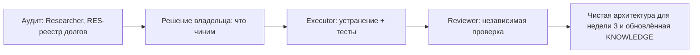

# HL — OOP_20261021-141300_REFAC: Предстартовый рефакторинг и закрытие техдолга перед неделей 3

> **Date**: 2026-10-21
> **Author**: Coordinator (Antigravity) для zhasulan
> **Title**: Предстартовый рефакторинг и закрытие техдолга перед неделей 3
> **Abbreviation**: REFAC
> **Status**: 🔬 RES — HL approved
> **Contract**: 🔒 FROZEN — approved by zhasulan 2026-10-22
> **Frozen**: §1 · §3 · §4 · §5 · §6 · §7 — locked on owner approval
> **Free**: §2 · §7.2 · §8 · §9 · §10 · §11 — research updates these directly
> **Append-only**: §12 Amendment Log — the only channel for changing a frozen section
> **Baseline**: freeze commits — recovery form in `conventions.md` §3 rule 15

> **Project North Star**: N/A — no project north star designated

---

## 1. Vision 🔒 FROZEN
Кодовая база и архитектура Web-OOP перед неделей 3 чистые: модули имеют одну зону ответственности, дублирование между неделями 1 и 2 убрано, монолиты разбиты, тесты покрывают позитивные и негативные случаи, документация и UML соответствуют коду. Долги найдены независимым аудитом, приоритизированы и закрыты. Дыра безопасности в тренажёре закрывается в той же работе как один из найденных долгов, а не как её цель.

**Impact:** неделя 3 добавляется в понятную расширяемую структуру без копирования кода недели 2, преподаватель и проверяющие видят чистый репозиторий с актуальными диаграммами.

> *«Новую неделю можно добавить как модуль по готовому образцу, ничего не копируя, а код читается без боли.»* (воображаемая цитата разработчика)

## 2. Current State (As-Is) 🟢 FREE
Наблюдения Coordinator на 2026-10-21, подлежат проверке Researcher.

- Бенефициары: студенты 2 курса (малая группа, KNOWLEDGE F1/F5), преподаватель `saubakirov`, разработчик `zhasulan`.
- [`app/services/ast_validator.py`](../../../app/services/ast_validator.py): чёрный список из 5 модулей и 3 вызовов. Обход возможен через `importlib`, `getattr`/`__builtins__`, `open`, `pathlib`, `ctypes`, цепочки `__subclasses__`.
- [`app/services/runner.py`](../../../app/services/runner.py): `subprocess` с правами сервера, таймаут и временная папка, без лимитов памяти и CPU, без запрета сети, с унаследованным окружением.
- `run_public.bat` публикует сервер через Cloudflare Tunnel; авторизации на `/api/*` нет; `/docs` открыт.
- `index.html` 607 строк, `app.js` 347 строк; 6 файлов тестов; `Dockerfile`, `docker-compose.yml`, `run_public.bat` не в git; в compose порт `8000:8000`.
- KNOWLEDGE F4 объявляет текущую изоляцию достаточной: факт требует пересмотра.
- Все запросы работают под одним зашитым студентом `zhasulan` (`ScoringService.get_or_create_student`): при нескольких студентах прогресс общий. Баллы квиза считает сервер (`evaluate_quiz`).
- Баг «10 failed = 10/10» из замечаний преподавателя относится к репозиторию другого студента и в объём не входит (подтверждено владельцем).
- Собственные UML-диаграммы проекта лежат в [`docs/domain_model_uml.md`](../../../docs/domain_model_uml.md) и [`docs/architecture.md`](../../../docs/architecture.md); их актуальность относительно кода недель 1–2 не проверена.
- Неизвестно: число одновременных студентов, режим доступа (локально или публично), наличие других дыр, назначение незафиксированных файлов.

## 3. Target State (To-Be) 🔒 FROZEN
Утверждённый владельцем список из RES-реестра закрыт: код и архитектура очищены и разделены по зонам ответственности, дублирование устранено, тесты и документация приведены в соответствие. Безопасность запуска студенческого кода закрыта как один из пунктов реестра. `KNOWLEDGE.md` обновлён.

### 3.1 Result Visualization

Структура и содержание (иллюстративно, точный состав определит RES):

| | Сейчас | После |
|---|---|---|
| Контент недель 1 и 2 | `week_1` и `week_2` повторяют структуру, роутеры `week1.py` и `week2.py` почти дублируют друг друга | общий слой для недели, неделя описывается данными и специфичной логикой |
| Фронтенд | `index.html` 607 строк, `app.js` 347 строк | компоненты и шаблоны, разбитые по зонам |
| Подсчёт и профиль студента | `ScoringService` с зашитым студентом | ответственность разделена, профиль не зашит |
| Тесты | 6 файлов | позитивные и негативные кейсы по каждому бизнес-процессу |
| Диаграммы | `docs/domain_model_uml.md`, `docs/architecture.md`, актуальность не проверена | соответствуют коду |
| Безопасность тренажёра (один из пунктов реестра) | защита чёрным списком, публичный запуск | изоляция запуска, публичный запуск допустим после закрытия пункта |

### 3.2 Value Flow

## 4. Phases 🔒 FROZEN

Одна фаза устранения после одной итерации исследования. Объём фазы определяется утверждённым владельцем списком из RES; главная цель фазы: чистота кода и архитектуры; безопасность закрывается как один из пунктов реестра. Дыру в тренажёре владелец называет в числе замечаний, она не определяет порядок работы.

### 4.1 Coordination Selection 🔒 FROZEN

| Activation source | Accountable owner | Task Coordinator unit | Phase Coordinator rule | Mandate scope / role reach | Upward route | Dialogue | Reporting | Reservations / controls | Amendment authority | Immutable epoch |
|---|---|---|---|---|---|---|---|---|---|---|
| owner-direct | zhasulan | antigravity:thread:local:a6b9be74-a4a5-4be5-9fdd-b28852c602d7 | none (one phase) | Task Coordinator ведёт планирование и фазу; Researcher, Executor и Reviewer запускает владелец по гейтам | owner:zhasulan | tfw-gates-only | native-gates | Выбор объёма устранения, публичный запуск и закрытие принадлежат владельцу | none | pending-freeze |

### Phase A: Рефакторинг и устранение найденных долгов 🔴
**Requires:** RES итерации 1 и утверждённый владельцем список.

1. 🔴 Архитектура и SRP: разделить зоны ответственности, убрать дублирование между неделями 1 и 2 (контент, роутеры, шаблоны), разбить монолиты (`index.html`, `app.js`, крупные модули контента), сделать расширяемую структуру под неделю 3.
2. 🔴 Тесты: позитивные и негативные кейсы по каждому бизнес-процессу (валидация, подсчёт и сводка баллов, профиль студента, запуск кода).
3. 🔴 Диаграммы и документация: собственные UML-диаграммы из `docs/` сохранить и привести в соответствие с кодом, не заменять.
4. 🟡 Требования преподавателя (созвон 2026-10-21), в объёме, подтверждённом владельцем: валидация, отметка о прочтении лекции, прозрачная сводка баллов (включая зашитого общего студента).
5. 🟡 Безопасность (замечание владельца): изоляция запуска студенческого кода вместо чёрного списка, `run_public.bat` в `.gitignore`, порядок публичного запуска, `/docs` и ограничение запросов, если этого требует RES.
6. 🟡 Прочие баги и долги из утверждённого списка.
7. 🟡 Обновление `KNOWLEDGE.md` (F4), `README.md` и `CHANGELOG.md`.

## 5. Definition of Done (DoD) 🔒 FROZEN
- ✅ 1. RES содержит реестр долгов по категориям (безопасность, архитектура, баги, тесты, документация, контент, эксплуатация) с приоритетами и разделом «не проверено».
- ✅ 2. Выбранный владельцем список закрыт, каждый пункт подтверждён тестом или явным доказательством.
- ✅ 3. Дублирование между неделями 1 и 2 устранено, монолиты разбиты, структура позволяет добавить неделю 3 без копирования кода; зоны ответственности модулей описаны и подтверждены ревью.
- ✅ 4. Для каждого бизнес-процесса есть позитивные и негативные тесты; полный набор проходит; поведение недель 1–2 для студента не регрессирует.
- ✅ 4а. UML-диаграммы и `docs/architecture.md` соответствуют коду.
- ✅ 4б. Если безопасность входит в утверждённый список: набор обходных попыток (минимум: `importlib`, `getattr`/`__builtins__`, `open`, `pathlib`, `ctypes`, `__subclasses__`, сетевой вызов, бесконечный цикл, выделение памяти) не получает доступа к хосту, файлам вне песочницы и сети.
- ✅ 5. Независимый Reviewer вынес APPROVE; владелец принял результат.
- ✅ 6. `KNOWLEDGE.md`, `README.md`, `CHANGELOG.md` отражают итоговое состояние.

## 6. Definition of Failure (DoF) 🔒 FROZEN
- ❌ 1. Рефакторинг изменил видимое поведение недель 1–2 или сломал существующие тесты без согласованной причины.
- ❌ 2. После работы дублирование между неделями осталось или появилось новое, либо структура требует копирования кода для недели 3.
- ❌ 2а. Безопасность входит в список, и хотя бы одна обходная попытка из DoD 4б выполняет действие на хосте.
- ❌ 3. Аудит проверял состояние, содержащее незавершённые или незафиксированные изменения кода недель 1–2 без указания этого в RES.
- ❌ 4. Изменения вышли за утверждённый владельцем список без поправки.

**On failure:** остановка, откат фазы к последнему рабочему коммиту, возврат владельцу с причиной.

## 7. Principles 🔒 FROZEN
1. **Чистота прежде всего** — одна сущность, одна зона ответственности; код не дублируется; диаграммы отражают код.
1а. **Изоляция вместо фильтрации** — если безопасность входит в список, защита не опирается на перечень запрещённого.
2. **Сначала измерить, потом чинить** — работа по списку из RES, а не по догадкам.
3. **Чистая база** — аудит проверяет зафиксированное состояние репозитория; незафиксированные изменения указываются в RES.
4. **Не ломать студента** — видимое поведение недель 1–2 сохраняется.
5. **Минимально достаточное** — не добавлять инфраструктуру сверх закрытия найденных рисков.

### 7.2 Knowledge Citations 🟢 FREE

| # | Source | Item | How it applies |
|---|--------|------|----------------|
| 1 | KNOWLEDGE.md §4 | F4 (изоляция RunnerService) | Заявленная изоляция пересматривается как один из пунктов реестра |
| 2 | KNOWLEDGE.md §4 | F1, F3, F5 (аудитория, локальный запуск, тренажёр без снятия баллов) | Ограничивают решения: малая группа, поведение тренажёра сохраняется |
| 3 | Project North Star | N/A | Не назначен, действует §1 Vision |

## 8. Dependencies 🟢 FREE
| Dependency | Status |
|------------|--------|
| Завершение работы по неделе 2 | ✅ (отдельной работы нет, W2SOL в DONE) |
| Утверждение HL владельцем | ✅ (режим, гипотезы, название и ABBR) |

## 9. Risks 🟢 FREE
| Risk | Probability | Impact | Mitigation |
|------|-------------|--------|------------|
| Одна итерация аудита поверхностна | Medium | High | Контракт по категориям, раздел «не проверено» |
| Изоляция ОС недоступна на Windows без Docker | Medium | High | H2, запасной вариант на уровне процесса, выбор владельца |
| Дыра остаётся открытой во время аудита | High | High | Не запускать `run_public.bat` до закрытия фазы A |

## 10. RESEARCH Case 🟢 FREE

### Blind Spots
- Режим доступа студентов и число одновременных пользователей.
- Назначение незафиксированных файлов (`Dockerfile`, `docker-compose.yml`, `run_public.bat`, правка `README.md`).

### Hypotheses

| # | Hypothesis | Status |
|---|----------|--------|
| H1 | Недели 1 и 2 дублируют структуру и логику (контент, роутеры, шаблоны) настолько, что неделя 3 потребует копирования | open |
| H2 | В `index.html` и `app.js` есть долги (монолит, смешение зон ответственности, XSS через контент) | open |
| H3 | Тесты не покрывают негативные случаи основных бизнес-процессов | open |
| H4 | Чёрный список AST обходится стандартными приёмами; изоляция на уровне ОС или контейнера реализуема на стеке владельца | open |

### Risks of Not Researching
Устранение пойдёт по догадкам; часть долгов останется незамеченной.

### Proposed RESEARCH Focus
1. **Gather**: реестр долгов по категориям из DoD 1 с ссылками на файлы.
2. **Extract**: карта дублирования и зон ответственности модулей (SRP), покрытие тестами по бизнес-процессам, соответствие диаграмм коду; отдельным пунктом воспроизведение обходов чёрного списка и сравнение вариантов изоляции под Windows и Docker.
3. **Challenge**: что в реестре ложное срабатывание, а что действительно блокирует неделю 3; что не проверено.

### Why Not Just...?

| Approach | Value | Adoption / operating burden | Risks / tradeoffs | Decision and reason |
|---|---|---|---|---|
| Аудит, затем рефакторинг | Полный реестр долгов, осознанный выбор, чистая архитектура | Одна итерация RES и одна фаза | Известная дыра открыта на время аудита | Рекомендован; временная мера: не запускать публичную ссылку |
| Сразу чинить только известное (дыра в тренажёре) | Быстро закрывает дыру | Минимальная | Пропуск рефакторинга и остальных долгов, правка по догадке | Не выбран: цель владельца, чистота кода и архитектуры |

**Leave unchanged:** неделя 3 строится на дублирующемся коде и монолитах, долг растёт; замечания преподавателя остаются открытыми; дыра в тренажёре сохраняется.

**Critical challenge:** одна итерация может охватить всё поверхностно. Защита: категории в контракте и раздел «не проверено» в RES.

## 11. Strategic Insights (Planning) 🟢 FREE

| # | Insight | Category | Source |
|---|---------|----------|--------|
| S3 | Преподаватель на созвоне 2026-10-21: диаграммы классов обязательны; баг подсчёта (10 failed = 10/10); валидация, отметка прочтения, прозрачная сводка баллов; позитивные и негативные тесты; SRP и отсутствие дублирования; разбиение монолитов; срок: пятница 2026-10-23 | constraint | User (пересказ созвона), 2026-10-21 |
| S4 | Правило «код руками, без ИИ» относится к двум студентам-проверяющим (Мухитов Арсений, Иванов Роман), которые проходят курс без ИИ-агентов и помогают искать проблемы; на работу Executor-агента над платформой оно не распространяется | decision | User, 2026-10-21 |
| S5 | Распределение 10 заданий (квиз и практика) владелец считает правильным; изменений не требуется | decision | User, 2026-10-21 |
| S1 | Владелец называет дыру в терминале-тренажёре среди замечаний; цель задачи — рефакторинг, чистота кода и архитектуры. Теоретически код студента может уничтожить данные хоста | risk, priority | User, 2026-10-21 |
| S6 | Приоритет владельца: рефакторинг, чистота кода и архитектуры идёт первым, безопасность одним из замечаний | decision | User, 2026-10-21 |

## 12. Amendment Log 🟢 APPEND-ONLY

**No amendments.**

### Material handover at this return
Producer: task Coordinator `a6b9be74-a4a5-4be5-9fdd-b28852c602d7`. Inspected: `app/services`, `app/routers/runner.py`, `run_public.bat`, `docker-compose.yml`, `app/main.py`, KNOWLEDGE.md §4. Uncertainty: публичность доступа неизвестны. Continuation: `/tfw-research OOP_20261021-141300_REFAC` после утверждения HL.

---

*HL — OOP_20261021-141300_REFAC: Предстартовый рефакторинг и закрытие техдолга перед неделей 3 | 2026-10-21*
