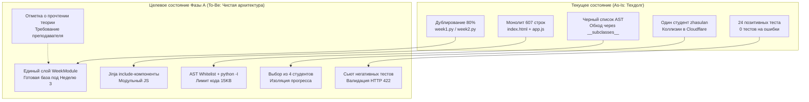

# RES — OOP_20261021-141300_REFAC: Предстартовый рефакторинг и закрытие техдолга перед неделей 3

> **Current filename**: `workspace/2026/OOP_20261021-141300_REFAC/research/iter1/RES.md`
> **Date**: 2026-10-23
> **Author**: Researcher (Antigravity) для zhasulan
> **Status**: 🔬 RES — Complete
> **Parent HL**: [HL-OOP_20261021-141300_REFAC.md](../../HL-OOP_20261021-141300_REFAC.md)
> **Mode**: Pipeline
> **Producer unit**: `antigravity:thread:local:80860ad5-eff9-4d51-a4fe-8c1ae154f5a1`
> **Parent Coordinator**: `antigravity:thread:local:a6b9be74-a4a5-4be5-9fdd-b28852c602d7`
> **Activation / dispatch source**: owner-direct activation, `/tfw-research OOP_20261021-141300_REFAC` от zhasulan
> **Coordination authority**: `HL-OOP_20261021-141300_REFAC.md @ 20724d2f1de1944a5e45f23b15aae61d77a34f8b`
> **Originating proposer**: `none`

---

## Research Context

Исследование проведено перед началом разработки учебного модуля Недели 3 с целью выявления и каталогизации технического долга в кодовой базе Web-OOP. Основной фокус: устранение архитектурного дублирования между Неделями 1 и 2, разбиение монолитных компонентов (`index.html` и `app.js`), расширение тестового покрытия на негативные сценарии и обеспечение надежной безопасности запуска студенческого кода в условиях публичного доступа через Cloudflare Tunnel на машине без Docker.

## Briefing

Опирается на [1_briefing.md](1_briefing.md). Владелец подтвердил режим `deep` для данной итерации, публичный доступ одногруппников через интернет, статус незафиксированных файлов (`Dockerfile`, `docker-compose.yml`, `run_public.bat` — наброски идей, а `run_public.bat` — активный скрипт запуска).

## Decisions

| # | Решение | Обоснование |
|---|---|---|
| **D1** | Реализовать общий слой модулей недель (контракт `WeekModule` + реестр недель). | Роутеры `week1.py` и `week2.py` дублируют 80% кода. Без общего слоя Неделя 3 потребует создания еще 140 строк копипаста. |
| **D2** | Защита запуска кода через строгий AST Whitelist (белый список синтаксиса) + изолированный процесс `python -I` с лимитом размера кода (15 КБ). | Docker на хосте владельца отсутствует. Черный список ненадежен. Белый список разрешает только учебный синтаксис (классы, методы, циклы) и блокирует доступ к системным атрибутам (`__class__`, `__subclasses__`). |
| **D3** | Идентификация студентов: выбор профиля из фиксированного списка группы (1: Zhasulan, 2: Roman, 3: Arseniy, 4: Saubakirov). | Прямое решение владельца от 2026-10-23. Исключает коллизии баллов при публичном туннеле без усложнения системы паролями. |
| **D4** | Декомпозиция `index.html` на Jinja `include`-компоненты по вкладкам (`home`, `theory`, `practice`, `quiz`, `results`). | Монолит в 607 строк содержит 3 ветвления по неделям. Неделя 3 сделает файл неуправляемым. |
| **D5** | Реализация отметки о прочтении теории в конце раздела лекций. | Требование преподавателя (HL §11 S3), подтвержденное владельцем. Реализуется через топик прогресса `week_N_theory` без изменения схемы БД. |
| **D6** | Закрытие эндпоинтов `/docs`, `/redoc` и `/api/runner/smoke` на публичном запуске и валидация пейлоадов. | Публичный туннель выставляет отладочные ручки и документацию API в открытый интернет без авторизации. |

## Open Questions

| # | Вопрос | Статус | Ответ владельца / Результат |
|---|---|---|---|
| 1 | Как студенты заходят и сколько их? | Закрыт | Заходят публично через туннель Cloudflare. В группе 4 постоянных участника (Zhasulan, Roman, Arseniy, Saubakirov). |
| 2 | Допустим ли Docker для изоляции? | Закрыт | Команда `docker` не установлена на рабочей машине. Изоляция строится нативно средствами Python и ОС. |
| 3 | Требуется ли отметка о прочтении теории? | Закрыт | Да, подтверждено владельцем: добавляется кнопка подтверждения в конце теории. |

## Hypotheses (from HL §10)

| # | Гипотеза | HL Status | RES Status | Доказательства и факты |
|---|---|---|---|---|
| **H1** | Недели 1 и 2 дублируют структуру и логику настолько, что Неделя 3 потребует копирования. | open | ✅ **CONFIRMED** | 80% совпадения строк в `week1.py` и `week2.py`. Функции `evaluate_quiz` и `get_practice_task` продублированы. `main.py` жестко импортирует каждую неделю. |
| **H2** | В `index.html` и `app.js` есть долги (монолит, смешение зон ответственности, XSS через контент). | open | 🟡 **PARTIALLY CONFIRMED** | Монолиты подтверждены (607 строк HTML с ветвлениями, 347 строк JS с глобальным состоянием). **XSS опровергнут:** вывод студенческого кода экранируется через `textContent`. |
| **H3** | Тесты не покрывают негативные случаи основных бизнес-процессов. | open | ✅ **CONFIRMED** | 24 теста покрывают только позитивные сценарии и базовые синтаксические ошибки. 0 тестов на пустые пейлоады, невалидные типы, превышение длины кода, конкуренцию сессий. |
| **H4** | Черный список AST обходится стандартными приемами; изоляция на уровне ОС или контейнера реализуема. | open | 🟡 **CONFIRMED (REFINED)** | Черный список действительно дыряв (обходы через `__subclasses__`). Но контейнеры недоступны (нет Docker). Решение: строгий синтаксический AST Whitelist + `python -I`. |

---

## HL Update Recommendations

### Refinements — свободные разделы, применяет Coordinator

| # | § | Что обновить | Обоснование / Источник |
|---|---|---|---|
| **R1** | §2 | Дополнить описание текущего состояния: команда `docker` отсутствует в PATH; подтвержден публичный запуск через `run_public.bat`; в коде отсутствует отметка о прочтении теории; GET-запросы к API прогресса вызывают мутацию БД (`commit`). | Стадии Gather и Extract (`2_gather.md`, `3_extract.md`). |
| **R2** | §7.2 | Обновить ссылку на KNOWLEDGE F4: текущий `ast_validator.py` уже проверяет `__import__`, но не защищает от обхода через `__subclasses__`. | Анализ `app/services/ast_validator.py`. |
| **R3** | §8 | Зафиксировать зависимость: Фаза А не требует установки Docker Desktop на машине владельца. | Решение владельца и статус окружения. |
| **R4** | §9 | Снять риск недоступности Docker на Windows, переведя изоляцию на синтаксический белый список AST + `python -I`. | Extract и Challenge (`3_extract.md`, `4_challenge.md`). |
| **R5** | §10 | Перевести гипотезы H1, H3 в статус `confirmed`, H2 и H4 в статус `resolved/refined`. | Результаты проверки гипотез в RES. |
| **R6** | §11 | Зафиксировать решение S7: профили студентов выбираются из 4 предопределенных участников группы. | Указание владельца от 2026-10-23. |

### Amendment Proposals — замороженные разделы, требуется решение владельца

| # | § | Type | Предлагаемое изменение | Обоснование | Стоимость принятия | Рассмотренные альтернативы |
|---|---|---|---|---|---|---|
| **A1** | §4 (п. 4), §5 (DoD 2) | `EXTEND` | Включить в состав Фазы А реализацию переключателя 4 профилей студентов (Zhasulan, Roman, Arseniy, Saubakirov) и отметку о прочтении лекции. | Решение владельца от 2026-10-23 для защиты от перезаписи прогресса при публичном туннеле и выполнения требования преподавателя. | Добавление 1 миграции данных/записи в `TopicProgress` и селектора в UI (около 1.5 часов работы Executor). | Полноценная аутентификация с паролями (слишком сложно для 4 студентов) либо сохранение общего `zhasulan` (затирание баллов). |
| **A2** | §5 (DoD 4б) | `SUPERSEDE` | Сформулировать требование безопасности песочницы: защита гарантируется строгим белым списком AST (разрешен только учебный синтаксис), запуском `python -I` и лимитом размера кода (15 КБ), без обязательного требования Docker. | На машине владельца отсутствует Docker; попытка привязаться к Docker заблокирует локальную разработку и сдачу проекта. | 0 дополнительной стоимости (упрощает стек и ускоряет тесты). | Принудительная установка Docker Desktop на Windows (тяжеловесно, требует прав администратора и WSL2). |

---

## Fact Candidates

| # | Категория | Кандидат в факты | Источник | Уверенность |
|---|---|---|---|---|
| **FC1** | `environment` | На рабочей машине владельца утилита `docker` отсутствует в системном PATH, запуск контейнеров локально не поддерживается. | Команда `docker --version` завершилась с ошибкой `CommandNotFoundException`. | ★★★ |
| **FC2** | `process` | Платформа открывается для одногруппников через `run_public.bat` с использованием временного Cloudflare Quick Tunnel (`trycloudflare.com`). | Сообщение владельца от 2026-10-22. | ★★★ |
| **FC3** | `stakeholder` | Круг реальных пользователей платформы ограничен 4 участниками: Zhasulan, Roman, Arseniy, Saubakirov. | Сообщение владельца от 2026-10-23. | ★★★ |

## Strategic Insights (Research)

| # | Категория | Инсайт | Источник | Уверенность |
|---|---|---|---|---|
| **SS1** | `stakeholder` | Переключение между 4 фиксированными профилями студентов закрывает проблему многопользовательской работы без необходимости внедрения тяжеловесных JWT/OAuth сервисов. | Владелец, обсуждение решений 2026-10-23. | ★★★ |
| **SS2** | `constraint` | Отказ от внешних контейнеров в пользу строгого синтаксического AST Whitelist сохраняет ключевое архитектурное преимущество проекта — Zero-Build и запуск одной командой `run.bat`. | Архитектурный анализ `app/services/runner.py`. | ★★★ |

---

## Findings Map

---

## Iteration Status

- **Iteration:** 1 of 1 (min) / 1 (max)
- **Hypotheses tested:** H1 (CONFIRMED), H2 (PARTIALLY CONFIRMED), H3 (CONFIRMED), H4 (CONFIRMED WITH REFINEMENT)
- **Hypotheses deferred:** None
- **Gaps discovered:** Отсутствие Docker на хосте; отсутствие функционала отметки теории; мутации базы данных при GET-запросах.
- **Superseded decisions:** Изоляция через Docker заменена на нативный AST Whitelist + `python -I`.

### Open Threads
No open threads.

### Recommendation
- [x] **SUFFICIENT** — исследование полностью закрыло вопросы объема рефакторинга и архитектурных границ. Рекомендуется перейти к `/tfw-plan` для составления спецификации задачи (TS) и запуска Фазы А.

---

## Conclusion

Исследование полностью вскрыло анатомию технического долга перед стартом Недели 3. Подтверждено опасное дублирование в роутерах и контенте (80%), монолитность страниц и слепые зоны тестирования. В ходе диалога с владельцем найдены простые и надежные компромиссы: отказ от неподдерживаемого на машине Docker в пользу строгого синтаксического белого списка AST, замена сложной авторизации на выбор из 4 реальных участников группы и реализация отметки прочтения лекций без миграций БД. База полностью подготовлена к разработке спецификации (TS) и чистой реализации Фазы А.

### Material handover at this return

Producer: `antigravity:thread:local:80860ad5-eff9-4d51-a4fe-8c1ae154f5a1`.
Epoch: `HEAD @ 3907259`.
Inspected: `app/routers/`, `app/services/`, `app/content/`, `app/templates/`, `app/static/`, `tests/`, `docs/`, `run_public.bat`, окружение Windows/Python.
Uncertainty: Нагрузочная способность SQLite при одновременной записи 4 студентов через Cloudflare (некритично для группы из 4 человек).
Continuation: Запустить `/tfw-plan OOP_20261021-141300_REFAC` для утверждения рекомендаций и создания TS Фазы А.

---

*RES — OOP_20261021-141300_REFAC: Предстартовый рефакторинг и закрытие техдолга перед неделей 3 | 2026-10-23*
