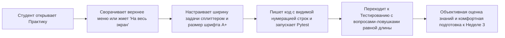

# HL — OOP_20261025-235206_UIEXP: Улучшение эргономики тренажёра (сдвиг меню, полноэкранный редактор, сплиттер, строки) и балансировка квизов

> **Current filename**: `HL-OOP_20261025-235206_UIEXP.md`
> **Date**: 2026-10-25
> **Author**: Coordinator (Antigravity) для zhasulan
> **Title**: Улучшение эргономики тренажёра (сдвиг меню, полноэкранный редактор, сплиттер, строки) и балансировка квизов
> **Abbreviation**: UIEXP
> **Status**: 🔒 FROZEN — Approved by owner
> **Contract**: 🔒 FROZEN — approved by zhasulan 2026-10-25
> **Frozen**: §1 · §3 · §4 · §5 · §6 · §7 — locked on owner approval
> **Free**: §2 · §7.2 · §8 · §9 · §10 · §11 — research updates these directly
> **Append-only**: §12 Amendment Log — the only channel for changing a frozen section
> **Baseline**: freeze commits — recovery form in `conventions.md` §3 rule 15
> **Project North Star**: `README.md § Цель и North Star проекта` · `.tfw/README.md #methodology-values · #success-criteria`
> **Producer unit**: `antigravity:thread:local:43c55687-5d64-4647-9012-0331bd386a85`
> **Parent Coordinator**: `owner:zhasulan`
> **Activation / dispatch source**: `owner-direct (/tfw-plan)`
> **Coordination authority**: `HL-OOP_20261025-235206_UIEXP.md @ frozen`
> **Originating proposer**: `{principal: zhasulan, unit: antigravity:thread:local:43c55687-5d64-4647-9012-0331bd386a85}`
> **Current selection**: `reporting: native-gates, selection_ref: baseline`

---

## 1. Vision 🔒 FROZEN

В учебной платформе **Web-OOP** исправлены ключевые эргономические и педагогические дефекты, выявленные владельцем при личном прохождении курса: громоздкая верхняя навигационная шапка сворачивается в компактную полоску одним кликом (`Свернуть меню ▲`), зона кодинга в разделе «Практика» оформлена как полноценная IDE-среда с вертикальной линейкой номеров строк (gutter), счетчиком строк, поддержкой клавиши `Tab` и регулировкой размера шрифта (`A- / A+`), соотношение ширины между условием задачи и редактором кода свободно меняется перетаскиванием разделителя (drag-splitter) или пресетами ширины, а кнопка `⛶ На весь экран` разворачивает текущую задачу вместе с редактором на `100vw × 100vh`. Одновременно итоговые квизы Недели 1 и Недели 2 избавлены от угадывания по длине текста: все 4 варианта ответа выровнены по объему, правильные ответы равномерно распределены по индексам `A, B, C, D`, а дистракторы содержат правдоподобные концептуальные ловушки по ООП и SOLID.

**Impact:** Студенты пишут и отлаживают Python-код в просторном полноэкранном тренажере с видимыми номерами строк и настраиваемыми пропорциями окна задачи, а итоговое тестирование проверяет реальное понимание инкапсуляции, SOLID и DI вместо механического выбора самого длинного абзаца.

> *«Раньше приходилось писать код в крошечной щели под шапкой сайта и ориентироваться по памяти, где какая строка. Теперь я просто жму "На весь экран", подтягиваю разделитель под себя, увеличиваю шрифт с номерами строк и спокойно пишу решение. А в тестах наконец-то приходится реально думать над ловушками в коде, а не выбирать самый длинный ответ!»* — явно воображаемая реплика студента курса.

---

## 2. Current State (As-Is) 🟢 FREE

Наблюдения владельца при ручном прохождении курса и инспекция кодовой базы на коммите `fdf0d80b3bbfba76d421fe889bf7223fe3379313`:

1. **Верхнее меню (`app/templates/components/header.html`) перекрывает экран при кодинге:**
   - `<header class="... sticky top-0 z-50">` жестко фиксирует сразу 3 ряда (бренд + селектор студента + баллы, пилюли недель, вкладки разделов) общей высотой ~190–210 px. Способа свернуть или сдвинуть шапку нет, из-за чего на ноутбуке под редактор остается узкая полоса экрана.
2. **Фиксированный малый размер окна задачи и редактора (`app/templates/components/tab_practice.html`):**
   - Карточки задач жестко разбиты сеткой `grid-cols-1 lg:grid-cols-12` (`lg:col-span-5` под условие и `lg:col-span-7` под код). Изменить ширину блока задачи или развернуть задачу с кодом на весь экран невозможно.
3. **Примитивная зона кодинга без номеров строк и масштабирования шрифта:**
   - Редактор представляет собой обычный `<textarea rows="14" class="code-editor-textarea ... text-xs sm:text-sm">`. Отсутствует колонка номеров строк (при ошибках `SyntaxError` или `AssertionError` в Pytest трудно найти нужную строку), нет индикатора количества строк и кнопок увеличения размера шрифта кода (`A- / A+`).
4. **Очевидность правильных ответов в тестах (`app/content/week_1/quiz.py`, `app/content/week_2/quiz.py`):**
   - В `week_1/quiz.py` 7 из 10 вопросов имеют `correct_index = 1` (вариант B), а в `week_2/quiz.py` **10 из 10 вопросов** имеют `correct_index = 1` (100% ответов — вариант B!).
   - Во всех 20 вопросах правильный ответ в 2–3.5 раза длиннее остальных вариантов (например, 160–210 символов против 40–55 символов у дистракторов), а неправильные варианты сформулированы заведомо нелепо («словари не хранят числа больше 100», «компьютер не сможет включить экран»).

### 2.1 Выбранные рабочие входы и воспроизводимость

| Путь | SHA-256 исходных байтов | Роль входа |
|---|---|---|
| `app/templates/components/header.html` | `b36d9b3e9e15d39a3e4f44ed91c42e72ddb595b81b691cede0bb0f4336cbd9c1` | Шапка платформы с 3 фиксированными рядами |
| `app/templates/components/tab_practice.html` | `6471d0a1bc2b3f9ee7b250da5399eebc6f759f7f9eec7835ac5be06c81ff420c` | Шаблон вкладки «Практика» и карточек задач |
| `app/static/js/app.js` | `0f87c8d908feba50230ea0d07e89843b06e5b69928d2ae94e9993ad4efbd0b3d` | Клиентский контроллер UI и тренажера |
| `app/static/css/style.css` | `b65540b2dd3eff4f2b5167c686d3b126168b9a87ba0ff7b4decbc38bbb947fcd` | Таблица стилей Dark Cyberpunk |
| `app/content/week_1/quiz.py` | `1430c9701a740103239058b8f2e31b9d2364dd27e3599d9f879d864cf092fe44` | Банк из 10 вопросов квиза Недели 1 |
| `app/content/week_2/quiz.py` | `1f6dd5547cbf1723ba46efc4eca3b24023a801519685a99befc5bfe0dd458213` | Банк из 10 вопросов квиза Недели 2 |

---

## 3. Target State (To-Be) 🔒 FROZEN

В платформе **Web-OOP** реализованы 5 взаимосвязанных улучшений пользовательского опыта и качества контроля знаний при полном сохранении принципа **Zero-Build (D5)** и всех существующих маршрутов API:

1. **Сдвиг / сворачивание верхнего меню (`header.html`, `app.js`, `style.css`):**
   - В шапке добавлена кнопка переключения компактного режима (`id="header-collapse-toggle"`, `onclick="toggleHeaderCollapse()"`).
   - В свернутом режиме верхние блоки (крупный логотип, подзаголовок, ряд выбора недель) плавно скрываются (`header-collapsed`), оставляя компактную навигационную полосу (~44 px) с вкладками разделов (`Главная..Результаты`), индикатором баллов и кнопкой разворота. Состояние сохраняется в `localStorage` (`weboop_header_collapsed`).
2. **Полноэкранный режим кода с заданием (`tab_practice.html`, `app.js`, `style.css`):**
   - В каждой карточке тренажера (`task_1..3`, `w2_task_1..3`) добавлена кнопка `⛶ На весь экран` (`id="fullscreen-btn-{{ task.id }}"`, `onclick="togglePracticeFullscreen('{{ task.id }}')"`).
   - При активации карточка текущей задачи разворачивается во весь экран (`practice-fullscreen-active`: `fixed inset-0 z-[90] w-screen h-screen bg-slate-950 p-4 sm:p-6 overflow-y-auto`), предоставляя максимум пространства для чтения условия, написания кода и просмотра результатов Pytest. Выход осуществляется кнопкой `✕ Обычный вид` или клавишей `Escape`.
3. **Изменяемый размер задачи и зоны кода (`tab_practice.html`, `app.js`, `style.css`):**
   - Жесткая сетка `lg:grid-cols-12` в карточках задач заменена на адаптивный сплит-контейнер (`id="split-layout-{{ task.id }}"`) с перетаскиваемым мышью разделителем (`id="split-resizer-{{ task.id }}"`, `.practice-split-resizer`) и кнопками быстрых пропорций (`35% / 65%`, `50% / 50%`, `25% / 75%`).
   - Студент может свободно расширять или сужать блок условия задачи (от 25% до 65% ширины) и блок кода; выбранная пропорция сохраняется в `localStorage` (`weboop_split_width`).
4. **Выделенная IDE-зона кодинга с номерами строк и масштабированием шрифта (`tab_practice.html`, `app.js`, `style.css`):**
   - Поле `<textarea>` объединено в единый блок с вертикальной линейкой номеров строк (`id="line-numbers-{{ task.id }}"`, `.line-numbers-gutter`), которая автоматически пересчитывает строки `1..N` при вводе текста, вставке готового решения или сбросе и синхронно прокручивается вместе с кодом (`scrollTop`).
   - В верхней панели редактора добавлены кнопки изменения размера шрифта кода (`A-` / `A+` с индикатором `14px`, диапазон `12px`–`20px`, сохранение в `localStorage`), а в нижней статусной панели — живой счетчик количества строк и символов (`id="line-count-label-{{ task.id }}"`) и поддержка отступов по клавише `Tab` (4 пробела).
5. **Балансировка тестов Недели 1 и Недели 2 и вопросы с ловушками (`week_1/quiz.py`, `week_2/quiz.py`):**
   - Все 10 вопросов Недели 1 (`q1..q10`) и 10 вопросов Недели 2 (`w2_q1..w2_q10`) содержат правдоподобные дистракторы-ловушки (типичные ошибки с `self`, мутацией атрибутов, `@property`, ссылками на объекты, скрытым нарушением `SRP/OCP/LSP/ISP/DIP`).
   - Длина всех 4 вариантов ответа в каждом вопросе сбалансирована (разброс длин не позволяет вычислить правильный ответ визуально; правильный ответ не является систематически самым длинным).
   - Индексы правильных ответов (`correct_index`) равномерно распределены между `0, 1, 2, 3` (`A, B, C, D`) вместо прежнего доминирования индекса `1`.

### 3.1 Result Visualization

#### Макет обновленного тренажера Практики (Обычный и Полноэкранный режим)
```
+--------------------------------------------------------------------------------------------------+
| [ООП] Укебная платформа | Неделя 1 / 2 | Главная | Теория | [Практика] | Тестирование | [▲ Сдвиг]|
+--------------------------------------------------------------------------------------------------+
| Шаг 1 из 3 [✅ Разобрано]  |  Шаг 2 из 3 [Тренажер]  |  Шаг 3 из 3 [Тренажер]                    |
+-----------------------------------------+---+----------------------------------------------------+
| [Условие задачи — ширина меняется 25-65%]| ⋮ | ● ● ● solution.py  [A-] 15px [A+] [✨ Решение] [⛶] |
|                                         | ⋮ |----------------------------------------------------|
| Шаг 1: Чертеж карты SmartCard           | ⋮ |  1 | class SmartCard:                              |
|                                         | ⋮ |  2 |     def __init__(self, owner: str, bal=0):    |
| Как устроен этот шаг:                   | ⋮ |  3 |         self.owner = owner                    |
| 1. Сохраните владельца в self.owner     |◄─►|  4 |         self._balance = bal                   |
| 2. Сохраните баланс в self._balance     | ⋮ |  5 |                                               |
| 3. Верните строку в info()              | ⋮ |  6 |     def info(self) -> str:                    |
|                                         | ⋮ |  7 |         return f"Владелец: {self.owner}"      |
| [💡 Показать текстовую подсказку]        | ⋮ |----------------------------------------------------|
| [Пропорции: 35/65 | 50/50]              | ⋮ | Строк: 7 | Tab = 4 пробела       [▶ Запустить код] |
+-----------------------------------------+---+----------------------------------------------------+
```

#### Сравнение состояния До / После

| Компонент | Сейчас (As-Is) | После (To-Be) |
|---|---|---|
| **Верхняя шапка (`header.html`)** | Всегда занимает ~200 px по высоте, нельзя свернуть. | Кнопка `▲ Свернуть меню` сжимает шапку в тонкую полоску ~44 px; авто-компакт в полноэкранном режиме. |
| **Режим экрана (`tab_practice.html`)** | Только встроенная карточка внутри страницы. | Кнопка `⛶ На весь экран` (Zen Mode `100vw × 100vh`) для выбранной задачи + выход по `Esc`. |
| **Размер задачи и кода** | Жесткие колонки `5/12` и `7/12` без регулировки. | Перетаскиваемый мышью сплиттер (`Drag Divider`) + кнопки быстрых пропорций (`35/65`, `50/50`). |
| **Зона кодинга** | Голый `<textarea>`, нет номеров строк, мелкий фиксированный шрифт. | Нумерация строк `1..N` (синхронный скролл), счетчик строк, кнопки шрифта `A- / A+` (`12px–20px`), `Tab` = 4 пробела. |
| **Квизы Недели 1 и 2** | Правильный ответ всегда в 2–3 раза длиннее; в Неделе 2 все 10 ответов под буквой `B`. | Сбалансированная длина всех 4 вариантов; реалистичные ловушки ООП/SOLID; равномерное распределение `A, B, C, D`. |

### 3.2 Value Flow



---

## 4. Phases 🔒 FROZEN

Задача выполняется в **одну фазу (Phase A)** без предварительной итерации `/tfw-research`, так как все затрагиваемые файлы локализованы, а архитектурные ограничения полностью известны из кодовой базы.

### 4.1 Coordination Selection 🔒 FROZEN

| Activation source | Accountable owner | Task Coordinator unit | Phase Coordinator rule | Mandate scope / role reach | Upward route | Dialogue | Reporting | Reservations / controls | Amendment authority | Immutable epoch |
|---|---|---|---|---|---|---|---|---|---|---|
| owner-direct (Single-phase subagent mode approved by owner) | zhasulan | `antigravity:thread:local:43c55687-5d64-4647-9012-0331bd386a85` | none (one phase) | Task Coordinator управляет циклом и запускает Executor (`/tfw-handoff`) и независимого Reviewer (`/tfw-review`) через нативный `invoke_subagent` | `owner:zhasulan` | `tfw-gates-only` | `native-gates` | Приемка результата и финальное закрытие принадлежат владельцу `zhasulan` | `none` | pending-freeze |

### Phase A: Реализация эргономичного IDE-тренажёра и балансировка квизов Недели 1–2 🔴

1. 🔴 **Сворачиваемое верхнее меню (`app/templates/components/header.html`, `app/static/js/app.js`, `app/static/css/style.css`):** кнопка сворачивания/разворачивания шапки с сохранением в `localStorage`.
2. 🔴 **IDE-зона кодинга, сплиттер и полноэкранный режим (`app/templates/components/tab_practice.html`, `app/static/js/app.js`, `app/static/css/style.css`):**
   - линейка номеров строк (gutter) с синхронизацией скролла и пересчетом при редактировании/вставке решения/сбросе;
   - счетчик количества строк и регулировка размера шрифта кода (`A-` / `A+`);
   - интерактивный разделитель ширины (drag-splitter + кнопки пропорций) между условием задачи и редактором кода;
   - полноэкранный режим задачи с кодом (`⛶ На весь экран` / `Esc`).
3. 🔴 **Переработка вариантов ответов и ловушек в квизах (`app/content/week_1/quiz.py`, `app/content/week_2/quiz.py`):**
   - выравнивание длины опций во всех 20 вопросах (10 в Неделе 1 + 10 в Неделе 2);
   - замена очевидных дистракторов на реалистичные концептуальные ловушки;
   - распределение `correct_index` по всем индексам `0, 1, 2, 3`.
4. 🟡 **Автотесты (`tests/test_ui_ergonomics.py`, `tests/test_week1.py`, `tests/test_week2.py`):** проверка наличия элементов UI (кнопки сдвига меню, полноэкранного режима, номеров строк, сплиттера, контролов шрифта) и проверка сбалансированности длин и распределения ответов в квизах Недели 1 и 2.

---

## 5. Definition of Done (DoD) 🔒 FROZEN

- ✅ 1. В `header.html` и `app.js` реализован переключатель сворачивания верхнего меню (`toggleHeaderCollapse`), уменьшающий высоту фиксированной шапки в свернутом состоянии.
- ✅ 2. В `tab_practice.html` и `app.js` для всех задач тренажера работает полноэкранный режим (`togglePracticeFullscreen`), открывающий условие задачи, редактор и блок вывода результата во весь экран с выходом по кнопке или `Escape`.
- ✅ 3. Между блоком описания задачи и блоком кода работает изменение размера (перетаскиваемый сплиттер и кнопки пропорций) с сохранением настройки в `localStorage`.
- ✅ 4. В зоне кодинга отображается синхронизированная линейка номеров строк (`1..N`), счетчик количества строк, поддержка `Tab` и кнопки увеличения/уменьшения шрифта (`A- / A+`).
- ✅ 5. В `app/content/week_1/quiz.py` и `app/content/week_2/quiz.py` все 20 вопросов содержат правдоподобные дистракторы-ловушки, `correct_index` распределен по всем 4 вариантам (`0, 1, 2, 3`), а правильный ответ не выделяется аномальной длиной (соотношение максимальной и минимальной длины опций внутри каждого вопроса $\le 1.65$, и правильный ответ не является самым длинным в большинстве вопросов).
- ✅ 6. Все существующие и новые автотесты (`pytest`) проходят на 100%, а независимый `Reviewer` выносит вердикт `APPROVE`.

---

## 6. Definition of Failure (DoF) 🔒 FROZEN

- ❌ 1. Поломка запуска студенческого кода в `RunnerService`, кнопки «✨ Вставить готовое решение» или подсчета баллов в `ScoringService`.
- ❌ 2. Нарушение принципа Zero-Build (подключение сборщиков `npm/webpack` или тяжелых внешних зависимостей, ломающих локальный запуск `run.bat`).
- ❌ 3. Сохранение в квизах Недели 1 или 2 перекоса, при котором один и тот же индекс ответа встречается более 4 раз из 10 или правильный ответ систематически является самым длинным.
- ❌ 4. Регрессия существующих тестов `tests/`.

**On failure:** откат изменений к коммиту `fdf0d80b3bbfba76d421fe889bf7223fe3379313`, исправление и повторный прогон тестов.

---

## 7. Principles 🔒 FROZEN

1. **P1: Zero-Build и нативная отзывчивость** — все интерактивные элементы (номера строк, сплиттер, полноэкранный режим, сворачивание шапки) реализуются на чистом Vanilla JS и CSS без внешних бандлеров.
2. **P2: Свобода рабочего пространства студента** — студент сам управляет размером шапки, пропорцией «условие / код», размером шрифта и полноэкранным режимом с сохранением предпочтений в `localStorage`.
3. **P3: Педагогическая честность тестирования** — дистракторы в тестах проверяют понимание типичных ошибок ООП/SOLID, а не способность выбрать самую длинную строчку.
4. **P4: Обратная совместимость воронки обучения** — 20-балльная шкала квизов (`10 × 2.0 = 20.0`), порог зачета `12.0` и бесплатный тренажер (`0.0` б.) остаются неизменными.

### 7.2 Knowledge Citations 🟢 FREE

| # | Source | Item | How it applies |
|---|---|---|---|
| 1 | `README.md` | `§ Цель и North Star проекта` (PV P0) | Определяет назначение Web-OOP как локальной интерактивной LMS с удобным веб-интерфейсом для изучения ООП на домене Avtobys. |
| 2 | `.tfw/README.md` | `#methodology-values` и `#success-criteria` (PV P1) | Требует проверяемых структурных гейтов (автотесты на баланс длины опций и наличие UI-контролов) и полной готовности результата без заглушек. |
| 3 | `KNOWLEDGE.md` | `§1 D5 (Zero-Build интерфейс)` и `D8 (Декомпозиция UI)` (PV P3) | Обязывает вносить изменения непосредственно в модульные Jinja2-компоненты (`header.html`, `tab_practice.html`) и `app.js` без этапа сборки. |
| 4 | `KNOWLEDGE.md` | `§1 D6, D7` и `§4 F5 (Педагогическая воронка и 20-балльный квиз)` (PV P3, P7) | Фиксирует неизменность формулы оценивания (`10 × 2.0 = 20.0` б., порог `12.0` б., тренажер `0.0` б. с кнопкой эталонного решения). |
| 5 | `.tfw/conventions.md` | `§3 HL (High Level)`, `§11 Design Rules`, `§14 Anti-patterns` (PV P4) | Управляет контрактом заморозки HL, учетом затронутых VALUE-файлов и запретом на комментарии-оправдания. |

---

## 8. Dependencies 🟢 FREE

| Dependency | Status |
|---|---|
| Завершенный рефакторинг `OOP_20261021-141300_REFAC` (Jinja2-компоненты `app/templates/components/`) | ✅ |
| Работоспособные модули Недели 1 и Недели 2 | ✅ |

---

## 9. Risks 🟢 FREE

| Risk | Probability | Impact | Mitigation |
|---|---|---|---|
| Рассинхронизация прокрутки номеров строк и `<textarea>` при большом коде | Low | Medium | Жестко синхронизировать `font-family`, `font-size`, `line-height`, `padding` и обрабатывать события `scroll`, `input` и изменение шрифта в `app.js`. |
| Нарушение верстки на мобильных/узких экранах при фиксированном сплиттере | Low | Medium | Применять горизонтальный сплиттер на `lg` экранах (`>= 1024px`), а на узких экранах сохранять вертикальный стек с возможностью регулировки высоты. |

---

## 10. RESEARCH Case 🟢 FREE

### Blind Spots
- Все технические детали шаблонов и банков вопросов полностью открыты в репозитории; слепых зон, требующих отдельной фазы `/tfw-research`, нет.

### Hypotheses

| # | Hypothesis | Status |
|---|---|---|
| H1 | Синхронная колонка номеров строк и drag-splitter реализуются в существующей архитектуре `tab_practice.html` + `app.js` без подключения сторонних библиотек | confirmed (by inspection) |

### Risks of Not Researching
Нулевые: объем изменений ограничен UI-компонентами шаблонов и словарями вопросов `quiz.py`.

### Proposed RESEARCH Focus
Исследование не требуется — переход напрямую к спецификации `TS` и `/tfw-handoff`.

### Why Not Just...?

| Approach | Value | Adoption / operating burden | Risks / tradeoffs | Decision and reason |
|---|---|---|---|---|
| **Вариант Б (Рекомендуемый): Легковесный IDE-слой на Vanilla JS/CSS + ребалансировка квизов** | Полноэкранный режим, сдвиг шапки, номера строк, шрифт `A-/A+`, drag-сплиттер и честные квизы с ловушками без угадывания по длине | 0 внешних зависимостей, 100% совместимость с `run.bat` и офлайн-режимом | Требует аккуратной синхронизации `line-height` между gutter и textarea | **Выбран владельцем:** закрывает все боли пользователя, сохраняя D5 (Zero-Build) |
| **Вариант А: Подключение внешнего редактора Monaco / CodeMirror через CDN** | Готовый тяжелый редактор кода | Ломает работу без интернета, утяжеляет страницу на >5 МБ, усложняет DOM-тесты | Высокий риск поломки кастомной темы Dark Cyberpunk и вставки готового решения | **Отклонен:** избыточен для учебных классов по 20–50 строк и нарушает автономность |

**Leave unchanged:** студентам неудобно писать код в узком окне под большой шапкой без номеров строк, а тесты проходятся угадыванием самого длинного варианта без чтения вопроса.

**Critical challenge:** если сделать сворачивание меню только автоматическим при скролле, шапка может дергать страницу («layout shift»). Решение: явная кнопка сворачивания шапки + полноэкранный режим задачи, не вызывающий скачков скролла.

---

## 11. Strategic Insights (Planning) 🟢 FREE

| # | Insight | Category | Source |
|---|---|---|---|
| S1 | Владелец лично прошел курс как студент и выявил реальные UX-барьеры: верхняя шапка съедает экран, окно условия задачи и редактора нельзя масштабировать, без номеров строк и увеличения шрифта тяжело ориентироваться в коде | stakeholder / ux | User, 2026-10-25 |
| S2 | Итоговые тесты не должны подсказывать правильный ответ своей длиной: нужны продуманные вопросы с ловушками (правдоподобными дистракторами), чтобы ответы требовали понимания материала | pedagogy / quality | User, 2026-10-25 |
| S3 | После закрытия проблем эргономики UI и качества тестов следующим шагом запланирована разработка Недели 3 | roadmap | User, 2026-10-25 |

---

## 12. Amendment Log 🟢 APPEND-ONLY

**No amendments.**

### Material handover at this return

- **Producer / unit**: Task Coordinator `antigravity:thread:local:43c55687-5d64-4647-9012-0331bd386a85`
- **Source / epoch**: `fdf0d80b3bbfba76d421fe889bf7223fe3379313` (2026-10-25)
- **Inspected scope**: `app/templates/components/header.html`, `app/templates/components/tab_practice.html`, `app/static/js/app.js`, `app/static/css/style.css`, `app/content/week_1/quiz.py`, `app/content/week_2/quiz.py`, `tests/test_week1.py`, `tests/test_week2.py`
- **Material findings**: 100% правильных ответов в Неделе 2 и 70% в Неделе 1 стояли под индексом `1` и были в 2–3 раза длиннее дистракторов; шапка и колонки тренажера не имели элементов управления размером и полноэкранным режимом.
- **Uncertainty**: None.
- **Recipient & continuation**: Freeze HL, выпустить `TS__OOP_20261025-235206_UIEXP.md` и запустить Executor (`/tfw-handoff OOP_20261025-235206_UIEXP`).

---

*HL — OOP_20261025-235206_UIEXP: Улучшение эргономики тренажёра (сдвиг меню, полноэкранный редактор, сплиттер, строки) и балансировка квизов | 2026-10-25*
