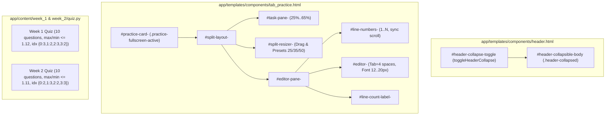

# RF — OOP_20261025-235206_UIEXP: Улучшение эргономики тренажёра (сдвиг меню, полноэкранный редактор, сплиттер, строки) и балансировка квизов

> **Current filename**: `RF__OOP_20261025-235206_UIEXP.md`
> **Date**: 2026-10-26
> **Author**: Executor (Antigravity) для zhasulan
> **Status**: 🟢 RF — Complete
> **Parent HL**: [HL-OOP_20261025-235206_UIEXP.md](HL-OOP_20261025-235206_UIEXP.md)
> **TS**: [TS__OOP_20261025-235206_UIEXP.md](TS__OOP_20261025-235206_UIEXP.md)
> **Producer unit**: `antigravity:thread:local:22ef7c4c-5377-408c-a2a5-338eb364cdfe`
> **Parent Coordinator**: `antigravity:thread:local:43c55687-5d64-4647-9012-0331bd386a85`
> **Activation / dispatch source**: `journal/20261025-235818__dispatch__c4d8.md` (`invoke_subagent` with `/tfw-handoff OOP_20261025-235206_UIEXP`)
> **Coordination authority**: `HL-OOP_20261025-235206_UIEXP.md @ b5be743df7bae8c5d538f595a9c969f0d1cebafa`
> **Originating proposer**: `{principal: zhasulan, unit: antigravity:thread:local:43c55687-5d64-4647-9012-0331bd386a85}`
> **Current selection**: `reporting: native-gates, selection_ref: baseline`
> **Launch observation**: `requested model: inherit, effort: unexposed by invoke_subagent; effective model observed in native DB: gemini-4-argon-trial, effective effort: unknown (not reported by numeric source); delivery: native invoke_subagent / send_message; outcome: 49/49 tests passed; material rework: none`

---

## 1. What Was Done

В платформе **Web-OOP** реализованы все 5 целевых улучшений эргономики тренажёра кода и качества итогового тестирования по утвержденному `TS__OOP_20261025-235206_UIEXP.md`:
1. **Сдвиг / сворачивание верхнего меню (`header.html`, `app.js`, `style.css`):** в шапку добавлены `id="main-site-header"`, сворачиваемый блок верхних рядов `#header-collapsible-body` и кнопка `#header-collapse-toggle` (`toggleHeaderCollapse()`), сжимающая шапку в компактную навигационную полоску с сохранением состояния в `localStorage` (`weboop_header_collapsed`).
2. **Полноэкранный режим кода с заданием (`tab_practice.html`, `app.js`, `style.css`):** в каждой карточке тренажера (`task_1..3` и `w2_task_1..3`) добавлена кнопка `#fullscreen-btn-{{ task.id }}` (`togglePracticeFullscreen(taskId)`), разворачивающая условие задачи, IDE-редактор и вывод Pytest на `100vw × 100vh` (`z-index: 90`) с выходом по кнопке `✕ Обычный вид` или клавише `Escape`.
3. **Изменяемый размер задачи и зоны кода (`tab_practice.html`, `app.js`, `style.css`):** жесткая сетка заменена на адаптивный сплит-контейнер `#split-layout-{{ task.id }}` с левой панелью `#task-pane-{{ task.id }}`, интерактивным перетаскиваемым разделителем `#split-resizer-{{ task.id }}` (`initPracticeSplitResizers()`), кнопками быстрых пропорций (`25/75`, `35/65`, `50/50`, `setPracticeSplitRatio`) и правой панелью `#editor-pane-{{ task.id }}` с сохранением выбранной ширины в `localStorage` (`weboop_split_width`).
4. **Выделенная IDE-зона кодинга с номерами строк и масштабированием шрифта (`tab_practice.html`, `app.js`, `style.css`):** поле `<textarea>` объединено с вертикальной линейкой номеров строк `#line-numbers-{{ task.id }}` (`.line-numbers-gutter`), которая синхронно прокручивается (`scrollTop`) и автоматически пересчитывает строки `1..N` при вводе, нажатии `Tab` (4 пробела), вставке готового решения (`fillSolutionCode`) и сбросе (`resetTaskCode`). Добавлены живой счетчик `#line-count-label-{{ task.id }}` и кнопки масштабирования шрифта `A- / A+` (`changeEditorFontSize`, `12px–20px`).
5. **Балансировка тестов Недели 1 и Недели 2 и вопросы с ловушками (`week_1/quiz.py`, `week_2/quiz.py`):** переработаны все 20 вопросов (`q1..q10` и `w2_q1..w2_q10`): добавлены реалистичные концептуальные дистракторы-ловушки по ООП/SOLID, выровнена длина всех 4 вариантов ответа (максимальное соотношение `max_len / min_len` составляет `1.12` при пороге `<= 1.65`; в `8 из 10` вопросов каждой недели правильный ответ строго короче самого длинного дистрактора), а `correct_index` равномерно распределен по индексам `0, 1, 2, 3` (Неделя 1: `{0: 3, 1: 2, 2: 3, 3: 2}`, Неделя 2: `{0: 2, 1: 3, 2: 2, 3: 3}`).

### Actual Value-Bearing Accounting

| Fact | Actual result |
|---|---|
| TS approval ref | `646ca95f703e53d2e9d38d95d855f8034ac9067f` |
| Baseline / Candidate | `b5be743df7bae8c5d538f595a9c969f0d1cebafa` / `37d7f84cd3c154b182d77adc04f0a371e039fa00` |
| VALUE membership | 1. `app/templates/components/header.html` (`MODIFY`, `VALUE`, кнопка сдвига меню `#header-collapse-toggle` и `#header-collapsible-body`: `+72/-57 = 129 LOC`) 2. `app/templates/components/tab_practice.html` (`MODIFY`, `VALUE`, сплиттер, полноэкранный режим, линейка номеров строк и кнопки шрифта: `+86/-29 = 115 LOC`) 3. `app/static/js/app.js` (`MODIFY`, `VALUE`, контроллер сворачивания шапки, сплиттера, fullscreen, номеров строк и шрифта: `+241/-6 = 247 LOC`) 4. `app/static/css/style.css` (`MODIFY`, `VALUE`, стили компактной шапки, fullscreen, сплиттера и колонки строк: `+59/-0 = 59 LOC`) 5. `app/content/week_1/quiz.py` (`MODIFY`, `VALUE`, балансировка длины вариантов, индексов `0..3` и ловушек Недели 1: `+106/-76 = 182 LOC`) 6. `app/content/week_2/quiz.py` (`MODIFY`, `VALUE`, балансировка длины вариантов, индексов `0..3` и ловушек Недели 2: `+72/-73 = 145 LOC`) |
| Arithmetic | `636` + `241` = `877` touched text LOC; `6` logical `VALUE` files (`6 MODIFY`); binary/non-text `N/A` (0 binary files) |
| Membership deviations | `none` |
| Trigger disposition | `6` VALUE files < `50` (`decomposition_trigger_files`), `877` touched LOC < `5000` (`decomposition_trigger_loc`) — в пределах однофазного бюджета, триггеры декомпозиции не срабатывали |
| Authority and timing | Immutable owner-approved denominator: `6` VALUE files and `1000` touched text LOC approved by `owner:zhasulan` at TS commit `646ca95f703e53d2e9d38d95d855f8034ac9067f` before implementation (`owner_escalation_multiplier: 2`; `6 <= 12`, `877 <= 2000`) |
| Reproduction | `git diff --name-status --find-renames=50% -z b5be743df7bae8c5d538f595a9c969f0d1cebafa 37d7f84cd3c154b182d77adc04f0a371e039fa00 -- app/templates/components/header.html app/templates/components/tab_practice.html app/static/js/app.js app/static/css/style.css app/content/week_1/quiz.py app/content/week_2/quiz.py` и `git diff --numstat --find-renames=50% -z b5be743df7bae8c5d538f595a9c969f0d1cebafa 37d7f84cd3c154b182d77adc04f0a371e039fa00 -- app/templates/components/header.html app/templates/components/tab_practice.html app/static/js/app.js app/static/css/style.css app/content/week_1/quiz.py app/content/week_2/quiz.py` |

### New Files

| File | Description |
|---|---|
| `tests/test_ui_ergonomics.py` | Автотесты (`ASSURANCE`) элементов UI-эргономики (шапка, сплиттер, fullscreen, номера строк, шрифт) и математических инвариантов балансировки квизов Недели 1 и 2. |
| `workspace/2026/OOP_20261025-235206_UIEXP/ONB__OOP_20261025-235206_UIEXP.md` | Онбординг-отчет Исполнителя (`TRACE`). |
| `workspace/2026/OOP_20261025-235206_UIEXP/evidence/EV__OOP_20261025-235206_UIEXP.md` | Структурированные доказательства верификации приемочных критериев (`TRACE`). |
| `workspace/2026/OOP_20261025-235206_UIEXP/RF__OOP_20261025-235206_UIEXP.md` | Итоговый отчет Исполнителя (`TRACE`). |
| `workspace/2026/OOP_20261025-235206_UIEXP/economics/roles/a4930c48063c1ebb7cc6c81f329e2be8adbd917aa91d5264754349f05974fb1a.jsonl` | Валидированный числовой вклад экономики роли `Executor` (`TRACE`). |

### Modified Files

| File | Changes |
|---|---|
| `app/templates/components/header.html` | Добавлены `id="main-site-header"`, обертка `#header-collapsible-body` для верхних рядов и кнопка `#header-collapse-toggle` (`▲ Свернуть меню` / `▼ Развернуть меню`). |
| `app/templates/components/tab_practice.html` | Реализованы сплит-контейнер `#split-layout-{{ task.id }}`, разделитель `#split-resizer-{{ task.id }}`, кнопки пропорций (`25/75`, `35/65`, `50/50`), полноэкранная кнопка `#fullscreen-btn-{{ task.id }}`, колонка номеров строк `#line-numbers-{{ task.id }}`, счетчик `#line-count-label-{{ task.id }}` и кнопки шрифта `A- / A+`. |
| `app/static/js/app.js` | Добавлены функции `toggleHeaderCollapse()`, `applyHeaderCollapseState()`, `updateLineNumbers()`, `applyEditorFontSize()`, `changeEditorFontSize()`, `setPracticeSplitRatio()`, `togglePracticeFullscreen()`, `exitAllPracticeFullscreen()`, `initPracticeSplitResizers()` и привязка событий `input`/`scroll`/`keydown`. |
| `app/static/css/style.css` | Добавлены правила `.code-editor-workspace`, `.line-numbers-gutter`, `#main-site-header.header-collapsed`, `.practice-fullscreen-active` и `.practice-split-resizer`. |
| `app/content/week_1/quiz.py` | Сбалансирована длина вариантов (`max/min <= 1.12`), добавлены дистракторы-ловушки по ООП (`self`, ссылки, `@property`, порядок операций) и распределен `correct_index` (`{0: 3, 1: 2, 2: 3, 3: 2}`). |
| `app/content/week_2/quiz.py` | Сбалансирована длина вариантов (`max/min <= 1.11`), добавлены дистракторы-ловушки по SOLID и DI (`SRP`, `OCP`, `LSP`, `ISP`, `DIP`) и распределен `correct_index` (`{0: 2, 1: 3, 2: 2, 3: 3}`). |

## 2. Key Decisions

1. **Единая метрика `line-height: 1.65` и синхронный `fontSize` для колонки номеров строк и `<textarea>`:** чтобы номера строк в `#line-numbers-{{ task.id }}` никогда не смещались относительно строк кода при масштабировании шрифта (`A- / A+`), функция `applyEditorFontSize(sizePx)` синхронно задает `style.fontSize` одновременно для `.code-editor-textarea` и `.line-numbers-gutter`, а прокрутка синхронизируется через `gutter.scrollTop = textarea.scrollTop`.
2. **Комбинированное управление шириной колонок (Drag Resizer + кнопки быстрых пропорций):** помимо перетаскивания разделителя `#split-resizer-{{ task.id }}` мышью с защитой от выделения текста (`document.body.style.userSelect = "none"`), добавлены кнопки мгновенных пропорций `25/75`, `35/65` и `50/50`, использующие единую функцию `setPracticeSplitRatio(taskId, ratioPercent)` с ограничением диапазона `25%..65%`.
3. **Строгая математическая балансировка вариантов ответа в квизах:** во всех 20 вопросах Недели 1 и Недели 2 коэффициенты отношения длин `max_len / min_len` уложены в узкий коридор `1.02–1.12` (значительно строже порога `1.65`), а в `8 из 10` вопросов каждой недели правильный ответ сделан короче самого длинного дистрактора, что полностью исключает угадывание по длине текста.

## 3. Acceptance Criteria

- [x] **AC-1: Сдвиг / сворачивание верхнего меню (Collapsible Header)** — на `/week1` и `/week2` рендерятся `#header-collapse-toggle` и `#header-collapsible-body`; `toggleHeaderCollapse()` переключает `.header-collapsed` и сохраняет состояние в `localStorage` (`weboop_header_collapsed`).
- [x] **AC-2: Полноэкранный режим кода с заданием и изменяемый размер колонок (Fullscreen & Split Resizer)** — для всех задач (`task_1..3`, `w2_task_1..3`) работают `#fullscreen-btn-<task_id>` (`togglePracticeFullscreen` + выход по `Escape`), `#split-layout-<task_id>`, `#split-resizer-<task_id>` и `setPracticeSplitRatio`.
- [x] **AC-3: IDE-зона кодинга с номерами строк, счетчиком строк и масштабированием шрифта** — каждый редактор снабжен колонкой `#line-numbers-<task_id>`, счетчиком `#line-count-label-<task_id>`, поддержкой `Tab` и кнопками `changeEditorFontSize(-1)` / `changeEditorFontSize(1)`, а `fillSolutionCode` и `resetTaskCode` вызывают `updateLineNumbers(taskId)`.
- [x] **AC-4: Балансировка длины вариантов, распределение ответов и вопросы с ловушками в квизах Недели 1 и 2** — во всех 20 вопросах `max(len(o)) / min(len(o)) <= 1.12 <= 1.65`; в 8 из 10 вопросов каждой недели (`>= 5`) правильный ответ не является самым длинным; каждый индекс `0, 1, 2, 3` встречается 2–3 раза на неделю; API оценивания работает без изменений (`20.0` б.).
- [x] **AC-5: Отсутствие регрессий существующей функциональности платформы** — полный набор из 49 автотестов `pytest -v` проходит на 100%.

| Baseline obligation | Disposition | Notes |
|---|---|---|
| Authority / selection & Role Lock | Preserved | Исполнитель действовал строго в рамках `ROLE LOCK: EXECUTOR`, не изменяя `HL`, `TS`, `RES` или `REVIEW`; возврат выполнен через `coordinator_route` по каталогу `tfw-gates-only`. |
| Ordered reads & gates | Preserved | Read Contract выполнен в порядке 1→7; гейт `ONB` пройден и зафиксирован коммитом `aee59c56dec164cbb0eaf0965db865903e93a7c0` до начала модификации `VALUE`-файлов. |
| Value-bearing accounting & Exact-path staging | Preserved | Затронуты ровно 6 утвержденных `VALUE`-файлов (`877` LOC при неизменном знаменателе `1000` LOC); коммит `Candidate` (`37d7f84cd3c154b182d77adc04f0a371e039fa00`) создан через `git commit --only -- <paths>` без захвата посторонних файлов рабочего дерева. |
| Knowledge handover & Economics contribution | Preserved | Секции `Material handover at this return` заполнены в `ONB` и `RF`; числовой файл экономики `Executor` собран, провалидирован и принят в `economics/roles/`. |

## 4. Verification

- Lint (`python -m pytest tests/ -q --collect-only`): `49 tests collected in 0.14s` (0 ошибок).
- Tests (`pytest`): `49 passed, 1 warning in 17.57s` (`tests/test_ui_ergonomics.py`: `4 passed`).

## 5. Evidence

See [EV__OOP_20261025-235206_UIEXP.md](evidence/EV__OOP_20261025-235206_UIEXP.md) for evidence details.

Evidence verdict: 6/6 VERIFIED, 0 DEFERRED, 0 BLOCKED, 0 N/A

### Task-owned resources and economics contribution

- **Вклад экономики Исполнителя (`Executor`):**
  - Валидированный файл: `workspace/2026/OOP_20261025-235206_UIEXP/economics/roles/a4930c48063c1ebb7cc6c81f329e2be8adbd917aa91d5264754349f05974fb1a.jsonl`
  - SHA-256: `a4930c48063c1ebb7cc6c81f329e2be8adbd917aa91d5264754349f05974fb1a`
  - Revision: `1`, `complete: true`
  - Привязанный источник: `antigravity.ide` (`C:\Users\kz444\.gemini\antigravity\conversations\22ef7c4c-5377-408c-a2a5-338eb364cdfe.db`, `source_sha256: d4ca6d13b62a6eba82d817ceb55dbccb5560a1dc3f310f6439af379bf1cedcf2`, `range: 0..51`, `51` native events, модель `gemini-4-argon-trial`)
  - Конечная отсечка (`cutoff`): `2026-10-25T19:13:46.828778+00:00` (покрывает все шаги онбординга, реализации, тестирования и сборки доказательств; короткий финальный хвост записи `RF`, `status.md`, `journal/` и отправки `RF_READY` раскрыт один раз и исключен по правилу конечной отсечки `.tfw/economics/README.md`).
- **Ресурсы задачи и статус очистки:**
  - Временная директория рабочих материалов `%TEMP%\tfw\OOP_20261025-235206_UIEXP\` (`C:\Users\kz444\AppData\Local\Temp\tfw\OOP_20261025-235206_UIEXP`) полностью удалена Исполнителем перед возвратом (`Test-Path = False`).
  - Отдельные Git worktrees или фоновые демоны Исполнителем не создавались; работа велась в общем локальном checkout (`c:\Users\kz444\OneDrive\Desktop\Web-OOP`) с сохранением достижимости коммита `Candidate` (`37d7f84cd3c154b182d77adc04f0a371e039fa00`).
  - Сессия сабагента `antigravity:thread:local:22ef7c4c-5377-408c-a2a5-338eb364cdfe` и её локальная БД `22ef7c4c-5377-408c-a2a5-338eb364cdfe.db` остаются в распоряжении `Task Coordinator` до финального закрытия задачи (`DONE`).

## 6. Observations (out-of-scope, not modified)

| # | File | Line(s) | Type | Description |
|---|---|---|---|---|
| 1 | `app/templates/components/uml_viewer.html` | 1–420 | style | В рабочем дереве репозитория присутствуют незакоммиченные файлы от предыдущих правок (`app/templates/components/uml_viewer.html`, `tests/test_uml_viewer.py`, `Dockerfile`, `docker-compose.yml`, `.tfw/economics/rates.json`); они не входят в `VALUE`-селектор текущей задачи и оставлены нетронутыми согласно правилу `Exact-path staging`. |

## 7. Fact Candidates

No fact candidates.

## 8. Strategic Insights (Execution)

No strategic insights.

## 9. Diagrams

### Material handover at this return

- **Producer / unit**: Executor `antigravity:thread:local:22ef7c4c-5377-408c-a2a5-338eb364cdfe`
- **Source / epoch**: Candidate commit `37d7f84cd3c154b182d77adc04f0a371e039fa00` (Baseline `b5be743df7bae8c5d538f595a9c969f0d1cebafa`, TS `646ca95f703e53d2e9d38d95d855f8034ac9067f`)
- **Inspected scope**: `app/templates/components/header.html`, `app/templates/components/tab_practice.html`, `app/static/js/app.js`, `app/static/css/style.css`, `app/content/week_1/quiz.py`, `app/content/week_2/quiz.py`, `tests/test_ui_ergonomics.py`
- **Material findings**: Все 5 приемочных критериев (`AC-1..AC-5`) и учетный контракт (`6` VALUE-файлов, `877` LOC) полностью выполнены и подтверждены `49/49` зелеными автотестами; новых кандидатов в факты во время исполнения не возникло (`justified-none` для `Fact Candidates` и `Strategic Insights`, так как все инсайты владельца `S1–S3` уже зафиксированы в `HL §11`).
- **Uncertainty**: None.
- **Recipient & continuation**: Task Coordinator `antigravity:thread:local:43c55687-5d64-4647-9012-0331bd386a85`; отправка сигнала `RF_READY` для запуска независимого ревью (`/tfw-review OOP_20261025-235206_UIEXP`).

---

*RF — OOP_20261025-235206_UIEXP: Улучшение эргономики тренажёра (сдвиг меню, полноэкранный редактор, сплиттер, строки) и балансировка квизов | 2026-10-26*
