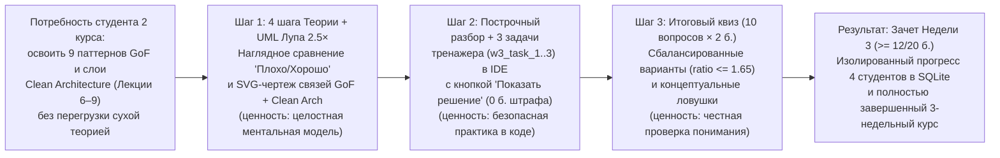

# HL — OOP_20261026-021211_W3GOF: Week 3 GoF Patterns and Clean Architecture Module

> **Date**: 2026-10-26
> **Author**: Coordinator (`antigravity:thread:local:5e1d1422-f45d-4f89-9d10-9eff76d814cb`)
> **Title**: Week 3 GoF Patterns and Clean Architecture Module
> **Abbreviation**: W3GOF
> **Status**: 🟡 TS_DRAFT — Research complete, TS drafted
> **Contract**: 🔒 FROZEN — approved by zhasulan 2026-10-26
> **Frozen**: §1 · §3 · §4 · §5 · §6 · §7 — locked on owner approval
> **Free**: §2 · §7.2 · §8 · §9 · §10 · §11 — research updates these directly
> **Append-only**: §12 Amendment Log — the only channel for changing a frozen section
> **Baseline**: freeze commits — recovery form in `conventions.md` §3 rule 15

> **Project North Star**: `README.md § Цель и North Star проекта` · `.tfw/README.md #ns1 · #ns2 · #ns3`

> **Producer Provenance**:
> - **Producer Unit**: `antigravity:thread:local:5e1d1422-f45d-4f89-9d10-9eff76d814cb` (Task Coordinator)
> - **Parent / Upward Route**: `owner:zhasulan`
> - **Activation Source**: `owner-direct` (`/tfw-plan` initiated by human owner `zhasulan`)
> - **Coordination Authority**: `HL-OOP_20261026-021211_W3GOF.md @ 6a230019863a0b2847c6fdb56c0284b2cc1a7165`
> - **Originating Proposer**: `{principal: zhasulan, unit: antigravity:thread:local:5e1d1422-f45d-4f89-9d10-9eff76d814cb}`

---

## 1. Vision 🔒 FROZEN

Студенты 2 курса открывают в браузере `/week3` (или выбирают активную вкладку **«Неделя 3 · Паттерны GoF и Clean Architecture»** в верхней навигационной шапке) и проходят заключительный 3-й учебный модуль экспресс-курса ООП на сквозном домене диспетчерского центра и бортового терминала **Avtobys**: от порождающих (`Factory Method`, `Builder`), структурных (`Adapter`, `Decorator`, `Facade`) и поведенческих (`Strategy`, `Observer`, `Chain of Responsibility`) паттернов GoF до четырёх слоёв Чистой Архитектуры (`Entities` → `Use Cases` → `Interface Adapters` → `Infrastructure`). В разделе «Теория» они изучают 4 пошаговых раздела с карточками анатомии и рассматривают под интерактивной лупой 2.5× векторную UML-схему архитектуры смены автобуса (`svg-week3`); в «Практике» собирают 3 ключевых компонента в масштабируемом IDE-тренажёре с готовыми решениями без риска потери баллов; а в «Тестировании» проходят сбалансированный квиз из 10 вопросов с концептуальными ловушками и получают свои `20.0` баллов в изолированный профиль студента.

**Impact:** Трёхнедельная программа мини-LMS Web-OOP полностью завершена: все 3 учебные недели работают в единой модульной архитектуре `WeekModule`/`WeekRegistry`, прогресс каждого из 4 участников группы (`zhasulan`, `roman`, `arseniy`, `saubakirov`) по Неделе 3 изолирован в SQLite WAL (`week_3`, `week_3_theory`, `week_3_quiz`, `week_3_w3_task_1..3`), а автотесты подтверждают безопасность песочницы `ASTValidator` и математический баланс всех 30 вопросов курса.

> *Explicitly imagined stakeholder quote (смоделированная цитата студента для превью целевого состояния, не фактический отзыв):*
> «Раньше слова Factory, Adapter, Observer и Clean Architecture казались мне абстрактной теорией из разных учебников. А на Неделе 3 я увидел на одной UML-схеме с лупой, как все они собираются в единый конвейер смены автобуса Avtobys, спокойно проверил код в тренажёре и с первого раза раскусил ловушки в финальном тесте!»

---

## 2. Current State (As-Is) 🟢 FREE

Инспекция репозитория и исходных материалов курса выявила следующие факты:

1. **Бенефициары и масштаб использования (`KNOWLEDGE.md` F1, F2, F5, F6):**
   - Платформа используется малой группой из 4 фиксированных участников (`zhasulan`, `roman`, `arseniy`, `saubakirov`) в рамках экспресс-курса ООП (КазНУ, 2 курс «Программная инженерия»).
   - Педагогический стандарт (`F5`, `F9`): 4 наглядных шага теории с карточками анатомии, 1 построчный разбор кода (`WALKTHROUGH_EXAMPLE`), 3 задачи в свободном тренажёре (`0.0` баллов штрафа + кнопка «Показать готовое решение» `fillSolutionCode`) и 10 вопросов финального теста (`10 × 2.0 = 20.0` б., порог зачёта `12.0` б., защита High-Water Mark).
2. **Состояние модульного ядра и точек интеграции (`app/`):**
   - `app/modules/base.py` и `app/modules/registry.py` (`D8`): контракт `WeekModule` и реестр `WeekRegistry` готовы к декларативной регистрации Недели 3, но сейчас в `week_registry` зарегистрированы только недели `1` и `2`.
   - `app/services/scoring.py` (строки 30–33): словарь `WEEK_TASK_IDS` содержит только ключи `1: ("task_1", "task_2", "task_3")` и `2: ("w2_task_1", "w2_task_2", "w2_task_3")`. При `week_number=3` метод `get_progress_summary()` откатывается на `WEEK_TASK_IDS[1]`, что без добавления `3: ("w3_task_1", "w3_task_2", "w3_task_3")` приводит к неверным ключам прогресса тренажёра.
   - `app/routers/` и `app/main.py`: обобщённый роутер `app/routers/weeks.py` обслуживает `/api/weeks/{week_number}/...`, а клиентский `app/static/js/app.js` обращается к `/week{N}` и `/api/week{N}/{progress,practice/{id}/run,quiz/check,theory/complete}`. Для Недели 3 отсутствует тонкий делегирующий роутер `app/routers/week3.py` и его подключение в `app/main.py`.
   - `app/templates/components/header.html` (строки 60–63): кнопка Недели 3 сверстана как заблокированная заглушка `<button onclick="showLockedWeekToast('Неделя 3 · Паттерны GoF')">` с бейджем `Скоро`.
   - `app/templates/components/uml_viewer.html` и `app/static/js/app.js` (строки 691, 715–750): интерактивный просмотрщик с лупой 2.5× поддерживает только вкладки `week1`, `week2`, `arch`, `db` (`let currentUmlTab = ACTIVE_WEEK === "2" ? "week2" : "week1"`). Для Недели 3 отсутствует векторная SVG-диаграмма `uml-diagram-week3` (с собственным самодостаточным `<defs>` для прохождения `tests/test_uml_viewer.py::test_uml_svgs_have_self_contained_defs`) и переключение по `ACTIVE_WEEK === "3"`.
   - `app/templates/components/tab_theory.html` (строка 6) и `app/templates/components/tab_practice.html` (строки 19, 47): содержат бинарные условия ` ... `, которые при `active_week == 3` проваливаются в ветку Недели 1 (`SmartCard` / `example_avtobys.py`) без добавления веток ``.
   - `app/static/images/`: присутствуют 6 растровых иллюстраций для Недель 1 и 2 (`week1_hero.jpg`, `oop_blueprint.jpg`, `oop_encapsulation.jpg`, `week2_hero.jpg`, `solid_modular.jpg`, `di_ports.jpg`), но отсутствуют 3 иллюстрации для Недели 3.
   - `tests/test_ui_ergonomics.py`: проверяет сворачивание шапки, полноэкранный режим, сплиттер, нумерацию строк и математический баланс вариантов ответа (`max_len / min_len <= 1.65`, `min_len >= 60`, `correct_index` по `2..3` на `0..3`, `not_strictly_longest >= 5/10`) только для Недель 1 и 2.
3. **Исходная методическая база Недели 3 (`C:\Users\kz444\OneDrive\Desktop\OOP` — верифицировано в `research/iter1/`):**
   - Неделе 3 соответствуют 4 лекции и 4 лабораторные работы с каноническими классами:
     - `01_Лекции\RF__lecture_06.pdf` / `02_Лабораторные\RF__lab_06.pdf`: Порождающие паттерны GoF (`Factory Method`: `Ticket(ABC)` / `QrTicket` / `NfcTicket` / `TicketIssuer(ABC).create_ticket(fare: Decimal)`; `Builder`: `@dataclass(frozen=True) class DailyShiftReport`, `IncompleteReportError`, `ShiftReportBuilder` с Fluent API `set_shift_info`, `add_qr_revenue`, `record_incident`, `build()`; рефакторинг антипаттерна `GlobalConfig` Singleton → `AppConfig` + DI).
     - `01_Лекции\RF__lecture_07.pdf` / `02_Лабораторные\RF__lab_07.pdf`: Структурные паттерны GoF (`Adapter`: `LegacyBankClient.execute_payment_kzt(source_pan, dest_account, amount_tiyn: int) -> dict` + `BankApiAdapter.charge(card_id: str, amount: Decimal) -> str`; `Decorator`: `TimingDecorator` / `RetryOnFailureDecorator`; `Facade`: `TransitTerminalFacade.tap()`).
     - `01_Лекции\RF__lecture_08.pdf` / `02_Лабораторные\RF__lab_08.pdf`: Поведенческие паттерны GoF (`Chain of Responsibility`: `PaymentRequest`, `ValidationResult`, `ValidationHandler(ABC)` с `BlacklistCheckHandler` и `BalanceCheckHandler`; `Observer`: `TransitTelemetrySubject` с `attach`, `detach`, `notify` и `MetricsCollectorObserver`; `Strategy` vs `State`).
     - `01_Лекции\RF__lecture_09.pdf` / `02_Лабораторные\RF__lab_09.pdf`: Чистая архитектура (`Clean Architecture`: 4 слоя `domain` ← `application` ← `infrastructure` ← `presentation`, `The Dependency Rule`, Value Object `Money(amount: Decimal, currency: str = "KZT")`, Entity `TransitCard.charge_fare(fare: Money)`, порты `CardRepositoryPort` / `PaymentGatewayPort`, `ValidateRideUseCase.execute(request: ValidateRideRequest) -> ValidateRideResponse`, и запахи кода Фаулера `Primitive Obsession`, `Divergent Change` vs `Shotgun Surgery`, `Feature Envy`, `Refused Bequest`).
   - В исходном коде PDF обнаружены 4 конструкции, блокируемые белым списком `ASTValidator` (`import time`, `import re`, `__new__`, `.__class__.__name__`), которые исключены из кода задач `w3_task_1..3` в пользу чистых ООП-абстракций из `ALLOWED_MODULES` (`abc`, `dataclasses`, `decimal`, `typing`).

---

## 3. Target State (To-Be) 🔒 FROZEN

Полноценный модуль **Недели 3 («Паттерны проектирования GoF и Чистая архитектура»)** интегрирован в платформу Web-OOP наравне с Неделями 1 и 2:

1. **Контентный пакет `app/content/week_3/` (`__init__.py`, `theory.py`, `practice.py`, `quiz.py`):**
   - `WEEK3_OVERVIEW`: обзор недели с карточкой Hero (`/static/images/week3_hero.jpg`) и 3-шаговой воронкой обучения.
   - `THEORY_SECTIONS`: 4 пошаговых раздела теории с карточками анатомии, примерами «Плохо / Хорошо» и иллюстрациями:
     - **Шаг 1 (Лекция 6):** Порождающие паттерны GoF (`Factory Method` и `Builder`) на примере фабрики билетов/валидаторов и пошагового строителя финансового отчёта смены Avtobys.
     - **Шаг 2 (Лекция 7):** Структурные паттерны GoF (`Adapter`, `Decorator`, `Facade`) на примере адаптера внешнего платёжного шлюза, декоратора чеков/логирования и единого фасада терминала.
     - **Шаг 3 (Лекция 8):** Поведенческие паттерны GoF (`Strategy`, `Observer`, `Chain of Responsibility`) на примере цепочки проверок оплаты и событийного наблюдателя диспетчерского мониторинга.
     - **Шаг 4 (Лекция 9):** Чистая Архитектура (`Clean Architecture`) и правило зависимостей (`Dependency Rule`: `Entities` ← `Use Cases` ← `Interface Adapters` ← `Infrastructure`) на примере симулятора смены автобуса.
   - `WALKTHROUGH_EXAMPLE`: построчный разбор сквозного примера кода перед практикой (4 логических блока с привязкой к строкам).
   - `PRACTICE_TASKS`: 3 связанные задачи свободного тренажёра (`w3_task_1`, `w3_task_2`, `w3_task_3`, `max_score: 0.0`) с `starter_code`, `reference_solution`, `hint` и `test_code` (совместимыми с `ASTValidator` и `RunnerService`):
     - `w3_task_1`: Порождающий / структурный паттерн GoF (строитель финансового отчёта смены / адаптер внешней оплаты в домене Avtobys).
     - `w3_task_2`: Поведенческий паттерн GoF (наблюдатель мониторинга / цепочка проверок поездки в домене Avtobys).
     - `w3_task_3`: Слой Use Case Чистой Архитектуры (сценарий обработки поездки / смены автобуса через чистые контракты без прямой привязки к инфраструктуре).
   - `QUIZ_QUESTIONS` и `evaluate_quiz`: 10 вопросов (`w3_q1..w3_q10`, по `2.0` балла, максимум `20.0` баллов) с концептуальными ловушками по GoF и Clean Architecture, удовлетворяющих строгим инвариантам баланса (`min_len >= 60`, `max_len / min_len <= 1.65`, каждый `correct_index` из `0..3` встречается 2–3 раза, минимум в 5 из 10 вопросов правильный ответ не является строго самым длинным).
2. **Интеграция в ядро, маршрутизацию и учёт прогресса:**
   - В `app/modules/registry.py` зарегистрирован `WeekModule(week_number=3, ...)`.
   - В `app/services/scoring.py` словарь `WEEK_TASK_IDS` дополнен ключом `3: ("w3_task_1", "w3_task_2", "w3_task_3")`.
   - Создан тонкий делегирующий роутер `app/routers/week3.py` (`/week3`, `/api/week3/progress`, `/api/week3/practice/{task_id}/run`, `/api/week3/quiz/check`, `/api/week3/quiz/evaluate`, `/api/week3/theory/complete`) и подключён в `app/main.py` и `app/routers/__init__.py`.
3. **Визуальный интерфейс и интерактивная UML-диаграмма:**
   - В `app/templates/components/header.html` заглушка Недели 3 заменена на активную навигационную ссылку `<a href="/week3">Неделя 3 · Паттерны GoF</a>`.
   - В `app/templates/components/uml_viewer.html` и `app/static/js/app.js` добавлена вкладка `week3` (`🏛️ Неделя 3: GoF & Clean Architecture`) с векторной SVG-схемой `svg-week3` (показывающей взаимодействие паттернов GoF и слоёв Clean Architecture в домене Avtobys), автоматически открывающаяся при `active_week == 3` и поддерживающая лупу 2.5× и полноэкранный зум.
   - В `app/static/images/` добавлены 3 растровые Cyberpunk-иллюстрации для Недели 3 (`week3_hero.jpg`, `gof_patterns.jpg`, `clean_arch_layers.jpg`).
4. **Автотесты и документация:**
   - Создан тестовый набор `tests/test_week3.py` (проверяющий маршруты `/week3`, `/api/week3/...`, прохождение всех `reference_solution` для `w3_task_1..3` в песочнице, оценивание квиза и изоляцию прогресса 4 студентов).
   - Расширены `tests/test_ui_ergonomics.py`, `tests/test_uml_viewer.py` и `tests/test_week_modules.py` на Неделю 3.
   - Обновлены `docs/domain_model_uml.md` и `docs/architecture.md` с отражением модуля Недели 3.

### 3.1 Result Visualization

| Измерение | Сейчас (As-Is) | После реализации (To-Be · иллюстративные данные) |
|---|---|---|
| **Навигация в `header.html`** | Кнопка `Неделя 3 · Паттерны GoF [Скоро]` вызывает тост `showLockedWeekToast` | Активная ссылка `<a href="/week3">Неделя 3 · Паттерны GoF</a>` с классом `week-pill-active` при `active_week == 3` |
| **Реестр `WeekRegistry` и `ScoringService`** | Зарегистрированы только Недели 1 и 2; `WEEK_TASK_IDS` не содержит ключ `3` | Зарегистрирован `WeekModule(week_number=3, ...)`; `WEEK_TASK_IDS[3] = ("w3_task_1", "w3_task_2", "w3_task_3")`; работают `/week3` и `/api/week3/...` |
| **Теория Недели 3 (`app/content/week_3/theory.py`)** | Отсутствует | **4 шага с карточками анатомии, примерами «Плохо/Хорошо» и 3 иллюстрациями:**<br>1) Порождающие GoF (`Factory Method`, `Builder`)<br>2) Структурные GoF (`Adapter`, `Decorator`, `Facade`)<br>3) Поведенческие GoF (`Strategy`, `Observer`, `Chain of Responsibility`)<br>4) `Clean Architecture` (`Entities`, `Use Cases`, `Adapters`, `Dependency Rule`) |
| **Интерактивный UML Viewer (`uml_viewer.html`)** | Вкладки только для `week1`, `week2`, `arch`, `db` | Добавлена вкладка **`🚀 Неделя 3: GoF & Clean Architecture`** с векторной SVG-схемой `svg-week3`, активная по умолчанию на `/week3` с лупой 2.5× и полноэкранным зумом |
| **Практика (`app/content/week_3/practice.py`)** | Отсутствует | Построчный разбор `WALKTHROUGH_EXAMPLE` + **3 задачи тренажёра (`w3_task_1..3`, `0.0` б.)** с кнопкой «Показать готовое решение» и проверкой в `RunnerService` |
| **Тестирование (`app/content/week_3/quiz.py`)** | Отсутствует | **10 сбалансированных вопросов (`w3_q1..w3_q10`, `20.0` б.)** с ловушками по GoF и Clean Architecture, проверенных в `test_ui_ergonomics.py` |

```text
┌──────────────────────────────────────────────────────────────────────────────────────────┐
│ [ООП] Учебная платформа    Профиль: [Жасулан Куандыков ▾]  Баллы: 20.0 / 20.0  [ЗАЧЕТ]   │
│ [Неделя 1 · Инкапсуляция]  [Неделя 2 · SOLID и DI]  [★ Неделя 3 · Паттерны GoF (Активно)]│
├──────────────────────────────────────────────────────────────────────────────────────────┤
│ [Главная]  [Теория]  [Практика]  [Тестирование]  [Результаты]   [📐 UML-Диаграммы] [▲]   │
├──────────────────────────────────────────────────────────────────────────────────────────┤
│ ⚡ Неделя 3 · Паттерны GoF и Clean Architecture • Ориентир: 60 + 60 + 60 мин             │
│ Паттерны проектирования GoF и Чистая Архитектура: диспетчерский центр Avtobys            │
│                                                                                          │
│ ┌─ ШАГ 01: Теория (4 шага) ─┐ ┌─ ШАГ 02: Тренажер (0 б.) ──┐ ┌─ ШАГ 03: Квиз (20 б.) ──┐ │
│ │ • Порождающие (Factory,   │ │ • w3_task_1: Порождающий / │ │ • 10 вопросов с         │ │
│ │   Builder)                │ │   Структурный паттерн GoF  │ │   ловушками (w3_q1..10) │ │
│ │ • Структурные (Adapter,   │ │ • w3_task_2: Поведенческий │ │ • Баланс длин <= 1.65   │ │
│ │   Decorator, Facade)      │ │   паттерн (Observer/Chain) │ │ • Зачет от 12.0 баллов  │ │
│ │ • Поведенческие (Observer,│ │ • w3_task_3: Use Case      │ │ • High-Water Mark       │ │
│ │   Chain, Strategy)        │ │   Чистой Архитектуры       │ │   сохранение в SQLite   │ │
│ │ • Clean Architecture      │ │ • Кнопка «Готовое решение» │ │                         │ │
│ └───────────────────────────┘ └────────────────────────────┘ └─────────────────────────┘ │
└──────────────────────────────────────────────────────────────────────────────────────────┘
  *Иллюстративный макет страницы /week3 после завершения задачи*
```

### 3.2 Value Flow



---

## 4. Phases 🔒 FROZEN

Задача реализуется в **одну фазу (Single-Phase)**, так как прогнозируемый объём изменений поверхности `VALUE` составляет ~14 файлов и ~1300 строк кода/контента, что кратно ниже настроенных порогов декомпозиции в `.tfw/project_config.yaml` (`decomposition_trigger_files: 50`, `decomposition_trigger_loc: 5000`).

### 4.1 Coordination Selection 🔒 FROZEN

| Activation source | Accountable owner | Task Coordinator unit | Phase Coordinator rule | Mandate scope / role reach | Upward route | Dialogue | Reporting | Reservations / controls | Amendment authority | Immutable epoch |
|---|---|---|---|---|---|---|---|---|---|---|
| owner-direct | `zhasulan` | `antigravity:thread:local:5e1d1422-f45d-4f89-9d10-9eff76d814cb` | none (single-phase task) | Task `OOP_20261026-021211_W3GOF` (single-phase: `PLAN`, `RESEARCH`, `EXEC`, `REVIEW`, `DOCS`, `KNW`) | `owner:zhasulan` | `tfw-gates-only` | `native-gates` | Owner approves frozen HL, TS + VALUE denominator, any scope/budget overrun ≥ 2×, and final task acceptance | `none` | `6a230019863a0b2847c6fdb56c0284b2cc1a7165` |

### Single-Phase Deliverables 🔴

- Создание контентного пакета `app/content/week_3/` (`__init__.py`, `theory.py`, `practice.py`, `quiz.py`) по материалам Лекций 6–9 и Лабораторных 6–9 в гибридной конфигурации **C3** (`WALKTHROUGH_EXAMPLE`: `TicketIssuer` + `TransitTerminalFacade`; `w3_task_1`: `DailyShiftReport` + `IncompleteReportError` + `ShiftReportBuilder` + `LegacyBankClient` + `BankApiAdapter`; `w3_task_2`: `PaymentRequest` + `ValidationResult` + `ValidationHandler` (`BlacklistCheckHandler`, `BalanceCheckHandler`) + `TransitTelemetrySubject`; `w3_task_3`: `Money` + `TransitCard` + `ValidateRideRequest` + `ValidateRideResponse` + `ValidateRideUseCase`; `QUIZ_QUESTIONS`: `w3_q1..w3_q10`).
- Добавление 3 растровых Cyberpunk-иллюстраций Недели 3 в `app/static/images/` (`week3_hero.jpg`, `gof_patterns.jpg`, `clean_arch_layers.jpg`).
- Регистрация модуля Недели 3 в `app/modules/registry.py` и регистрация `WEEK_TASK_IDS[3] = ("w3_task_1", "w3_task_2", "w3_task_3")` в `app/services/scoring.py`.
- Создание тонкого делегирующего роутера `app/routers/week3.py` и его подключение в `app/routers/__init__.py` и `app/main.py`.
- Разблокировка ссылки `<a href="/week3">` в `app/templates/components/header.html` и добавление веток `` в `app/templates/components/tab_theory.html` и `app/templates/components/tab_practice.html`.
- Добавление вкладки `week3` и векторной SVG-схемы `svg-week3` (с автономным `<defs>` для локальных фильтров/маркеров `#shadow-box-w3`, `#arrow-dep-w3`, `#arrow-impl-w3`) в `app/templates/components/uml_viewer.html` с поддержкой переключения по `ACTIVE_WEEK === "3"` и `tabKey === "week3"` в `app/static/js/app.js`.
- Добавление автотестов `tests/test_week3.py` и расширение `tests/test_ui_ergonomics.py`, `tests/test_uml_viewer.py` и `tests/test_week_modules.py` на Неделю 3; обновление `docs/domain_model_uml.md` и `docs/architecture.md`.

---

## 5. Definition of Done (DoD) 🔒 FROZEN

- ✅ 1. Пакет `app/content/week_3/` содержит полный учебный контент Недели 3: `WEEK3_OVERVIEW`, 4 шага `THEORY_SECTIONS` (Порождающие GoF, Структурные GoF, Поведенческие GoF, Clean Architecture), построчный разбор `WALKTHROUGH_EXAMPLE`, 3 задачи тренажёра `PRACTICE_TASKS` (`w3_task_1`, `w3_task_2`, `w3_task_3` с `max_score: 0.0`, `starter_code`, `reference_solution`, `hint`, `test_code`) и 10 вопросов квиза `QUIZ_QUESTIONS` (`w3_q1..w3_q10` по `2.0` балла, всего `20.0` баллов) с функцией `evaluate_quiz`.
- ✅ 2. Модуль Недели 3 зарегистрирован в `WeekRegistry` (`app/modules/registry.py`), задачи `("w3_task_1", "w3_task_2", "w3_task_3")` добавлены в `ScoringService.WEEK_TASK_IDS[3]`, а маршруты `/week3` и `/api/week3/{progress,practice/{task_id}/run,quiz/check,quiz/evaluate,theory/complete}` работают через `app/routers/week3.py` с полной изоляцией прогресса 4 студентов (`X-Student-Id`) и защитой High-Water Mark.
- ✅ 3. В `app/templates/components/header.html` кнопка Недели 3 преобразована в рабочую навигационную ссылку `/week3`; в `app/templates/components/uml_viewer.html` и `app/static/js/app.js` добавлена векторная SVG-диаграмма `uml-diagram-week3` (`svg-week3`), автоматически активируемая на `/week3` и работающая с интерактивной лупой 2.5× и полноэкранным режимом; в `app/static/images/` присутствуют 3 иллюстрации Недели 3.
- ✅ 4. Эталонные решения (`reference_solution`) всех 3 задач `w3_task_1..3` успешно проходят проверку в изолированной песочнице `RunnerService` (`ASTValidator` + `python -I -m pytest` в пределах 5.0 сек), а все 10 вопросов квиза Недели 3 проходят автотест математического баланса и ловушек в `tests/test_ui_ergonomics.py` (`min_len >= 60`, `max_len / min_len <= 1.65`, распределение `correct_index` по `2..3`, минимум 5 из 10 правильных ответов не являются строго самыми длинными).
- ✅ 5. Все существующие и новые автотесты (`pytest`) проходят на 100% без регрессий для Недель 1 и 2, а архитектурная документация (`docs/domain_model_uml.md`, `docs/architecture.md`) синхронизирована с Неделей 3.

---

## 6. Definition of Failure (DoF) 🔒 FROZEN

- ❌ 1. Поломка или регрессия функциональности Недели 1 (`/week1`) или Недели 2 (`/week2`), либо повреждение схемы/прогресса 4 профилей студентов в SQLite.
- ❌ 2. Отказ хотя бы одного эталонного решения `w3_task_1..3` в песочнице `RunnerService` или ослабление правил безопасности `ASTValidator` (добавление опасных системных модулей/вызовов).
- ❌ 3. Нарушение инвариантов эргономики IDE или математического баланса квиза Недели 3 (`max_len / min_len > 1.65`, `min_len < 60`, перекос `correct_index` или угадывание правильного ответа по самому длинному тексту).
- ❌ 4. Наличие плейсхолдеров (`TODO`, `pass` в `reference_solution`, битых путей к картинкам) или нарушение принципа Zero-Build (добавление `node_modules` или сборщиков фронтенда).

**On failure:** Откатить проблемные изменения, исправить контент или маршрутизацию внутри границ `TS`, перезапустить полный прогон `pytest` и проверку в живом окружении.

---

## 7. Principles 🔒 FROZEN

1. **P1: Сквозной домен Avtobys от класса до архитектуры** — все 4 шага теории, разбор кода, 3 задачи тренажёра, SVG UML-диаграмма и 10 вопросов квиза строятся вокруг единой предметной области транспортной системы Avtobys.
2. **P2: Бережная воронка для начинающих (`0.0` б. тренажёр + `20.0` б. квиз)** — практика остаётся безопасной средой для экспериментов с кнопкой «Показать готовое решение» без штрафов, а 100% оценки недели формирует сбалансированный итоговый тест.
3. **P3: Декларативная модульность через `WeekModule`** — подключение Недели 3 выполняется через стандартный контракт `WeekModule` и `WeekRegistry` без дублирования бизнес-логики контроллеров и шаблонов.
4. **P4: Строгая нативная безопасность и Zero-Build** — весь исполняемый код задач обязан укладываться в синтаксический белый список `ASTValidator` и стандартную библиотеку Python без внешних зависимостей, а фронтенд остаётся чистым HTML/CSS/Vanilla JS + встроенный SVG.
5. **P5: Доказуемый баланс квизов против угадывания** — варианты ответов квиза Недели 3 проектируются с правдоподобными концептуальными дистракторами и проверяются автоматическим тестом длины и распределения индексов.

### 7.2 Knowledge Citations 🟢 FREE

| # | Source | Item | How it applies |
|---|---|---|---|
| 1 | `README.md` (PV Priority 0 — Project North Star) | `§ Цель и North Star проекта` (`NS1`: локальная интерактивная мини-LMS на 3 недели изучения ООП; Неделя 3 — ключевые паттерны GoF и основы чистой архитектуры на домене Avtobys) | Определяет прямое целевое назначение задачи: запуск заключительной 3-й учебной недели курса без выхода за рамки локальной Zero-Build платформы. |
| 2 | `.tfw/README.md` (PV Priority 1 — Methodology Values & Success Criteria) | `#ns2` (`The Saint-Exupéry Principle`, `Questions before premature answers`), `#methodology-values` (`Candor Over Flattery`, `Structural Enforcement`), `#success-criteria` (`4. The result is ready for acceptance`) | Требует проверки инвариантов Недели 3 структурными автотестами (`pytest`) и отсутствия плейсхолдеров или лишних управляющих надстроек. |
| 3 | `knowledge/philosophy.md` (PV Priority 2) | `N/A — файл отсутствует в репозитории` | Философия проекта зафиксирована непосредственно в `README.md` и `KNOWLEDGE.md` §1. |
| 4 | `KNOWLEDGE.md` (PV Priority 3 — Architecture Decisions) | `§1 D2 (Домен Avtobys)`, `D6 (Воронка Недели 1: тренажер 0 б. + квиз 20 б.)`, `D7 (Мультинедельная архитектура)`, `D8 (WeekModule / WeekRegistry)`, `D9 (ASTValidator Whitelist + python -I)`, `D10 (4 профиля студентов + WAL)`, `D11 (Эргономика IDE + математический баланс квизов <= 1.65)` | Задаёт точный архитектурный каркас: регистрация в `WeekRegistry`, делегат `week3.py`, `WEEK_TASK_IDS[3]`, совместимость с `ASTValidator` и автотестами `test_ui_ergonomics.py`. |
| 5 | `.tfw/conventions.md` (PV Priority 4 — Contract, Design Rules, Anti-patterns) | `§3 HL Contract`, `§6 Scope Budgets (per Phase)`, `§7 Coordination`, `§11 Content Language: ru`, `§12 Working material & Comments`, `§14 Anti-patterns`, `§15 Role Lock Protocol` | Обеспечивает соблюдение Role Lock Координатора, русскоязычное наполнение артефактов, учёт бюджета `VALUE` и запрет на хранение рабочих черновиков в дереве проекта. |
| 6 | `knowledge/convention.md` & `knowledge/process.md` (PV Priorities 5–6) | `N/A — файлы отсутствуют в репозитории` | Соглашения и процессные правила проекта консолидированы в `KNOWLEDGE.md` §4 и `knowledge/records/`. |
| 7 | `KNOWLEDGE.md` §4 & `knowledge/records/` (PV Priority 7 — Domain, Stakeholder & Technical Records) | `F5` ([REC-OOP_20261018-213107_W1MAT-human-beginner-format.md](../../../knowledge/records/REC-OOP_20261018-213107_W1MAT-human-beginner-format.md)), `F7` ([REC-OOP_20261021-141300_REFAC-human-sandbox-constraint.md](../../../knowledge/records/REC-OOP_20261021-141300_REFAC-human-sandbox-constraint.md)), `F9` ([REC-OOP_20261025-235206_UIEXP-human-quiz-and-ide-ux.md](../../../knowledge/records/REC-OOP_20261025-235206_UIEXP-human-quiz-and-ide-ux.md)), [REC-OOP_20261021-141300_REFAC-tech-modular-weeks.md](../../../knowledge/records/REC-OOP_20261021-141300_REFAC-tech-modular-weeks.md), [REC-OOP_20261025-235206_UIEXP-tech-ide-ergonomics-and-quiz-balance.md](../../../knowledge/records/REC-OOP_20261025-235206_UIEXP-tech-ide-ergonomics-and-quiz-balance.md) | Подтверждает актуальные требования (без входящих конфликтов): формат для начинающих, нативная песочница без Docker, эргономика редактора и баланс длины вариантов квиза `<= 1.65`. |

---

## 8. Dependencies 🟢 FREE

| Dependency | Status |
|---|---|
| Завершённая модульная архитектура `WeekModule` / `WeekRegistry` (`OOP_20261021-141300_REFAC`) | ✅ Выполнено |
| Завершённый стандарт эргономики IDE и UML-просмотрщика с лупой (`OOP_20261025-235206_UIEXP`) | ✅ Выполнено |
| Исходные PDF-материалы Лекций 06–09 и Лабораторных 06–09 в `C:\Users\kz444\OneDrive\Desktop\OOP` | ✅ Извлечены и верифицированы в `research/iter1/RES.md` |

---

## 9. Risks 🟢 FREE

| Risk | Probability | Impact | Mitigation |
|---|---|---|---|
| **R1: Расхождение примеров Недели 3 с оригинальными Лекциями/Лабораторными 6–9** | Low (Resolved) | High | В `research/iter1/` извлечены точные классы и сигнатуры из `RF__lecture_06..09.pdf` и `RF__lab_06..09.pdf` (`TicketIssuer`, `DailyShiftReport`, `ShiftReportBuilder`, `IncompleteReportError`, `LegacyBankClient`, `BankApiAdapter`, `ValidationHandler`, `BlacklistCheckHandler`, `BalanceCheckHandler`, `TransitTelemetrySubject`, `Money`, `TransitCard`, `ValidateRideUseCase`) и зафиксированы в `TS`. |
| **R2: Блокировка кода задач `w3_task_1..3` белым списком `ASTValidator`** | Low (Resolved) | High | Выявлены и исключены 4 запрещённые конструкции из PDF (`import time`, `import re`, `__new__`, `.__class__.__name__`); код `w3_task_1..3` использует только разрешённые модули из `ALLOWED_MODULES` (`abc`, `dataclasses`, `decimal`, `typing`). |
| **R3: Нарушение коэффициента длины вариантов ответа (`<= 1.65`) в квизе Недели 3** | Medium | Medium | Включить `w3_q1..w3_q10` в автотест `test_quiz_balance_and_traps` (`tests/test_ui_ergonomics.py`) и верифицировать длины всех 40 строк вариантов ответа (`min_len >= 60`, `max_len / min_len <= 1.65`, распределение `correct_index` по 2–3 раза на `0..3`, `not_strictly_longest >= 5/10`). |
| **R4: Визуальное наложение текста или ошибка ссылок `<defs>` в новой SVG-диаграмме `svg-week3`** | Low | Medium | Спроектировать 4-колоночную компоновку `svg-week3` (`viewBox="0 0 1120 560"`) с собственным изолированным блоком `<defs>` (`#shadow-box-w3`, `#arrow-dep-w3`, `#arrow-impl-w3`) для прохождения `tests/test_uml_viewer.py::test_uml_svgs_have_self_contained_defs`. |

---

## 10. RESEARCH Case 🟢 FREE

### Blind Spots
- Точные названия классов, сигнатуры методов и сюжетные связки в оригинальных PDF-файлах `RF__lecture_06..09.pdf` и `RF__lab_06..09.pdf` (`C:\Users\kz444\OneDrive\Desktop\OOP`) — **закрыто в `research/iter1/`**.
- Проверка того, не используют ли примеры из Лабораторных 6–9 синтаксических конструкций или модулей стандартной библиотеки, отсутствующих в `ASTValidator.ALLOWED_MODULES` — **закрыто в `research/iter1/`** (выявлены и исключены `import time`, `import re`, `__new__`, `.__class__.__name__`).

### Hypotheses

| # | Hypothesis | Status |
|---|---|---|
| **H1** | В исходных PDF-материалах Лекций 6–9 и Лабораторных 6–9 (`C:\Users\kz444\OneDrive\Desktop\OOP`) используется сквозная доменная модель транспортной системы Avtobys (строитель финансовых отчётов / фабрика, адаптер / декоратор / фасад терминала, цепочка обязанностей / наблюдатель мониторинга, Use Case симулятора смены автобуса), из которой можно выделить 3 компактные in-memory задачи тренажёра (`w3_task_1..3`), полностью совместимые с текущим белым списком `ASTValidator` без ослабления безопасности песочницы. | confirmed (`research/iter1/3_extract.md`, `4_challenge.md`, `RES.md`) |
| **H2** | Существующие Jinja2-компоненты (`tab_home.html`, `tab_theory.html`, `tab_practice.html`, `tab_quiz.html`, `tab_results.html`) и клиентский контроллер `app/static/js/app.js` требуют для полной поддержки Недели 3 изменений только в `header.html` (ссылка `/week3`), `uml_viewer.html` (вкладка и SVG `week3`) и `app.js` (инициализация и переключение `currentUmlTab` для `ACTIVE_WEEK === "3"`). | refined (`tab_theory.html` и `tab_practice.html` также требуют веток ``, а `app.js` требует веток `ACTIVE_WEEK === "3"` и `tabKey === "week3"` в `currentUmlTab`, `switchUmlDiagramTab`, `openUmlFullscreen`) |

### Risks of Not Researching
Если пропустить исследование `RF__lecture_06..09.pdf` и `RF__lab_06..09.pdf` и написать `TS` по общим представлениям о паттернах GoF, названия классов и контракты в тренажёре Недели 3 могут разойтись с реальной программой курса CS2203 и экзаменационными требованиями.

### Proposed RESEARCH Focus
1. **Gather**: Извлечь структуру, ключевые классы, методы и примеры кода из `RF__lecture_06..09.pdf` и `RF__lab_06..09.pdf`, а также проверить все точки привязки к номеру недели в `app/templates/`, `app/static/js/app.js` и `tests/`.
2. **Extract**: Сформировать пространство конфигураций для 4 шагов теории, `WALKTHROUGH_EXAMPLE`, 3 задач тренажёра (`w3_task_1..3`), SVG-схемы `svg-week3` и 10 вопросов квиза (`w3_q1..w3_q10`).
3. **Challenge**: Проверить выбранные сигнатуры задач на совместимость с `ASTValidator`, отсутствие перегрузки для начинающих (до 45 строк на задачу) и покрытие всех 4 тем Недели 3.

### Why Not Just...?

| Approach | Value | Adoption / operating burden | Risks / tradeoffs | Decision and reason |
|---|---|---|---|---|
| **1. (Рекомендуется) Сквозной конвейер смены Avtobys: 4 шага теории (Порождающие → Структурные → Поведенческие → Clean Architecture) + 3 сфокусированные задачи тренажёра + SVG UML `week3`** | Студенты видят, как паттерны GoF работают внутри слоёв Clean Architecture одного терминала Avtobys; каждая задача тренажёра компактна (25–45 строк) и понятна второкурснику | Средняя (~16 файлов `VALUE`, ~1350 LOC: пакет `week_3`, роутер `week3.py`, SVG-схема в `uml_viewer.html`, шаблоны `header`/`tab_theory`/`tab_practice`, 3 иллюстрации и доки) | Требует точного отбора 3 репрезентативных упражнений для практики, в то время как все 9 паттернов и Clean Architecture проверяются в 10 вопросах квиза | **Выбрано:** оптимальный баланс методической полноты Лекций 6–9 и бережного порога входа для начинающих (`F5`), с полной поддержкой UML-лупы и автотестов (`D11`) |
| **2. «Полный каталог в коде»: включить в 3 задачи тренажёра написание кода сразу для всех 9 паттернов GoF + 4 слоёв Clean Architecture** | Каждый паттерн представлен отдельной реализацией в редакторе кода | Высокая (шаблоны по 120–180 строк на задачу, громоздкие тесты) | Когнитивная перегрузка начинающих студентов: фокус смещается с понимания архитектуры на борьбу с бойлерплейтом и механическую вставку готового ответа | **Отклонено:** нарушает педагогический принцип `F5` |
| **3. «Контент без визуализации»: добавить только `app/content/week_3/` и `week3.py` без новой вкладки SVG в `uml_viewer.html` и без новых иллюстраций** | Минимальное число затронутых файлов | Низкая (~7 файлов) | При нажатии «📐 UML-Диаграммы (Лупа 2.5×)» на Неделе 3 откроется схема `SmartCard` из Недели 1; визуально Неделя 3 будет выглядеть незавершённой | **Отклонено:** нарушает стандарт визуальной целостности платформы (`D6`, `D11`) |

**Leave unchanged:** Кнопка «Неделя 3 · Паттерны GoF» в шапке остаётся заблокированной со всплывающим тостом «Скоро», а 3-недельный экспресс-курс ООП обрывается на 2-й неделе, оставляя студентов без материалов по паттернам GoF и Clean Architecture перед экзаменом.

**Critical challenge:** На Неделе 3 в один учебный модуль сжимаются сразу 4 крупные темы (Лекции 6–9). Рекомендация окажется ошибочной, если мы придумаем абстрактные примеры GoF, не совпадающие с классами из авторских файлов `RF__lecture_06..09.pdf` и `RF__lab_06..09.pdf`. Именно поэтому перед написанием `TS` проводится целевое исследование `/tfw-research` по исходным PDF-материалам курса.

---

## 11. Strategic Insights (Planning) 🟢 FREE

| # | Insight | Category | Source |
|---|---|---|---|
| **S1** | Владелец подтвердил запуск Недели 3 в едином педагогическом и визуальном стандарте с Неделями 1 и 2: с предварительной сверкой по авторским материалам Лекций/Лабораторных 6–9 (`/tfw-research`), 3 пошаговыми задачами свободного тренажёра, новой векторной диаграммой `week3` в компоненте интерактивной лупы `uml_viewer.html` и 3 тематическими Cyberpunk-иллюстрациями. | `domain` | User (`zhasulan`), подтверждение фрейминга и объёма Недели 3 при запуске `/tfw-plan` |
| **S2** | При переносе 4 лабораторных работ Недели 3 (Лаб 6–9) в 3 задачи свободного тренажёра (`w3_task_1..3`) гибридная конфигурация **C3** из `research/iter1/3_extract.md` (`WALKTHROUGH_EXAMPLE`: `TicketIssuer` + `TransitTerminalFacade`; `w3_task_1`: `DailyShiftReport` + `ShiftReportBuilder` + `LegacyBankClient` + `BankApiAdapter`; `w3_task_2`: `ValidationHandler` + `TransitTelemetrySubject`; `w3_task_3`: `Money` + `TransitCard` + `ValidateRideUseCase`) обеспечивает 100% покрытие всех 4 лабораторных и строгое соответствие замороженному `HL §3` при объёме 30–44 строк на задачу. *(Примечание Координатора по сверке `3_extract.md` и `RES.md`: в `TS` связывается точный контракт `WeekModule` из `app/modules/base.py` и `3_extract.md` — `WEEK3_OVERVIEW`, `THEORY_SECTIONS`, `WALKTHROUGH_EXAMPLE`, `PRACTICE_TASKS` с `max_score: 0.0`, `QUIZ_QUESTIONS` на `20.0` баллов, `evaluate_quiz` — а также явная доработка `app/static/js/app.js` для `ACTIVE_WEEK === "3"` и `tabKey === "week3"`).* | `architecture` | `research/iter1/3_extract.md` (`E1–E4`), `research/iter1/RES.md` (`SS1`, `SS2`) |

---

## 12. Amendment Log 🟢 APPEND-ONLY

**No amendments.**

---

### Material handover at this return

- **Producer / Unit:** Task Coordinator (`antigravity:thread:local:5e1d1422-f45d-4f89-9d10-9eff76d814cb`), acting on behalf of human owner `zhasulan`.
- **Source / Epoch:** Repository state after `research/iter1/RES.md` return (freeze baseline `HL-OOP_20261026-021211_W3GOF.md @ e31342f75d719eb67ab978fc7d1c3bd5265701a4`), task `OOP_20261026-021211_W3GOF`.
- **Inspected Scope:** `workspace/2026/OOP_20261026-021211_W3GOF/research/iter1/{1_briefing,2_gather,3_extract,4_challenge,RES}.md`, `workspace/2026/OOP_20261026-021211_W3GOF/economics/roles/e823f4161f68ddf2da2315fea3e4169cd97aa6a6220a20e7e8db784f332d8adb.jsonl`, `app/modules/{base,registry}.py`, `app/static/js/app.js`, `tests/test_week_modules.py`.
- **Material Outcome:** Приняты результаты исследования `research/iter1/RES.md` (гипотеза `H1` подтверждена, `H2` уточнена включениями `tab_theory.html` и `tab_practice.html`), закрыта запись `iter1` в `research/iterations.yaml`, обновлены свободные секции `HL` (`§2`, `§4 Single-Phase Deliverables`, `§8`, `§9`, `§10`, `§11`), подготовлена спецификация `TS__OOP_20261026-021211_W3GOF.md` и выполнен переход задачи в `TS_DRAFT`.
- **Remaining Uncertainty:** Отсутствует; все контракты классов, ограничения `ASTValidator`, баланс квиза и точки интеграции UI/UML полностью специфицированы в `TS__OOP_20261026-021211_W3GOF.md`.
- **Recipient & Continuation:** Владелец (`owner:zhasulan`) для утверждения `TS__OOP_20261026-021211_W3GOF.md` и знаменателя бюджета `VALUE` (`16` файлов `VALUE`, `1350` затронутых текстовых строк LOC) перед запуском `/tfw-handoff OOP_20261026-021211_W3GOF`.
- **Task Economics Trace (Research Return & TS Draft Checkpoint):** Проверен возвращённый артефакт экономики Researcher (`workspace/2026/OOP_20261026-021211_W3GOF/economics/roles/e823f4161f68ddf2da2315fea3e4169cd97aa6a6220a20e7e8db784f332d8adb.jsonl`, `range_start=0`, `range_end=70`, `complete=true`); финальная сверка вклада Coordinator будет выполнена на этапе закрытия (`KNW -> DONE`).

---

*HL — OOP_20261026-021211_W3GOF: Week 3 GoF Patterns and Clean Architecture Module | 2026-10-26*
