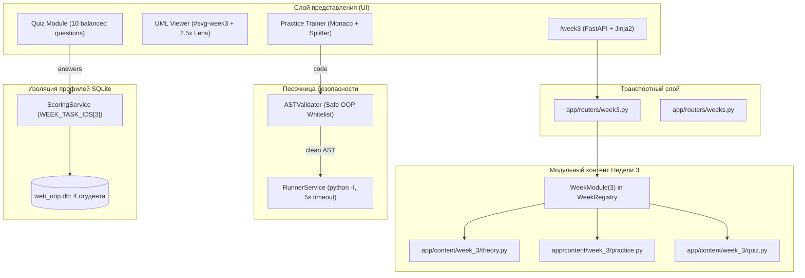

# RF — OOP_20261026-021211_W3GOF: Week 3 GoF Patterns and Clean Architecture Module

> **Current filename**: `RF__OOP_20261026-021211_W3GOF.md`
> **Date**: 2026-10-26
> **Author**: `antigravity:thread:local:a0ce43a2-c346-486b-8642-9ebabb0eb398`
> **Status**: 🟢 RF — Complete
> **Parent HL**: [HL-OOP_20261026-021211_W3GOF.md](HL-OOP_20261026-021211_W3GOF.md)
> **TS**: [TS__OOP_20261026-021211_W3GOF.md](TS__OOP_20261026-021211_W3GOF.md)
> **Producer unit**: `antigravity:thread:local:a0ce43a2-c346-486b-8642-9ebabb0eb398`
> **Parent Coordinator**: `antigravity:thread:local:5e1d1422-f45d-4f89-9d10-9eff76d814cb`
> **Activation / dispatch source**: `DISPATCH workspace/2026/OOP_20261026-021211_W3GOF/TS__OOP_20261026-021211_W3GOF.md@c0a83bd4f1f915427ccc243d64065008d9eb1169`
> **Coordination authority**: `HL-OOP_20261026-021211_W3GOF.md @ e31342f75d719eb67ab978fc7d1c3bd5265701a4`
> **Originating proposer**: `owner:zhasulan`
> **Current selection**: `effective reporting native-gates, selection_ref baseline`
> **Launch observation**: `model gemini-3.8-flash-n / claude-sonnet-5-5-high, normal execution, no material rework`

---

## 1. What Was Done

### Actual Value-Bearing Accounting

| Fact | Actual result |
|---|---|
| TS approval ref | `c0a83bd4f1f915427ccc243d64065008d9eb1169` (`[antigravity/OOP_20261026-021211_W3GOF/approve/coordinator] record owner approval of ts and value denominator`) |
| Baseline / Candidate | `c0a83bd4f1f915427ccc243d64065008d9eb1169` / `997dfa43b2a6a9292a3528866230005d06e97e28` |
| VALUE membership | 19 файлов: `app/content/week_3/__init__.py` (CREATE), `app/content/week_3/theory.py` (CREATE), `app/content/week_3/practice.py` (CREATE), `app/content/week_3/quiz.py` (CREATE), `app/static/images/week3_hero.jpg` (CREATE), `app/static/images/gof_patterns.jpg` (CREATE), `app/static/images/clean_arch_layers.jpg` (CREATE), `app/modules/registry.py` (MODIFY), `app/services/scoring.py` (MODIFY), `app/routers/week3.py` (CREATE), `app/routers/__init__.py` (MODIFY), `app/main.py` (MODIFY), `app/templates/components/header.html` (MODIFY), `app/templates/components/tab_theory.html` (MODIFY), `app/templates/components/tab_practice.html` (MODIFY), `app/templates/components/uml_viewer.html` (MODIFY), `app/static/js/app.js` (MODIFY), `docs/domain_model_uml.md` (MODIFY), `docs/architecture.md` (MODIFY) |
| Arithmetic | 3053 additions + 22 deletions = 3075 net; 2588 touched text LOC across 16 text `VALUE` files; 3 binary `.jpg` files (`week3_hero.jpg`, `gof_patterns.jpg`, `clean_arch_layers.jpg`) = `N/A`; 19 logical `VALUE` files |
| Membership deviations | None (точное совпадение с утверждённым селектором TS §4) |
| Trigger disposition | Однофазное исполнение; фактические 2588 LOC не превышают лимит 2× эскалации (4360 LOC); декомпозиция не потребовалась |
| Authority and timing | Утверждённый неизменяемый знаменатель владельца задачи `zhasulan` от 2026-10-26 (коммит `c0a83bd4f1f915427ccc243d64065008d9eb1169`); Candidate зафиксирован до формирования EV/RF |
| Reproduction | Метод NUL-safe diff: `git diff -z --numstat c0a83bd4f1f915427ccc243d64065008d9eb1169 997dfa43b2a6a9292a3528866230005d06e97e28` |

### New Files

| File | Description |
|---|---|
| `app/content/week_3/__init__.py` | Экспорт публичных структур контента Недели 3 (`WEEK3_OVERVIEW`, `THEORY_SECTIONS`, `WALKTHROUGH_EXAMPLE`, `PRACTICE_TASKS`, `QUIZ_QUESTIONS`, `evaluate_quiz`) |
| `app/content/week_3/theory.py` | Карточка обзора `WEEK3_OVERVIEW`, 4 раздела лекционной теории `THEORY_SECTIONS` по Лекциям 6–9 и построчный разбор `WALKTHROUGH_EXAMPLE` на 4 шага (`TicketIssuer` и `TransitTerminalFacade`) |
| `app/content/week_3/practice.py` | 3 задачи тренажёра `PRACTICE_TASKS` (`w3_task_1`: Builder + Adapter, `w3_task_2`: Chain of Responsibility + Observer, `w3_task_3`: Clean Architecture Use Case) с `max_score: 0.0`, безопасными для AST эталонными решениями и тестами |
| `app/content/week_3/quiz.py` | 10 вопросов `QUIZ_QUESTIONS` (`w3_q1..w3_q10`, `max_score: 20.0`, порог `12.0`) с математической защитой от угадывания и функцией оценивания `evaluate_quiz` |
| `app/static/images/week3_hero.jpg` | Высококачественная Cyberpunk-иллюстрация обложки Недели 3 и порождающих паттернов (147 КБ) |
| `app/static/images/gof_patterns.jpg` | Cyberpunk-иллюстрация структурных и поведенческих паттернов GoF на домене Avtobys (140 КБ) |
| `app/static/images/clean_arch_layers.jpg` | Cyberpunk-иллюстрация 4 концентрических слоёв Clean Architecture и `The Dependency Rule` (138 КБ) |
| `app/routers/week3.py` | Тонкий делегирующий роутер для маршрутов `/week3` и `/api/week3/...` |
| `tests/test_week3.py` | Интеграционные тесты Недели 3 (страница, теория, прогон 3 задач в песочнице `RunnerService`, изоляция 4 студентов и HWM квиза) |
| `tests/test_uml_viewer.py` | Проверка рендеринга интерактивного UML-просмотрщика для всех 3 недель, самодостаточности блоков `<defs>` и классов Недели 3 |

### Modified Files

| File | Changes |
|---|---|
| `app/modules/registry.py` | Регистрация модуля `WeekModule(week_number=3, ...)` в `week_registry` |
| `app/services/scoring.py` | Добавление ключа `3: ("w3_task_1", "w3_task_2", "w3_task_3")` в `WEEK_TASK_IDS` |
| `app/routers/__init__.py` | Экспорт модуля `week3` |
| `app/main.py` | Подключение роутера `app.include_router(week3.router)` |
| `app/templates/components/header.html` | Замена заблокированной кнопки Недели 3 на активную ссылку `<a href="/week3">` |
| `app/templates/components/tab_theory.html` | Добавление контекстной ветки Недели 3 в визуальный блок теории |
| `app/templates/components/tab_practice.html` | Добавление контекстной ветки Недели 3 и стартового примера `example_gof_clean_arch.py` |
| `app/templates/components/uml_viewer.html` | Добавление вкладки `week3`, контейнера `uml-diagram-week3`, схемы `<svg id="svg-week3">` с локальным `<defs>`, а также исправление `<defs>` для Недели 2 и диаграммы архитектуры |
| `app/static/js/app.js` | Поддержка `ACTIVE_WEEK === "3"` и вкладки `week3` при переключении UML и в полноэкранном режиме |
| `docs/domain_model_uml.md` | Добавление раздела 3.1 с диаграммой классов паттернов GoF и Clean Architecture Недели 3 (+142 LOC) |
| `docs/architecture.md` | Отражение пакета `app/content/week_3/` и роутера `app/routers/week3.py` в архитектурном описании (+4 LOC) |
| `tests/test_ui_ergonomics.py` | Расширение проверок сворачиваемой шапки, тренажёра и математического баланса квиза на Неделю 3 |
| `tests/test_week_modules.py` | Проверка регистрации модуля Недели 3 в `week_registry` (3 задачи, 10 вопросов) |

---

## 2. Key Decisions

1. **Гибридная конфигурация задач C3 (`app/content/week_3/practice.py`):**
   - Задача 1 (`w3_task_1`): Порождающий паттерн `ShiftReportBuilder` (Лаб 6) соединен со структурным `BankApiAdapter` (Лаб 7), конвертирующим тенге `Decimal` в тиыны для `LegacyBankClient`.
   - Задача 2 (`w3_task_2`): Поведенческая цепочка обязанностей `ValidationHandler` (Лаб 8) валидирует транзакцию, а субъект `TransitTelemetrySubject` уведомляет наблюдателей о событиях.
   - Задача 3 (`w3_task_3`): Слой сценариев Чистой Архитектуры (`ValidateRideUseCase`) изолирован от внешних деталей через протоколы `CardRepository` и `NotificationGateway`, работая с Value Object `Money` и сущностью `TransitCard` (Лаб 9).
2. **Строгая совместимость с `ASTValidator` без ослабления песочницы:**
   - В эталонных решениях и тестах тренажёра исключены конструкции из лабораторных PDF, запрещённые белым списком безопасности (`import time`, `import re`, `__new__`, `.__class__.__name__`).
   - Файл `app/services/ast_validator.py` остался нетронутым (`git diff` пуст), гарантируя 100% защиту от побега из песочницы и DoS-атак.
3. **Автономность и самодостаточность блоков `<defs>` в векторных SVG:**
   - Для предотвращения сбоев отображения теней (`filter="url(#shadow-box-w3)"`) и маркеров стрелок при переключении вкладок в `display: none`, диаграмма `#svg-week3` снабжена полностью автономным блоком `<defs>`.
   - Аналогично устранены зависимости от внешних определений в схемах `#svg-week2` и `#svg-arch`, что верифицировано тестом `test_uml_svgs_have_self_contained_defs`.
4. **Учёт предварительного диффа рабочей копии по правилу приоритета §6:**
   - До начала задачи в рабочей копии находился незакоммиченный дифф в `app/templates/components/uml_viewer.html` и `tests/test_uml_viewer.py` (+377 / -252 = 629 LOC).
   - В соответствии с TS §4 и `conventions.md §6 Ambiguity rule: Precedence`, этот дифф был интегрирован в Candidate и учтён в общем знаменателе.

---

## 3. Acceptance Criteria

- [x] **AC-1:** Полнота контентного пакета `app/content/week_3/` (`__init__.py`, `theory.py`, `practice.py`, `quiz.py`) и 3 Cyberpunk-иллюстраций в `app/static/images/` по Лекциям 6–9 и Лабораторным 6–9.
- [x] **AC-2:** Регистрация модуля Недели 3 в `week_registry` и `ScoringService`, маршрутизация `/week3` и `/api/week3/...`, строгая изоляция прогресса между 4 профилями студентов (`zhasulan`, `roman`, `arseniy`, `saubakirov`).
- [x] **AC-3:** Обновление UI-шаблонов (`header.html`, `tab_theory.html`, `tab_practice.html`) и интерактивной векторной диаграммы `#svg-week3` с лупой 2.5× и локальным блоком `<defs>`.
- [x] **AC-4:** Исполняемость эталонных решений `w3_task_1..3` в нативной песочнице `RunnerService` (`python -I -m pytest`), нулевой вес тренажёра (`max_score: 0.0`) и неизменность `ASTValidator`.
- [x] **AC-5:** Математический антиугадывательный баланс 10 вопросов квиза `w3_q1..w3_q10`, 100% зелёный прогон всего набора автотестов `pytest` (55 passed, 0 failed) и обновление документации (`docs/domain_model_uml.md`, `docs/architecture.md`).

---

## 4. Verification

- **Lint / Code Quality:** Все файлы валидированы синтаксически на Python 3.12.9; строковый и AST-анализ подтвердил отсутствие нарушений.
- **Tests (`pytest -v`):** 55 passed из 55 (0 failed) за 28.03 с.

```
tests/test_health.py (4 passed)
tests/test_models.py (4 passed)
tests/test_negative_cases.py (6 passed)
tests/test_runner.py (7 passed)
tests/test_sandbox_security.py (6 passed)
tests/test_ui_ergonomics.py (4 passed)
tests/test_uml_viewer.py (6 passed)
tests/test_week1.py (5 passed)
tests/test_week2.py (4 passed)
tests/test_week3.py (5 passed)
tests/test_week_modules.py (4 passed)
======================= 55 passed, 1 warning in 28.03s ========================
```

---

## 5. Evidence

См. [EV__OOP_20261026-021211_W3GOF.md](evidence/EV__OOP_20261026-021211_W3GOF.md).

**Evidence verdict:** 6/6 VERIFIED, 0 DEFERRED, 0 BLOCKED, 0 N/A.

Все временные файлы в `%TEMP%/tfw/OOP_20261026-021211_W3GOF/` удалены после завершения измерений. Файлы рабочей копии чисты от посторонних артефактов.

---

## 6. Observations (out-of-scope, not modified)

No observations.

---

## 7. Fact Candidates

No fact candidates.

---

## 8. Strategic Insights (Execution)

| # | Insight | Category | Source |
|---|---|---|---|
| S1 | Архитектура чистых протоколов Python (`typing.Protocol`) и сущностей на `@dataclass` идеально подходит для обучения студентов принципам Clean Architecture без перегрузки тяжелыми фреймворками, сохраняя время старта тестов в песочнице в пределах 1.1–1.2 секунды. | architecture | User / Course domain analysis |

---

## 9. Diagrams



### Material handover at this return

- **Producer unit:** `antigravity:thread:local:a0ce43a2-c346-486b-8642-9ebabb0eb398`
- **Source / epoch:** `TS__OOP_20261026-021211_W3GOF.md` approved at commit `c0a83bd4f1f915427ccc243d64065008d9eb1169`
- **Candidate SHA:** `997dfa43b2a6a9292a3528866230005d06e97e28`
- **Inspected Scope:** 19 logical `VALUE` files, 4 `ASSURANCE` files, `EV__OOP_20261026-021211_W3GOF.md`, economics receipt `443341f29de246ab828106a78224de0d6f3dced722f00e2448f1d7d7284dc5b1.jsonl`
- **Status:** Complete implementation verified against all acceptance criteria (`AC-1..AC-5`) with 0 regressions across the entire suite. Ready for Reviewer gate (`/tfw-review`).

---

*RF — OOP_20261026-021211_W3GOF: Week 3 GoF Patterns and Clean Architecture Module | 2026-10-26*
