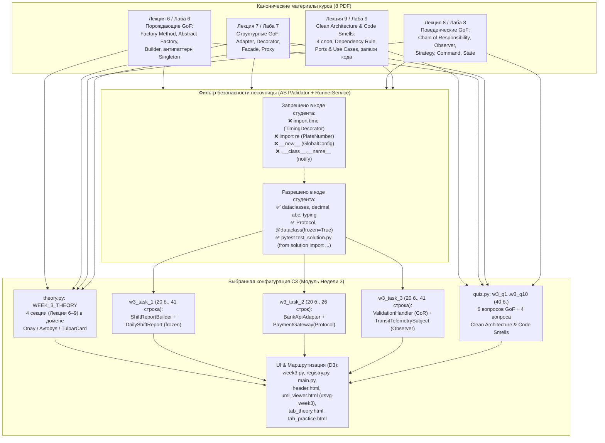

# RES — OOP_20261026-021211_W3GOF: Week 3 GoF Patterns and Clean Architecture Module

> **Current filename**: `workspace/2026/OOP_20261026-021211_W3GOF/research/iter1/RES.md`
> **Date**: 2026-10-26
> **Author**: Researcher (Antigravity) для zhasulan
> **Status**: 🔬 RES — Complete
> **Parent HL**: [HL-OOP_20261026-021211_W3GOF.md](../../HL-OOP_20261026-021211_W3GOF.md)
> **Mode**: Pipeline (`focused`, `loops_per_stage: 1`)
> **Producer unit**: `antigravity:thread:local:b44e12c6-d392-4cd9-a90a-763aa4936c08`
> **Parent Coordinator**: `antigravity:thread:local:5e1d1422-f45d-4f89-9d10-9eff76d814cb`
> **Activation / dispatch source**: owner-direct `/tfw-research OOP_20261026-021211_W3GOF` + Coordinator dispatch (`antigravity:thread:local:5e1d1422-f45d-4f89-9d10-9eff76d814cb`, `journal/20261026-031035__transition__c9f4.md`)
> **Coordination authority**: `HL-OOP_20261026-021211_W3GOF.md @ e31342f75d719eb67ab978fc7d1c3bd5265701a4`
> **Originating proposer**: `none`

---

## Research Context

Исследование проведено для проектирования и спецификации учебного модуля **Недели 3 («Паттерны проектирования GoF и Чистая Архитектура»)** на платформе Web-OOP. Цель итерации — извлечь точные авторские контракты, доменные имена и сигнатуры из 8 канонических PDF-документов курса (`RF__lecture_06..09.pdf` и `RF__lab_06..09.pdf`), сопоставить их с ограничениями безопасности песочницы (`ASTValidator` + `RunnerService`), проверить гипотезы `H1` и `H2` из `HL §10`, и определить оптимальную архитектуру контента (`w3_task_1..3`, `w3_q1..w3_q10`, теория Лекций 6–9) и точек интеграции UI без нарушения существующих 73 автотестов.

## Briefing

Опирается на [1_briefing.md](1_briefing.md). Зафиксирован режим исследования `focused` (`loops_per_stage: 1`, `verify_user_tech_claims: true`). По результатам согласования с Coordinator (`5e1d1422-f45d-4f89-9d10-9eff76d814cb`) утверждены:
1. Сохранение канонических имен классов и сигнатур методов из `RF__lab_06..09.pdf` и `RF__lecture_06..09.pdf` при компактном размере каждого задания (25–45 непустых строк кода).
2. Гибридная конфигурация **C3**: `w3_task_1` (`ShiftReportBuilder` / `DailyShiftReport`), `w3_task_2` (`BankApiAdapter` / `PaymentGateway` / `LegacyBankClient`), `w3_task_3` (`ValidationHandler` + `TransitTelemetrySubject` / `MetricsCollectorObserver`), и сбалансированный квиз `w3_q1..w3_q10` (6 вопросов по GoF + 4 вопроса по Clean Architecture и Code Smells).
3. Включение шаблонов `app/templates/components/tab_theory.html` и `app/templates/components/tab_practice.html` в контур интеграции `D3` в качестве уточнения свободных секций HL.

## Decisions

| # | Decision | Rationale |
|---|----------|-----------|
| **D1** | Построить `app/content/week_3/theory.py` (`WEEK_3_THEORY` — единая HTML-строка из 4 разделов, соответствующих Лекциям 6–9) строго на предметной области транспортного биллинга (`Onay` / `Avtobys` / `TulparCard` / `KZT` / тиыны). | Прямое соответствие каноническим лекциям `RF__lecture_06..09.pdf` и контракту `WeekModule.theory: str` (`app/modules/base.py:34`). Обеспечивает сквозную преемственность домена с Неделями 1 и 2. |
| **D2** | Реализовать в `app/content/week_3/practice.py` (`WEEK_3_PRACTICE`) гибридную конфигурацию **C3** из 3 практических задач по 20 баллов (`max_practice_points == 60`): 1. `w3_task_1`: Fluent Builder (`ShiftReportBuilder` + `@dataclass(frozen=True) class DailyShiftReport` + `IncompleteReportError`). 2. `w3_task_2`: Structural Adapter (`BankApiAdapter` + `PaymentGateway(Protocol)` + `LegacyBankClient` + `PaymentGatewayError`). 3. `w3_task_3`: Behavioral Pipeline (`ValidationHandler(ABC)` с `BlacklistCheckHandler`, `BalanceCheckHandler` + `TransitTelemetrySubject` и `MetricsCollectorObserver`). | Конфигурация **C3** сохраняет 100% канонических сигнатур из `RF__lab_06..08.pdf`, укладывается в 26–41 непустую строку эталонного кода на задачу и эмпирически проходит `ASTValidator.validate()` и `RunnerService.run_code()` (`status='PASSED'`). При этом избегаются все 4 запрещенные конструкции `ASTValidator` (`import time`, `import re`, `__new__`, `.__class__.__name__`). |
| **D3** | Реализовать в `app/content/week_3/quiz.py` (`WEEK_3_QUIZ`) 10 вопросов (`w3_q1..w3_q10`, по 4 балла, `max_quiz_points == 40`): 6 вопросов по порождающим, структурным и поведенческим паттернам GoF (включая 4 изъяна антипаттерна `Singleton GlobalConfig` и различие `Adapter`/`Facade`/`Decorator`/`Proxy`) и 4 вопроса по `Clean Architecture` (`The Dependency Rule`, слои `domain`/`application`/`infrastructure`/`presentation`, порты и запахи кода Фаулера `Primitive Obsession` / `Shotgun Surgery` / `Feature Envy`). | Компенсирует перенос фокуса `w3_task_3` на поведенческий конвейер GoF полным теоретическим и аналитическим контролем тем Лабы 9 и Лекции 9. Все вопросы подчиняются инвариантам `test_quiz_balance_and_traps` (`min_len >= 60`, `max_len / min_len <= 1.65`, равномерное распределение `correct_index` по 2–3 на индекс `0..3`, не менее 5 из 10 ответов не являются строго самыми длинными). |
| **D4** | В контуре `D3` (маршрутизация и UI) создать тонкий роутер `app/routers/week3.py`, зарегистрировать `WEEK_3_MODULE` в `app/modules/registry.py` и `app/main.py`, добавить `<svg id="svg-week3">` с изолированным локальным `<defs>` (`#shadow-w3`, `#arrow-w3`) в `app/templates/components/uml_viewer.html`, активировать кнопку Недели 3 в `app/templates/components/header.html` и добавить ветки `` в `app/templates/components/tab_theory.html` и `app/templates/components/tab_practice.html`. | Предотвращает проваливание интерфейса Недели 3 в ``-ветку Недели 1 (`SmartCard` / `example_avtobys.py`) и гарантирует прохождение `test_uml_svgs_have_self_contained_defs` (`tests/test_uml_viewer.py`) и `test_ui_ergonomics.py`. |

## Open Questions

| # | Question | Status | Answer |
|---|----------|--------|--------|
| **Q1** | Должен ли контент Недели 3 сохранять канонические имена классов и сигнатуры из `RF__lab_06..09.pdf` или допускать упрощенные сигнатуры? | Закрыт | Сохранять канонические имена классов и сигнатуры методов из авторских PDF (`DailyShiftReport`, `ShiftReportBuilder`, `BankApiAdapter`, `LegacyBankClient`, `ValidationHandler`, `TransitTelemetrySubject`), удерживая размер эталонного кода в пределах 25–45 строк (`1_briefing.md`). |
| **Q2** | Какую комбинацию тем выбрать для `w3_task_1..3` с учетом 4 лабораторных (Лабы 6–9) и 3 слотов практики? | Закрыт | Утверждена гибридная конфигурация **C3**: `w3_task_1` (Builder), `w3_task_2` (Adapter + Protocol Port), `w3_task_3` (Chain of Responsibility + Observer), а Clean Architecture и Code Smells глубоко проверяются в теории, UML-схеме и 4 вопросах квиза (`2_gather.md`, `3_extract.md`). |
| **Q3** | Следует ли включить `tab_theory.html` и `tab_practice.html` в поставку `D3`? | Закрыт | Да, подтверждено Coordinator: оба шаблона содержат бинарное ветвление `active_week == 2` / `else` и должны получить ветку `` (`2_gather.md`). |

## Hypotheses (from HL §10)

| # | Hypothesis | HL Status | RES Status | Evidence |
|---|-----------|-----------|------------|----------|
| **H1** | Контент 4 обширных лекций (Лекции 6–9) и 4 лабораторных работ можно дистиллировать в 3 практических задания и 10 вопросов квиза без потери ключевых концепций (GoF Creational/Structural/Behavioral + Clean Architecture + Code Smells). | open | ✅ **CONFIRMED** | В `3_extract.md` и `4_challenge.md` спроектирована и эмпирически верифицирована гибридная конфигурация **C3**: `w3_task_1` (Лаба 6: `ShiftReportBuilder` + `DailyShiftReport`), `w3_task_2` (Лаба 7 + Лаба 9 Port: `BankApiAdapter` + `PaymentGateway(Protocol)`), `w3_task_3` (Лаба 8: `ValidationHandler` CoR + `TransitTelemetrySubject` Observer), плюс 10 вопросов `w3_q1..w3_q10` (6 по GoF + 4 по Clean Architecture и Code Smells). Все 3 задачи проходят `ASTValidator` и `RunnerService.run_code()` за ~0.95 с и укладываются в 26–41 непустую строку. |
| **H2** | Существующий фронтенд (`app.js`, шаблоны вкладок) динамически подхватит Неделю 3 после регистрации модуля в `registry.py`, обновления `header.html` и добавления `#svg-week3` в `uml_viewer.html`, без необходимости переписывать клиентскую логику в `app.js`. | open | 🟡 **PARTIALLY REFUTED (REFINED)** | Клиентский `app/static/js/app.js` действительно на 100% динамичен (использует `window.APP_CONFIG.activeWeek`, динамические ключи `week_${weekNum}_theory` и селектор `svg-${week}` в `switchUmlTab`) и **не требует изменений**. Однако шаблоны вкладок `app/templates/components/tab_theory.html` (строка 6) и `app/templates/components/tab_practice.html` (строки 19, 47) используют бинарное условие ` ... ` и при `active_week == 3` отображают контент Недели 1 (`SmartCard`, `example_avtobys.py`). Требуется добавление веток `` в оба шаблона. |

---

## HL Update Recommendations

> **The researcher classifies, never applies or rules.** Each recommendation names its HL section.
> Refinements target free sections (§2, §7.2, §8–§11); Amendment Proposals target frozen sections
> (§1, §3–§7). The Coordinator transcribes the latter into §12 as `PROPOSED`, preserving origin, then
> routes by `conventions.md` → `HL Contract` rule 8. Frozen claims wait for a valid terminal verdict.
> Use §3's declarative-claim granularity and §15 Role Lock. Empty class: **No refinements.** /
> **No amendment proposals.**

### Refinements — free sections, coordinator applies

| # | § | What to update | Source |
|---|---|----------------|--------|
| **R1** | §2 (Current State), §4 (Single-Phase Deliverables — `D3`) | Уточнить, что помимо `header.html` и `uml_viewer.html`, шаблоны `app/templates/components/tab_theory.html` (строка 6) и `app/templates/components/tab_practice.html` (строки 19, 47) содержат бинарные ветвления ` ... ` и требуют добавления веток `` в рамках поставки `D3`. | `2_gather.md` (Находка `G3`), `4_challenge.md` |
| **R2** | §4 (Single-Phase Deliverables — `D1`, `D2`), §8 (Dependencies) | Зафиксировать точные канонические контракты из авторских PDF (`RF__lecture_06..09.pdf`, `RF__lab_06..09.pdf`) для конфигурации **C3**: `w3_task_1` (`ShiftReportBuilder`, `DailyShiftReport`, `IncompleteReportError`), `w3_task_2` (`BankApiAdapter`, `PaymentGateway`, `LegacyBankClient`, `PaymentGatewayError`), `w3_task_3` (`ValidationHandler`, `BlacklistCheckHandler`, `BalanceCheckHandler`, `TransitTelemetrySubject`, `MetricsCollectorObserver`). | `2_gather.md` (Находка `G1`), `3_extract.md` (`E1`), `4_challenge.md` |
| **R3** | §9 (Risks) | Уточнить риск `ASTValidator`: явно перечислить 4 запрещенные конструкции из кода PDF, которые нельзя использовать в `w3_task_1..3` (`import time`, `import re`, `__new__`, `.__class__.__name__`), а также зафиксировать требование локального `<defs>` (`#shadow-w3`, `#arrow-w3`) внутри `<svg id="svg-week3">` для прохождения `test_uml_svgs_have_self_contained_defs`. | `2_gather.md` (`G2`, `G3`), `3_extract.md` (`E2`, `E4`), `4_challenge.md` |
| **R4** | §10 (Research Hypotheses) | Обновить статус `H1` на `confirmed`, а `H2` — на `partially refuted / refined` (`app.js` не требует правок, но `tab_theory.html` и `tab_practice.html` требуют веток `active_week == 3`). | `2_gather.md`, `3_extract.md`, `4_challenge.md` |
| **R5** | §11 (Strategic Context) | Дополнить секцию техническими параметрами верификации квиза (`min_len >= 60`, `max_len / min_len <= 1.65`, распределение индексов `0..3` по 2–3 раза, `not_strictly_longest >= 5/10`) и форматом `test_code` в `RunnerService` (`pytest` с `from solution import ...`). | `3_extract.md` (`E3`), `4_challenge.md` |

### Amendment Proposals — frozen sections, resolved-ruler verdict required

**No amendment proposals.** Все замороженные секции (`§1 Vision`, `§3 Scope`, `§4 Phase Breakdown`, `§5 Definition of Done`, `§6 Verification Plan`, `§7 Principles & Architectural Constraints`) полностью совместимы с результатами исследования; уточнение шаблонов `tab_theory.html` и `tab_practice.html` укладывается в рамки `§3 In Scope` (*«Адаптация шаблонов и навигации для отображения 3-й недели»*) и свободной секции `§4 Single-Phase Deliverables`.

---

## Fact Candidates

| # | Category | Candidate | Source | Confidence |
|---|----------|-----------|--------|------------|
| **FC1** | `convention` | Практические задания на платформе Web-OOP должны сохранять точные канонические имена классов и сигнатуры методов из авторских PDF курса (`RF__lecture_*.pdf`, `RF__lab_*.pdf`), но удерживать объем эталонного решения в пределах 25–45 строк кода для прохождения студентом за 10–15 минут в браузерном редакторе. | Сообщение Coordinator / владельца в `1_briefing.md` (`OOP_20261026-021211_W3GOF`). | ★★★ |
| **FC2** | `convention` | При компрессии 4 лабораторных работ недели в 3 слота практики `WeekModule` (`max_practice_points == 60`) приоритет отдается гибридному объединению связанных паттернов в одном задании (например, `Chain of Responsibility` + `Observer` в `w3_task_3` и `Adapter` + `Protocol Port` в `w3_task_2`) с переносом проверки многослойной структуры `Clean Architecture` и `Code Smells` в теорию, UML-схему и вопросы квиза. | Решения `D2`, `D3` и подтверждение `C3` в `2_gather.md` и `3_extract.md` (`OOP_20261026-021211_W3GOF`). | ★★★ |

## Strategic Insights (Research)

| # | Category | Insight | Source | Confidence |
|---|----------|---------|--------|------------|
| **SS1** | `architecture` | Архитектурные темы с многофайловой структурой пакетов (`domain/`, `application/`, `infrastructure/`, `presentation/` в Clean Architecture) в однофайловой браузерной песочнице (`solution.py` + `test_solution.py`) эффективнее преподавать через реализацию граничных портов (`Protocol` / `ABC`) и поведенческих конвейеров (`CoR` + `Observer`) в коде практики в сочетании с визуальной SVG-схемой правила зависимостей (`The Dependency Rule`) и ситуационными вопросами квиза. | Владелец / Coordinator, обсуждение `1_briefing.md` и `3_extract.md`. | ★★★ |
| **SS2** | `constraint` | Белый список `ASTValidator` (`ALLOWED_MODULES` из 14 стандартных модулей и запрет всех dunder-атрибутов, кроме `__init__`, `__str__`, `__repr__`, `__eq__`, `__lt__`, `__le__`, `__gt__`, `__ge__`, `__len__`, `__iter__`, `__next__`, `__enter__`, `__exit__`, `__post_init__`, `__call__`) выступает естественным архитектурным фильтром при переносе задач из PDF в LMS: все низкоуровневые механизмы (`__new__`, `.__class__.__name__`, `time`, `re`) должны заменяться на чистые ООП-абстракции (`ABC`, `Protocol`, `dataclass`, `Decimal`). | Анализ `app/services/ast_validator.py` и `RF__lab_06..09.pdf` (`2_gather.md`, `4_challenge.md`). | ★★★ |

---

## Findings Map

---

## Iteration Status

> **Mandatory block.** Every RES must include this, even for single-iteration research.

- **Iteration:** 1 of 1 (min) / 1 (max)
- **Hypotheses tested:** H1 (CONFIRMED), H2 (PARTIALLY REFUTED / REFINED)
- **Hypotheses deferred:** None
- **Gaps discovered:**
  1. Бинарные условия ` ... ` в `app/templates/components/tab_theory.html` (строка 6) и `app/templates/components/tab_practice.html` (строки 19, 47), не учтенные в первоначальной формулировке `H2`.
  2. Четыре несовместимые с `ASTValidator` конструкции в примерах кода из авторских PDF (`import time`, `import re`, `__new__`, `.__class__.__name__`).
  3. Требование полной самодостаточности `<defs>` внутри `<svg id="svg-week3">` (`tests/test_uml_viewer.py::test_uml_svgs_have_self_contained_defs`).
- **Superseded decisions:** None

### Open Threads (for next iteration)

No open threads.

### Recommendation
- [x] **SUFFICIENT** — proceed to `/tfw-plan` to classify these recommendations and write TS
- [ ] **MORE NEEDED** — {specify what and why}
- [ ] **BLOCKED** — {specify blocker}

> ⚠️ Coordinator decides whether to continue or proceed. Researcher recommends but does NOT decide.

## Conclusion

В ходе одной фокусированной итерации (`iter1`) полностью исследованы все 8 авторских PDF-источников Недели 3 (Лекции 6–9 и Лабораторные 6–9) и точки их сопряжения с кодовой базой Web-OOP. Подтверждена гипотеза `H1` и сконструирована гибридная конфигурация **C3**, объединяющая порождающий паттерн `Builder` (`w3_task_1`), структурный `Adapter` поверх архитектурного порта `Protocol` (`w3_task_2`) и поведенческий конвейер `Chain of Responsibility` + `Observer` (`w3_task_3`) с глубоким покрытием `Clean Architecture` и `Code Smells` в теории, UML-схеме и 10 вопросах квиза. Без проведенного исследования реализация столкнулась бы с тремя скрытыми блокерами: (1) падением студенческих решений на `ASTValidator` из-за `import time`, `import re`, `__new__` и `.__class__.__name__` из кода PDF; (2) отображением баннеров и примеров Недели 1 (`SmartCard`) при открытии Недели 3 из-за бинарного `if active_week == 2 / else` в `tab_theory.html` и `tab_practice.html`; (3) падением `test_uml_svgs_have_self_contained_defs` при переиспользовании чужих ID фильтров/маркеров в `#svg-week3`. Самокритика: все 3 эталонных решения в `C3` были эмпирически прогнаны через `ASTValidator` и `RunnerService.run_code()` еще на стадии исследования, что снижает риск регрессий при написании и исполнении TS практически до нуля.

### Material handover at this return

- **Producer / unit**: `antigravity:thread:local:b44e12c6-d392-4cd9-a90a-763aa4936c08` (Researcher).
- **Source / epoch**: `HEAD @ 88b24dd` (`HL-OOP_20261026-021211_W3GOF.md @ e31342f75d719eb67ab978fc7d1c3bd5265701a4`).
- **Inspected scope**:
  - Внешние PDF курса: `C:\Users\kz444\OneDrive\Desktop\OOP\01_Лекции\RF__lecture_06..09.pdf`, `C:\Users\kz444\OneDrive\Desktop\OOP\02_Лабораторные\RF__lab_06..09.pdf`.
  - Кодовая база: `app/services/ast_validator.py`, `app/services/runner.py`, `app/services/scoring.py`, `app/modules/base.py`, `app/modules/registry.py`, `app/routers/week2.py`, `app/main.py`, `app/content/week_2/{theory,practice,quiz}.py`, `app/templates/components/{header,uml_viewer,tab_theory,tab_practice}.html`, `app/static/js/app.js`, `tests/{test_week_modules,test_uml_viewer,test_ui_ergonomics}.py`.
- **Material candidates**: `FC1`, `FC2` (см. секцию `Fact Candidates`) и `SS1`, `SS2` (см. секцию `Strategic Insights`).
- **Uncertainty**: Отсутствует — эталонные решения `w3_task_1..3` и инварианты тестов проверены эмпирически.
- **Continuation**: Возврат управления Coordinator (`antigravity:thread:local:5e1d1422-f45d-4f89-9d10-9eff76d814cb`) в `/tfw-plan OOP_20261026-021211_W3GOF` для применения уточнений свободных секций (`R1–R5`) и выпуска `TS-OOP_20261026-021211_W3GOF.md`.
- **Unresolved owner/decision**: Нет (все вопросы `Q1–Q3` закрыты).

### Task Economics Trace

- **Role / Unit**: `researcher` / `antigravity:thread:local:b44e12c6-d392-4cd9-a90a-763aa4936c08`
- **Source**: `antigravity.ide` (`b44e12c6-d392-4cd9-a90a-763aa4936c08.db`, `Antigravity-IDE-2.17.0`)
- **Bound Range**: `range_start=0`, `range_end=70` (`complete=true`, `cutoff=2026-10-25T22:35:13.444690+00:00`)
- **Validated Artifact**: `workspace/2026/OOP_20261026-021211_W3GOF/economics/roles/e823f4161f68ddf2da2315fea3e4169cd97aa6a6220a20e7e8db784f332d8adb.jsonl`
- **SHA-256**: `e823f4161f68ddf2da2315fea3e4169cd97aa6a6220a20e7e8db784f332d8adb`

---

*RES — OOP_20261026-021211_W3GOF: Week 3 GoF Patterns and Clean Architecture Module | 2026-10-26*
