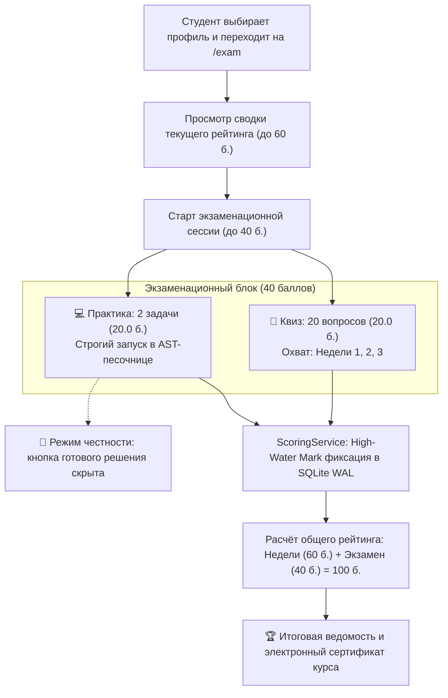

# HL — OOP_20261029-200322_EXAM: Final Exam Module and Comprehensive Assessment Engine

> **Current filename**: `HL-OOP_20261029-200322_EXAM.md`
> **Date**: 2026-10-29
> **Author**: Coordinator (`antigravity:thread:local:7dc123a4-589f-4ee8-b43d-a035a4018225`)
> **Title**: Final Exam Module and Comprehensive Assessment Engine
> **Abbreviation**: EXAM
> **Status**: 🟡 TS_DRAFT — HL approved, TS drafted
> **Contract**: 🔒 FROZEN — approved by zhasulan 2026-10-29
> **Frozen**: §1 · §3 · §4 · §5 · §6 · §7 — locked on owner approval
> **Free**: §2 · §7.2 · §8 · §9 · §10 · §11 — research updates these directly
> **Append-only**: §12 Amendment Log — the only channel for changing a frozen section
> **Baseline**: freeze commits — recovery form in `conventions.md` §3 rule 15

> **Project North Star**: `README.md § Цель и North Star проекта` · `.tfw/README.md #ns1 · #ns2 · #ns3`

> **Producer Provenance**:
> - **Producer Unit**: `antigravity:thread:local:7dc123a4-589f-4ee8-b43d-a035a4018225` (Task Coordinator)
> - **Parent / Upward Route**: `owner:zhasulan`
> - **Activation Source**: `owner-direct` (`/tfw-plan` initiated by human owner `zhasulan`)
> - **Coordination Authority**: `HL-OOP_20261029-200322_EXAM.md @ baseline`
> - **Originating Proposer**: `{principal: zhasulan, unit: antigravity:thread:local:7dc123a4-589f-4ee8-b43d-a035a4018225}`

---

## 1. Vision 🔒 FROZEN

Студенты 2 курса специальности «Программная инженерия» завершают изучение курса ООП в мини-LMS Web-OOP через прохождение единого итогового экзамена (**«🏆 Итоговый Экзамен»**, `/exam`), объединяющего все ключевые концепции трёх пройденных недель на сквозном домене транспортной системы **Avtobys**: базовое ООП и контракты (Неделя 1), принципы SOLID и Dependency Injection (Неделя 2), паттерны GoF и Чистая архитектура (Неделя 3). Экзамен включает теоретическую часть из 20 сбалансированных вопросов-ловушек (20 баллов, по 1.0 б. за вопрос) и практическую часть из 2 боевых задач в проверенной IDE-среде (20 баллов, по 10.0 б. за задачу) со строгой проверкой в изолированной песочнице `ASTValidator` и со скрытой кнопкой подсказок/готовых решений. Экзамен даёт ровно недостающие 40 баллов к 60 баллам текущего контроля (по 20 б. за каждую из 3 недель), доводя итоговую ведомость студента до классической академической 100-балльной шкалы.

**Impact:** Учебный процесс полностью укомплектован и логически завершён: студенты получают объективную оценку без возможности списывания из готовых решений тренажёра, их совокупный результат суммируется из текущей работы (60 б.) и экзамена (40 б.) до 100 б. в изолированных профилях SQLite WAL, а преподаватель видит целостную ведомость успеваемости малой группы.

> *Explicitly imagined stakeholder quote (смоделированная цитата студента, не фактический отзыв):*  
> «На экзамене не было кнопки готового решения, поэтому пришлось реально применить всё, чему мы учились три недели: аккуратно соблюдать инкапсуляцию, разделять ответственность по SOLID и собирать слои Use Case с паттернами GoF. Когда автотесты песочницы выдали зелёный статус по обеим задачам и квиз показал 19 из 20, я увидел свой итоговый балл — 95 из 100 за весь курс!»

---

## 2. Current State (As-Is) 🟢 FREE

1. **Завершённость программы 3 недель (`KNOWLEDGE.md` F1, F5, F10):**
   - Недели 1, 2 и 3 полностью реализованы, протестированы (55+ автотестов) и зарегистрированы в `WeekRegistry`.
   - В каждой неделе реализована воронка: теория ➔ тренажёр (3 задачи, 0 б., обучающий режим с кнопкой готового решения `fillSolutionCode`) ➔ квиз (10 вопросов, 20 б., порог 12 б.).
2. **Баланс баллов текущего контроля (`app/services/scoring.py`):**
   - Каждая учебная неделя даёт максимум `20.0` баллов.
   - Три недели суммарно дают ровно: `20.0 + 20.0 + 20.0 = 60.0` баллов (классический семестровый рейтинг / текущий контроль).
   - Недостающие баллы до 100-балльной шкалы составляют ровно `40.0` баллов (`100.0 - 60.0 = 40.0`).
3. **Навигация и пользовательский интерфейс (`header.html`):**
   - Навигационная панель содержит только 3 ссылки: `Неделя 1 · Инкапсуляция`, `Неделя 2 · SOLID и DI`, `Неделя 3 · Паттерны GoF`.
   - Раздел итоговой аттестации (Экзамен) отсутствует.
4. **Режим экзамена и академическая честность:**
   - В тренажёре недель 1–3 присутствует кнопка «Показать готовое решение» (`fillSolutionCode`), подставляющая эталонный код. На экзамене это недопустимо.
   - Необходим режим экзамена, в котором кнопка готового решения скрыта, а запуск в песочнице проверяет код и начисляет реальные баллы (по 10.0 б. за задачу).

---

## 3. Target State (To-Be) 🔒 FROZEN

1. **Экзаменационный пакет контента `app/content/exam/` (`__init__.py`, `practice.py`, `quiz.py`):**
   - `EXAM_OVERVIEW`: Регламент экзамена, распределение баллов (20 б. тест + 20 б. код = 40 б., порог сдачи `20.0` б., порог итогового зачёта курса `50.0 / 100.0` б.).
   - `EXAM_QUIZ_QUESTIONS`: 20 комплексных вопросов со сквозными кейсами из всех лекций (1–9) и практик курса:
     - 6 вопросов по Неделе 1 (Инкапсуляция, инварианты, композиция vs наследование, полиморфизм).
     - 7 вопросов по Неделе 2 (SOLID, Cohesion/Coupling, Dependency Injection, Liskov Substitution).
     - 7 вопросов по Неделе 3 (GoF Factory, Builder, Adapter, Decorator, Facade, Observer, Clean Architecture Layers & Dependency Rule).
     - Антиугадывательный баланс длин и ловушек (`max_len / min_len <= 1.65`, равномерное распределение верных букв).
   - `EXAM_PRACTICE_TASKS`: 2 боевые задачи по 10.0 баллов каждая (максимум 20.0 баллов):
     - `exam_task_1` (10 б.): Доменная модель и SOLID — проектирование сервиса тарификации с инвариантами и DI без нарушения контрактов.
     - `exam_task_2` (10 б.): Паттерны GoF и Clean Architecture — реализация сценария обработки смены терминала с фасадом, адаптером и слоем Use Case.
     - Обе задачи строго совместимы с белым списком `ASTValidator` и исполняются в `RunnerService`.
2. **Ядро подсчёта баллов и 100-балльная шкала (`app/services/scoring.py`):**
   - Поддержка экзаменационного скоринга: `EXAM_QUIZ_MAX = 20.0`, `EXAM_TASKS_MAX = 20.0`, `EXAM_TOTAL_MAX = 40.0`, `EXAM_PASS_THRESHOLD = 20.0`.
   - Расчёт совокупного балла за весь курс: `Grand Total = Week 1 (20) + Week 2 (20) + Week 3 (20) + Exam (40) = 100.0`.
   - Изолированное хранение попыток в SQLite WAL под топиками `exam_quiz`, `exam_task_1`, `exam_task_2`, `exam_overall` с защитой High-Water Mark.
3. **Маршрутизация и API (`app/routers/exam.py`, `app/main.py`):**
   - Эндпоинты `/exam` (рендеринг страницы экзамена), `/api/exam/progress`, `/api/exam/practice/{task_id}/run`, `/api/exam/quiz/check`, `/api/exam/quiz/evaluate`.
4. **Интерфейс экзамена (`app/templates/exam.html` или компонент с поддержкой `/exam`):**
   - Акцентная золотая/рубиновая вкладка в шапке `🏆 Экзамен`.
   - Скрытие кнопки «Показать готовое решение» в экзаменационном тренажёре.
   - Сводная ведомость студента: прогресс по неделям (из 60 б.), экзамен (из 40 б.) и итоговый балл (из 100 б.) с электронным статусом зачёта.
5. **Автотесты (`tests/test_exam.py`):**
   - Проверка маршрутов экзамена, верификация всех 20 вопросов квиза, успешное прохождение тестов песочницы для эталонных решений обеих задач, корректность расчета 100-балльной ведомости для всех 4 студентов.

### 3.1 Result Visualization

| Измерение | Сейчас (As-Is) | После реализации (To-Be) |
|---|---|---|
| **Навигация** | Только Недели 1, 2, 3 | Добавлена вкладка **`🏆 Экзамен`** (`/exam`) с акцентным стилем |
| **Теоретический контроль** | По 10 вопросов в неделю (20 б./нед.) | **20 сквозных вопросов** по всем темам (20.0 баллов, по 1.0 б. за вопрос) |
| **Практический контроль** | 3 задачи в неделю по 0 б. (обучающий режим) | **2 боевые задачи** по 10.0 баллов (20.0 баллов) с реальной проверкой |
| **Подсказки и решения** | Кнопка «Показать готовое решение» доступна | Кнопка готового решения **скрыта** на экзамене |
| **Итоговая шкала курса** | 60 баллов суммарно (по 20 б. за 3 недели) | **100 баллов суммарно** (60 б. недели 1–3 + 40 б. экзамен) |

```text
┌──────────────────────────────────────────────────────────────────────────────────────────┐
│ [ООП] Учебная платформа    Профиль: [Жасулан Куандыков ▾]  Курс: 92.0 / 100 б.  [ОТЛИЧНО]│
│ [Неделя 1 · 20/20]  [Неделя 2 · 18/20]  [Неделя 3 · 20/20]  [★ 🏆 ЭКЗАМЕН · 34/40 (АКТИВ)]│
├──────────────────────────────────────────────────────────────────────────────────────────┤
│ 🏆 Итоговый Экзамен по курсу ООП (Недели 1–3) • Регламент: 20 вопросов + 2 задачи         │
│ Сводка: Текущий контроль: 58.0 / 60 б.  |  Экзамен: 34.0 / 40 б.  |  ИТОГО: 92.0 / 100 б.   │
├──────────────────────────────────────────────────────────────────────────────────────────┤
│ ┌─ Часть 1: Тестирование (20 вопросов · 20.0 б.) ┐ ┌─ Часть 2: Практика (2 задачи · 20.0 б.) ─┐ │
│ │ Вопрос 12/20: Принцип подстановки Лисков (LSP) │ │ [Задача 1: Core SOLID (10.0 б.)]          │
│ │ [ ] Дочерний класс усиливает предусловия       │ │ [Задача 2: Clean Arch & GoF (10.0 б.)]    │
│ │ [x] Дочерний класс сохраняет инварианты предка │ │                                           │
│ │ [ ] Наследование всегда лучше композиции       │ │ [Редактор кода · Номера строк · Tab]      │
│ │                                                │ │ ⚠️ Кнопка готового решения скрыта         │
│ │ Результат теста: 18.0 / 20.0 б.                │ │ [▶ Запустить код в песочнице AST] ➔ 10/10│
│ └────────────────────────────────────────────────┘ └─────────────────────────────────────────┘ │
└──────────────────────────────────────────────────────────────────────────────────────────┘
```

### 3.2 Value Flow



---

## 4. Phases 🔒 FROZEN

Данная задача проектируется как **однофазная (Single-phase task)**:
- **Phase A: Exam Engine, Comprehensive Content & Assessment Integration** 🔴
  - Разработка контентного пакета `app/content/exam/` (20 вопросов квиза и 2 боевые задачи тренажёра).
  - Расширение `ScoringService` на 40-балльный экзамен и 100-балльную общую шкалу курса.
  - Создание роутера `app/routers/exam.py` и интеграция в `app/main.py`.
  - Обновление навигации в `header.html` с акцентной вкладкой `🏆 Экзамен`.
  - Реализация UI экзамена со скрытой кнопкой готового решения и сводным табелем успеваемости.
  - Написание автотестов `tests/test_exam.py` и проверка регрессии существующих тестов.

### 4.1 Coordination Selection 🔒 FROZEN

| Activation source | Accountable owner | Task Coordinator unit | Phase Coordinator rule | Mandate scope / role reach | Upward route | Dialogue | Reporting | Reservations / controls | Amendment authority | Immutable epoch |
|---|---|---|---|---|---|---|---|---|---|---|
| owner-direct | zhasulan | `antigravity:thread:local:7dc123a4-589f-4ee8-b43d-a035a4018225` | none (однофазная задача) | Bounded task `OOP_20261029-200322_EXAM` (Executor, Reviewer) | owner:zhasulan | tfw-gates-only | native-gates | Утверждение HL/TS, финальная приёмка | none | baseline |

---

## 5. Definition of Done (DoD) 🔒 FROZEN

- ✅ 1. Контентный пакет `app/content/exam/` содержит 20 сбалансированных вопросов квиза (`EXAM_QUIZ_QUESTIONS`) по материалам Недель 1–3 и 2 боевые задачи (`EXAM_PRACTICE_TASKS`) по 10 баллов.
- ✅ 2. `ScoringService` корректно начисляет до 20.0 баллов за квиз и до 20.0 баллов за 2 задачи экзамена (суммарно до 40.0 б.), а также рассчитывает общий итог курса из 100.0 баллов (60 б. текущий контроль + 40 б. экзамен) с сохранением в SQLite WAL.
- ✅ 3. Создан роутер `app/routers/exam.py`, подключённый в `app/main.py`, обслуживающий `/exam` и сопутствующие API-эндпоинты.
- ✅ 4. В `header.html` добавлена акцентная вкладка `🏆 Экзамен`, ведущая на страницу экзамена.
- ✅ 5. В экзаменационном тренажёре кодинга скрыта кнопка подстановки готового решения (`fillSolutionCode`), исключающая несамостоятельную сдачу.
- ✅ 6. Создан набор тестов `tests/test_exam.py`, проверяющий эндпоинты экзамена, запуск задач в песочнице AST и расчёт 100-балльной ведомости; все существующие тесты платформы продолжают успешно выполняться (`pytest` = 100% pass).

---

## 6. Definition of Failure (DoF) 🔒 FROZEN

- ❌ 1. На экзамене отображается или доступна кнопка автоматической подстановки готового решения.
- ❌ 2. Экзаменационный код задач нарушает белый список `ASTValidator` или падает по таймауту песочницы.
- ❌ 3. Нарушена изоляция 4 профилей студентов, либо пересдача экзамена ухудшает ранее зафиксированный максимальный результат (нарушение High-Water Mark).
- ❌ 4. Общая сумма баллов курса отклоняется от 100.0 баллов (60 б. недели + 40 б. экзамен).
- ❌ 5. Ломаются существующие маршруты Недель 1, 2, 3 или регрессируют существующие автотесты.

**On failure:** Немедленная остановка, локализация регрессии, откат некорректных изменений, исправление логики в рамках Role Lock.

---

## 7. Principles 🔒 FROZEN

1. **Academic Integrity (Академическая честность)** — На экзамене не допускаются подсказки и эталонные решения; оценка выставляется только за фактически написанный и прошедший тесты код.
2. **Comprehensive Domain Cohesion (Сквозная доменная связность)** — Задачи и вопросы экзамена базируются на сквозном домене системы Avtobys и проверяют синергию всех трёх недель.
3. **Sandbox Security (Безопасность песочницы)** — Экзаменационный код валидируется строгим белым списком AST и запускается в изолированном процессе `python -I`.
4. **Seamless Multi-User Isolation (Многопользовательская изоляция без паролей)** — Прогресс экзамена каждого из 4 студентов сохраняется независимо в SQLite WAL.

### 7.2 Knowledge Citations 🟢 FREE

| # | Source | Item | How it applies |
|---|--------|------|----------------|
| 1 | `README.md` | Цель и North Star проекта | Финализирует 3-недельный курс ООП проведением итогового экзамена на домене Avtobys. |
| 2 | `.tfw/README.md` | #ns1 · #ns2 · #ns3 | Обеспечивает трассируемость решений и проверяемость результатов автотестами. |
| 3 | `KNOWLEDGE.md` | D1 (Стек), D2 (Домен Avtobys) | Использование единого стека FastAPI/SQLite/Tailwind и сквозного домена транспорта. |
| 4 | `KNOWLEDGE.md` | D9 (Белый список AST) | Проверка решений экзаменационных задач в строгой песочнице без запрещённых импортов. |
| 5 | `KNOWLEDGE.md` | D10 (Изоляция 4 студентов) | Сохранение баллов экзамена для Zhasulan, Roman, Arseniy, Saubakirov. |
| 6 | `KNOWLEDGE.md` | D11 (Эргономика IDE) | Использование номеров строк, drag-splitter и полноэкранного режима на экзамене. |
| 7 | `KNOWLEDGE.md` | F1, F5, F10 | Интеграция 40-балльного экзамена к 60 баллам текущего контроля для получения 100 баллов. |

---

## 8. Dependencies 🟢 FREE

| Dependency | Status |
|------------|--------|
| `app/modules/base.py` & `app/modules/registry.py` | ✅ Готовы |
| `app/services/scoring.py` | 🟡 Требует добавления топиков экзамена и 100-балльной шкалы |
| `app/services/runner.py` & `ast_validator.py` | ✅ Готовы |
| `app/templates/components/header.html` | 🟡 Требует добавления вкладки Экзамена |

---

## 9. Risks 🟢 FREE

| Risk | Probability | Impact | Mitigation |
|------|-------------|--------|------------|
| Студенты столкнутся со сложностями при кодинге 2 задач без подсказок | Medium | Medium | Обеспечить понятные сообщения об ошибках от pytest/песочницы и понятные докстринги в стартовом коде. |
| Конфликт ключей прогресса в `TopicProgress` | Low | High | Использовать префикс `exam_` (`exam_quiz`, `exam_task_1`, `exam_task_2`) с валидацией в тестах. |

---

## 10. RESEARCH Case 🟢 FREE

### Why Not Just...?

| Approach | Value | Adoption / operating burden | Risks / tradeoffs | Decision and reason |
|---|---|---|---|---|
| **Рекомендуемый: 1 вариант (20 вопросов + 2 задачи, 40 баллов, без подсказок)** | Честная аттестация, логичное завершение курса до 100 баллов, высокая надежность | Минимальная нагрузка на студентов и преподавателя, чистая интеграция | Требует тщательной балансировки сложности 2 задач | **Выбран владельцем** |
| **Альтернатива: Колесо удачи со случайными вариантами** | Игровой элемент (рулетка) | Риск неравномерной сложности для 4 студентов, попытки реролла | Отклонено владельцем в пользу прямого экзамена |

**Critical challenge:** Главное возражение — не окажутся ли 2 боевые задачи слишком сложными для студентов без кнопки решения? Ответ: стартовый код содержит чёткие сигнатуры методов и спецификации в docstring, а тесты в песочнице дают понятный вывод ошибок при запуске.

---

## 11. Strategic Insights (Planning) 🟢 FREE

| # | Insight | Category | Source |
|---|---------|----------|--------|
| S1 | Владелец отказался от рулетки/колеса фортуны и утвердил единый вариант экзамена: 20 вопросов + 2 задачи. | Decision | Владелец (`zhasulan`), сообщение от 2026-10-29 |
| S2 | Экзамен закрывает недостающие 40 баллов (к 60 баллам за недели 1–3), формируя общую 100-балльную шкалу курса. | Domain Context | Анализ `app/services/scoring.py` и указание владельца |
| S3 | Кнопка «Показать готовое решение» на экзамене категорически скрывается для обеспечения самостоятельности решения. | Constraint | Владелец (`zhasulan`), сообщение от 2026-10-29 |

---

## 12. Amendment Log 🟢 APPEND-ONLY

**No amendments.**

---

*HL — OOP_20261029-200322_EXAM: Final Exam Module and Comprehensive Assessment Engine | 2026-10-29*
