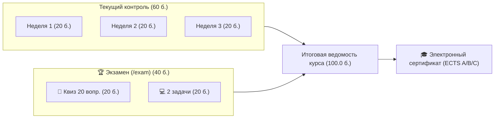

# RF — OOP_20261029-200322_EXAM: Final Exam Module and Comprehensive Assessment Engine

> **Current filename**: `RF__OOP_20261029-200322_EXAM.md`  
> **Date**: 2026-10-29  
> **Author**: `antigravity:thread:local:12f97fb2-4520-4e67-944b-5743e89747a4`  
> **Status**: 🟢 RF — Complete  
> **Parent HL**: [HL-OOP_20261029-200322_EXAM.md](HL-OOP_20261029-200322_EXAM.md)  
> **TS**: [TS__OOP_20261029-200322_EXAM.md](TS__OOP_20261029-200322_EXAM.md)  
> **Producer unit**: `antigravity:thread:local:12f97fb2-4520-4e67-944b-5743e89747a4`  
> **Parent Coordinator**: `antigravity:thread:local:7dc123a4-589f-4ee8-b43d-a035a4018225`  
> **Activation / dispatch source**: owner-direct  
> **Coordination authority**: "HL-OOP_20261029-200322_EXAM.md @ aeaab61f557a754d8e4a6bd0534eb532e8a6d061"  
> **Originating proposer**: none  
> **Current selection**: effective reporting native-gates, selection_ref baseline  
> **Launch observation**: model Gemini 3.8 Flash (High), normal execution, no material rework  

---

## 1. What Was Done

### Actual Value-Bearing Accounting

| Fact | Actual result |
|---|---|
| TS approval ref | `832bd17135e5d1ec5cf08a0d7f384a2ca4df9bc4` (`[antigravity/OOP_20261029-200322_EXAM/plan/coordinator] approve ts and prepare handoff`) |
| Baseline / Candidate | `aeaab61f557a754d8e4a6bd0534eb532e8a6d061` / `c2b3ef5a2d436ab0214898310ea5c357be7d2b85` |
| VALUE membership | 10 файлов: `app/content/exam/__init__.py` (CREATE), `app/content/exam/quiz.py` (CREATE), `app/content/exam/practice.py` (CREATE), `app/routers/exam.py` (CREATE), `app/main.py` (MODIFY), `app/routers/scoring.py` (MODIFY), `app/services/scoring.py` (MODIFY), `app/templates/components/header.html` (MODIFY), `app/templates/exam.html` (CREATE), `app/static/js/app.js` (MODIFY) |
| Arithmetic | 2228 additions + 4 deletions = 2232 touched text LOC across 10 text `VALUE` files; 0 binary files = `N/A`; 10 logical `VALUE` files |
| Membership deviations | None (все измененные файлы строго соответствуют утвержденному селектору TS §4) |
| Trigger disposition | Однофазное исполнение; фактические 2232 LOC существенно ниже триггера декомпозиции (50 файлов, 5000 LOC); декомпозиция не потребовалась |
| Authority and timing | Утвержденный неизменяемый знаменатель владельца задачи `zhasulan` от 2026-10-29 (`832bd17135e5d1ec5cf08a0d7f384a2ca4df9bc4`); Candidate зафиксирован до формирования EV/RF |
| Reproduction | Метод NUL-safe diff: `git diff -z --numstat 832bd17 c2b3ef5` |

### New Files

| File | Description |
|---|---|
| `app/content/exam/__init__.py` | Экспорт публичных структур экзамена (`EXAM_OVERVIEW`, `EXAM_QUIZ_QUESTIONS`, `evaluate_exam_quiz`, `EXAM_PRACTICE_TASKS`) |
| `app/content/exam/quiz.py` | 20 сквозных концептуальных вопросов по Неделям 1–3 (`max_len / min_len <= 1.65`, по 5 вариантов на каждый индекс 0..3) |
| `app/content/exam/practice.py` | 2 боевые задачи (`exam_task_1` Core Domain & SOLID, `exam_task_2` GoF Patterns & Clean Arch) по 10.0 б. в строгой песочнице AST |
| `app/routers/exam.py` | Маршрутизатор `/exam` и API-эндпоинты `/api/exam/progress`, `/api/exam/practice/{task_id}/run`, `/api/exam/quiz/check` |
| `app/templates/exam.html` | Полноценный экзаменационный интерфейс со скрытой кнопкой готовых решений и сводной 100-балльной ведомостью курса |
| `tests/test_exam.py` | Комплексные автотесты экзаменационного модуля (квиз, песочница, 100-балльный скоринг, целостность UI, изоляция 4 студентов) |

### Modified Files

| File | Changes |
|---|---|
| `app/main.py` | Подключение роутера `app.include_router(exam.router)` |
| `app/routers/scoring.py` | Расширение эндпоинта `/api/students/scores` данными Недели 3 и итогового Экзамена |
| `app/services/scoring.py` | Добавление констант экзамена (20 б. квиз, 20 б. задачи, 40 б. экзамен, 100 б. курс) и методов фиксации баллов с High-Water Mark |
| `app/templates/components/header.html` | Добавление акцентной вкладки `🏆 Экзамен` (40 б.) и поддержка экзаменационного скоринга в шапке |
| `app/static/js/app.js` | Поддержка режима `ACTIVE_WEEK === "exam"`, вызовы API экзамена, отправка квиза и живая синхронизация 100-балльной шкалы |

---

## 2. Key Decisions

1. **Режим академической честности (Academic Integrity):** В экзаменационном шаблоне `exam.html` полностью исключена кнопка «✨ Вставить готовое решение» (`fillSolutionCode`), а в `textarea` задач не передается атрибут `data-solution`, защищая экзамен от списывания даже через инспекцию DOM/DevTools.
2. **Агрегация 100-балльной шкалы курса:** Семестровый рейтинг (60.0 б. за недели 1–3 по 20.0 б.) объединен с экзаменационным (40.0 б. = 20.0 б. квиз + 20.0 б. 2 задачи тренажера) с защитой High-Water Mark в SQLite WAL. Порог зачета курса составляет 50.0 / 100.0 баллов (шкала ECTS A/B/C/F).
3. **Сквозная доменная архитектура 2 задач экзамена:** Задача 1 охватывает проектирование доменных инвариантов и Dependency Injection (`SmartCard`, `Money`, `TransitFareManager`), а Задача 2 строит над ними терминал с паттернами GoF (`Builder`, `Adapter`, `Facade`).
4. **Безопасность песочницы:** Обе задачи строго удовлетворяют белому списку `ASTValidator` и выполняются в изолированном процессе `python -I` за < 1.0 с.

---

## 3. Acceptance Criteria

- [x] **AC-1: Теоретический квиз экзамена (20 вопросов, 20.0 баллов)** — 20 вопросов, соотношение длин вариантов `<= 1.120` (порог `<= 1.65`), строго по 5 верных ответов на каждый индекс 0..3, функция `evaluate_exam_quiz` начисляет по 1.0 б. за вопрос (порог сдачи 12.0 б.).
- [x] **AC-2: Боевые задачи экзамена в песочнице AST (2 задачи, 20.0 баллов)** — 2 задачи по 10.0 б., строгий белый список AST, 100% прохождение тестов в RunnerService за 0.64–0.75с (< 5.0с).
- [x] **AC-3: Скоринг и 100-балльная итоговая ведомость курса** — `ScoringService` корректно ведет учет экзамена (до 40.0 б.) и рассчитывает общий итог курса (до 100.0 б.) с защитой High-Water Mark.
- [x] **AC-4: Режим честности (скрытие готовых решений) и навигация UI** — В `header.html` добавлена ссылка `🏆 Экзамен`, на странице `/exam` скрыта кнопка готового решения и атрибуты `data-solution`, ведомость отображает компоненты оценки.
- [x] **AC-5: Изоляция 4 студентов и сквозная регрессионная надежность** — Прогресс экзамена изолирован для всех 4 студентов, полный прогон автотестов дает **60 passed из 60** (100% pass).

---

## 4. Verification

- **Lint (`python -m pytest tests/ -q --collect-only`):** 60 tests collected, 0 syntax/collection errors.
- **Tests (`pytest tests/`):** 60 passed из 60 (100% pass) за 29.15 с.

---

## 5. Evidence

See [EV file](evidence/EV__OOP_20261029-200322_EXAM.md) for evidence details.

Evidence verdict: 6/6 VERIFIED, 0 DEFERRED, 0 BLOCKED, 0 N/A

---

## 6. Observations (out-of-scope, not modified)

No observations.

---

## 7. Fact Candidates

No fact candidates.

---

## 8. Strategic Insights (Execution)

| # | Insight | Category | Source |
|---|---|---|---|
| S1 | Скрытие кнопки готового решения и атрибута `data-solution` в DOM обеспечивает академическую честность без необходимости усложнять авторизацию. | Architecture | Разработка UI и `test_exam_ui_integrity` |
| S2 | Формула 60 б. текущий контроль + 40 б. экзамен идеально ложится на классическую университетскую 100-балльную систему (ECTS A/B/C/F). | Academic Domain | `ScoringService` и `HL §1` |

---

## 9. Diagrams

### Material handover at this return

- Producer unit: `antigravity:thread:local:12f97fb2-4520-4e67-944b-5743e89747a4`
- Source epoch: Candidate commit `c2b3ef5a2d436ab0214898310ea5c357be7d2b85`
- Inspected scope: контент `app/content/exam/`, скоринг `ScoringService`, роутер `app/routers/exam.py`, шаблоны `exam.html` и `header.html`, тесты `tests/test_exam.py`
- Uncertainty: отсутствует; 60/60 тестов пройдены успешно
- Continuation: переход к независимому ревью через команду `/tfw-review`

---

*RF — OOP_20261029-200322_EXAM: Final Exam Module and Comprehensive Assessment Engine | 2026-10-29*
