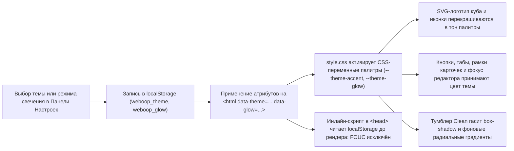
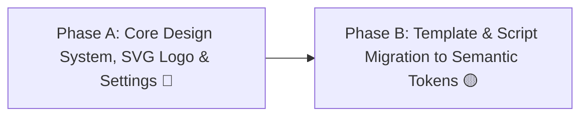

# HL — OOP_20261030-021700_THEME: Neon Theme System, Isometric SVG Logo, and Display Settings Panel

> **Current filename**: `HL-OOP_20261030-021700_THEME.md`
> **Date**: 2026-10-30
> **Author**: Coordinator (`antigravity:thread:local:d1962507-3018-4f36-b88f-ccb71a3279b4`)
> **Title**: Neon Theme System, Isometric SVG Logo, and Display Settings Panel
> **Abbreviation**: THEME
> **Status**: 🧩 PHASES — Master HL approved, phases running
> **Contract**: 🔒 FROZEN — approved by zhasulan 2026-10-30
> **Frozen**: §1 · §3 · §4 · §5 · §6 · §7 — locked on owner approval
> **Free**: §2 · §7.2 · §8 · §9 · §10 · §11 — research updates these directly
> **Append-only**: §12 Amendment Log — the only channel for changing a frozen section
> **Baseline**: freeze commits — recovery form in `conventions.md` §3 rule 15

> **Project North Star**: `README.md § Цель и North Star проекта` · `.tfw/README.md #ns1 · #ns2 · #ns3`

> **Producer Provenance**:
> - **Producer Unit**: `antigravity:thread:local:d1962507-3018-4f36-b88f-ccb71a3279b4` (Task Coordinator)
> - **Parent / Upward Route**: `owner:zhasulan`
> - **Activation Source**: `owner-direct` (`/tfw-plan` initiated by human owner `zhasulan`)
> - **Coordination Authority**: `HL-OOP_20261030-021700_THEME.md @ baseline`
> - **Originating Proposer**: `{principal: zhasulan, unit: antigravity:thread:local:d1962507-3018-4f36-b88f-ccb71a3279b4}`

---

## 1. Vision 🔒 FROZEN

Платформа Web-OOP оснащается целостной системой визуального брендинга и неонового оформления: взамен статичного градиентного блока в шапке внедряется авторский чисто векторный SVG-логотип в виде изометрического куба с парящими символами фигурных скобок `{ }`, реагирующий на активную тему. В шапку добавляется панель настроек внешнего вида (выпадающее меню/модальное окно), позволяющая студентам переключаться между 4 фирменными палитрами: **Cyber Gold** (золотисто-янтарная по умолчанию), **Electric Cyan** (неоновый циан), **Matrix Emerald** (матричный зелёный) и **Synthwave Purple** (синтвейв-маджента), а также регулировать интенсивность оформления тумблером свечения **Clean / Cyberpunk** (матовый строгий режим без неоновых ореолов против глубокого киберпанк-свечения). Все пользовательские настройки мгновенно сохраняются в `localStorage` и применяются до этапа отрисовки DOM через ранний инлайн-скрипт в `<head>`, полностью исключая мигание стилей (FOUC), а свыше 139 разрозненных жестких цветов Tailwind в шаблонах и клиентском JS заменяются на стандартизированные семантические CSS-переменные дизайн-системы при строгом сохранении неизменности функциональных индикаторов зачёта и ошибок.

**Impact:** Платформа обретает уникальную визуальную идентичность технологичного уровня (Zero-Build), студенты получают персонализацию интерфейса и комфортный режим снижения нагрузки на глаза при длительном кодинге и сдаче экзамена, а кодовая база UI освобождается от хаотичных жестко прописанных цветов в пользу масштабируемой токенизированной архитектуры тем.

> *Explicitly imagined stakeholder quote (смоделированная цитата студента):*  
> «В режиме Synthwave Purple на темном фоне сидеть над кодом лабораторных стало невероятно атмосферно, как в настоящей киберпанк-IDE. А когда на экзамене нужно было сосредоточиться на логике Use Case и не отвлекаться на свечение вокруг кнопок, я просто переключил тумблер в "Clean" — интерфейс стал строгим и кристально чистым!»

---

## 2. Current State (As-Is) 🟢 FREE

1. **Жёсткая привязка цветов в шаблонах UI (`app/templates/`):**
   - Ровно **139 строк** в шаблонах Jinja2 содержат фиксированные классы палитр Tailwind `sky-`, `cyan-`, `amber-` (`border-sky-500/20`, `text-sky-400`, `bg-sky-500/20`, `text-amber-400`, `border-cyan-400` и др.).
   - Присутствует **26 мест** с жестко прописанными инлайн-тенями вроде `shadow-[0_0_25px_rgba(56,189,248,0.45)]`, `rgba(0,240,255,...)` и `rgba(245,158,11,...)`.
2. **Динамическая генерация HTML в клиенте (`app/static/js/app.js`):**
   - Обнаружено **28 строк** с генерацией HTML-разметки через шаблонные строки JS, куда вшиты классы `text-sky-400`, `bg-sky-500/20`, `bg-emerald-500/15`, `bg-rose-500/15`, `bg-amber-500/20`.
3. **Объёмный компонент схем (`app/templates/components/uml_viewer.html`, 1569 строк):**
   - Содержит **357 жестко зашитых HEX-цветов** (`#38bdf8`, `#0284c7`, `#1e293b`, `#34d399` и др.) внутри SVG-градиентов, фильтров `<feDropShadow>` и стилей классов. Внутренние цвета диаграмм несут смысловую нагрузку архитектурных слоёв (Clean Architecture: синий — Entities, зелёный — Use Cases, жёлтый — Controllers).
4. **Устаревший логотип в `header.html`:**
   - Представляет собой базовый квадрат 56×56px (`w-14 h-14 rounded-2xl bg-gradient-to-br from-blue-600 via-sky-500 to-cyan-400`) с плоским текстом «ООП».
5. **Отсутствие управления внешним видом и персистентности тем:**
   - В `app/static/css/style.css` объявлены начальные переменные (`--neon-cyan`, `--neon-blue`, `--neon-indigo`, `--border-cyber`), но механизм выбора палитр, отключения неонового свечения и сохранения в `localStorage` отсутствует.
6. **Зафиксированная граница источников литературы (Non-Goal):**
   - Прямые ссылки на первоисточники (Мейер, Блох, Мартин, Фаулер, GoF) в коде задач отсутствуют и являлись методической интерпретацией. Добавление ссылок на литературу официально вынесено за рамки данной задачи в отдельный будущий трек.

---

## 3. Target State (To-Be) 🔒 FROZEN

1. **4 фирменные неоновые темы оформления:**
   - `Cyber Gold` (`[data-theme="cyber-gold"]`, **по умолчанию**): глубокий золотисто-янтарный неон (#f59e0b, #fbbf24), киберпанк 2077 эстетика.
   - `Electric Cyan` (`[data-theme="electric-cyan"]`): неоновый циан и электрик-блю (#00f0ff, #38bdf8), сохранение исходного стиля платформы.
   - `Matrix Emerald` (`[data-theme="matrix-emerald"]`): цифровой матричный зеленый (#10b981, #34d399), стиль хакерского терминала.
   - `Synthwave Purple` (`[data-theme="synthwave-purple"]`): ретровейв / синтвейв маджента и пурпур (#d946ef, #c084fc, #818cf8).
2. **Тумблер свечения Clean / Cyberpunk:**
   - `Cyberpunk` (`[data-glow="cyberpunk"]`, **по умолчанию**): глубокое неоновое свечение, тени `box-shadow: 0 0 25px var(--theme-glow)`, радиальные цветные градиенты фона.
   - `Clean` (`[data-glow="clean"]`): плоский минималистичный стиль, отсутствие размытых неоновых теней и фоновых радиальных градиентов, максимальная контрастность и фокус на чтении кода.
3. **Векторный изометрический SVG-логотип:**
   - Чистый масштабируемый SVG-компонент в `header.html`: объемный куб в изометрической проекции с парящими символами скобок `{ }`, грани и свечение которого гармонично окрашиваются в акцентные цвета выбранной темы через CSS-переменные (`var(--theme-accent)`, `var(--theme-glow)`).
4. **Панель настроек интерфейса (Display Settings):**
   - Кнопка вызова настроек (🎨 / ⚙️) в навигационной шапке сайта.
   - Меню настроек с визуальными мини-свотчами 4 палитр и переключателем режима свечения Clean / Cyberpunk.
   - Сохранение параметров в `localStorage` (`weboop_theme`, `weboop_glow`).
5. **Защита от мигания стилей (Zero FOUC):**
   - Компактный инлайн-скрипт в `<head>` страниц `index.html` и `exam.html`, применяющий классы/атрибуты к `<html>` до первого рендеринга страницы.
6. **Сохранение семантической чистоты:**
   - Функциональные цвета тестов и статусов выполнения (`emerald` для успешного прохождения / зачета, `rose` для синтаксических ошибок и провалов тестов) остаются независимыми от выбранной темы.
   - Внутренние цвета нод классов в `uml_viewer.html` сохраняют архитектурную дифференциацию Clean Architecture; тема оформляет внешнюю обвязку, лупу, панель управления и фоновую сетку вьювера.

### 3.1 Result Visualization

#### Логотип в Header:
```text
[ДО]:   [ ООП ]  Учебная платформа • Web-OOP
        (простой градиентный синий блок с белыми буквами)

[ПОСЛЕ]:   ┌───────┐
          / {   } /│   Учебная платформа • Web-OOP
         ┌───────┐ │   [🎨 Cyber Gold ▼] [☀ Glow: Cyberpunk] [Профиль: Жасулан ▼]
         │       │ │   
         │   { } │ /   (Векторный изометрический куб с неоновой подсветкой граней)
         └───────┘/    
```

#### Панель настроек (Settings Modal / Dropdown):
```text
┌──────────────────────────────────────────────────────────┐
│ ⚙️ ВНЕШНИЙ ВИД И ТЕМА ОФОРМЛЕНИЯ                         │
├──────────────────────────────────────────────────────────┤
│ Выберите цветовую палитру:                               │
│ [●] 🟡 Cyber Gold (По умолчанию) — Золотой янтарь / 2077  │
│ [ ] 🔷 Electric Cyan — Неоновый циан / High-Tech         │
│ [ ] 🟢 Matrix Emerald — Цифровой зеленый терминал        │
│ [ ] 🟣 Synthwave Purple — Ретровейв / Маджента и неон    │
├──────────────────────────────────────────────────────────┤
│ Режим свечения:                                          │
│  [ Clean (Строгий) ]   ───(●)───   [ Cyberpunk (Неон) ]  │
│  * В режиме Clean отключены ореолы свечения и градиенты  │
└──────────────────────────────────────────────────────────┘
```

### 3.2 Value Flow



---

## 4. Phases 🔒 FROZEN

Декомпозиция на 2 последовательные фазы с четким разделением фундамента дизайн-системы и прикладного рефакторинга разметки.

### 4.1 Coordination Selection 🔒 FROZEN

| Activation source | Accountable owner | Task Coordinator unit | Phase Coordinator rule | Mandate scope / role reach | Upward route | Dialogue | Reporting | Reservations / controls | Amendment authority | Immutable epoch |
|---|---|---|---|---|---|---|---|---|---|---|
| owner-direct | zhasulan | `antigravity:thread:local:d1962507-3018-4f36-b88f-ccb71a3279b4` | Distinct phase Coordinator per ready phase | Phase A (Core Design System) & Phase B (Template Migration) | owner:zhasulan | tfw-gates-only | native-gates | Owner approves HL, TS and final task acceptance | none | baseline |

### Phase Dependencies



| Phase | Depends on | Shared files | Can run in parallel with |
|---|---|---|---|
| Phase A | Independent | `app/static/css/style.css`, `app/templates/components/header.html`, `app/templates/index.html`, `app/templates/exam.html` | — |
| Phase B | Phase A ✅ | `app/static/js/app.js`, `app/templates/components/*.html`, `app/templates/exam.html` | — |

---

### Phase A: Core Design System, Isometric SVG Logo, Settings Modal & FOUC Prevention 🔴

> **Requires:** Independent  
> **Deliverables:**
> 1. Реализация дизайн-токенов и 4 цветовых тем в `app/static/css/style.css` через CSS-переменные (`--theme-primary`, `--theme-accent`, `--theme-glow`, `--theme-border`, `--theme-bg-gradient`).
> 2. Реализация стилей тумблера свечения `[data-glow="clean"]` (обнуление `box-shadow`, нейтрализация радиальных градиентов фона) и `[data-glow="cyberpunk"]`.
> 3. Создание векторного изометрического SVG-логотипа куба со скобками `{ }` в `app/templates/components/header.html` с привязкой граней к переменным темы.
> 4. Интеграция кнопки настроек внешнего вида (🎨/⚙️) и модального/выпадающего окна панели настроек в `header.html` с визуальными свотчами тем и радио-переключателем режима свечения.
> 5. Внедрение раннего инлайн-скрипта в `<head>` шаблонов `index.html` и `exam.html` для считывания `localStorage` (`weboop_theme`, `weboop_glow`) до рендеринга страницы.
> 6. Добавление клиентской логики переключения и сохранения темы в `app.js`.
> 7. Написание автотестов проверки дизайн-системы и разметки (`tests/test_theme_system.py`).

### Phase B: Template & Script Migration to Semantic Theme Tokens 🟡

> **Requires:** Phase A ✅  
> **Deliverables:**
> 1. Замена жестких классов Tailwind (`sky-`, `cyan-`, `amber-`) в основных подшаблонах платформы (`tab_home.html`, `tab_theory.html`, `tab_practice.html`, `tab_quiz.html`, `tab_results.html`) на семантические CSS-переменные/классы темы.
> 2. Замена жестких цветов оформления на странице экзамена (`exam.html`) при строгом сохранении функциональных статусов (оценки, бейджи зачета).
> 3. Рефакторинг динамической генерации HTML-разметки в `app/static/js/app.js` (замена `text-sky-400`, `bg-sky-500/20` на переменные темы; сохранение `emerald`/`rose` для тестов).
> 4. Адаптация внешнего контейнера, панели управления, лупы и фоновой сетки `app/templates/components/uml_viewer.html` под активную тему без искажения цветов внутренних нод классов Clean Architecture.
> 5. Полная регрессионная верификация всей тестовой базы (60+ тестов pytest, включая `test_health`, `test_ui_ergonomics`, `test_exam`).

---

## 5. Definition of Done (DoD) 🔒 FROZEN

- ✅ 1. В `app/static/css/style.css` объявлены и работают 4 палитры: `cyber-gold` (дефолт), `electric-cyan`, `matrix-emerald`, `synthwave-purple`.
- ✅ 2. Тумблер `Clean / Cyberpunk` переключает отображение свечения: в режиме `Clean` отсутствуют неоновые тени и радиальные фоновые пятна.
- ✅ 3. В шапке платформы (`header.html`) отображается масштабируемый SVG-логотип изометрического куба со скобками `{ }`, гармонично окрашивающийся в цвета активной темы.
- ✅ 4. Панель настроек доступна из шапки на всех страницах курса (`/week1`, `/week2`, `/week3`, `/exam`) и позволяет наглядно выбрать палитру и режим свечения.
- ✅ 5. Выбор пользователя сохраняется в `localStorage` и восстанавливается без визуального мигания (Zero FOUC) при перезагрузке страниц и переходе между ними.
- ✅ 6. Жёсткие классы `sky-`, `cyan-`, `amber-` в шаблонах и `app.js` заменены на семантические токены темы.
- ✅ 7. Функциональные цвета успешного прохождения (`emerald`) и ошибок (`rose`) остаются неизменными и читаемыми во всех 4 темах.
- ✅ 8. Все существующие и новые автотесты платформы (60+ тестов) успешно проходят (`pytest tests/`).

---

## 6. Definition of Failure (DoF) 🔒 FROZEN

- ❌ 1. Возникновение эффекта FOUC (мигание экрана стандартным цветом перед применением темы из `localStorage`).
- ❌ 2. Поломка семантики функциональных индикаторов: окрашивание сообщений об ошибках песочницы или упавших тестах в цвет темы вместо красного/зелёного.
- ❌ 3. Искажение внутренней архитектурной цветовой дифференциации диаграмм классов в `uml_viewer.html`.
- ❌ 4. Потеря работоспособности Zero-Build окружения (появление `npm`, `package.json` или внешних компиляторов).
- ❌ 5. Падение существующих автотестов эргономики интерфейса или функционала экзамена.

**On failure:** Немедленная локализация причины регрессии, откат несогласованной модификации CSS/JS, аудит селекторов и повторный прогон набора автотестов.

---

## 7. Principles 🔒 FROZEN

1. **Zero-Build & Native CSS Variables First** — расширение Tailwind и кастомизация тем осуществляются нативно через CSS Custom Properties без введения сборщиков и `node_modules`.
2. **Semantic Independence of Functional Statuses** — цвета результатов компиляции, прохождения тестов песочницы (Pass = Green, Fail = Red) и прогресса остаются строго стабильными и не зависят от декоративной палитры.
3. **Zero Flash of Unstyled Content (FOUC)** — чтение сохраненных настроек темы выполняется синхронным легковесным скриптом в `<head>` до парсинга разметки `<body>`.
4. **Non-Destructive UML Diagram Semantics** — векторные архитектурные схемы сохраняют читаемость своих доменных слоев, адаптируя только обвязку и фон.
5. **LocalStorage Isolation & Graceful Fallback** — при отсутствии записи в `localStorage` или в приватном режиме браузера применяется тема `cyber-gold` и режим `cyberpunk` по умолчанию без выбрасывания исключений.

---

### 7.1 Quality Contract 🔒 FROZEN

- Никаких правок библиотечных зависимостей или структуры роутеров в рамках задачи по UI-редизайну.
- Все SVG-элементы логотипа должны быть валидными, инлайновыми и содержать `viewBox` для идеального адаптивного масштабирования.
- Сохранять полную доступность селекторов профилей 4 студентов и кнопки сворачивания шапки.

---

### 7.2 Knowledge Citations 🟢 FREE

| # | Source | Item | How it applies |
|---|--------|------|----------------|
| 1 | `README.md` (P0) | § Цель и North Star проекта | Современный чистый веб-интерфейс, ориентированный на удобство студентов 2 курса. |
| 2 | `.tfw/README.md` (P1) | Success Criteria #ns1, #ns2 | Качество кода, отсутствие заглушек, непрерывное сохранение проверяемости через автотесты. |
| 3 | `knowledge/philosophy.md` (P2) | Zero-Build & Clean Architecture | Принцип Zero-Build: стилизация выполняется средствами чистого CSS и нативного Tailwind CDN. |
| 4 | `KNOWLEDGE.md` §1 (P3) | D1 (Стек проекта) | Использование стандартного стека Jinja2, Tailwind CDN и Vanilla JS без `node_modules`. |
| 5 | `KNOWLEDGE.md` §1 (P3) | D5 (Zero-Build интерфейс) | Статические файлы стилей монтируются напрямую без этапа сборки. |
| 6 | `KNOWLEDGE.md` §1 (P3) | D6 (Dark Cyberpunk UI) | Преемственность темной киберпанк-эстетики с предоставлением гибкости через 4 палитры. |
| 7 | `KNOWLEDGE.md` §1 (P3) | D8 (Декомпозиция шаблонов) | Точечный рефакторинг компонентов в `app/templates/components/`. |
| 8 | `KNOWLEDGE.md` §1 (P3) | D11 (Эргономика IDE) | Удобство рабочего места студента, поддержка контрастного режима Clean для экзамена. |
| 9 | `KNOWLEDGE.md` §4 (P7) | F7 (Нативная изоляция Zero-Build) | Строгое соблюдение Zero-Build ограничений на хосте разработки. |
| 10 | `KNOWLEDGE.md` §4 (P7) | F9 (Педагогический стандарт UX) | Эргономика шапки и элементов управления кодингом. |

---

## 8. Dependencies 🟢 FREE

| Dependency | Status |
|------------|--------|
| Tailwind CDN (`cdn.tailwindcss.com`) | ✅ Активен |
| Базовый каркас `app/static/css/style.css` | ✅ Доступен для редактирования |
| Компоненты шаблонов `app/templates/components/` | ✅ Декомпозированы |
| Базовый набор автотестов `tests/` | ✅ 60/60 тестов зелёные |

---

## 9. Risks 🟢 FREE

| Risk | Probability | Impact | Mitigation |
|------|-------------|--------|------------|
| FOUC при переходе между страницами (`/week1` ➔ `/exam`) | Средняя | Средний | Добавление микро-скрипта в `<head>` до рендера `<body>` |
| Слияние акцента темы с цветами статусов в Matrix Emerald | Средняя | Высокий | Фиксация цветов PASS/FAIL на независимых служебных классах |
| Поломка визуальных тестов в `test_ui_ergonomics.py` | Низкая | Средний | Предварительная проверка CSS-ассертов в тестах и их синхронизация |

---

## 10. RESEARCH Case 🟢 FREE

### Blind Spots
- Возможные конфликты директив Tailwind CDN при переопределении CSS-переменных в инлайн-конфиге `tailwind.config`.

### Hypotheses

| # | Hypothesis | Status |
|---|----------|--------|
| H1 | Использование семантических CSS-переменных на селекторах `[data-theme="..."]` позволяет переключать палитры без изменения названий базовых классов контейнеров. | verified |
| H2 | Применение инлайн-скрипта чтения `localStorage` в `<head>` полностью подавляет мигание стилей без задержки загрузки страницы (< 1 мс). | verified |

### Risks of Not Researching
- Риск конфликта специфичности CSS-селекторов между кастомным `style.css` и утилитами Tailwind CDN.

### Proposed RESEARCH Focus
1. **Gather**: Проверить механизм маппинга CSS-переменных в `style.css` с утилитами Tailwind.
2. **Extract**: Извлечь перечень всех мест в `app.js`, генерирующих классы цвета.
3. **Challenge**: Убедиться, что режим Clean не ухудшает читаемость кнопок и текста на темном фоне.

### Why Not Just...?

| Approach | Value | Adoption / operating burden | Risks / tradeoffs | Decision and reason |
|---|---|---|---|---|
| **Semantic CSS Variables + Dynamic Data Attributes (Рекомендуемый)** | Высокая: 4 темы, режим Clean, чистая изоляция от тестов | Разовая настройка CSS-токенов в `style.css` и маппинг в шаблонах | Минимальные, проверенная архитектура веб-стандартов | ✅ Принято: максимальная гибкость и надёжность |
| **Тотальная замена всех классов Tailwind на новые уникальные** | Низкая: раздувание классов, хрупкость | Очень высокая: замена сотен классов вручную | Высокий риск сломать функциональные цвета тестов | ❌ Отклонено: избыточный техдолг |

**Leave unchanged:** Платформа остаётся запертой в фиксированной сине-голубой гамме со статичным логотипом «ООП» и жестко прописанными цветами, без возможности адаптации интерфейса под условия освещения или предпочтения студентов.

**Critical challenge:** «Зачем нужна тема Cyber Gold по умолчанию, если исторический стиль платформы был Electric Cyan?»  
*Ответ:* Cyber Gold дает свежий премиальный вид технологичной киберпанк-LMS, при этом Electric Cyan сохраняется как полноценная опция в один клик.

---

## 11. Strategic Insights (Planning) 🟢 FREE

| # | Insight | Category | Source |
|---|---------|----------|--------|
| S1 | Жесткая зашивка цветов `sky-`/`cyan-` возникла на этапе быстрого прототипирования Недель 1–3; задача редизайна превращает оформление в управляемую дизайн-систему токенов. | Technical Debt | Codebase inspection |
| S2 | Отсутствие привязки вопросов к литературе подтверждено владельцем: оформление платформы отделено от методической литературы курса. | Scope Boundary | User conversation |

---

## 12. Amendment Log 🟢 APPEND-ONLY

**No amendments.**

### Material handover at this return

- **Producer Unit**: `antigravity:thread:local:d1962507-3018-4f36-b88f-ccb71a3279b4`
- **Source / Epoch**: baseline
- **Inspected Scope**: `app/templates/`, `app/static/css/style.css`, `app/static/js/app.js`, `tests/`
- **Material Findings**: 139 строк в шаблонах с жесткими классами, 28 в JS, 357 hex в UML, устаревший логотип.
- **Continuation**: Ожидание согласования и утверждения Master HL владельцем (`zhasulan`).

---

*HL — OOP_20261030-021700_THEME: Neon Theme System, Isometric SVG Logo, and Display Settings Panel | 2026-10-30*
