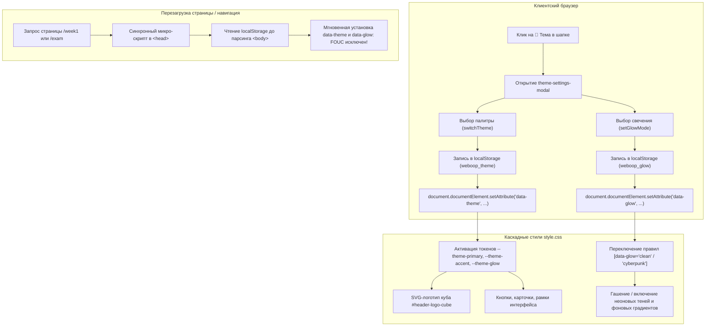

# RF — OOP_20261030-021700_THEME / Phase A: Core Design System, SVG Logo, and Settings Panel

> **Current filename**: `RF__phase-a__core_design_system_svg_logo_and_settings_panel.md`
> **Date**: 2026-10-30
> **Author**: Executor (`antigravity:thread:local:29d073ad-cf42-4504-9212-4aaa7e0ef202`)
> **Status**: 🟢 RF — Complete
> **Parent HL**: [HL-OOP_20261030-021700_THEME.md](../HL-OOP_20261030-021700_THEME.md)
> **TS**: [TS__phase-a__core_design_system_svg_logo_and_settings_panel.md](TS__phase-a__core_design_system_svg_logo_and_settings_panel.md)
> **Producer unit**: `antigravity:thread:local:29d073ad-cf42-4504-9212-4aaa7e0ef202`
> **Parent Coordinator**: `antigravity:thread:local:d1962507-3018-4f36-b88f-ccb71a3279b4`
> **Activation / dispatch source**: owner-direct (`/tfw-handoff OOP_20261030-021700_THEME/phase-a`)
> **Coordination authority**: "HL-OOP_20261030-021700_THEME.md @ 91921d22dfbf9a87cc18a0ae194b435b713bcb69"
> **Originating proposer**: `none`
> **Current selection**: `reporting: native-gates`, `selection_ref: baseline`
> **Launch observation**: requested model: Gemini 3.8 Flash (High); delivery: native execution; material rework: none; outcome: complete

---

## 1. What Was Done

### Actual Value-Bearing Accounting

| Fact | Actual result |
|---|---|
| TS approval ref | `e7864cffb8c2d939a2741c23d63c92008e0bfd68` |
| Baseline / Candidate | `91921d22dfbf9a87cc18a0ae194b435b713bcb69` / `5855e38a94e3293f65efc0ad3bc3a32861c83439` |
| VALUE membership | `app/static/css/style.css` (MODIFY, VALUE, CSS-переменные 4 тем, тумблера Clean/Cyberpunk, стили панели настроек); `app/templates/components/header.html` (MODIFY, VALUE, Векторный SVG-логотип изометрического куба, кнопка и модалка настроек темы); `app/templates/index.html` (MODIFY, VALUE, Инлайн-скрипт в `<head>` для чтения `localStorage` и предотвращения FOUC); `app/templates/exam.html` (MODIFY, VALUE, Инлайн-скрипт в `<head>` для чтения `localStorage` и предотвращения FOUC); `app/static/js/app.js` (MODIFY, VALUE, Модуль переключения тем, обработчики событий и сохранение в `localStorage`) |
| Arithmetic | 399 additions + 6 deletions = 405 touched text LOC; 5 logical VALUE files; binary/non-text N/A: 0 |
| Membership deviations | None |
| Trigger disposition | Single-phase budget respected (within owner escalation multiplier 2 ceiling of 10 files / 690 LOC; threshold 50 files / 5000 LOC not reached) |
| Authority and timing | Immutable owner-approved denominator (5 files / 345 LOC, multiplier 2 ceiling 690 LOC); pre-work decision respected |
| Reproduction | `git diff --name-status --find-renames=50% -z 91921d22dfbf9a87cc18a0ae194b435b713bcb69 5855e38a94e3293f65efc0ad3bc3a32861c83439 -- app/static/css/style.css app/templates/components/header.html app/templates/index.html app/templates/exam.html app/static/js/app.js`   `git diff --numstat --find-renames=50% -z 91921d22dfbf9a87cc18a0ae194b435b713bcb69 5855e38a94e3293f65efc0ad3bc3a32861c83439 -- app/static/css/style.css app/templates/components/header.html app/templates/index.html app/templates/exam.html app/static/js/app.js` |

### New Files

| File | Description |
|---|---|
| `tests/test_theme_system.py` | `ASSURANCE`: Набор комплексных автотестов AC-1 — AC-7 (токены CSS 4 тем, тумблер свечения, SVG-логотип, модальное окно настроек, скрипты Zero-FOUC и интеграция FastAPI эндпоинтов) |

### Modified Files

| File | Changes |
|---|---|
| `app/static/css/style.css` | `VALUE`: Добавлены токены `--theme-primary`, `--theme-accent`, `--theme-glow`, `--theme-border`, `--theme-bg-gradient` для 4 палитр (`cyber-gold`, `electric-cyan`, `matrix-emerald`, `synthwave-purple`), правила тумблера свечения `[data-glow="clean"]` и `[data-glow="cyberpunk"]`, а также классы подсветки элементов модального окна |
| `app/templates/components/header.html` | `VALUE`: Заменен квадратный блок «ООП» на адаптивный изометрический векторный SVG-куб с парящими скобками `{ }` и динамической подсветкой; добавлена кнопка вызова настроек 🎨 в навигационную строку и разметка модального окна `theme-settings-modal` со свотчами палитр и радио-тумблером режима свечения |
| `app/templates/index.html` | `VALUE`: Добавлен синхронный скрипт чтения настроек темы из `localStorage` в `<head>` до рендера `<body>` для исключения эффекта FOUC |
| `app/templates/exam.html` | `VALUE`: Добавлен синхронный скрипт чтения настроек темы из `localStorage` в `<head>` до рендера `<body>` для исключения эффекта FOUC |
| `app/static/js/app.js` | `VALUE`: Реализован модуль управления темами (функции `initThemeSystem`, `switchTheme`, `setGlowMode`, `openThemeSettings`, `closeThemeSettings`, обработка клика по оверлею и закрытие по нажатию клавиши `Escape`) |

---

## 2. Key Decisions

1. **Zero FOUC в `<head>`**: Инлайн-скрипт чтения `localStorage` размещен непосредственно в секции `<head>` перед парсингом `<body>` с обработкой `try/catch`, гарантируя мгновенную установку атрибутов `data-theme` и `data-glow` до первой отрисовки пикселей даже в режиме инкогнито с заблокированным `localStorage`.
2. **Семантические токены CSS Variables**: Все 4 темы используют одинаковый набор переменных (`--theme-primary`, `--theme-accent`, `--theme-glow`, `--theme-border`, `--theme-bg-gradient`), что обеспечивает прозрачную перекраску всех зависимых компонентов интерфейса без добавления новых классов в HTML.
3. **Строгий режим Clean**: В режиме Clean не просто приглушаются тени, а полностью нейтрализуются радиальные фоновые градиенты и неоновые ореолы `box-shadow` для максимальной читаемости текста кода при подготовке к экзамену.
4. **Доступность кнопки настроек**: Кнопка 🎨 помещена в навигационную строку Row 2 рядом с элементами управления шапкой, благодаря чему она остается доступной пользователю даже при свернутом состоянии заголовка.

---

## 3. Acceptance Criteria

- [x] **AC-1**: Реализация 4 неоновых палитр в `style.css` (`cyber-gold`, `electric-cyan`, `matrix-emerald`, `synthwave-purple`).
- [x] **AC-2**: Тумблер режимов свечения Clean / Cyberpunk в `style.css`.
- [x] **AC-3**: Векторный изометрический SVG-логотип куба с `{ }` в `header.html`.
- [x] **AC-4**: Кнопка вызова настроек и модальное окно `theme-settings-modal` в `header.html`.
- [x] **AC-5**: Предотвращение мигания темы (Zero FOUC) в `<head>` страниц `index.html` и `exam.html`.
- [x] **AC-6**: Клиентский модуль управления темами в `app.js` с персистентностью в `localStorage`.
- [x] **AC-7**: Регрессионная верификация тестов платформы: 67 из 67 тестов успешно проходят (`pytest tests/`).

---

## 4. Verification

- Lint (`python -m pytest tests/ -q --collect-only`): 67 tests collected in 0.04s, PASSED
- Tests (`pytest`): 67 passed, 1 warning in 19.59s, PASSED

---

## 5. Evidence

See [EV file](evidence/EV__phase-a__core_design_system_svg_logo_and_settings_panel.md) for evidence details.

Evidence verdict: 8/8 VERIFIED, 0 DEFERRED, 0 BLOCKED, 0 N/A

Task-owned resources: Временные файлы тестов изолированы в `%TEMP%\tfw\OOP_20261030-021700_THEME\`; внешние сервисы и демоны не запускались.

---

## 6. Observations (out-of-scope, not modified)

No observations.

---

## 7. Fact Candidates

No fact candidates.

---

## 8. Strategic Insights (Execution)

No strategic insights.

---

## 9. Diagrams

### Material handover at this return

- **Producer unit**: `antigravity:thread:local:29d073ad-cf42-4504-9212-4aaa7e0ef202`
- **Source / epoch**: Candidate `5855e38a94e3293f65efc0ad3bc3a32861c83439`
- **Inspected scope**: `app/static/css/style.css`, `app/templates/components/header.html`, `app/templates/index.html`, `app/templates/exam.html`, `app/static/js/app.js`, `tests/`
- **Material or justified-none**: Material. Реализация Phase A полностью завершена, все 7 критериев приемки выполнены и подтверждены автотестами.
- **Uncertainty**: None.
- **Continuation**: Передача на этап `/tfw-review` координатору задачи.

---

*RF — OOP_20261030-021700_THEME / Phase A: Core Design System, SVG Logo, and Settings Panel | 2026-10-30*
