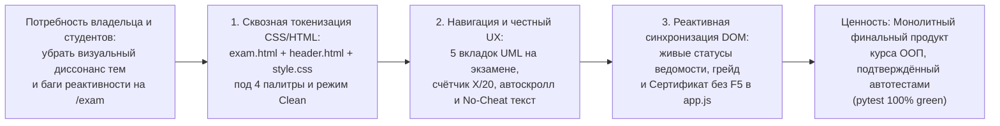

# HL — OOP_20261103-233431_EXMPOL: Полировка дизайн-системы, реактивности ведомости и UX итогового экзамена

> **Current filename**: `HL-OOP_20261103-233431_EXMPOL.md`

> **Date**: 2026-11-03
> **Author**: zhasulan
> **Title**: Полировка дизайн-системы, реактивности ведомости и UX итогового экзамена
> **Abbreviation**: EXMPOL
> **Status**: 🔒 FROZEN — Approved by zhasulan
> **Contract**: 🔒 FROZEN — approved by zhasulan 2026-11-03
> **Frozen**: §1 · §3 · §4 · §5 · §6 · §7 — locked on owner approval
> **Free**: §2 · §7.2 · §8 · §9 · §10 · §11 — research updates these directly
> **Append-only**: §12 Amendment Log — the only channel for changing a frozen section
> **Baseline**: freeze commits — recovery form in `conventions.md` §3 rule 15

> **Project North Star**: `README.md § Цель и North Star проекта` · `.tfw/README.md #ns1 · #ns2 · #ns3`

> **Producer Unit**: `antigravity:thread:local:97f8d680-d228-41e8-8d05-2ec8ccf6ef82`
> **Parent Coordinator Route**: `owner:zhasulan`
> **Activation Source**: `owner-direct (zhasulan)`
> **Coordination Authority**: `HL-OOP_20261103-233431_EXMPOL.md §4.1 @ draft-20261103-233431`
> **Originating Proposer**: `none`

---

## 1. Vision 🔒 FROZEN
Финальный модуль аттестации (`/exam`) и сопряжённые компоненты неоновой дизайн-системы платформы Web-OOP приведены к единому визуальному и функциональному стандарту без цветовых конфликтов и интерфейсных дефектов. При выборе любой из четырёх палитр (`Cyber Gold`, `Electric Cyan`, `Matrix Emerald`, `Synthwave Purple`) и переключении режима свечения (`Clean` / `Cyberpunk`) все элементы экзамена, карточек, скроллбаров и UML-просмотрщика перекрашиваются и гасят блики синхронно, все 5 архитектурных и предметных UML-диаграмм доступны прямо со страницы экзамена, квиз из 20 вопросов снабжён счётчиком ответов и автоскроллом к результату, а 100-балльная ведомость и электронный сертификат обновляют все статусы в реальном времени без перезагрузки страницы (`F5`).

**Impact:** Студенты и преподаватель получают визуально монолитный, эргономичный и предсказуемый финальный продукт без «слепых зон» UX и ложных подсказок, а младшая модель-Исполнитель реализует все правки за один детерминированный проход по строгой спецификации `TS`.

> *Воображаемая цитата стейкхолдера (явно смоделированная для приёмки):*
> «Раньше на экзамене при включении циановой или изумрудной темы и строгого режима Clean кнопки, рамки и тени всё равно светились жёлтым, сертификат внизу был фиолетовым и писал "Ожидает сдачи" до нажатия F5, а при ошибке кода вылезал совет вставить готовое решение, которого на экзамене нет. Теперь дизайн экзамена идеально подчиняется выбранной неоновой палитре и режиму Clean, все 5 UML-схем открываются в один клик, а ведомость и сертификат мгновенно зажигаются зелёным после ответа!» — *Жасулан, автор и ведущий разработчик Web-OOP (воображаемая цитата)*.

## 2. Current State (As-Is) 🟢 FREE
В ходе экспертного аудита кода и стилей после внедрения модуля экзамена (`OOP_20261029-200322_EXAM`, `D13`) и неоновой системы тем (`OOP_20261030-021700_THEME`, `D14`) выявлены **7 конкретных визуальных и функциональных дефектов** в файлах `app/templates/exam.html`, `app/templates/components/header.html`, `app/templates/components/uml_viewer.html`, `app/static/css/style.css` и `app/static/js/app.js`:

1. **Конфликт неоновых палитр (`D14`) с жёсткими `amber`/`rose`/`indigo`-классами в `exam.html` и `header.html`:**
   - В `app/templates/exam.html` семантические классы темы (`theme-accent-text`, `theme-border`) применены только в 4 местах, тогда как более 35 интерактивных и структурных элементов жёстко зашиты в `amber-*`, `rose-*` и `indigo-*`:
     - Выделение текста на странице (`exam.html:25` — `selection:bg-amber-500`, в `index.html:26` — `selection:bg-sky-500` вместо привязки к `--theme-accent`).
     - Главный Hero-баннер экзамена (`exam.html:37` — `border-amber-500/40 bg-gradient-to-br from-slate-950 via-slate-900 to-amber-950/20 shadow-[0_0_35px_rgba(245,158,11,0.15)]`). При выборе `Electric Cyan`, `Matrix Emerald` или `Synthwave Purple` шапка и логотип куба становятся голубыми/зелёными/пурпурными, а под ними висит жёлто-коричневый Hero-блок с оранжево-малиновыми кнопками (`exam.html:90, 205` — `bg-gradient-to-r from-amber-500 to-rose-600`).
     - Карточки секций квиза, практики и ведомости (`exam.html:141, 217, 326, 434` — `border-amber-500/30` и `border-amber-500/40`), бейджи вопросов (`exam.html:166` — `bg-amber-500/20 text-amber-300 border-amber-500/30`), бейджи сложности задач (`exam.html:267`), сплиттер колонок (`exam.html:319` — `hover:bg-amber-500/60`), индикатор размера шрифта (`exam.html:345` — `text-amber-400`), кнопка полноэкранного режима (`exam.html:362` — `bg-amber-500/20 border-amber-400/40 text-amber-200`), счётчик строк (`exam.html:389` — `text-amber-300`) и кнопка высоты терминала (`exam.html:412` — `hover:text-amber-300`).
     - **Цвет текста кода в редакторе IDE на экзамене** (`exam.html:382` — `text-amber-100`) окрашен в жёлтый оттенок, тогда как в эталонных тренажёрах Недель 1–3 (`tab_practice.html:215`) используется чистый нейтральный `text-slate-100`.
     - **Карточка Электронного сертификата** внизу ведомости (`exam.html:557–560`) внезапно использует сине-фиолетовую палитру (`to-indigo-950/40 border-indigo-500/40` и иконку `bg-indigo-500/20 border-indigo-400/40`), визуально конфликтующую и с золотым стилем экзамена, и с изумрудной/циановой палитрами темы.
     - В `header.html:94–96` активная вкладка `🏆 Экзамен` одновременно несёт класс `week-pill-active` (перекрашивающий рамку и текст в `--theme-accent`) и жёлто-розовый градиент `from-amber-500/30 to-rose-500/30`, а внутренний бейдж `40 б.` остаётся жёлтым (`bg-amber-500/20 text-amber-300`) даже внутри пурпурной или зелёной таблетки. В `header.html:104` стартовая подвкладка «Инструкция и Регламент» имеет жёсткий `text-amber-400` без `theme-accent-text`.

2. **Пробой строгого режима без свечения `👓 Clean` (`[data-glow="clean"]`) и жёсткие голубые рамки в `style.css`:**
   - В `app/static/css/style.css:75–103` базовый класс `.cyber-card` имеет жёсткую голубую рамку `border: 1px solid rgba(56, 189, 248, 0.18)`, а горизонтальные скроллбары `.overflow-x-auto` окрашены в фиксированный голубой цвет `rgba(56, 189, 248, 0.4)` вместо переменных `--theme-border` и `--theme-accent`.
   - В `style.css:129–135` правило `[data-glow="clean"]` отключает `box-shadow` только для `.week-pill-active`, `.subtab-active`, `.theme-btn-primary`, `.theme-glow-card`, но не гасит произвольные Tailwind-тени (`shadow-[0_0_...]`) в `exam.html` (строки 37, 79, 90, 205, 397, 444, 547) и `header.html` (строка 55). В результате при включении режима `Clean` элементы экзамена продолжают светиться неоном.

3. **Ложное сообщение о «готовом решении» при ошибке кода на экзамене (`app.js:435`):**
   - В `app/static/js/app.js:435` при `data.passed === false` выводится фиксированный текст: `❌ ЕСТЬ ОШИБКИ (${data.status}) — ПОПРОБУЙТЕ ПОДСКАЗКУ ИЛИ ГОТОВОЕ РЕШЕНИЕ`. На странице `/exam` кнопка готового решения отключена по правилу академической честности (`F11`/`D13`), поэтому упоминание «готового решения» вводит студента в заблуждение.

4. **Отсутствие реактивного обновления статусов строк ведомости, оценки и сертификата без перезагрузки (`F5`):**
   - В `exam.html:450, 514–538, 570–578` и `app.js:749–800` функция `updateProgressUI(progress)` обновляет числовые баллы, но не обновляет:
     - буквенную оценку `#results-grade-letter` в верхней карточке вкладки «Итоговая Ведомость» (`exam.html:450`);
     - бейджи статусов строк таблицы для `Недели 1–3` (`#table-w1-status`, `#table-w2-status`, `#table-w3-status`), `Экзамен · Часть 1 (Теория)` (`#table-quiz-status`: `В процессе` / `Пройден`), `Экзамен · Часть 2 (Практика)` (`#table-tasks-status`: `В процессе` / `Пройден`), `ИТОГО ЗА ЭКЗАМЕН` (`#table-exam-status`: `В процессе` / `Сдан (>=20 б.)`);
     - блок **Электронного сертификата курса ООП** (`exam.html:570–578`): статус аккредитации (`#cert-status-badge`: `ОЖИДАЕТ СДАЧИ ЭКЗАМЕНА` → `ВЕДОМОСТЬ ПОДТВЕРЖДЕНА (100%)`) и строку итогового балла/оценки в тексте сертификата (`#cert-grand-total`, `#cert-grade-letter`).
   - Аналогично в `app.js:613` кнопка «В Итоговую Ведомость →» внутри баннера результата экзаменационного квиза имеет жёсткий класс `bg-amber-500 hover:bg-amber-400` вместо `theme-btn-primary`.

5. **Дублирование вкладки Недели 3 и недоступность UML-диаграмм Недель 1 и 2 на `/exam` (`uml_viewer.html` + `app.js`):**
   - В `app/templates/components/uml_viewer.html:105–133` на странице экзамена (`active_week == 'exam'`) отображаются две кнопки: `⭐ Диаграмма классов: Архитектура курса (Недели 1–3)` (`data-diagram-tab="week"`) и `🚀 Неделя 3: GoF & Clean Arch` (`data-diagram-tab="week3"`). Обе открывают один и тот же контейнер `#uml-diagram-week3`, а кнопки для переключения на `#uml-diagram-week1` (Неделя 1: `SmartCard`, `Passenger`, `Validator`) и `#uml-diagram-week2` (Неделя 2: `SOLID & DI`) отсутствуют, хотя сами SVG-диаграммы рендерятся в DOM (`uml_viewer.html:215, 369`), а `openUmlFullscreen()` в `app.js:1112–1117` уже содержит обработку `currentUmlTab === "week1"` и `"week2"`.
   - В `uml_viewer.html:177` используется класс `theme-accent-bg`, который отсутствует в `style.css` (пульсирующая точка-индикатор режима лупы не имеет фона и невидима).
   - В `app.js:979` (`toggleUmlLens`) активное состояние кнопки «Выключить лупу» жёстко задано классом `bg-cyan-500/20 text-cyan-300 border-cyan-400 shadow-[0_0_20px_rgba(0,240,255,0.4)]` вместо семантического стиля темы (`theme-glow-card theme-accent-text`).

6. **Слепая зона UX при прохождении экзаменационного теста из 20 вопросов (`exam.html` + `app.js`):**
   - В нижней панели отправки квиза (`exam.html:200–209`) отсутствует счётчик выбранных ответов (`Выбрано ответов: X из 20`), помогающий студенту контролировать заполнение длинного полотна.
   - При нажатии «Отправить ответы на проверку →» внизу страницы баннер `#quiz-result-banner` появляется вверху секции (`exam.html:159`), но `submitExamQuiz()` (и `submitWeek1Quiz()`) не прокручивает экран к `#quiz-result-banner`, оставляя пользователя внизу страницы без видимой обратной связи.
   - При клике на отправку без единого выбранного ответа (`Object.keys(quizSelections).length === 0`) запрос уходит на сервер, получает `422 Unprocessable Entity` (так как `QuizSubmissionRequest` требует непустой словарь `answers`), и `submitExamQuiz()` рендерит некорректный баннер с `undefined из undefined`.

7. **Микро-рассинхронизация стилей карточек квиза и практики на экзамене (`exam.html:185, 245–248` + `app.js:741`):**
   - В вариантах ответа квиза на экзамене (`exam.html:185`) буквенные индикаторы `A, B, C, D` не имеют класса `theme-accent-text` (в отличие от `tab_quiz.html:35`).
   - В переключателе задач практики (`exam.html:247`) заголовок `Задача N из 2` имеет жёсткий `text-white`, перебивающий цвет `.week-pill-active`, а точка статуса `#step-dot-...` меняет размер с `w-3 h-3` на `w-2.5 h-2.5` при вызове `updateProgressUI` (`app.js:741`).

## 3. Target State (To-Be) 🔒 FROZEN
После выполнения задачи страница `/exam` и общие компоненты дизайн-системы работают как единое целое во всех 4 неоновых палитрах и обоих режимах свечения (`Clean` / `Cyberpunk`):
1. **Семантическая адаптация `/exam` под 4 палитры и режим `Clean` (с сохранением золотого микро-акцента аттестации):**
   - Каркас страницы `/exam` (Hero-карточка, главные CTA-кнопки, рамки секций, бейджи вопросов и сложности, кнопки сплиттера, размера шрифта, полноэкранного режима, счётчика строк и карточка Электронного сертификата) переведён на семантические классы темы (`theme-btn-primary`, `theme-btn-secondary`, `theme-badge`, `theme-border`, `theme-accent-text`, `theme-glow-card`).
   - Текст кода в `textarea` редактора экзамена переведён с жёлтого `text-amber-100` на чистый `text-slate-100` (идентично Неделям 1–3).
   - Смысловой золотой акцент (`amber`) аккуратно сохранён там, где он несёт семантику аттестационного статуса: предупреждающий баннер `🛡️ Режим академической честности`, карточка и колонка `Экзамен (40.0 б.)` в сводке и ведомости, а также кнопка показа подсказки `💡`. Это сохраняет совместимость с инвариантом `test_exam_page_theme_tokens` и устраняет визуальный хаос при смене палитры.
   - В `style.css` добавлен класс `.theme-accent-bg` (`background-color: var(--theme-accent) !important;`), рамка `.cyber-card` и ползунок `.overflow-x-auto` переведены на `--theme-border` / `--theme-accent`, а режим `[data-glow="clean"]` гарантированно отключает все декоративные неоновые тени (включая `.theme-btn-secondary`, активные элементы и статус-бейджи).
2. **Честный контекстный вердикт песочницы на экзамене (`No-Cheat Mode`):**
   - В `runPracticeTask()` (`app.js`) при ошибке выполнения кода на странице экзамена (`ACTIVE_WEEK === "exam"`) выводится сообщение: `❌ ТЕСТЫ НЕ ПРОЙДЕНЫ (${data.status}) — ПРОВЕРЬТЕ КОНТРАКТЫ И ИНВАРИАНТЫ (СМ. ПОДСКАЗКУ 💡)`, без упоминания несуществующего «готового решения».
3. **100% живая реактивность Итоговой Ведомости и Сертификата (Zero-F5):**
   - `updateProgressUI(progress)` в `app.js` динамически обновляет букву оценки `#results-grade-letter`, бейджи статусов всех строк таблицы (`#table-w1-status`, `#table-w2-status`, `#table-w3-status`, `#table-quiz-status`, `#table-tasks-status`, `#table-exam-status`) с переключением текста и классов (`В процессе` ↔ `Зачет` / `Пройден` / `Сдан (>=20 б.)`), а также статус аккредитации (`#cert-status-badge`) и итоговые баллы/оценку (`#cert-grand-total`, `#cert-grade-letter`) внутри карточки Электронного сертификата.
4. **Полный набор из 5 вкладок в UML-просмотрщике на экзамене:**
   - В `uml_viewer.html` при `active_week == 'exam'` вместо дублирующей кнопки рендерятся 5 чётких вкладок: `📦 Неделя 1: Инкапсуляция` (`week1`), `⚡ Неделя 2: SOLID & DI` (`week2`), `🚀 Неделя 3: GoF & Clean Arch` (`week3`, активна по умолчанию или по выбору), `🏛️ Архитектура платформы` (`arch`) и `🗄️ База данных ERD` (`db`). Кнопка активной лупы в `toggleUmlLens()` использует семантические классы темы вместо жёсткого `cyan`.
5. **Эргономика квиза из 20 вопросов (живой счётчик, валидация пустой отправки и автоскролл):**
   - В нижней панели квиза отображается живой счётчик `Выбрано ответов: X / 20` (`#quiz-answered-counter`), обновляемый при каждом вызове `selectQuizOption()`.
   - Если студент нажимает «Отправить ответы» при 0 выбранных вариантов, выводится аккуратное предупреждение в `#quiz-result-banner` без отправки заведомо невалидного пустого запроса (`422`) на сервер.
   - После проверки ответов (`submitExamQuiz()` и `submitWeek1Quiz()`) страница плавно прокручивается к `#quiz-result-banner` (`scrollIntoView({ behavior: "smooth", block: "nearest" })`), чтобы студент сразу видел свой результат.

### 3.1 Result Visualization

```text
====================================================================================================
 ДО (AS-IS: Нарушения стиля и UX на /exam)         ПОСЛЕ (TO-BE: Монолитная дизайн-система /exam)
====================================================================================================
 1. ТЕМА = Synthwave Purple + РЕЖИМ = Clean (👓)   1. ТЕМА = Synthwave Purple + РЕЖИМ = Clean (👓)
 ------------------------------------------------  ------------------------------------------------
 • Hero и кнопки CTA: жёлто-оранжевые (amber/rose) • Hero и кнопки CTA: пурпурный неон (.theme-*)
 • В режиме Clean: Hero и кнопки продолжают        • В режиме Clean: все неоновые ореолы (box-shadow)
   светиться размытыми цветными тенями               полностью погашены (строгий матовый контур)
 • Код в редакторе IDE: жёлтый (text-amber-100)    • Код в редакторе IDE: чистый (text-slate-100)
 • Сертификат внизу ведомости: синий (indigo-*)    • Сертификат: в единой рамке активной темы

 2. ПРАКТИКА И UML-ПРОСМОТРЩИК НА ЭКЗАМЕНЕ         2. ПРАКТИКА И UML-ПРОСМОТРЩИК НА ЭКЗАМЕНЕ
 ------------------------------------------------  ------------------------------------------------
 • Бейдж ошибки: "❌ ЕСТЬ ОШИБКИ — ПОПРОБУЙТЕ      • Бейдж ошибки на /exam: "❌ ТЕСТЫ НЕ ПРОЙДЕНЫ —
   ПОДСКАЗКУ ИЛИ ГОТОВОЕ РЕШЕНИЕ" (шпаргалки нет!)   ПРОВЕРЬТЕ КОНТРАКТЫ И ИНВАРИАНТЫ (ПОДСКАЗКА 💡)"
 • Табы UML: [⭐ Архитектура] и [🚀 Неделя 3]      • Табы UML: [📦 Неделя 1] [⚡ Неделя 2] [🚀 Неделя 3]
   (оба открывают Неделю 3; Недели 1–2 недоступны)   [🏛️ Архитектура] [🗄️ База данных ERD] (все 5!)
 • Точка .theme-accent-bg: невидима; лупа = cyan   • .theme-accent-bg и активная лупа в цвете темы

 3. ТЕСТИРОВАНИЕ (20 ВОПРОСОВ)                     3. ТЕСТИРОВАНИЕ (20 ВОПРОСОВ)
 ------------------------------------------------  ------------------------------------------------
 • Буквы [A][B][C][D]: серые без акцента темы      • Буквы [A][B][C][D]: .theme-accent-text
 • Нет счётчика ответов; при 0 ответов — HTTP 422  • Счётчик [Выбрано ответов: 20 / 20] + защита 0
 • После клика "Отправить": экран остаётся внизу   • После клика "Отправить": плавный скролл к итогу

 4. ИТОГОВАЯ ВЕДОМОСТЬ И СЕРТИФИКАТ (БЕЗ F5)       4. ИТОГОВАЯ ВЕДОМОСТЬ И СЕРТИФИКАТ (БЕЗ F5)
 ------------------------------------------------  ------------------------------------------------
 • Строки Части 1, 2 и Экзамена: [В процессе]      • Строки Части 1, 2 и Экзамена: [Пройден] / [Сдан]
 • Грейд в шапке и Сертификат: старые до F5        • Грейд и Сертификат: "ВЕДОМОСТЬ ПОДТВЕРЖДЕНА
                                                     (100%)" + "96.0 из 100.0 (A)" мгновенно!
====================================================================================================
*(Иллюстративные данные: тема Synthwave Purple, режим Clean, итоговый балл 96.0 / 100.0).*
```

### 3.2 Value Flow



## 4. Phases 🔒 FROZEN

### 4.1 Coordination Selection 🔒 FROZEN

| Activation source | Accountable owner | Task Coordinator unit | Phase Coordinator rule | Mandate scope / role reach | Upward route | Dialogue | Reporting | Reservations / controls | Amendment authority | Immutable epoch |
|---|---|---|---|---|---|---|---|---|---|---|
| owner-direct | `zhasulan` | `antigravity:thread:local:97f8d680-d228-41e8-8d05-2ec8ccf6ef82` | `none` (однофазная задача; Task Coordinator ведёт локальный цикл напрямую) | `OOP_20261103-233431_EXMPOL` (1 фаза; роли Coordinator, Executor, Reviewer запускаются владельцем в отдельных чатах с выбранной моделью) | `owner:zhasulan` | `tfw-gates-only` | `native-gates` | Одобрение `HL`, одобрение `TS` и бюджета скоупа, переключение модели при запуске `/tfw-handoff` и `/tfw-review`, поправки к замороженным секциям `HL`, финальная приёмка задачи | `none` | `HL-OOP_20261103-233431_EXMPOL.md @ freeze` |

### Phase A: Унификация неоновых тем, режима Clean, UML-вкладок и живой реактивности экзамена 🔴
Единая атомарная фаза, охватывающая все 7 найденных визуальных и UX-исправлений:
- Миграция структурных и интерактивных элементов `app/templates/exam.html` и `app/templates/components/header.html` на семантические классы темы (`theme-btn-primary`, `theme-btn-secondary`, `theme-badge`, `theme-border`, `theme-accent-text`, `theme-glow-card`), перевод текста редактора кода на `text-slate-100` и унификация карточки Электронного сертификата при сохранении смыслового золотого акцента (`amber`) на плашке честности и бейдже баллов экзамена.
- Доработка `app/static/css/style.css`: добавление утилиты `.theme-accent-bg`, перевод базовой рамки `.cyber-card` и скроллбаров `.overflow-x-auto` на переменные темы `--theme-border` и `--theme-accent`, а также полное подавление неоновых теней в режиме `[data-glow="clean"]`.
- Расширение `app/templates/components/uml_viewer.html` на странице экзамена (`active_week == 'exam'`) до всех 5 вкладок диаграмм (`week1`, `week2`, `week3`, `arch`, `db`) и перевод активной кнопки лупы в `app/static/js/app.js` на семантические классы темы.
- Исправление в `app/static/js/app.js` текста бейджа ошибки песочницы для экзамена (без упоминания готового решения), добавление живого счётчика ответов квиза (`#quiz-answered-counter`), защиты от отправки пустого теста (`0` ответов), плавного автоскролла к `#quiz-result-banner` и полного реактивного обновления всех статусов таблицы ведомости, буквы оценки и карточки Электронного сертификата в `updateProgressUI(progress)`.
- Добавление автоматизированных проверок в `tests/test_theme_system.py` и `tests/test_exam.py`, закрепляющих все исправленные инварианты.

## 5. Definition of Done (DoD) 🔒 FROZEN
- ✅ 1. **Гармония 4 неоновых палитр на `/exam` и в `style.css`:** Структурные карточки, кнопки действий, бейджи вопросов/задач, элементы IDE-тулбара и карточка Электронного сертификата в `app/templates/exam.html`, а также `.cyber-card`, `.overflow-x-auto` и `.theme-accent-bg` в `app/static/css/style.css` используют семантические токены темы (`--theme-*`), текст кода в редакторе экзамена имеет класс `text-slate-100`, а смысловой акцент `amber` сохранён для плашки академической честности и плашек экзаменационного балла.
- ✅ 2. **Полное гашение свечения в режиме `Clean` (`[data-glow="clean"]`):** В `app/static/css/style.css` и шаблонах `exam.html` / `header.html` устранены неотключаемые инлайновые неоновые тени; при активации `data-glow="clean"` декоративные `box-shadow` и градиентные свечения полностью отключаются на всех страницах, включая `/exam`.
- ✅ 3. **Соблюдение `No-Cheat Mode` в сообщениях песочницы:** В `app/static/js/app.js` (`runPracticeTask`) при `ACTIVE_WEEK === "exam"` и `passed === false` бейдж вердикта не содержит слов «готовое решение», а предлагает проверить контракты, инварианты и текстовую подсказку `💡`.
- ✅ 4. **Доступность всех 5 UML-диаграмм и темизация лупы на `/exam`:** В `app/templates/components/uml_viewer.html` при `active_week == 'exam'` доступны кнопки переключения всех 5 диаграмм (`week1`, `week2`, `week3`, `arch`, `db`), все 5 панелей корректно открываются через `switchUmlDiagramTab()`, а активная кнопка лупы в `toggleUmlLens()` (`app.js`) использует классы темы вместо жёсткого `cyan`.
- ✅ 5. **Эргономика квиза (живой счётчик, защита от пустой отправки и автоскролл):** На странице `/exam` (и в модульных квизах недель) работает живой счётчик выбранных ответов `#quiz-answered-counter`, отправка пустого теста (`0` выбранных ответов) перехватывается информативным предупреждением на клиенте без ошибки `422`, а после получения результата страница плавно скроллится к `#quiz-result-banner`.
- ✅ 6. **100% реактивность Итоговой Ведомости и Сертификата без `F5`:** Функция `updateProgressUI(progress)` в `app/static/js/app.js` обновляет в реальном времени букву оценки `#results-grade-letter`, бейджи статусов всех строк таблицы (`#table-w1-status` .. `#table-exam-status`) и поля Электронного сертификата (`#cert-status-badge`, `#cert-grand-total`, `#cert-grade-letter`).
- ✅ 7. **Зелёный прогон автотестов (`100% green`):** Все существующие и новые автотесты в `tests/test_theme_system.py` и `tests/test_exam.py` (и весь набор `pytest`) проходят без единой ошибки и регрессии.

## 6. Definition of Failure (DoF) 🔒 FROZEN
- ❌ 1. **Нарушение академической честности (`No-Cheat Mode`):** Появление на странице `/exam` кнопки «Вставить готовое решение», атрибута `data-solution` с кодом решения или текста, предлагающего вставить готовое решение.
- ❌ 2. **Поломка функциональной цветовой семантики:** Замена функциональных индикаторов прохождения тестов (`emerald` для PASS / зачёта, `rose` для FAIL / незачёта) или цветов архитектурных слоёв внутри SVG-диаграмм UML на переменные темы.
- ❌ 3. **Регрессия существующих тестов или API:** Падение любого из существующих 73 автотестов `pytest` или изменение контрактов бэкенд-роутеров `/api/exam/*` и `ScoringService`.
- ❌ 4. **Внешние сборщики или зависимости:** Нарушение принципа Zero-Build (добавление npm-пакетов, сторонних UI-библиотек или шагов сборки).

**On failure:** Немедленный откат некорректного изменения до последнего стабильного состояния, исправление селекторов/DOM-идентификаторов в рамках `TS` и повторный прогон `pytest`.

## 7. Principles 🔒 FROZEN
1. **Semantic Theme Consistency with Ceremonial Restraint** — все интерактивные кнопки, рамки, скроллбары и состояния выбора подчиняются активной палитре `--theme-*` и режиму `Clean`, тогда как `emerald`/`rose` зарезервированы строго за результатами проверок (PASS/FAIL), а `amber` на экзамене используется только как смысловой маркер аттестационного балла и баннера честности.
2. **Zero-F5 Reactive Truth** — любое изменение баллов студента в ходе сессии должно мгновенно и консистентно отражаться во всех связанных узлах DOM (шапка, карточки, строки таблицы ведомости, бейджи статусов и текст сертификата) без необходимости перезагружать страницу.
3. **Saint-Exupéry Minimalism & Deterministic Spec** — исправления вносятся точечно в существующие шаблоны, CSS и JS без дублирования шаблонов и без усложнения архитектуры, чтобы младшая модель-Исполнитель выполнила `TS` однозначно.

### 7.2 Knowledge Citations 🟢 FREE

| # | Source | Item | How it applies |
|---|--------|------|----------------|
| 1 | `README.md` (PV Priority 0 — Project North Star) | `§ Цель и North Star проекта` | Задаёт целевой ориентир продукта: локальная мини-LMS с 40-балльным экзаменом, 100-балльной ведомостью и современным чистым веб-интерфейсом, удобным для сопровождения ИИ-агентами. |
| 2 | `.tfw/README.md` (PV Priority 1 — Methodology Values & Success Criteria) | `#ns1`, `#ns2` (Saint-Exupéry Principle), `#methodology-values` (Candor Over Flattery, Structural Enforcement), `#success-criteria` | Требует честной фиксации всех найденных визуальных/UX дефектов, минималистичного решения без раздувания шаблонов и закрепления каждого инварианта в автотестах `pytest`. |
| 3 | `knowledge/philosophy.md` (PV Priority 2) | `N/A — файл отсутствует в проекте` | Философия проекта зафиксирована непосредственно в `README.md` и `.tfw/README.md`. |
| 4 | `KNOWLEDGE.md` (PV Priority 3 — Architecture Decisions) | `§1 D5 (Zero-Build интерфейс)`, `D11 (Эргономичный Zero-Build IDE-тренажёр)` | Обязывает сохранять чистый CSS/Vanilla JS без сборщиков и поддерживать единый стандарт эргономики IDE (нейтральный цвет текста кода `text-slate-100`, сплиттер, полноэкранный режим, стабильный размер точек шагов). |
| 5 | `KNOWLEDGE.md` (PV Priority 3 — Architecture Decisions) & `knowledge/records/REC-OOP_20261029-200322_EXAM-tech-final-exam-module.md` | `§1 D13 (Модуль итогового экзамена: академическая честность, 100-балльная шкала)` | Требует строгого соблюдения `No-Cheat Mode` (отсутствие готовых решений и любых отсылок к ним на экзамене) и корректного отображения 100-балльной ведомости. |
| 6 | `KNOWLEDGE.md` (PV Priority 3 — Architecture Decisions) & `knowledge/records/REC-OOP_20261030-021700_THEME-tech-neon-theme-system.md` | `§1 D14 (Неоновая дизайн-система тем, SVG-логотип и тумблер Clean/Cyberpunk)` | Определяет контракт 4 палитр (`--theme-primary`, `--theme-accent`, `--theme-glow`, `--theme-border`), режима `[data-glow="clean"]` и неприкосновенность семантических цветов `emerald`/`rose` и слоёв UML. |
| 7 | `.tfw/conventions.md` (PV Priority 4 — Conventions) | `§3 HL Contract`, `§6 Scope Budgets`, `§7 Coordination`, `§15 Role Lock Protocol` | Управляет заморозкой контракта `HL`, классификацией файлов `VALUE`/`ASSURANCE`/`TRACE`, вертикальной маршрутизацией и разделением ролей между Координатором и младшими моделями Исполнителя/Ревьюера. |
| 8 | `KNOWLEDGE.md` (PV Priority 5–7 — Project Facts) & `knowledge/records/REC-OOP_20261029-200322_EXAM-human-final-exam-assessment.md` | `§4 F9 (Педагогический стандарт квизов и эргономики кодинга)`, `F11 (Итоговая аттестация курса ООП)` | Закрепляет пользовательские ожидания от процесса сдачи экзамена: удобная навигация по 20 вопросам, доступ к чертежам классов всех 3 недель и мгновенное подтверждение результата в ведомости. |

## 8. Dependencies 🟢 FREE
| Dependency | Status |
|------------|--------|
| Задача `OOP_20261029-200322_EXAM` (Модуль итогового экзамена `/exam`) | ✅ DONE |
| Задача `OOP_20261030-021700_THEME` (Неоновая система тем и режим `Clean/Cyberpunk`) | ✅ DONE |

## 9. Risks 🟢 FREE
| Risk | Probability | Impact | Mitigation |
|------|-------------|--------|------------|
| R1: Полное удаление слова `amber` из `exam.html` приведёт к падению теста `test_exam_page_theme_tokens` в `tests/test_theme_system.py:179` (`assert "amber" in content`) | Low | Medium | Сохранить смысловые классы `amber` для баннера академической честности (`🛡️`) и карточки/колонки экзаменационного рейтинга (`40.0 б.`), переведя остальные элементы на `theme-*`. |
| R2: Младшая модель-Исполнитель при редактировании `uml_viewer.html` случайно затронет внутренние `<svg>` определения диаграмм | Low | High | В `TS` явно ограничить область правки в `uml_viewer.html` только блоком кнопок переключения вкладок и строкой индикатора (строки 100–190), запретив изменение `<svg>` узлов. |
| R3: Рассинхронизация DOM-идентификаторов между `exam.html` и `updateProgressUI()` в `app.js` | Low | Medium | Зафиксировать точный список `id` (`#results-grade-letter`, `#table-w1-status`..`#table-exam-status`, `#cert-status-badge`, `#cert-grand-total`, `#cert-grade-letter`, `#quiz-answered-counter`) в `TS` и проверять их наличие автотестами. |

## 10. RESEARCH Case 🟢 FREE

### Blind Spots
- Отсутствуют: все 5 затрагиваемых файлов (`exam.html`, `header.html`, `uml_viewer.html`, `style.css`, `app.js`) и оба тестовых файла (`test_theme_system.py`, `test_exam.py`) полностью проинспектированы локально в Шаге 2.

### Hypotheses

| # | Hypothesis | Status |
|---|----------|--------|
| H1 | Все 7 выявленных визуальных и UX-дефектов страницы `/exam` полностью устраняются локальными правками CSS/HTML/JS в 5 файлах `VALUE` без изменения серверных маршрутов FastAPI и схемы БД SQLite. | confirmed (by code inspection in Step 2; `/tfw-research` can be skipped directly to `TS_DRAFT`) |

### Risks of Not Researching
Нулевые: кодовая база полностью локальна, внешние API не задействованы, все точные номера строк и селекторы уже установлены при аудите Координатора. Переход сразу к `TS_DRAFT` после заморозки `HL` экономит время и токены без потери качества.

### Proposed RESEARCH Focus
Исследование (`/tfw-research`) не требуется — рекомендуется прямой переход `HL_DRAFT → TS_DRAFT` после одобрения `HL` владельцем.

### Why Not Just...?

| Approach | Value | Adoption / operating burden | Risks / tradeoffs | Decision and reason |
|---|---|---|---|---|
| **1. Рекомендуемый: Гибридная токенизация `/exam` (Theme-Aware Exam + Trophy Accents) и точечный фикс реактивности JS/UML** | 100% поддержка 4 палитр и режима `Clean` на экзамене при сохранении золотого акцента для плашки честности `🛡️` и балла экзамена; полная реактивность ведомости/сертификата без `F5`, все 5 вкладок UML, счётчик и автоскролл в квизе. | **1 фаза**, 5 файлов `VALUE` (`exam.html`, `header.html`, `uml_viewer.html`, `style.css`, `app.js`) + 2 файла `ASSURANCE` (~180–240 LOC). Простая и надёжная реализация для младшей модели. | Требует точного списка селекторов и `id` в `TS`. | **Выбрано.** Полностью решает задачу владельца с минимальной сложностью и нулевым риском для архитектуры. |
| **2. Слияние `exam.html` с `index.html` и общими компонентами `tab_*.html` через условия Jinja2** | Единый шаблон для недель и экзамена. | Масштабная переработка 6 шаблонов (~500+ LOC) с десятками веток ``. | Высокий риск случайной утечки кнопки готового решения на экзамен (нарушение `F11`) или поломки вёрстки недель младшей моделью. | **Отклонено.** Избыточная сложность и риск нарушения академической честности при нулевой дополнительной пользе для пользователя. |
| **3. Только замена CSS-классов в `exam.html` без доработки `app.js` и `uml_viewer.html`** | Быстрая перекраска кнопок и рамок. | Только 2 файла (~60 LOC). | Оставляет ложный совет «попробуйте готовое решение» на экзамене, недоступные UML-диаграммы Недель 1–2, «мёртвые» до `F5` статусы ведомости/сертификата и отсутствие автоскролла в тесте. | **Отклонено.** Не устраняет очевидные функционально-визуальные ошибки, сделанные в предыдущих итерациях. |

**Leave unchanged:** При переключении неоновых палитр или включении режима `Clean` страница экзамена остаётся визуально чужеродной (с жёлтыми кнопками, неотключаемыми бликами, жёлтым кодом в IDE и фиолетовым сертификатом), при ошибке кода предлагает нажать несуществующую кнопку готового решения, не даёт открыть UML-схемы Недель 1 и 2, а после сдачи экзамена показывает в ведомости и сертификате статус «В процессе / Ожидает сдачи» до ручного нажатия `F5`.

**Critical challenge:** *Не потеряет ли страница экзамена свою особую «финальную» атмосферу, если убрать с неё тотальную жёлтую (`amber`) заливку?*
Ответ: тотальная жёлтая заливка при активной теме *Electric Cyan*, *Matrix Emerald* или *Synthwave Purple* воспринимается не как «торжественность», а как баг неработающей темы. Перевод интерактивного каркаса на токены `--theme-*` при сохранении золотого акцента на бейдже `🏆` и баннере `🛡️ Режим академической честности` делает страницу одновременно гармоничной в любой из 4 палитр и визуально узнаваемой как финальная аттестация.

## 11. Strategic Insights (Planning) 🟢 FREE

| # | Insight | Category | Source |
|---|---------|----------|--------|
| S1 | **Стратегия каскадного разделения труда между старшей и младшими моделями ИИ:** Владелец целенаправленно использует старшую флагманскую модель (Gemini 4 Argon) в роли Координатора и дизайн-ревьюера («оценщика»), чтобы провести глубокий аудит продукта, выявить тонкие визуальные и логические нестыковки и составить исчерпывающий, детерминированный контракт (`HL`/`TS`), а рутинное написание кода (`Executor`) и проверку (`Reviewer`) делегирует более быстрым/младшим моделям (Claude или младшим версиям Gemini) с ручным переключением модели по сигналу Координатора. *Следствие для проекта:* спецификация `TS` должна формулировать каждое изменение максимально конкретно (с точными классами, DOM `id` и ожидаемым поведением), исключая двусмысленность для младшей модели. | `process` | User (`zhasulan`), диалог запуска `/tfw-plan` от 2026-11-03 |
| S2 | **Приоритет визуальной целостности неоновых палитр на финальной стадии продукта:** После завершения всех функциональных модулей курса основной фокус владельца смещается на устранение визуального диссонанса («уродства дизайна»), возникающего на стыке разных фич — в частности, когда выбранная пользователем неоновая палитра или режим `Clean` конфликтуют с жёстко зашитыми цветами отдельных страниц (`/exam`). *Следствие для проекта:* дизайн-система на CSS Custom Properties должна быть единым источником правды для всех интерактивных поверхностей и состояний свечения на каждой странице платформы. | `philosophy` | User (`zhasulan`), ответы на вопросы фрейминга от 2026-11-03 |

## 12. Amendment Log 🟢 APPEND-ONLY
**No amendments.**

### Material handover at this return

- **Producer / Unit:** Task Coordinator `antigravity:thread:local:97f8d680-d228-41e8-8d05-2ec8ccf6ef82` (`owner:zhasulan`).
- **Source / Epoch:** Инспекция репозитория `local/web-oop` (`branch: main`) и диалог планирования с владельцем `zhasulan` от `2026-11-03T23:34:31+05:00`.
- **Inspected Scope:** `KNOWLEDGE.md` (`D1`–`D14`, `F1`–`F11`), записи `knowledge/records/REC-OOP_20261029-200322_EXAM-*`, `REC-OOP_20261030-021700_THEME-*`, файлы `app/templates/exam.html`, `app/templates/index.html`, `app/templates/components/{header,uml_viewer,tab_home,tab_theory,tab_practice,tab_quiz,tab_results}.html`, `app/static/css/style.css`, `app/static/js/app.js`, `app/routers/exam.py`, `app/content/exam/__init__.py`, `tests/{test_theme_system,test_exam}.py`.
- **Material Outcome:** В `HL §2` зафиксированы 7 конкретных дефектов стиля и UX экзаменационного модуля, в `HL §11` зафиксированы 2 стратегических инсайта владельца (`S1`, `S2`) для последующей квалификации через `/tfw-knowledge` и `/tfw-docs` на этапе закрытия (`KNW`).
- **Uncertainty:** Неопределённость по коду отсутствует.
- **Economics Binding Disposition (Interim Planning Checkpoint):** Для юнита Координатора `antigravity:thread:local:97f8d680-d228-41e8-8d05-2ec8ccf6ef82` в среде Antigravity IDE нативный источник потребления — локальная БД разговора `97f8d680-d228-41e8-8d05-2ec8ccf6ef82` (рецепт `Antigravity IDE numeric database recipe` в `.tfw/economics/README.md`). В соответствии с контрактом Full (`plan.md` / `.tfw/economics/README.md`), на промежуточном этапе черновика `HL_DRAFT` экстракция финального JSONL не выполняется (`attempted_extraction: false`, interim planning state); полная сборка и сверка `economics.md` будут выполнены на этапе закрытия задачи.
- **Recipient & Continuation:** Владелец `owner:zhasulan`. Ожидается одобрение `HL-OOP_20261103-233431_EXMPOL.md` для заморозки (`freeze` commit) и немедленного написания `TS__OOP_20261103-233431_EXMPOL.md` (этим же Координатором Аргоном, без смены модели на данном шаге).

---

*HL — OOP_20261103-233431_EXMPOL: Полировка дизайн-системы, реактивности ведомости и UX итогового экзамена | 2026-11-03*
