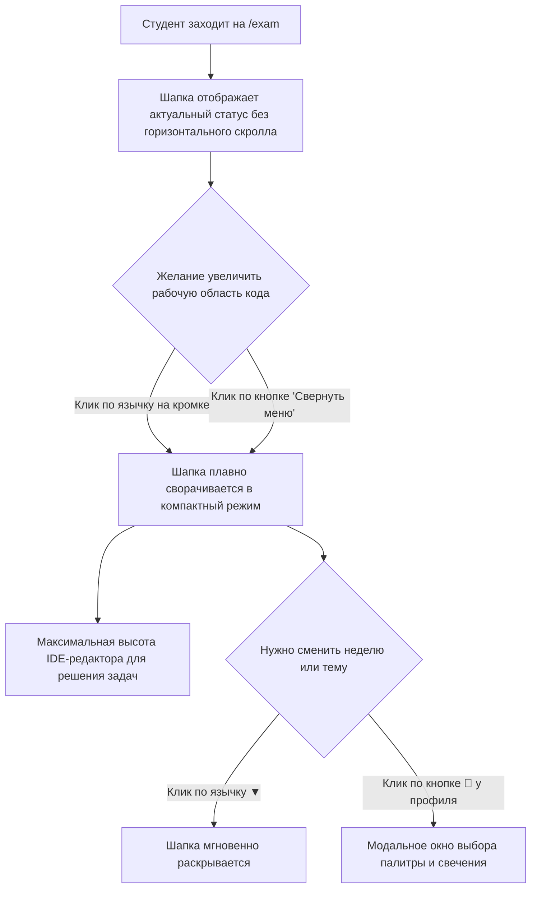

# HL — OOP_20261105-211500_HDRERG: Эргономика шапки: язычок сворачивания, вынос темы и устранение горизонтального скролла

> **Current filename**: `HL-OOP_20261105-211500_HDRERG.md`
> **Date**: 2026-11-05
> **Author**: zhasulan & Coordinator
> **Title**: Эргономика шапки: язычок сворачивания, вынос темы и устранение горизонтального скролла
> **Abbreviation**: HDRERG
> **Status**: 📝 HL_DRAFT — Approved by owner
> **Contract**: 🔒 FROZEN — approved by zhasulan 2026-11-05
> **Frozen**: §1 · §3 · §4 · §5 · §6 · §7 — locked on owner approval
> **Free**: §2 · §7.2 · §8 · §9 · §10 · §11
> **Append-only**: §12 Amendment Log
> **Baseline**: 77c5d083e9e782b5c1b118825e6053b378aaad81
> **Project North Star**: `README.md` · `KNOWLEDGE.md` §1 Architecture Map

---

## 1. Vision 🔒 FROZEN

Шапка учебной платформы в режиме итогового экзамена (`/exam`) и на неделях курса предоставляет максимально эргономичное рабочее пространство без нагромождения кнопок, без горизонтального скролла и со стильным, интуитивным комбо-управлением видимостью шапки. Кнопка настроек темы гармонично размещена в верхнем баре рядом с профилем студента, вкладки навигации гарантированно помещаются на экранах без необходимости прокрутки влево/вправо, а сворачивание и разворачивание шапки доступно как через аккуратный интерактивный язычок (IDE Handle) на нижней кромке панели, так и через понятную текстовую кнопку.

**Impact:** Студенты получают чистый интерфейс, где рабочая область IDE и редактора кода раскрывается на максимум в 1 клик, а навигационные элементы не перекрывают друг друга и не создают раздражающих полос горизонтальной прокрутки.

> *«Наконец-то на экране помещается весь редактор кода! Шапка больше не занимает треть экрана: кликаю на аккуратный язычок на нижней границе — и меню плавно складывается. При этом ничего не уезжает за экран, нет никаких раздражающих стрелок влево-вправо, а переключатель темы теперь логично сидит в верхнем ряду возле моего имени».*

---

## 2. Current State (As-Is) 🟢 FREE

1. **Горизонтальный скролл (`overflow-x-auto`):** Во 2-й строке хедера (`Row 2: Section Sub-Tabs & Collapse Toggle`) сгруппированы одновременно:
   - Вкладки подраздела (в экзамене их 4 с длинными названиями: *«Инструкция и Регламент»*, *«Часть 1 · Тестирование (20 б.)»*, *«Часть 2 · Практика (20 б.)»*, *«Итоговая Ведомость (100 б.)»*).
   - Кнопка *«🎨 Тема»*.
   - Кнопка *«📐 UML-Диаграммы [🔍 Лупа]»*.
   - Кнопка *«▲ Свернуть меню»*.
2. **Уход кнопок за границу видимости:** Из-за помещения блока действий в общий контейнер `nav.overflow-x-auto`, на мониторах и ноутбуках шириной до 1440px правые кнопки уезжают вправо за экран. Пользователю приходится скроллить горизонтально, при этом левые вкладки скрываются за левой границей.
3. **Визуальный диссонанс и потеря кнопки сворачивания:** Кнопка UML подсвечена неоновым свечением, а кнопка *«Свернуть меню»* имеет тёмно-серый приглушенный стиль `bg-slate-900 border-slate-700` и сливается с фоном, делаясь почти незаметной.
4. **Нелогичное расположение настроек темы:** Настройки темы оформления (*Cyber Gold*, *Electric Cyan*, *Matrix Emerald*, *Synthwave Purple*, *Clean/Cyberpunk*) — это глобальное предпочтение пользователя, однако кнопка находится на уровне вкладок конкретной недели/экзамена, загромождая навигационный ряд.

---

## 3. Target State (To-Be) 🔒 FROZEN

1. **Комбо-сворачивание (Язычок-шторка + Текстовая кнопка):**
   - На нижней границе хедера (`#main-site-header`) по центру интегрирован компактный язычок (`#header-collapse-handle`) со стрелкой `▲` / `▼` и тултипом, переключающий состояние шапки.
   - В правой части навигационного ряда сохранена явная кнопка с текстом `▲ Свернуть меню` / `▼ Развернуть меню`, получившая более контрастный акцентный стиль.
2. **Перенос «🎨 Тема» в верхний ряд:**
   - Кнопка настроек оформления размещена в верхнем баре рядом с селектором студента (`#student-selector`) и статусным бейджем.
   - Это высвобождает свыше 90px ширины в навигационном ряду.
3. **Ликвидация горизонтального скролла во вкладках экзамена:**
   - Подвкладки экзамена форматируются с оптимизированными паддингами и аккуратными подписями (*«Инструкция»*, *«Часть 1 · Тест (20 б.)»*, *«Часть 2 · Практика (20 б.)»*, *«Итоговая Ведомость (100 б.)»*).
   - Блок действий справа (`UML` + кнопка «Свернуть») закреплён с `shrink-0` вне зоны скролла вкладок.
   - Горизонтальная прокрутка шапки полностью отсутствует на стандартных десктопных разрешениях (от 1200px и выше).

### 3.1 Result Visualization

```
┌────────────────────────────────────────────────────────────────────────────────────────┐
│ [Лого { }] Учебная платформа      Профиль: [Жасулан Куандыков v] [🎨]  [Экзамен: 40/40]│
│ [Неделя 1]   [Неделя 2]   [Неделя 3]   [🏆 Экзамен 40 б.]                              │
│────────────────────────────────────────────────────────────────────────────────────────│
│ [Инструкция] [Часть 1 · Тест (20 б.)] [Часть 2 · Практика (20 б.)] [Ведомость (100 б.)]│
│                                                   [📐 UML-Диаграммы] [▲ Свернуть меню] │
└────────────────────────────────────[ ▲ ]───────────────────────────────────────────────┘
                                        └── Язычок IDE Handle
```

При сворачивании шапки (`header-collapsed`):
```
┌────────────────────────────────────────────────────────────────────────────────────────┐
│ [Инструкция] [Часть 1 · Тест (20 б.)] [Часть 2 · Практика (20 б.)] [Ведомость (100 б.)]│
│                                                   [📐 UML-Диаграммы] [▼ Развернуть меню]│
└────────────────────────────────────[ ▼ ]───────────────────────────────────────────────┘
```

### 3.2 Value Flow



---

## 4. Scope and Decomposition 🔒 FROZEN

### In Scope
1. Рефакторинг `app/templates/components/header.html`:
   - Перемещение `#theme-settings-btn` в блок профиля/баллов верхнего ряда.
   - Добавление язычка `#header-collapse-handle` на нижней кромке `#main-site-header`.
   - Разделение 2-го ряда на независимый контейнер вкладок и закреплённый правый блок (`shrink-0`).
   - Лаконичные подписи вкладок экзамена, устраняющие оверфлоу.
2. Стилизация в `app/static/css/style.css`:
   - Стили для `#header-collapse-handle` (позиционирование, форма, неоновая подсветка при ховере, анимация поворота стрелки).
   - Корректные отступы и отсутствие горизонтального скролла.
3. Логика в `app/static/js/app.js`:
   - Синхронное обновление обоих элементов (текстовой кнопки `#header-collapse-label` и иконки язычка `#header-collapse-handle-icon`) в функции `applyHeaderCollapseState`.
   - Сохранение состояния в `localStorage` (`weboop_header_collapsed`).
4. Автоматизированные тесты `tests/test_header_ergonomics.py` (рендер, наличие элементов, отсутствие регрессий).

### Out of Scope
- Изменение механики экзаменационных тестов или скоринга.
- Изменение цветовых токенов палитр.

### 4.1 Coordination & Operating Mode
- **Выбранный режим**: `Single-phase agent mode` (одна фаза, последовательные роли Executor и Reviewer под управлением координатора в рамках задачи).
- **Диалог**: `tfw-gates-only`.
- **Маршрут**: `coordinator_route: antigravity:thread:local:3878cb43-01bf-4058-a713-5212d88ebe76`.

---

## 5. Principles Check 🔒 FROZEN

- **PV-0 (Академическая ценность и фокус на коде):** Максимальное полезное пространство под редактор кода и задачи.
- **PV-1 (Zero-Build & Легковесность):** Чистый CSS и Vanilla JS без внешних UI-библиотек.
- **PV-2 (Отсутствие FOUC и сохранение состояния):** Состояние сворачивания шапки читается синхронно и сохраняется в `localStorage`.
- **PV-3 (Доступность и эргономика):** Устранение необходимости горизонтальной прокрутки, двойной доступ к управлению (язычок + кнопка).

---

## 6. Non-Goals 🔒 FROZEN

- Не переделывать структуру роутинга страниц FastAPI.
- Не изменять функциональность модального окна темы или просмотрщика UML-диаграмм.

---

## 7. Requirements and Acceptance Criteria 🔒 FROZEN

### 7.1 Acceptance Criteria
- [ ] **AC-1:** Кнопка *«🎨 Тема»* перенесена в верхний ряд хедера рядом с селектором студента и доступна на всех страницах (недели 1–3 и экзамен).
- [ ] **AC-2:** На нижней границе хедера `#main-site-header` добавлен язычок `#header-collapse-handle` со стрелкой-индикатором (`▲` / `▼`), клик по которому сворачивает/разворачивает шапку.
- [ ] **AC-3:** Текстовая кнопка `#header-collapse-toggle` сохранена в навигационном ряду, синхронизирована с состоянием язычка и имеет чёткий визуальный акцент.
- [ ] **AC-4:** На странице экзамена `/exam` при ширине экрана >= 1200px отсутствует горизонтальная полоса прокрутки навигации.
- [ ] **AC-5:** Переключение состояния шапки корректно сохраняется в `localStorage` (`weboop_header_collapsed`) и восстанавливается при перезагрузке страницы.
- [ ] **AC-6:** Все существующие 73 теста и новые тесты эргономики шапки проходят успешно без ошибок.

---

## 8. Risks and Tradeoffs 🟢 FREE

- **Риск:** Язычок может перекрывать верхний контент при скролле страницы.
  - *Минимизация:* Высота язычка минимальна (~16-18px), он расположен по центру нижней границы шапки (`sticky top-0`), не мешая просмотру заголовков страницы.

---

## 9. Assumptions and Dependencies 🟢 FREE

- Поддерживается браузерами с CSS Flexbox и CSS Custom Properties.
- Клиентский код использует существующую функцию `toggleHeaderCollapse()` и `applyHeaderCollapseState()`.

---

## 10. Why Not Just...? 🟢 FREE

| Альтернатива | Почему отклонено |
|---|---|
| Оставить всё как есть | Пользователю приходится двигать горизонтальный скролл туда-обратно, чтобы увидеть кнопки или вкладки. |
| Только перенос в угол | Новичкам понятно, но при работе с кодом тянуться в самый верхний угол менее удобно, чем кликнуть по нижней кромке шапки. |
| Только язычок без кнопки | Пользователи, не привыкшие к интерфейсам IDE/DevTools, могут не сразу заметить хлястик. Комбо-решение покрывает 100% сценариев. |

---

## 11. Verification Strategy 🟢 FREE

- Автотесты `pytest tests/test_header_ergonomics.py` проверяют наличие элементов, их классы, атрибуты и рендер шаблона.
- Полный регрессионный прогон `pytest` по всем 73+ тестам.

---

## 12. Amendment Log

*(Пока изменений нет)*
